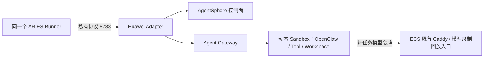

# 华为 AgentSphere 基础接入

最新结果与阶段耗时见[性能档案](../../docs/performance-archive.md)，原始记录和摘要见
[性能证据附录](../../docs/performance-evidence.md)。本页同时保留早期失败与诊断历史。

本路径复用 ARIES 的四角色 Runner 和 E2B Adapter 私有协议，使用独立的华为
SDK 进程、内部令牌及持久账本。构建、测试和运行只在远程 Linux ECS 进行。
**B 内嵌模式的 record3 和 replay1 已条件性通过：均完成 12 项独立测试、
评分前停止与撤权、任务及评分沙箱清理。A 外置模式的真实录制也已完成 12 项
独立测试；原样回放旧 E2B A Tape 因文件系统元数据不同而严格拒绝，该失败保留。**
另一个显式 workload `merge-ranges-portable-v1` 已完成一次 E2B A 录制及同 Tape 的
E2B A、华为 A recorded 严格回放：三次各 8 轮模型交互、7 次真实工具、12 项独立测试，
联合复核 16/16 通过，停止、撤权及资源清理确认。该[单次跨云对照](../../docs/performance-archive.md#portable-crosscloud)
保留华为 Verifier 出网隔离假设，不能据此给厂商排名。
当前华为的禁止出网能力尚未验证有效，适配器默认在创建资源前拒绝
`allow_internet_access=false`，返回
`422 network_isolation_unsupported`。独立 Verifier 保持原要求，不跳过评分，
也不把拒绝记为验证成功。

用户已授权的临时假设模式需要同时设置 profile 的
`sandbox.assume_network_isolation=true` 和 Adapter 的
`HUAWEI_AGENTSPHERE_ASSUME_NETWORK_ISOLATION=true`。两者默认均为 false，
health 回读必须一致；环境变量仅接受小写 `true` 或 `false`。此开关只适用于华为，
向平台发送的 `allow_internet_access=false` 保持原义。产物明确记录
`assumed-huawei-verifier-egress-unverified`，不能作为实际隔离已通过的证据。
Agent 停止、工具撤权、独立隐藏测试和资源清理仍须完成；此条件的评分和吞吐
须与实际隔离已确认的结果分开。当前计数器不会自动从 validated throughput 或
Goodput 中剔除假设模式结果；分析须按 `infrastructure.network_policy` 分组，
将其标为假设条件下的结果。B 的条件性通过没有放宽上述停止、评分或清理要求。

## 当前验收状态

| 形态 | 执行位置 | 已有结果 |
| --- | --- | --- |
| A 外置 | Agent 在 ECS Docker 容器，工具经 SSH/Bridge 在华为 Sandbox 执行 | 原 workload 真实录制条件性通过，旧 E2B Tape 跨云偏离失败保留；portable-v1 使用与 E2B 相同 Tape 的 recorded 回放条件性通过 |
| B 内嵌 | Agent、Gateway 和工具都在华为 Sandbox，Runner 在 ECS | record3 与 recorded replay1 均条件性通过，禁止出网仍为 assumed/unverified |

`agentsphere-embedded-record-3/` 和 `agentsphere-embedded-replay-1/` 分别通过
7/7 独立复核；每次 4 轮模型交互、3 次真实工具调用、12 项独立测试。
回放只读加载 record3 的真实 Tape，严格匹配完整历史及 693 个 recorded SSE 帧，
没有真实模型调用。两次均先确认 Stop/撤权，再独立评分；任务与新建评分 Sandbox
均经独立 GET 404 确认删除，临时模板、容器和凭据也已清理。
上述 B 轨迹只在华为自身重跑，不能与另行验收的 portable A 同轨迹对照混为一组。
运行路径、镜像及证据摘要见[录制记录](../../docs/performance-evidence.md#huawei-embedded-真实录制条件性通过)
与[回放记录](../../docs/performance-evidence.md#huawei-真实-sandbox-的-recorded-严格回放)。

A 的旧 workload 录制与失败跨云回放分开保存在[性能档案](../../docs/performance-archive.md)。
录制为 7 轮模型交互、6 次工具调用；不能与 B 的三工具轨迹或 E2B A 的另一份
Tape 按调用编号硬对齐。两次任务的停止、独立评分和资源删除均有证据，
失败样本不计入成功吞吐。

新的 portable A 组使用不可变 Tape
`07be09fa95cb3678c94c43accdc4b96ae079d6ae2352505091eeff134e6065bd`，
E2B 与华为回放均执行全部 7 次真实工具并严格匹配完整历史、工具参数和结果。
录制原件经离线复核接管，没有重新录制、修改错误输出或删除失败步骤。
当前各环境只有一次运行；评分出网仍未验证，A 的原生工具时长由 telemetry 独立复核，
现有 Trace 尚未包含 A 的原生工具片段。校验脚本修正、单次数据及证据见
[同 Tape 对照](../../docs/performance-archive.md#portable-crosscloud)。

## 服务关系

下图为 B 内嵌形态。A 使用同一 Adapter 访问华为工具沙箱，Agent 与原生 Gateway
在 ECS Docker 容器内，工具通过 ECS 上的 SSH/Bridge 转发；它不要求把 Agent
Gateway 的 18789 端口放在华为沙箱中。



Compose 只部署 Adapter 和按需 Runner；Sandbox 由控制面动态分配。
模型 HTTPS 沿用 [E2B 部署](../e2b/README.md)中已经配置的 Caddy，华为 Compose
不再启动第二个 80/443 服务。两种后端共用模型代理 8082，不能同时启动两个
Runner；一个 Runner 内的并发仍由 scheduler 控制。

## 选择 profile

| Profile | 用途与验收状态 |
| --- | --- |
| [openclaw-agentsphere-external-record.json](../../profiles/cloud/openclaw-agentsphere-external-record.json) | A 外置，调用真实模型并录制；12 项独立测试条件性通过 |
| [openclaw-agentsphere-external-replay.json](../../profiles/cloud/openclaw-agentsphere-external-replay.json) | A 外置，原 workload 的 recorded 严格回放入口；已测旧 E2B A Tape 的真实结果偏离失败保留 |
| [openclaw-agentsphere-embedded-record.json](../../profiles/cloud/openclaw-agentsphere-embedded-record.json) | B 内嵌录制入口；其条件性录制与真实回放结果见上文，回放使用的具体 profile 保留在 ECS 归档 |
| [openclaw-agentsphere-external-portable-record.json](../../profiles/cloud/openclaw-agentsphere-external-portable-record.json) | A 外置，portable-v1 独立录制入口，尚未单独实跑；本轮共同源 Tape 录制于 E2B |
| [openclaw-agentsphere-external-portable-replay.json](../../profiles/cloud/openclaw-agentsphere-external-portable-replay.json) | A 外置，portable-v1 recorded 严格回放；使用与 E2B 相同的 Tape，12 项独立测试及清理条件性通过 |

这些 profile 都固定 `sandbox_backend=huawei-agentsphere` 和
`sandbox.token_env=ARIES_HUAWEI_ADAPTER_TOKEN`，并保持隔离假设默认关闭。
按用户授权运行假设模式时，须在本次实验 profile 显式设置
`sandbox.assume_network_isolation=true`，同时启用 Adapter 的对应开关，不能只改其一。
共享配置和固定镜像版本来自 `configs/versions.json`；凭据值不写入 profile。

A 还需要 ECS Docker、Agent 容器可访问的私网 `ARIES_ECS_PRIVATE_IP`，以及
ECS 构建的 `aries-ssh-client`（可执行文件模式为 `0555`）。样例 helper 路径为
`../../bin/aries-ssh-client`，相对于 profile 解析；其他目录须配置实际绝对路径。
沙箱仍须具备 UID 60000、受 root 控制的 cgroup v2 和 `cgroup.kill`，以确认工具撤权。
它复用现有华为模板的工具环境，不因外置模式另起一套 Gateway 代理协议。

运行命令为 `aries cloud [--env-file PATH] [--tape FILE] PROFILE.json`，全部在 ECS
执行。回放使用 `--tape` 指定真实外置 Tape；不能把 B 内嵌 Tape 填进 A profile。
同一 A Tape 跨云使用也须通过完整请求及工具结果的严格匹配，不能为跑通而放宽匹配。
私有配置只按消费方提供：Huawei API Key 给 Adapter，真实模型 Key 仅给录制入口；
回放不需要真实模型 Key，Agent 只获得本次模型代理令牌。

## 配置与构建

从私有配置选择性提供下列字段；不要把整个 `.env` 传给容器或通过 shell 执行。
Runner 不需要华为平台 API Key，Agent 只接收本次模型访问令牌。

| 字段 | 消费方 |
| --- | --- |
| `HUAWEI_AGENTSPHERE_API_URL`、`HUAWEI_AGENTSPHERE_API_KEY` | Adapter 控制面请求；本账户使用 `agentsandbox.cn-southwest-2.myhuaweicloud.com` |
| `HUAWEI_AGENTSPHERE_GATEWAY_URL` | Adapter 访问模板绑定的 Gateway；须为可信 HTTPS origin |
| `HUAWEI_SANDBOX_TEMPLATE_ID` | 固定的华为模板ID:构建ID，不使用 E2B 模板 |
| `HUAWEI_AGENTSPHERE_ASSUME_NETWORK_ISOLATION` | Adapter 显式假设开关，默认 `false`，须与 profile 一致 |
| `ARIES_HUAWEI_ADAPTER_TOKEN` | Runner ↔ Adapter 的独立高熵令牌 |
| `ARIES_HUAWEI_ADAPTER_URL` | Runner 默认为 `http://127.0.0.1:8788`；Compose 保持回环绑定 |
| `ARIES_ECS_PRIVATE_IP` | A 外置 Bridge 绑定地址，须为 Agent 容器可达的 ECS 私网地址；B 不需要外置 Bridge |
| 模型、并发、TTL 设置 | 与现有 cloud 配置相同，见[配置参考](../../docs/configuration.md#e2b-cloud-workload-profiles) |

`HUAWEI_AGENTSPHERE_GATEWAY_ID` 用于模板准备，已发布模板运行时不需要再次注入。
`HUAWEI_VERIFIER_TEMPLATE_ID` 供填写控制台准备的受限出站 VPC 模板，格式为
`TemplateID:BuildID`；它当前仅是后续隔离核验的准备项，CLI/Adapter/Compose 尚不读取。
若后续恢复私网隔离验证，应使用同一已归档镜像及 2 vCPU / 4096 MiB 规格，
区分镜像构建所需访问和评分运行时的出站限制，并检查实际网络行为。
当前 private 模板构建问题已按用户要求记为遗留；不能以网络资源配置回读
代替禁止出网验收。B 的现有条件性结果使用显式假设，不依赖此预留字段。
SWR 登录凭据仅用于镜像发布，不进入 Adapter、Runner 或被测沙箱。

在 ECS 仓库根目录使用本目录的 `compose.yaml`；Adapter 构建说明与 SDK 固定版本
见 [Adapter README](../../adapters/agentsphere/README.md)。Runner 镜像必须包含本次
Huawei 配置和 provider 校验改动，不能直接用旧 E2B 发布标签声称支持：

```sh
python3 deploy/agentsphere/prepare-build-context.py --wheels-dir /PATH/TO/ARCHIVED/WHEELS
docker build -f deploy/e2b/Runner.Dockerfile -t aries-e2b-runner:agentsphere-candidate .
docker build -t aries-agentsphere-adapter:candidate .cache/agentsphere-adapter-context
```

`/PATH/TO/ARCHIVED/WHEELS` 应替换为 ECS 上存放两个已固定 wheel 的归档目录。
准备脚本只复制明确列出的源码和 wheel，校验摘要，拒绝覆盖已有构建目录。
它不会复制仓库 `.env`、运行数据或其他缓存。

实际部署应将 Compose 的两个镜像固定到经 ECS 测试并归档的 image ID，保存
来源清单、镜像 tar、SHA256 及运行结果。B 的已接受运行使用
`agentsphere-runtime-release-1/release-images-1/` 中的发布候选；以下早期镜像
保留作历史证据，不作为最新推荐标签。候选构建成功不等于可以替换已验收部署。
状态卷固定为 `aries-agentsphere-adapter-state`，不得使用或清空
`aries-e2b-adapter-state`。停机后保留卷；恢复会核对自有资源并确认删除。

### 历史构建与修复

2026-10-23 的早期 ECS 离线候选构建归档于
`/opt/aries-artifacts/agentsphere-adapter-candidate-3/`：

- Adapter image ID：`sha256:b6e0764727b31199419ab188d3c83922a6db403d34682b53987575e9ed59e70d`。
- Runner image ID：`sha256:79a67978839d4d1b4cb37947723770a810ec5bae54b52aa718cc8e890a75c64c`。
- `adapter.tar`、`runner.tar`、`evidence.json`、依赖清单、构建上下文和日志均在该目录。
- Huawei 13 项与原 E2B 23 项单测/SDK 检查通过；镜像按非 root 用户启动的无网络 HTTP 检查通过，未认证返回 401，禁止出网请求返回 422 且无资源分配。
- Go 目标单测/race 证据在 `agentsphere-go-check-1/`；此候选另通过 `make build`、`make lint`。这不是新的完整发布或云端评分验收，生产 E2B 标签未替换。

此前 candidate-1 的测试导入路径问题、candidate-2 的测试容器挂载权限问题均已修正；原失败记录保留。三个候选作业均未调用云或真实模型。

后续 `agentsphere-adapter-candidate-4/` 修复了命令包装器依赖默认
`/home/user` 的问题；包装器从 `/` 启动，任务自身的工作目录保持原值。
ECS 先用新增回归复现旧代码失败，再验证修复后的 E2B 24 项、Huawei 13 项
及镜像 HTTP 检查通过。新 Adapter 为
`sha256:12777a1caff6fbb851d97f5987cd537def01e6ffad0845a54843784fa2a65cbc`，
`adapter.tar` SHA256 为
`2f610027b1779fc893b163fa371940106324b8b040b78c723ad88043cf4301e4`。
同一 Docker daemon 的 load 后镜像身份已核对；Runner 沿用 candidate-3
归档的 `79a67978…`，此次没有 Go 改动或 Runner 重建，也未替换生产 E2B 服务。

## 验收边界

以下按历史顺序保留协议探针和失败诊断；当前 A 录制、B 录制与回放条件性通过的状态以
[本页顶部](#当前验收状态)和[性能档案](../../docs/performance-archive.md)为准。

candidate-4 镜像的真实云协议检查已通过，证据在
`/opt/aries-artifacts/agentsphere-adapter-live-4/evidence.json`，SHA256 为
`c548840be8e7158cb9f49891020fcafa4560940be6e09c948a751587ec4d9627`。
终态为 `PASS_ADAPTER_PROTOCOL_SMOKE`，八项检查均通过，仅创建一个沙箱。
检查覆盖 Adapter 鉴权和断网请求零分配、provider/生命周期、二进制文件、
命令 stdin/EOF 与退出结果、受管进程移除、Gateway HTTP/WebSocket、指标快照及删除。
沙箱由独立 GET 404 确认不存在，模板删除已确认，容器和临时凭据已清理。

Gateway 完整凭据请求返回 HTTP 200 且内容匹配；保留路由而移除认证返回 401，
仅缺 ENVD token 也返回 401；WebSocket 返回 101 并收到预期帧。无头请求的 400
属于缺少路由的诊断，不能作为鉴权证明。进程检查只证明受管 PID 消失，
不证明所有后代已隔离；指标仍为单次快照，采样周期未知。
live-1 的路由负例判断、live-2 的启动阶段协议错误和 live-3 的凭据路径错误
保留为原始失败记录；不能用 live-4 成功改写历史结果。

首次真实 OpenClaw 运行保存在 `agentsphere-embedded-record-1/`，终态 FAIL：
Gateway 因三个 core library 的插件 manifest 检查退出 78，未进入模型请求；
独立 Verifier 另被断网策略拒绝。一只沙箱、模板与容器均确认清理。
这次运行没有通过完整任务和独立 Verifier 验收，详见下方架构指南中的实际诊断。
[内嵌录制 profile](../../profiles/cloud/openclaw-agentsphere-embedded-record.json)
用于该阶段；当时 Verifier 创建要求禁止出网，被默认策略明确拒绝。
真实平台问题、拒绝原因、Agent outcome 和验证 outcome 分开留存。

该启动失败现已定位到 OpenClaw 原生插件发现：华为 guest 中 `/app` 与
`/app/extensions` 的 Node number inode 都变成 `9223372036854776000`，
但 bigint inode 不同。原生判断因此误认为源码目录是挂载点，把
`image-generation-core`、`media-understanding-core`、`video-generation-core`
三个普通库当成插件。这些目录在原始镜像中也没有插件 manifest，不能认定为
华为导入时丢失文件。

ECS 的 `agentsphere-overlay-probe-1/` 用相同镜像、无网络容器复现了三个条件：
普通目录启动成功；模拟源码目录挂载后退出 78；保留挂载并设置原生
`OPENCLAW_DISABLE_BUNDLED_SOURCE_OVERLAYS=1` 后启动成功。
`agentsphere-native-overlay-1/` 又在真实华为 guest 确认数值碰撞和非实际挂载点；
关闭源码覆盖发现后，正常的 69 个 compiled 插件候选与原始镜像的集合完全一致，
比对结果保存在 `review.json`。本次仅诊断发现机制，没有模型调用；一只沙箱和
模板均确认删除，容器与临时凭据已清理。

共享 Gateway launcher 已固定上述原生设置，使外置和内嵌路径一致；没有添加假
manifest 或删除库文件。`agentsphere-runner-candidate-5/` 已通过 ECS 的 `make build`、
`make test`、`make test-race`、`make lint`、`make integration`；Runner 镜像
`sha256:3b35484a7c1d97ff3c48e1d195dd3e5f0d3ca362358313688a7712972bb71c20`
已归档，`runner.tar` SHA256 为
`289ea9a803c19fc34134552502ec1f57d9199b137237cb88907b6489f220ff1f`。
同一 daemon 的保存/加载检查通过，生产 E2B 镜像未替换。

第二次正式任务 `agentsphere-embedded-record-2/` 越过插件启动失败，但仍为 FAIL：
Gateway 连接未获得 `operator.write`；日志提示不可信代理头，当时客户端仅携带
共享 token、没有原生设备身份。模型记录为零轮，独立 Verifier 仍被 422 拒绝。
原生授权路径需要单独验证，不删除 scope 检查或伪装本地连接。该次一个沙箱经
独立 GET 404 确认删除，模板、Adapter、Runner 和临时凭据均清理。
这不是完整 Agent、严格回放或独立 Verifier 验收。

后续 ECS `gateway-device-auth-probe-2/` 已通过同镜像无网络容器验证，
终态 `PASS_NATIVE_GATEWAY_DEVICE_AUTH`，证据 SHA256 为
`e051af2a78c69768003d3d2fe7d1830bd7ae1051718b2d04ba223dbd6c958ab4`。
代理头加 token 的连接被清空 scopes；原生 Ed25519 身份经精确请求 ID、公钥、
角色和 scopes 核对，再用原生 CLI 配对后，获得原生规范中的 read/write。
CLI URL 和 token 从环境传入，错误 nonce 和错误签名均被拒绝。容器已删除，
没有云或模型调用。probe-1 因断言误以为写设备令牌不含 read 而失败，原结果保留。
Go 客户端及 Embedded 配对接入现已完成，并通过 ECS 定向验证：6 个 Go 包的
race 测试、Huawei 15 项和原 E2B 24 项单测/已安装 SDK 合约检查均通过，无跳过。
证据在 `/opt/aries-artifacts/agentsphere-device-assumption-check-1/`，SHA256 为
`a4b8c4dac5ae55c18fdac4156f6ac56e59e93ad732c144702efd88a8552d9280`。
该检查没有云或模型调用，不能用定向测试替代完整 Agent/Verifier 结果。
后续 `gateway-go-device-auth-probe-1/retry-1/` 通过真实 Go/native 互通，发布候选
也完成 ECS 检查和镜像归档；华为 B record3/replay1 的条件性通过及新 Runner 的
E2B A/B 回归另有真实运行证据，见[性能证据附录](../../docs/performance-evidence.md)。

API 报告 ENVD 0.6.1、监听进程实测 0.8.0、镜像文件 0.10.0 的差异已记遗留；
用户确认平台注入 ENVD。保留原始版本字段，按实际能力适配，不做版本相等检查。
完整问题与取证方法见[架构指南](../../docs/architecture-guide.md#84-重复并发和故障路径的实际结果)。

网关实例关闭公网访问控制的是外部请求入口，不能据此断言沙箱禁止主动出网。
华为指南将模板的入站网关与出站网络配置分列；独立评分应检查模板的出站网络、
VPC/安全组出方向及实际连接结果。任务沙箱仍需要访问模型入口，不能将所有
沙箱一并断网。参见[创建网关](https://support.huaweicloud.com/usermanual-agentsphere/agentsphere_03_0024.html)
和[创建模板](https://support.huaweicloud.com/usermanual-agentsphere/agentsphere_03_0006.html)。

2026-10-23 10:22 UTC 的只读清单 `agentsphere-network-inventory-1/` 完整返回
零个可见模板；没有创建资源或修改网关。用户示例的 VPC 字段是
`networkMode=private`、`targetProjectId`、`targetVpcId`、`targetSubnetId`，
原示例未提供安全组绑定字段；随后用户提供的控制台请求补齐
`networkConfiguration.targetSecurityGroupIds`，类型为安全组 ID 数组。当时计划使用
独立创建的网络资源和该字段构建模板，再验证控制通路与出站阻断；后续模板实验
及其失败边界见下文。
模板处于 VPC 模式或公网入口关闭，均不能单独作为禁止出网的验收证据。

也可由 ECS 自动准备专用 VPC、子网和安全组：现有 AgentSphere API Key 已可创建
模板，但 VPC API 需要项目级 IAM 认证。私有 `.env` 已预留
`HUAWEICLOUD_SDK_AK`、`HUAWEICLOUD_SDK_SK`、`HUAWEICLOUD_SDK_SECURITY_TOKEN`
和 `HUAWEICLOUD_SDK_PROJECT_ID`，项目为 cn-southwest-2。控制台下载的长期 AK/SK
无需 SecurityToken，该字段留空；临时凭据则必须同时填写 AK、SK 和 SecurityToken。
这些字段只用于网络准备，不进入 Agent、模型或产品运行容器；当前产品不消费。
这些准备字段和网络创建权限本身不证明端到端隔离；后续 private 模板构建未成功，
未进入真实 Sandbox 禁止出网检查。当前 B 验收仍依赖明确的未验证假设。

2026-10-23 10:45 UTC，ECS `huawei-network-readonly-1/` 已用新配置的长期 AK/SK
完成五类只读查询，均为 HTTP 200 且分页完整：当前授权项目可见 1 个 VPC、
1 个子网、1 个安全组、4 条安全组规则和 1 张路由表。官方 SDK 3.1.219 及 wheel
摘要归档于 `huawei-network-sdk-1/`，私有网络响应仅保存在 ECS，临时凭据输入已删除。
这证明读取认证有效，尚不证明创建权限或沙箱出站隔离；现有网络未修改。

随后重新核对官方[文档索引](https://support.huaweicloud.com/agentsphere/llms.txt)、
[文档下载](https://support.huaweicloud.com/download_agentsphere/index.html)和
[API Explorer 的 AgentSphere 列表](https://console.huaweicloud.com/apiexplorer/new/v3/apis?product_short=AgentSphere&limit=100&offset=0)：
公开索引未列 API 参考，Explorer 查询返回零项，同接口查询 AgentArts 返回 263 项。
用户指南确认控制台可选安全组，但未提供 Build 请求字段；这说明本次公开资料
未覆盖准确 schema，不说明平台不支持该能力。不得猜字段或把 VPC API 的安全组
创建参数当成 AgentSphere 的绑定参数。上述公开资料缺口后来由用户提供的
控制台 Build 请求补齐：`targetSecurityGroupIds` 位于 `networkConfiguration`
内，值为字符串数组。用户确认请求中的资源 ID 只是示例，应另建专用资源；
原请求保留在私有归档，不照搬控制台 Cookie/CSRF 头或示例资源 ID。

`huawei-verifier-network-1/` 已实际创建专用 VPC 和子网，首次回读时子网仍为
`UNKNOWN` 且缺少 `vpc_id`，归属校验失败，原 FAIL 保留。
`huawei-verifier-network-resume-1/` 依据原创建回执接管相同两个 ID，未重复创建；
11:01:45 UTC 子网已为 `ACTIVE`，详情和按 VPC 筛选的列表均确认关联。
续接作业另创建一个专用安全组，删除其两条出站规则，回读确认 IPv4/IPv6 均无
出站规则。三个资源保留用于后续模板实验，现有网络未修改，临时凭据已删除。
终态为 `PASS_NETWORK_RESOURCES_PREPARED_NOT_BOUND`，证据 SHA256 为
`86b5fe0ca353f3e39be0ded7fa9f5b3a4eaa075fae2c43cd8e8bff3b8667cbe9`。
模板绑定和真实 Sandbox 的禁止出网检查仍待完成，不能据此把实际隔离标为通过；默认 422 和显式假设模式分别按配置处理。

### 专用网络的首次模板实验

本项目保留专用 VPC、子网、安全组及用户自行购买的 VPCEP。实验清理仅删除
本次创建的测试沙箱和临时模板，不购买或删除 VPCEP，也不删除这些网络资源。
用户已购买 SWR/OBS VPCEP；回读确认 accepted 状态、同一专用 VPC 和相应路由。
后续构建仍失败，当前按用户要求保留问题并推进其他主线，不继续追查私网。

2026-10-23 11:21 UTC，`agentsphere-vpc-egress-2/` 完成，整体为 FAIL。
此前 `agentsphere-vpc-egress-1/` 的公共模板显示 ready 后约 8 毫秒即创建沙箱，
返回 HTTP 500，错误为 `AgentSphere.0513 / NC.20105: snapshot not found`。
TTL 后两次完整清单均无运行或暂停实例；保留同一模板/build，约八分钟后再次创建
成功，文件读写、命令执行及两次到自有 ECS 的公网 IPv4 TCP/TLS 检查通过。
这提示存在就绪时间差的可能性，不能确定平台内部根因，也没有给产品增加自动重试。

随后使用专用 VPC、子网和零出站安全组提交 private 模板；构建从 building 转为
error，尚未创建私网沙箱。终态 build 详情没有原因字段；此前读取的 status 日志
为空，本次没有在 error 后、删除前补取 status 日志，因此具体原因尚未查明。
不能把这次失败认定为安全组不支持、权限不足或出站阻断生效。

公共沙箱和两个测试模板均由 DELETE 204、GET 404 确认清理；三项专用网络资源
保留，原网络未修改。ECS 已核对 67 份 HTTP 归档及令牌字段脱敏，临时输入已删除，
原 E2B 的 33 条 absent 账本不变，未调用模型。egress-2 的 evidence SHA256 为
`1628bddd90fdc1db64c566ca428b4ec72a79d31975d4649ef2fcaea00cf375f9`，
独立 review SHA256 为
`c4091d3c1787f2a3563767e43834e4666f605bdddbe1d827606af6f3298e700a`。

补齐 VPCEP 后的 `agentsphere-vpc-egress-3/` 已在删除前取得终态构建日志。
private 模板在镜像 pull/flatten 阶段查询 SWR 域名时，向
`169.254.169.253:53` 发起的 DNS 查询超时。尚未创建任何 private Sandbox，
因此没有得到沙箱内部出站隔离的测试结果。DNS 超时的底层原因尚未归因，
不能据此断言是安全组、路由、VPCEP 或平台 DNS 故障。

本次临时模板经 DELETE 204、GET 404 确认删除；VPC、子网、安全组及 SWR/OBS
VPCEP 全部保留。证据归档在 `/opt/aries-artifacts/agentsphere-vpc-egress-3/`，
evidence SHA256 为
`35739779ef81b8ecfe2d1b8479c8a9c1069545cc3f6dc29d851179f67d0fb413`。
按用户要求，私网构建问题记为遗留，继续其他主线。独立 Verifier 仍执行隐藏测试；
显式假设模式不等于禁止出网已验证。
