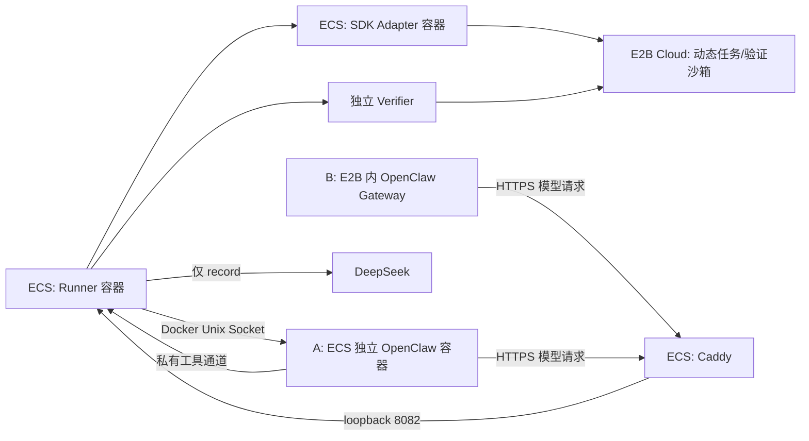

# 在 Linux ECS 部署 E2B 实验控制端

这些文件是当前源码的部署接线。**ECS 已通过 Go 构建、完整单测、race、lint
及 Docker 集成检查，Python Adapter/模板工具测试也已通过。E2B 模板已发布且
使用固定构建引用创建成功；真实 SDK smoke 已 PASS 并确认删除。首版运行环境
探针因 `/usr/local` 等受信路径权限为 `0777` 返回 `UNSUPPORTED`；修正后的 v2
云构建、启动、cgroup 隔离探针及删除确认均已 PASS。最新真实 A 任务完成 7 轮
DeepSeek 交互和 6 次工具调用，独立验证的 12 项公开及隐藏测试全部通过，隔离和清理确认。
首次 A 的失败证据保留。随后 A 的真实 recorded 回放通过；B 真实录制及独立验收、
协议校验也通过，B 的真实 recorded/zero 回放随后通过。五项单次基线、A C1×2、
B C1×2、B C2×3 三个批次及三项 W2 组件故障探针均已通过。W3 已汇总 8 个条件、
12 个已接受任务；这不代表全历史成功率、完整观测开销或全局关键路径已验证**。
W2 不覆盖整个外置 Agent Loop 的断连实验，具体范围见[架构指南 §8.4](../../docs/architecture-guide.md#84-重复并发和故障路径的实际结果)。
构建、测试、服务和实验命令全部在目标 Linux ECS 执行。
工作站只用于编辑、SSH 连接和传送源码，不编译、不启动项目服务、不运行实验。

截至 2026-10-23（北京时间），本轮证据分开记录如下；构建或单测通过不等于真实链路通过。

| 项目 | 实际结果与边界 |
| --- | --- |
| ECS 发布检查 | 最新 `bridge-evidence-release-1` 的 `make build/test/test-race/lint/integration` 全部 PASS，包含按 occurrence 分开 Bridge 证据及失败启动保留原始文件的修复；此前发布和显式可选 SKIP 保留原记录 |
| Python 与 Adapter 镜像 | 此前镜像内 18 项 Adapter/SDK、5 项模板测试 PASS；刷新镜像的源码哈希、依赖与 smoke help 检查 PASS，未重跑这 18+5 项；post-finalize 修正的 8 项模板测试、原生 Docker 正负探针另已 PASS |
| E2B 模板与启动探针 | 首版因受信路径 `0777` 返回 `UNSUPPORTED`；v2 于 2026-10-22 16:20:09–16:20:56 UTC 完成云构建与启动验证，`verify_exit=0`、`runtime_status=PASS`、cgroup 探针 PASS、`cleanup_confirmed=true`；未启动真实 Gateway/Agent |
| 真实 SDK smoke | 2026-10-22 16:05:37–16:05:48 UTC，PASS、`cleanup_confirmed=true`；二进制文件、stdin/stdout/stderr、预期退出码 7、后台进程与私有 endpoint 检查通过；该 smoke 不包含完整 Agent 任务 |
| A 录制与真实回放 | 两次均为 7 轮、6 次真实工具、1175 个 SSE 帧，12 项独立测试通过，隔离和清理确认；回放保持两次预期工具错误，未调用真实上游模型 |
| B 录制与真实回放 | record、recorded、zero 各为 4 轮、3 次本地工具、573 个 SSE 帧；各自七项独立验收 PASS，12 项独立测试通过，隔离/清理确认，回放候选与源录制一致 |
| HTTPS 与 SSH 访问 | 公网 IP TLS 及 B 从 E2B 访问模型入口通过；工作站显式使用已有 SOCKS5 出口后，5 次独立 SSH 认证、持续连接和 SCP 往返通过；不改变模型网络或 sshd |
| 镜像与源码归档 | 原归档保留；最新 Runner `bridge-evidence-1`、529 文件源码及 Adapter `69ffe664…` 均已归档，镜像哈希/同 daemon 恢复身份检查通过；Runner `:local` 已切换至 `ad1fe30e…`，干净机器恢复 UNRUN |
| 重复、并发与故障 | 三个 recorded 批次的 7 项任务均通过独立验证和清理；W2 组件断连、内嵌超时及停止不可确认时阻止评分的探针通过，不计入任务成功样本 |
| W3 结果导出 | `runtime-performance-summary-1` 为 READ_COMPLETE，包含逐任务 CSV、分层 JSON 与输入哈希；不同轨迹、版本、时钟和采样限制保留，未配 SLO 不计算 Goodput |

首版模板的 SDK smoke 实测 hostname 为 `e2b.local`；`/usr/local`、`/usr/local/bin`、Node 二进制
及模板探针均为 root:root、`0777`，而 `/app` 为 `0555`、`/run` 为 `0755`、
`/sys/fs/cgroup` 为 `0555`。后续 v2 已通过创建子组、`cgroup.kill` 与 `populated=0`
探针；这不替代每次正式任务的停止隔离确认。smoke 的 metrics 返回 1 个 CPU、内存与磁盘使用/容量样本，标称间隔 5 秒；
disk I/O、network I/O 与 Agent/Tool 资源拆分为 `UNSUPPORTED`，不是零值。

首次 Adapter 刷新于 2026-10-22 16:43:57 UTC 完成，`smoke.py` 已进入该镜像，归档位于
`/opt/aries-artifacts/aries-e2b-adapter-refresh-1/`。UID/GID 10001、e2b 2.58.0、
`pip check`、三个源码文件哈希、smoke help、同 daemon save/load 身份检查均 PASS，
检查容器已确认不存在。镜像刷新作业未调用云端/模型或启动 Adapter 服务。
随后服务部署通过：`/opt/aries-artifacts/e2b-platform-deployment-1/evidence.json`
记录 Adapter 健康与实际镜像锁定；2026-10-22 17:03:22 UTC 核对时，正式累计创建为 0、无未确认分配。
该目录保留私有的 `compose.base.yaml`、`compose.lock.json` 和 `service.env.lock`。
当时限制为累计创建 4、并发 1、TTL 600 秒；SLO 未配置，不计算 Goodput。
当前源码及 ECS Adapter 已移除累计创建次数上限，部署验证见
`/opt/aries-artifacts/e2b-remove-create-cap-1/`；保留计数、所有权账本、并发和 TTL，
更新时原账本未重置。以下历史证据不改写。
最新 Adapter 部署锁与镜像归档位于 `/opt/aries-artifacts/e2b-delete-concurrency-1/`。
2026-10-23 03:13:10–03:13:25 UTC，23 项 Python 测试、镜像构建、源码/依赖检查、
健康检查与同 daemon save/load 均 PASS；实际镜像为
`sha256:69ffe66403a83d5956a887e838138b1b9fd50f1e3040313d076aefba0a257a11`，
`aries-e2b-adapter:local` 已同步。修复允许正常删除过程中在剩余容量内创建，
删除失败、重启后的未确认删除和持久化失败仍阻止创建；没有放宽清理确认。
更新未调用云端或模型，原 12 条 absent 账本、环境、Runner、Caddy 均不变。
该目录保留 Adapter 更新时的 Compose/env 锁；当前综合运行锁位于
`/opt/aries-artifacts/bridge-evidence-adoption-1/`，原发布目录和历史证据保留。
当时 SSH 间歇超时影响作业提交和证据读取；不能因此重复启动同一付费任务。
2026-10-23 已通过工作站的显式已有 SOCKS5 出口恢复稳定访问，验证记录见下方 SSH 说明。
第一次 A 启动包装作业于 17:10:30 UTC 在提交 Runner 前报 `FileNotFoundError`，
证据保留在 `/opt/aries-artifacts/e2b-formal-external-record-1/`；前后创建计数均为 0，
未产生正式 Benchmark 结果。第二次包装作业已确认缺失的结果目录并提交修复后的执行，
证据目录为 `/opt/aries-artifacts/e2b-formal-external-record-2/`，继续使用同一所有权与创建计数账本。
该作业于 17:23:00–17:23:35 UTC 实际运行，结果 FAIL：planned/admitted/started/executed
各 1，failed 1，verified 0。模型仅录制一轮工具调用；后续请求被拒绝，Tape 不完整，
不得作为完整回放材料。独立隐藏测试失败，评分 0；Harness 完成不代表任务正确。
隔离 confirmed，任务与共享清理 succeeded；两个新建 E2B 沙箱均已确认 absent，
累计创建为 2/4。失败后 Adapter 已停止。17:29:11 UTC 的独立 Docker 查询确认
该 run 的容器、网络以及 Runner 均不存在。随后先定位协议问题，再用原有状态卷
启动 Adapter；原始账本保留。

该失败样本的性能事件完整：28 条，离线配对检查无缺口，arrival 终态为 failed。
单次 Agent 调用阶段约 6.68 秒，独立评分调用约 6.38 秒；评分包含候选固定、验证沙箱创建和测试，
删除由后续 Cleanup 单列，嵌套的创建时长不能再次相加。operation 的 succeeded 表示对应函数调用完成，任务正确性以独立评分和
Attempt 为准。单个失败样本不支持性能排名；SLO 留空，Goodput 未计算。

2026-10-22 的发布证据与归档在 `/opt/aries-artifacts/native-input-release-1/`：五项 make 检查、
gofmt、Runner build/save/load 全部退出 0，作业进程组已确认退出，Docker 容器与网络
前后集合完全一致。Runner tag 为 `aries-e2b-runner:native-inputs-1`，实际 image ID 为
`sha256:72a17baf16f41d372e1384ec56ebe377db3b473d550f867766fedf76e71d3e24`。
`runner.tar` 为 56,714,240 字节，SHA-256
`e37aeb452aa5eaf39e36465d09e44c1c90771b9a2ee0c8cc51d43b6d21d59452`；
完整 529 文件 `source.tar.gz` 的 SHA-256 为
`ea461971fec25470e38fc57f57ecfc62db9ec879f67cbf05c00ab67dfa6e764b`，已取回并核对清单。
本次发布检查没有调用 E2B 或真实模型。

随后第三次 A 包装作业于 18:53:45–18:54:41 UTC 完成，证据在
`/opt/aries-artifacts/e2b-formal-external-record-3/`，实际 run 为
`/opt/aries-agent-bench/runs/20261022T185352.745645061Z-openclaw-e2b-external-record/`。
Runner 使用上述新镜像、退出 0；planned/admitted/started/executed/completed/
verified_succeeded/succeeded 各 1，失败、阻断、未终结及清理失败均为 0。
DeepSeek `deepseek-v4-pro` 完成 7 轮、6 次工具调用，完整 tape 含 1175 个 SSE 帧；
独立验证 12 项公开及隐藏测试全部通过，score=1，正向停止隔离、任务与共享清理均通过。
当时旧配置下累计账本为 **4/4，四个均 absent**；这是历史计数与旧上限，不是当前创建门槛。
18:57:00 UTC 独立 Docker 审计确认该 run 的 Harness、Runner 与网络均不存在。
这项录制证据只证明一次 A 正常链路通过；B 和真实回放的后续验收单独记录如下，
故障注入或重复性能实验仍不能由它替代。
原始包装证据 SHA-256 为 `0bcf4261145a93cf4533a197a6790220b9d4b8f36468c74dfee2b3cd63b53f4c`。

A3 的后处理证据另存两处：`/opt/aries-artifacts/formal-a3-model-protocol-check-1/`
已通过真实 tape 的 checksum/因果、zero/recorded SSE、历史/tool result/schema 偏离和
两个独立会话/重试检查；它不执行 Agent、工具或 E2B，不替代云端回放。
`/opt/aries-artifacts/formal-a3-performance-analysis-1/` 的 `aries-perf` 退出 0，
28 条事件身份、计数和配对完整，无 problems。原 run 与账本保持不变。

| A3 单次实测边界 | 秒 | 如何解释 |
| --- | ---: | --- |
| 计划到达 → 稳定产物 | 40.633 | 停止隔离后导出并固定候选，不含后续验证 |
| 计划到达 → 验证完成 | 45.974 | 包含独立验证，仍不含后续清理 |
| Attempt 完整观测窗口 | 48.099 | 本次验证成功吞吐为 1/48.099 ≈ 0.02079 次/秒；不是容量估计 |
| 原生 Agent 客户端调用 → 返回 | 21.159 | 不是纯 Harness 开销；内部还包含模型和工具等待 |
| Stop + revoke | 5.704 | 有正向隔离证据，不凭 health 失败猜已停止 |
| Benchmark Evaluate 调用 | 6.032 | 包含候选固定、验证沙箱创建与测试；与其他窗口重叠 |
| Cleanup | 2.094 | 删除验证和任务沙箱，单独记录 |

模型 7 次请求生命周期合计约 13.768 秒，已在 Agent 区间内，不能再相加或相减归因为
Sandbox/Loop 开销。Bridge 审计共 25 条（19 exec、6 workspace_upload），与 6 个模型
tool call 不是一一相等。SDK 任务侧 10 次查询返回 45 条累计读数，实际仅 9 个不同
provider 时间戳；验证侧 2 次查询没有读数，不能填成零资源占用。Docker Harness
记录 34 个采样点。短任务峰值、跨服务关键路径和观测开销仍需专项校准。
未配置 SLO，因此 Goodput 未定义；单次任务不支持 p95、并发容量或厂商排名。

### 后续真实 A/B 验收

A recorded 回放 run 为 `20261023T015907.662466731Z-openclaw-e2b-external-replay`，
证据在 `/opt/aries-artifacts/e2b-formal-external-replay-1/`。独立 `review.json` 为
`PASS_SINGLE_A_RECORDED_REPLAY`，六项检查全部通过：7 轮完整请求成功匹配，
6 次真实工具及两次预期错误与原轨迹一致，1175 个帧事件的字节长度/数量/目标时序相符，
候选一致且新沙箱的 12 项测试通过，正向隔离与清理确认。原 tape 不变，账本 4→6，
全部 absent。Replay 清空 DeepSeek key，不访问真实上游；原始 replay HTTP/SSE 没有另外归档。

B 录制 run 为 `20261023T022605.576605763Z-openclaw-e2b-embedded-record`，证据在
`/opt/aries-artifacts/e2b-formal-embedded-record-1/`。独立 `review.json` 为
`PASS_SINGLE_B_LIVE_RECORD`，七项检查通过，另有真实 tape 协议检查 PASS。
4 轮 DeepSeek、3 次 native exec、573 个 SSE 帧，其中一次工具 exit 1 被后续修复；
候选哈希、12 项独立测试、停止隔离与清理通过，账本 6→8，全部 absent。
原生证据包含命令及结果元数据，不含独立的完整原生结果正文；guest cgroup/UID 是
启动快照，停止确认依赖已实现的 Stop 契约，不冒充每 Tool PID 采样或故障注入验收。
B recorded 回放 run 为 `20261023T023947.417753785Z-openclaw-e2b-embedded-replay`，
证据在 `/opt/aries-artifacts/e2b-formal-embedded-replay-1/`。七项独立检查全部通过，
状态为 `PASS_SINGLE_B_RECORDED_REPLAY`：4 个完整请求严格接受、573 个帧的录制目标
时序一致，3 次工具元数据重现并保留原来的一次错误，候选哈希与源 B 录制一致，
12 项独立测试、正向隔离与清理通过。账本 8→10、全部 absent，源证据未变，
没有真实模型调用。

B zero 回放 run 为 `20261023T024511.324592751Z-openclaw-e2b-embedded-replay-zero`，
证据在 `/opt/aries-artifacts/e2b-formal-embedded-replay-zero-1/`。七项独立检查全部通过，
状态为 `PASS_SINGLE_B_ZERO_REPLAY`：同一 B tape 的 4 个完整请求严格接受，573 个帧
目标 offset 全为 0，3 次工具元数据及原有的一次错误重现，候选一致、12 项独立测试、
隔离与清理通过。账本 10→12、全部 absent，原始证据保留，未调用真实模型。
这完成当时五项各一次的正常基线；后续重复/并发、组件故障和 W3 汇总单独验收，不能由这五次结果推定。

| 后续单次运行 | 计划到达→稳定产物（秒） | 计划到达→验证完成（秒） | 完整窗口（秒） |
| --- | ---: | ---: | ---: |
| A recorded 回放 | 42.101 | 48.025 | 49.966 |
| B 真实录制 | 44.809 | 49.695 | 52.019 |
| B recorded 回放 | 42.946 | 46.736 | 48.197 |
| B zero 回放 | 31.874 | 36.689 | 38.097 |

这四次离线性能检查均为 28 条事件、无配对 problems。A 原生 runtime 为 21.057 秒；
B 录制为 15.909 秒，Harness 启动另为 22.731 秒，B recorded 回放的 runtime 为 15.716 秒。
B 回放此次最大帧 flush 迟到为 1.268 ms，是单次代理边界的观测值，没有时序精度 SLO。
B zero 的 runtime 为 6.299 秒，4 个模型请求实际合计仍为 0.656 秒，不能把 zero 当作
服务或网络耗时为零；其实际 flush offset 也不是 recorded 时序误差。
B 录制/recorded 各 13 次 SDK 查询，zero 为 11 次，都不等于独立资源样本数，
Agent/Tool 资源拆分不支持。A/B 轨迹与工作量不同，这些单次时长不能相减归因为
桥接或 Sandbox 性能，也不能推出容量、p95 或厂商排名；SLO 未设，Goodput 不计算。

18+5 项测试来自此前镜像，2026-10-22 的首次刷新未重跑它们；原证据仍在
`/opt/aries-artifacts/aries-e2b-adapter-1c416b778afa98ff993f26768c99bcef176cf518dfb877721036b79e3f7da846/container-validation/`。

### 归档保留与磁盘清理

按版本和实际运行保留必要产物，避免每次实验复制整套环境：源码、二进制、镜像配方与固定 digest 按版本保存一次；单次运行保留有效配置、Tape、原始计时/身份事件、独立评分、失败原因与清理确认。同一快照生成的 Perfetto / OTLP 文件各保留一份，离线复核不再额外存一套相同内容。已冻结且逐字节相同的副本可以共享存储，保留原路径与 SHA。

历史构建中的 `.cache` 数据集副本、编译缓存和临时文件可在作业结束后删除；固定版本的基准主 checkout、当前使用的缓存和运行依赖保留。失败或中断仅保留诊断与复现所需材料，不为每个失败另存完整镜像、整套源码或虚拟机快照。新发布的检查结束后清除未进入源码 manifest 的临时数据集副本。

2026-10-26 已清理 20 个历史 release 的数据集/构建缓存及旧 Go 编译缓存，27 个重复投影文件共享原副本；根盘实际可用空间增加 **14,881,345,536 字节（约 14.9 GB）**。源码、Tape、评分与当前任务保持不变；小型清理回执位于 ECS `/opt/aries-artifacts/disk-cleanup-20261026-1/evidence.json`。清理以低 CPU/I/O 优先级执行，主线队列继续运行，没有删除镜像、容器卷或当前 release5 的缓存。

随后清除4处已停止使用的历史`source/.cache`（含release5；release7/8及共享Go缓存保留），磁盘可用空间从37,835,587,584增至39,365,361,664字节，净增加 **1,529,774,080字节**。原证据和source manifest不变，基准主checkout、Tape、评分、镜像与网络均保留；没有执行全局prune。本次小回执为`disk-cleanup-20261026-2/attempt-2/evidence.json`，SHA `c0fa31f5fb114425f2bcc16c0162491e0d65cb7556ef8d71a3282c9bfca3f13e`。两次清理的实测净增加合计约16.41GB；磁盘实时剩余空间还受并行构建和运行写入影响。

### 当前发布、运行锁与结果归档

2026-10-23 的完整发布在 `/opt/aries-artifacts/bridge-evidence-release-1/`，
`evidence.json` SHA-256 为 `7b9d56505ab8f299def8f580899d8b346f49f1921bec7dfe785684b4edaa9499`。
五项 make 检查、Runner 构建及同 daemon save/load 均通过，529 文件源码已封存：

| 产物 | 不可变身份或 SHA-256 |
| --- | --- |
| Runner image ID | `sha256:ad1fe30e14050ef4b42b4df1884ac179d23d4113c989bfd6be5b9d31291842fc` |
| `runner.tar` | `12d4a790a6848535bf04e332c6e11d211e396ae7d4745c8c36e3f840562fdd9b` |
| `source.tar.gz` | `ae91be6e8b4e70ab9bce4119bea864c4be8246cef9059dffd26cb9bfbc9cc172` |

`bridge-evidence-adoption-1/` 保存该 Runner 与既有 Adapter/Caddy 的综合私有锁；
随后 `bridge-evidence-runtime-activation-1/` 已确认运行激活，`aries-e2b-runner:local`
已指向上述 image ID。发布和采用锁时的 `deployed=false` 是当时状态，不能当成当前状态。
新实验使用这份锁，不复用旧 `native-inputs-1` Runner；已有失败及基线产物保持原样。

三个后续批次分别归档于 `/opt/aries-artifacts/e2b-runtime-batch-a-c1-2-2/`、
`e2b-runtime-batch-b-c1-2-2/`、`e2b-runtime-batch-b-c2-3-2/`，各目录保存有效 profile、
实际命令脚本、`review.json` 与清理证据。W2 的三项组件故障证据位于
`/opt/aries-artifacts/e2b-w2-faults-1/`；不把这些故障探针加入正式任务成功分母。

W3 的 `/opt/aries-artifacts/runtime-performance-summary-1/` 保存 `attempts.csv`、
`analysis.json`、`analysis-source.py`。JSON SHA-256 为
`999dcec423948c1d4f18524973362a20dc44e5e41e5d9c01347bb63dbdcad282`，CSV 为
`c5977c3ca583b7f3a4afad360c18e7174e0122868a8b7ba845d9e19b1cd3ed4a`。
它汇总五项基线与三个新批次的 12 个已接受任务，原始输入哈希前后不变；旧失败另列。
不同 A/B tape 和旧新版本不能混为同条件重复样本，SDK 重复读数不是独立样本；
这份汇总不证明全历史成功率、完整观测开销、全局关键路径或容量。
数值及 W2 范围见[架构指南 §8.4](../../docs/architecture-guide.md#84-重复并发和故障路径的实际结果)。

## 服务与运行边界



| 部件 | 实际职责 | 访问与凭据 |
| --- | --- | --- |
| `runner` | `aries cloud`、每 attempt 模型代理、调度、结果和四角色生命周期 | host network；只有它挂载 Docker socket；record 时持有 DeepSeek key |
| `e2b-adapter` | 固定版本官方 Python SDK、沙箱所有权、执行/文件/指标 API | 主机只发布 `127.0.0.1:8787`；持有 E2B key 和独立 Adapter token |
| `caddy` | HTTPS 证书与模型 API 转发 | host network；只转发模型路径到 `127.0.0.1:8082`；不接收任何 API key |
| A 的 OpenClaw | 在独立 Docker 容器中运行 Agent Loop | Runner 按 run/attempt 动态创建；只获得该 attempt 的模型 token |
| B 的 OpenClaw | 在 E2B 沙箱内运行 Gateway、Agent Loop 和工具 | 不创建本地 Docker Agent runtime；只获得该 attempt 的模型 token |

E2B 沙箱不是 Compose 服务。独立验证也可能新建一个 E2B 沙箱。
Runner 镜像包含 `aries`、`aries-ssh-client`、`aries-model-replay`、`aries-perf`，
以及 cloud profiles 和版本配置；工作目录为 `/app`。正式 cloud 命令在 Runner
进程内嵌模型代理，Compose 不另外启动 `aries-model-replay` 服务。

Runner 使用 host network，是为了保持 Docker transport 的主机回环地址语义，
并让 Caddy 能访问其回环监听。当前 A/B 共享同一 Runner 服务定义，B 仍会看到
挂载的 Docker socket，但其 wiring 不调用 Docker。Socket 不发布为 TCP API，
也不交给 Caddy、Adapter 或 Agent。Runner 是可信控制端；socket 权限等同于
对该 ECS Docker daemon 的管理权限。

## 先准备这些条件

- 工作站的 `.env` 用 `ARIES_ECS_SSH_HOST`、`ARIES_ECS_SSH_USER` 和
  `ARIES_ECS_SSH_PORT` 指定连接目标；密钥登录可填 `ARIES_ECS_SSH_IDENTITY_FILE`，
  密码登录可填 `ARIES_ECS_SSH_PASSWORD`。SSH 密码只保留在工作站的私有 `.env`，
  不放进源码归档、ECS 上的服务 `.env` 或 Compose/container 环境，也不写入命令参数。
  SSH 改端口时，先确认新端口可建立独立认证连接，再更新工作站的端口配置。
  当前 ECS 使用 8228。工作站若有已验证的本地 SOCKS5 出口，可在私有 `.env`
  填 `ARIES_ECS_SSH_PROXY=socks5://127.0.0.1:7890`；本轮本地辅助脚本
  `.cache/ecs-ssh.py` 支持该可选项，只接受无认证的 loopback SOCKS5 地址，
  留空不覆盖已有 SSH 代理配置。此选项只控制工作站到 ECS 的 SSH，不改变模型或 Sandbox 的网络。
  手动 SSH 和 SCP 使用同一个参数
  `-o 'ProxyCommand=/usr/bin/nc -X 5 -x 127.0.0.1:7890 %h %p'`，
  分别用 `-p 8228` 和 `-P 8228` 指定端口，并保留主机密钥校验。
  代理不可用时报告连接失败，不自动改路由重放远程命令。
- Linux ECS、Docker Engine 和 Docker Compose v2；具备拉取基础镜像、Go 依赖、
  Python 依赖及固定 OpenClaw 镜像的网络条件。镜像构建出的 Linux SSH helper
  必须与 ECS 上 OpenClaw 容器的架构一致。
- `ARIES_MODEL_PROXY_PUBLIC_URL`：用户控制的 HTTPS origin，可以是
  `https://公网IPv4` 或 `https://model.example.net`，无路径、query、fragment。
  IP 方式无需域名；域名方式应解析到 ECS。E2B 必须能访问它；入站 TCP 80/443
  用于证书验证和 HTTPS。此接线不修改 DNS、安全组或创建公网隧道。
  使用公网 IP 时，另填 `ARIES_MODEL_PROXY_TLS_NAME=同一裸IP`，不带协议或端口，
  让 ECS NAT 后未发送 SNI 的客户端也能取得公网 IP 证书。域名方式也可填相同域名。
  自定义端口需自行匹配证书和防火墙条件。
- `ARIES_ECS_PRIVATE_IP`：A 的 Docker 容器能路由到的 ECS 私有 IP。
  动态工具监听仅允许受控私有路径；不要向公网开放此 IP 的随机工具端口。
- E2B Cloud 配额、`E2B_API_KEY` 和已发布的 `E2B_TEMPLATE_ID`。
  该变量传递完整模板引用；固定实验使用 `模板ID:构建ID`，Adapter allowlist
  与所有 A/B profiles 必须使用同一值。裸 ID 会选择 `default` tag，不能用来
  指代只发布了自定义 tag 的构建，也不能保证之后仍选中同一个构建。
  模板须包含 Python 3、pytest、root 控制路径、独立 UID 60000 的
  `aries-agent` 用户及可写、root 所有的 cgroup v2，支持 `cgroup.kill`。
  B 还要求安装配置中指定路径、版本固定的 OpenClaw/Node，安装目录不能由 Agent
  写入。普通 E2B 模板是否具备这些权限必须实测；缺失时当前实现返回 unsupported，
  不会退化为无法确认的 Stop。详见 [模板/隔离要求](../../pkg/harness/openclawcloud/README.md)。
  [同一 A/B 模板的构建与启动验证](../../adapters/e2b/template/README.md)
  v2 已实际发布并通过运行环境/cgroup 探针及创建/清理确认；启动验证会独立
  创建一个收费沙箱，与 SDK smoke 和正式 Adapter 的创建记录分开保存。
- 在 ECS 的私有 `.env` 中填写模型 ID、DeepSeek key、模板、URL 和 Adapter token；
  使用 [`.env.example`](../../.env.example) 的变量名，权限 `0600`。
  Adapter token 至少 32 个字符。不要在聊天、命令行参数或公开日志里填写密钥。

2026-10-23 的 SSH 诊断与验收位于 `/opt/aries-artifacts/ssh-diagnostic-20261023-1/`。
同一时段直连 8228 超时，显式已有 SOCKS5 出口成功；ECS 捕获到代理连接的握手，
未看到失败直连的 SYN，不能据此确定客端到 ECS 之间具体哪一跳丢包。
配置后 5 次独立认证全部通过（3.518–4.495 秒），持续连接 60 秒的 7 次输出完整，
SCP 2699 字节往返 SHA 一致。只修改项目工作站连接设置，未改 sshd 的 8228 监听、
服务器防火墙或系统全局代理；代理不通时仍应报错并先查已有作业，不能重复付费提交。

Compose **没有 `env_file:`**，只逐项注入声明的变量；不会把 ECS SSH 配置或完整
`.env` 传入容器。E2B key 仅进入 Adapter，DeepSeek key 仅进入 Runner，临时
模型 token 由 Runner 为每个 attempt 生成。重放命令还会明确清空 DeepSeek key。
容器管理员仍能查看容器环境，应按私有实验 ECS 的权限边界管理。

Caddy 显式使用 Let’s Encrypt 的 `shortlived` ACME profile，避免 IP 站点默认取得
内部 CA 证书。Let’s Encrypt 的公网 IP 证书有效期为 160 小时，需保持 Caddy 运行、
验证端口可达及 `/data` 卷持久化，以便自动续签；不关闭客户端证书验证。
依据：[IP 证书公告](https://letsencrypt.org/2026/01/15/6day-and-ip-general-availability)、
[Caddy TLS 配置](https://caddyserver.com/docs/caddyfile/directives/tls)、
[无 SNI 默认名称](https://caddyserver.com/docs/caddyfile/options#default-sni)。
2026-10-22 已在 ECS 实际签发公网 IP 证书，并通过正常 CA/IP 校验、无 SNI
握手及公网 IP 根路径 404 检查；2026-10-23 的 B 真实录制已验证 E2B 内 Agent
通过该 HTTPS 入口完成多轮模型交互，实际自动续签仍未验收。
私有证据位于 `/opt/aries-artifacts/caddy-2.11.7-alpine-ip-https/`。

Compose 的 `--env-file .env` 用于 Compose 自己的插值，语义不同于
`aries cloud --env-file .env` 的字面解析器：值含 `$` 时使用单引号，避免 Compose
展开；含空格或 `#` 的值也应引用。不要 `source` 或 `eval` 文件，不要把展开后的
`docker compose config` 输出贴到终端记录或提交 Git。

## 同步、检查和构建：仅在 ECS

先用已有安全文件通道把**当前工作区源码，包括未提交修改**放入 ECS 暂存目录。
仅 clone 旧 HEAD 不会带上本轮实现。凭据单独配置，不放进源码归档。
下面是从 ECS 暂存目录同步到运行目录的骨架，先替换两个路径：

```sh
umask 077
ARIES_SOURCE_DIR=/srv/aries-source-upload
ARIES_REPO_DIR=/srv/Aries-agent-bench
mkdir -p "$ARIES_REPO_DIR"
rsync -a --exclude='.git' --exclude='.env' --include='.env.example' --exclude='.env.*' \
  --exclude='*.key' --exclude='*.pem' --exclude='runs/' --exclude='.cache/' \
  --exclude='.venv/' --exclude='__pycache__/' --exclude='bin/' \
  "$ARIES_SOURCE_DIR/" "$ARIES_REPO_DIR/"
cd "$ARIES_REPO_DIR"
mkdir -p runs
chmod 700 runs
chmod 600 .env

dc() { docker compose --env-file .env -f deploy/e2b/compose.yaml "$@"; }
dc --profile experiment config --quiet
dc --profile experiment build e2b-adapter runner
dc pull caddy
```

`Runner.Dockerfile` 使用 Go `1.26.5`，最终运行层不包含源码、测试数据、`.env`
或已有 runs。它旁边的 `Runner.Dockerfile.dockerignore` 限制根目录构建上下文；
Adapter 使用自己的精简 `.dockerignore`。构建不调用模型或创建 E2B 沙箱。
Runner 的构建基础镜像仍按版本 tag 引用；Adapter Python 基础镜像与 OpenClaw
目录配置已固定真实 `tag@sha256`。正式复现实验应保存实际镜像 digest/ID、源码版本和变更摘要，
不应声称普通 tag 本身完全不可变。

协议、记账及隔离测试也在 ECS 执行。下面 Go 命令要求该 ECS 已安装 Go `1.26.5`
和 race 检查所需的 C 编译器，并启用 CGO。Python fixture 检查还需要 ECS 上的
`python3` 和 pytest；必须显式设置 `ARIES_RUN_PYTHON_CASE_TESTS=1`，仅安装依赖
不会取消该测试的 SKIP。先格式化，再运行检查：

```sh
find cmd internal pkg scripts -name '*.go' -type f -exec gofmt -w {} +

CGO_ENABLED=1 ARIES_RUN_PYTHON_CASE_TESTS=1 \
  GOCACHE="$PWD/.cache/go-build" GOMODCACHE="$PWD/.cache/go-mod" \
  go test -race ./internal/envfile ./internal/modelreplay ./cmd/aries ./cmd/aries-model-replay \
  ./internal/app/... ./pkg/config ./pkg/containerimage ./pkg/deployment/docker ./pkg/deployment/kubernetes \
  ./pkg/runner ./pkg/harness ./pkg/harness/hermes \
  ./pkg/harness/openclaw/... ./pkg/harness/openclawcloud \
  ./pkg/sandbox/e2b ./pkg/benchmark/codingcase ./pkg/performance ./cmd/aries-perf

# 私有源码目录可能只有 root 可读；复制最小公开测试输入，不放宽原仓库权限。
# 快照不含 .env、凭据、缓存或运行产物；外层临时目录仍为私有目录。
(
  set -eu
  ARIES_TEST_DIR=$(mktemp -d /tmp/aries-e2b-tests.XXXXXX)
  trap 'rm -rf "$ARIES_TEST_DIR"' EXIT
  install -d -m 755 "$ARIES_TEST_DIR/repo" "$ARIES_TEST_DIR/repo/adapters" \
    "$ARIES_TEST_DIR/repo/adapters/e2b" "$ARIES_TEST_DIR/repo/adapters/e2b/template" \
    "$ARIES_TEST_DIR/repo/configs"
  install -m 644 adapters/e2b/*.py "$ARIES_TEST_DIR/repo/adapters/e2b/"
  install -m 644 adapters/e2b/template/*.py adapters/e2b/template/prepare.sh \
    "$ARIES_TEST_DIR/repo/adapters/e2b/template/"
  install -m 644 configs/versions.json "$ARIES_TEST_DIR/repo/configs/"

  docker run --rm --user 10001:10001 --network none --read-only \
    --tmpfs /tmp:mode=1777 --cap-drop ALL --security-opt no-new-privileges:true \
    --entrypoint python -e PYTHONDONTWRITEBYTECODE=1 \
    -v "$ARIES_TEST_DIR/repo:/repo:ro" -w /repo/adapters/e2b \
    aries-e2b-adapter:local -m unittest discover -s /repo/adapters/e2b -p 'test_*.py' -v

  # template 不在上面 discover 的递归覆盖内；保留读取版本配置所需的目录结构。
  docker run --rm --user 10001:10001 --network none --read-only \
    --tmpfs /tmp:mode=1777 --cap-drop ALL --security-opt no-new-privileges:true \
    --entrypoint python -e PYTHONDONTWRITEBYTECODE=1 \
    -v "$ARIES_TEST_DIR/repo:/repo:ro" -w /repo \
    aries-e2b-adapter:local -m unittest discover \
    -s /repo/adapters/e2b/template -p 'test_*.py' -v
)

dc run --rm --no-deps caddy caddy validate --config /etc/caddy/Caddyfile --adapter caddyfile
```

上面测试没有获得真实模型/E2B 凭据。Python 测试使用 fake SDK、容器内子进程和
回环 HTTP；SDK contract test 只检查已安装 SDK 签名。bug/gold fixture 检查只验证
公开测试能区分已知错误与正确实现，不证明真实 Agent 或隔离隐藏测试已通过。
Caddy validate 只检查配置，不证明 DNS、证书、E2B 可达性或 SSE 断连取消传播已通过。

定向检查通过后，在同一 ECS 完成仓库要求的发布检查；前面的定向测试不能替代它们。
`make integration` 会构建 Bridge 镜像并启动真实 Docker 容器，使用确定性的 fake
模型，不调用付费 E2B/DeepSeek，也不能作为云端验收证据。旧 Hermes 集成测试要求
固定镜像和 Terminal-Bench `fix-git` 数据已准备；下面的 `aries setup` 只准备这些
输入和镜像，不执行 Agent 或请求模型。ECS 还需有 git、git-lfs，并能访问数据与
镜像仓库；完整集成测试中的 SWE-bench Pro 数据准备会执行 `git lfs pull`。
保留各命令的实际结果，其他 benchmark 因数据缺失产生的 SKIP 也要单独解释：

```sh
export CGO_ENABLED=1 ARIES_RUN_PYTHON_CASE_TESTS=1
make build
make test
make test-race
make lint
./bin/aries setup profiles/hermes-tb2-fix-git-deepseek.json
make integration
```

若检查期间修改了源码，在正式实验前重新执行
`dc --profile experiment build e2b-adapter runner`，确保运行镜像包含已验证的修改。

## 单次 SDK smoke 与服务启动

以下 smoke 每次运行产生**最多一个收费 E2B 沙箱**，TTL 120 秒。它使用单独、持久化的
`sdk-smoke.state.json`，保留所有权和累计计数，不设置累计次数上限。
再次运行前仍须确认前一次清理成功；smoke 费用与正式实验分开计入用量。

```sh
dc run --rm --no-deps --entrypoint python e2b-adapter \
  /app/smoke.py --confirm-create --state-file /state/sdk-smoke.state.json \
  > "runs/e2b-sdk-smoke-$(date -u +%Y%m%dT%H%M%SZ).json"

dc up -d --wait e2b-adapter
dc up -d caddy
dc ps
```

在 ECS 使用实际公网 IP 运行 `curl --connect-timeout 10 --max-time 30 -i https://公网IP/`。
根路径应返回 Caddy 的 `404`，同时 TLS 校验成功；不使用 `-k`。
这仅证明该客户端的证书和入口路径；还需从真实 E2B Sandbox 重复验证，再确认
带 attempt token 的模型请求与 SSE 正常。根路径成功不等于模型服务验收通过。

检查 smoke 的 `result`、`cleanup_confirmed` 和能力探针。它验证命令/文件、背景
进程和 provider 清理，不验证真实 Agent、模型多轮、Gateway 生命周期或独立评分。
不可仅凭 smoke PASS 进入高并发实验。模板缺少 cgroup 能力时，先解决模板前提。

正式 Adapter 在 `/state/adapter.state.json` 维护私有所有权与累计创建账本，
卷名固定为 `aries-e2b-adapter-state`；镜像中的 `/state` 由 UID 10001 所有。
不要在同一账本上同时运行两个 Adapter，也不要删除卷、执行 `down -v` 或更换
state 路径丢弃所有权记录。已知残留 ID 会在重启时尝试删除并确认缺失；未知 ID
的 allocation_unconfirmed 会阻止启动，需人工对照云账号记录核实。

## 五项实验矩阵

默认上限为并发 `1`、每次运行最多 `2` 个 attempts、最多 `4` 个存活/不确定沙箱、
TTL 上限 `600` 秒。对应变量是 `ARIES_MAX_CONCURRENCY`、`ARIES_MAX_ATTEMPTS`、
`ARIES_MAX_SANDBOXES`、`ARIES_SANDBOX_TIMEOUT_SECONDS`。
它们是独立限制，`max-attempts=2` 不表示必须跑 2 次。累计创建次数只记账，不设上限。

每次成功执行一个 coding attempt 通常需要一个任务沙箱和一个独立验证沙箱。
完整五项各一次通常需要 `10` 次创建，另计 SDK smoke 1 次和模板启动验证 1 次；
失败/不确定创建同样保留在计数中。按顺序执行并检查每一步的证据和云端清理结果，
回放使用对应 placement 的完整录制；未知分配或清理失败须先处理，不能自动重试创建。

```sh
# 1. A：真实 DeepSeek + 外置 OpenClaw + E2B，生成 A 自己的 tape。
dc run --rm runner cloud profiles/cloud/openclaw-e2b-external-record.json

# 2. B：真实 DeepSeek + E2B 内 OpenClaw，生成 B 自己的 tape。
dc run --rm runner cloud profiles/cloud/openclaw-e2b-embedded-record.json
```

从对应 attempt 的模型产物中选择完整、校验通过的 `tape.json`。
下面变量是 **Runner 容器内路径**，须替换真实 run ID；A/B 分别使用自己的录制。
确认对应录制完整、此前沙箱清理完成后再回放。未完整的录制、schema/history 不匹配或 unsupported
必须失败，不可换成脚本 mock 来宣称 Strict Replay 通过。

```sh
A_TAPE=/app/runs/REPLACE_A_RUN_ID/merge-ranges-001/model/tape.json
B_TAPE=/app/runs/REPLACE_B_RUN_ID/merge-ranges-001/model/tape.json

# 3. A：Recorded-timing Strict Replay，真实工具继续执行。
dc run --rm -e DEEPSEEK_API_KEY= runner cloud --tape "$A_TAPE" \
  profiles/cloud/openclaw-e2b-external-replay.json

# 4. B：Recorded-timing Strict Replay。
dc run --rm -e DEEPSEEK_API_KEY= runner cloud --tape "$B_TAPE" \
  profiles/cloud/openclaw-e2b-embedded-replay.json

# 5. B：Zero-added-wait Strict Replay，无人为模型等待。
dc run --rm -e DEEPSEEK_API_KEY= runner cloud --tape "$B_TAPE" \
  profiles/cloud/openclaw-e2b-embedded-replay-zero.json
```

同一 ECS 当前只运行一个 cloud 命令，复用固定的 `127.0.0.1:8082` 监听。
单次运行内的并发由 scheduler 管理，模型会话有独立 token 和游标。
公开模型路径固定为 `/v1/chat/completions`、`/v1/models`；Runner 按每 attempt
的高熵 bearer token 显式选择对应 Handler，不根据 prompt 或请求次序猜会话。
不要为并行启动多个 Runner 命令自动改端口或共享一套 session。
五项矩阵也不能替代“主动修改旧工具结果/schema、两并发 session 不串线、
取消/断连与清理”的专项验收。A/B 提示词、工具通道及资源位置可能不同，
各自回放成功不代表同一轨迹或可以直接把 E2E 差归因于 Sandbox。

### 重复和并发批次

下面复用已执行批次的配置方式，只使用各 placement 已验收的原始 tape。
三个条件分别为 A recorded C1×2、B recorded C1×2、B recorded C2×3；
`execution.concurrency/attempts` 决定实际负载，Runner 环境变量决定允许上限，两处都要设置。
不修改 `.env` 或原 profile。每条命令都会创建收费沙箱；按顺序单独运行，
核对本批完整结果、独立评分与所有权账本确认全部删除后，才进入下一批；失败不自动重试。

在 ECS 仓库根目录操作。先确认没有其他 Runner/构建/探针占用实验环境，
Adapter 健康、Caddy 已就绪，固定状态卷保持不变；私有锁中的存活沙箱上限为 4，
能够容纳此处并发度 2 的任务与验证环境。沿用前文已替换为真实容器路径的 `A_TAPE`、`B_TAPE`。
首次准备只生成新配置目录和不同的结果目录，不产生云资源：

```sh
umask 077
ARIES_LOCK_DIR=/opt/aries-artifacts/bridge-evidence-adoption-1
dc_locked() {
  docker compose --project-directory "$PWD/deploy/e2b" \
    --env-file "$ARIES_LOCK_DIR/service.env.lock" \
    -f "$ARIES_LOCK_DIR/compose.base.yaml" -f "$ARIES_LOCK_DIR/compose.lock.json" \
    --profile experiment "$@"
}
dc_locked config --quiet
ARIES_BATCH_DIR=$(mktemp -d /opt/aries-artifacts/replay-batch.XXXXXX)
# 日志目标已存在时拒绝再次运行该命令；重跑需重新准备整个批次目录。
set -C
python3 - "$ARIES_BATCH_DIR" <<'PY'
import json, os, sys
from pathlib import Path
os.umask(0o077)
out = Path(sys.argv[1])
for name, placement, concurrency, attempts in (
    ('a-c1-2', 'external', 1, 2),
    ('b-c1-2', 'embedded', 1, 2),
    ('b-c2-3', 'embedded', 2, 3),
):
    profile = json.loads(Path(f'profiles/cloud/openclaw-e2b-{placement}-replay.json').read_text())
    assert profile['model']['mode'] == 'replay' and profile['model']['timing'] == 'recorded'
    profile['execution'].update(concurrency=concurrency, attempts=attempts)
    profile['output_dir'] = f'/app/runs/batches/{out.name}/{name}'
    with (out / f'{name}.json').open('x') as stream:
        json.dump(profile, stream, indent=2)
        stream.write('\n')
PY
```

先运行 A 的两次顺序回放，日志只写入本次私有目录：

```sh
dc_locked run --rm --no-deps --pull never \
  -v "$ARIES_BATCH_DIR/a-c1-2.json:/app/profiles/cloud/batch-replay.json:ro" \
  -e DEEPSEEK_API_KEY= -e ARIES_MAX_CONCURRENCY=1 -e ARIES_MAX_ATTEMPTS=2 \
  runner cloud --tape "$A_TAPE" /app/profiles/cloud/batch-replay.json \
  > "$ARIES_BATCH_DIR/a-c1-2.runner.log" 2>&1
```

确认 A 本批的两个 attempt 均完成验收和清理后，再运行 B 的两次顺序回放：

```sh
dc_locked run --rm --no-deps --pull never \
  -v "$ARIES_BATCH_DIR/b-c1-2.json:/app/profiles/cloud/batch-replay.json:ro" \
  -e DEEPSEEK_API_KEY= -e ARIES_MAX_CONCURRENCY=1 -e ARIES_MAX_ATTEMPTS=2 \
  runner cloud --tape "$B_TAPE" /app/profiles/cloud/batch-replay.json \
  > "$ARIES_BATCH_DIR/b-c1-2.runner.log" 2>&1
```

确认 B 顺序批次验收及清理后，再在一个 Runner 内执行并发度 2、共三个任务：

```sh
dc_locked run --rm --no-deps --pull never \
  -v "$ARIES_BATCH_DIR/b-c2-3.json:/app/profiles/cloud/batch-replay.json:ro" \
  -e DEEPSEEK_API_KEY= -e ARIES_MAX_CONCURRENCY=2 -e ARIES_MAX_ATTEMPTS=3 \
  runner cloud --tape "$B_TAPE" /app/profiles/cloud/batch-replay.json \
  > "$ARIES_BATCH_DIR/b-c2-3.runner.log" 2>&1
```

结果在宿主机 `runs/batches/<本次配置目录名>/<条件>/<run-id>/`。每次重跑先重新生成
整个配置目录，不覆盖旧日志或结果；不得并行启动这三条 Runner 命令。
这组步骤复现负载配置，验收仍需核对完整请求回放、独立 12 项测试、隔离及清理，
并保存 profile/tape/实际镜像身份和原始证据；退出 0 不替代这些检查。

## 看结果与停止

首条 A 失败后的无云诊断归档于
`/opt/aries-artifacts/native-protocol-diagnostic-1/`，已复现固定 OpenClaw 镜像
在下一轮请求中清理 Tool Call ID。新增显式 `model.tool_call_id_dialect` 仅补齐
录制/加载因果校验，完整请求回放比较不变；详见[协议边界](../../docs/implementation/model-replay.md#固定-openclaw-的-tool-call-id-方言)。
离线原生往返第二版已 PASS：record/replay 各 3 轮、2 次本地工具，原始第一轮 SSE
加两轮合成响应，无 Gateway/E2B/Verifier；配置使用原生 `skipBootstrap`，公开输入
mtime 固定。完整发布检查和新 Runner `native-inputs-1` 归档也已 PASS。
旧 Runner 第 3 次构建不包含这些修复。第三次 A 包装作业使用当时的 `native-inputs-1`
完成真实多轮录制与独立验证；当前实验则使用上文已激活的 `bridge-evidence-1`
及综合私有锁，保留 Adapter/Caddy、凭据和所有权账本，不把旧镜像切回默认入口。

每次检查 `runs/<run-id>/run-result.json` 中的 attempts/attempt_summary、
Harness、Isolation 双确认、独立 Evaluation、Cleanup 和 ModelSessions。
再核对 private model tape/events、原生 Gateway/工具证据、provider observations。
缺少样本不能当零；模型最终说成功不等于 verifier PASS；进程退出 0 也不能替代
这些证据。Goodput 只有显式期限、稳定产物时间和最终独立验证通过时才计算。

```sh
dc run --rm --no-deps -e DEEPSEEK_API_KEY= --entrypoint /app/bin/aries-perf runner \
  /app/runs/REPLACE_RUN_ID > runs/REPLACE_RUN_ID-performance.json

# 先结束前台 Runner，核实清理证据，再停止基础服务；不删除 volumes。
dc stop e2b-adapter caddy
```

SIGTERM 和 TTL 都不是“已经确认删除”的证据。停止后还应检查 Adapter 私有账本、
E2B 控制面、动态 Docker Agent 容器和 run network 是否仍有残留；失败时保留
证据与账本。Runner 产物由容器 root 写入，需用受控账号读取，保持目录私有。

### 费用与残留处理

本期默认用完即删除，包括任务沙箱、独立 Verifier 和模板/SDK 探针；不为保留
镜像或实验记录让实例一直运行。先导出需要的证据，再删除并以控制面 NotFound
确认；清理未知时先处理残留，不继续分配。只操作本项目账本或创建标记能证明
归属的资源。累计创建计数不限制后续创建；并发和 TTL 限制也不是美元硬封顶。

正式沙箱的云端超时为上面配置的 600 秒上限，SDK smoke 为 120 秒，模板启动
验证为 180 秒，均设置到期 kill。控制端异常时不续期或自动恢复；TTL 兜底仍需
事后核对。正常退出立即清理，不等这些时限耗尽。

E2B 官方说明运行时计费，暂停和删除停止沙箱运行计费；暂停会保留状态，失败的
暂停请求可能让沙箱继续运行。因此首版不增加暂停/恢复路径，需要保留调试现场
时另行确认实际 paused 状态。镜像与证据归档在 ECS，不能用“暂停了”替代归档。
依据：[计费说明](https://docs.e2b.dev/billing)、
[暂停及失败语义](https://docs.e2b.dev/sandbox/persistence)。

执行前按当时模板规格、累计创建次数与每次最长运行秒数估算计算费，另计模板
构建、其他用量及账户套餐。模板构建提交后连接超时不代表构建已取消，必须先按
已有 build ID 查询，不可重新提交。每批后核对云端用量与余额，保留清理结果；
未接入真实账户计费读取前，不声称已实现美元自动止损。

### 在 ECS 固化和归档镜像

镜像制作、模板发布、验证和归档由开发流程完成。归档放在
`/opt/aries-artifacts/<UTC时间>-<源码摘要>/`，目录权限 0700，不放入 Git。
完成前仍标记 UNRUN，不把版本 tag 或模板名称当成不可变身份。

| 归档内容 | 用途和验收 |
| --- | --- |
| `images/` 的 Docker save 文件、`images.json` | 保存实际使用的 OpenClaw/Hermes、Runner、Adapter、Caddy、Bridge 镜像；记录平台、image ID 和 registry digest；恢复后核对 ID |
| `versions.lock.json` | OpenClaw 保留版本 tag 并附真实 `@sha256:...`；外置 Harness 与 E2B 构建使用同一份锁定目录配置 |
| `source/`、构建配方、依赖锁定文件 | 保存实际未提交源码快照及摘要，Dockerfile/Compose、E2B 构建上下文、Go/Python 依赖版本；不能只保存旧 Git HEAD |
| `e2b/` | 保存 template ID、build ID、资源规格、源镜像 digest、上下文摘要、启动版本/隔离检查和删除确认；不声称已导出托管 VM 镜像 |
| `SHA256SUMS`、构建/恢复记录 | 检测损坏，记录真正执行的命令、PASS/FAIL/UNRUN 和对应证据 |

先检查 ECS 磁盘余量再拉取/保存镜像，避免镜像层与归档副本挤满系统盘。
对上表中的实际镜像执行 `docker image inspect` 和 `docker image save`，保存
SHA256；用 `docker image load` 恢复后核对 image ID。已加载同一镜像只能证明
归档可读和身份一致，不能冒称在另一台干净机器上完整恢复成功。
Docker load 对 registry digest 引用的恢复不能仅凭 image ID 推定；干净存储中
还须验证完整 `tag@digest` 可解析并启动，才标记离线恢复通过。否则当前拉取路径
可能需要访问原 registry。依据：[Docker load](https://docs.docker.com/reference/cli/docker/image/load/)。

正式运行用锁定配置覆盖 Runner 的 `/app/configs/versions.json`；Compose 服务
也绑定归档记录中的实际镜像 ID/digest。E2B template 构建传同一份锁定版本文件，
A/B 使用同一个已验证 template ID。基础 OS 包仍可能在重建时变化，故保留实际
镜像和模板身份；“能按配方重新构建”不等于逐字节重现旧镜像。
归档源码时排除 `.env`、SSH 凭据、模型密钥和私有运行目录；模板与运行证据另存
私有目录，不把完整带凭据的 Compose 展开结果混入可分发归档。

Caddy 只代理精确模型路由，真正认证由每个 attempt 的模型 Handler 执行。
模型请求体上限为 64 MiB（`67108864` 字节），与模型录制服务的单请求上限一致。
修改已有 bind mount 配置时先备份并原位写入，保留挂载 inode；运行
`docker exec aries-e2b-caddy-1 caddy validate --config /etc/caddy/Caddyfile --adapter caddyfile`
后，当前以配置文件启动的 Caddy 2.11.7 可用
`docker kill --signal=USR1 aries-e2b-caddy-1` 热加载，保持容器和进程不变。
这里的 `admin off` 禁用了通过管理 API 的 `caddy reload`；信号方式的适用条件见
[Caddy Signals](https://caddyserver.com/docs/command-line#signals)。
2026-10-27 的 ECS 验证保留旧配置并使用无模型会话的本地 401 fixture：旧配置的
17 MiB 请求返回 413；热加载后 17 MiB 与 64 MiB 请求完整通过（字节数及 SHA-256
一致），64 MiB 加一字节仍返回 413。TLS 校验正常，容器 ID、PID、启动时间和重启
计数不变，临时 8082 listener 已关闭。证据位于
`/opt/aries-artifacts/caddy-capacity64-1/evidence.json`；这不代表实际模型任务验收。
不启用访问日志、压缩、响应缓存或代理重试。没有设置 `flush_interval -1`：
官方文档说明 SSE 自动及时 flush，而显式负值会改变客户端断连时的上游取消行为。
配置选择参考 [Caddy reverse_proxy 文档](https://caddyserver.com/docs/caddyfile/directives/reverse_proxy)；
镜像版本参考 [官方 Dockerfile](https://github.com/caddyserver/caddy-docker/blob/master/2.11/alpine/Dockerfile)
和 [2.11.7 发布说明](https://github.com/caddyserver/caddy/releases/tag/v2.11.7)。
HTTPS 中间层的实际 TTFT、分片和取消传播仍须在 ECS/E2B 链路实测。
