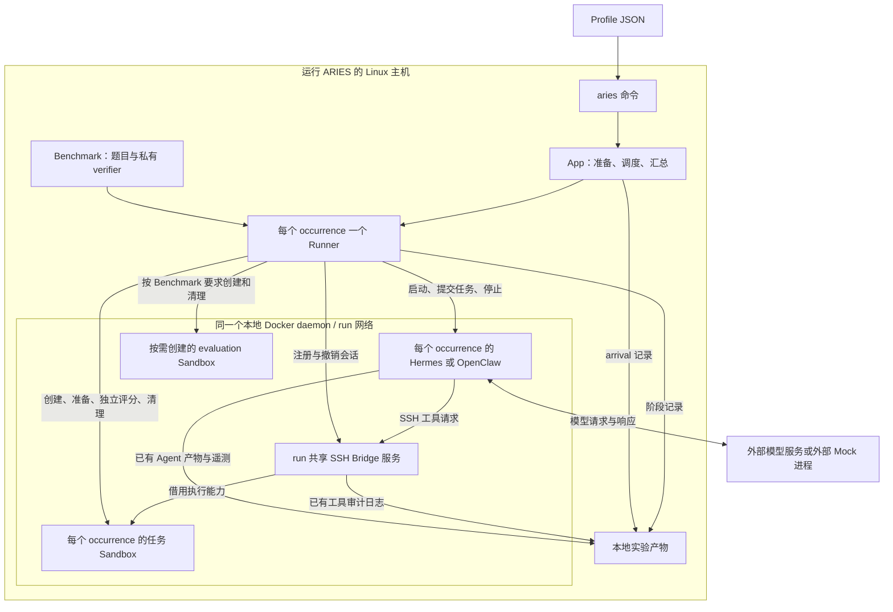
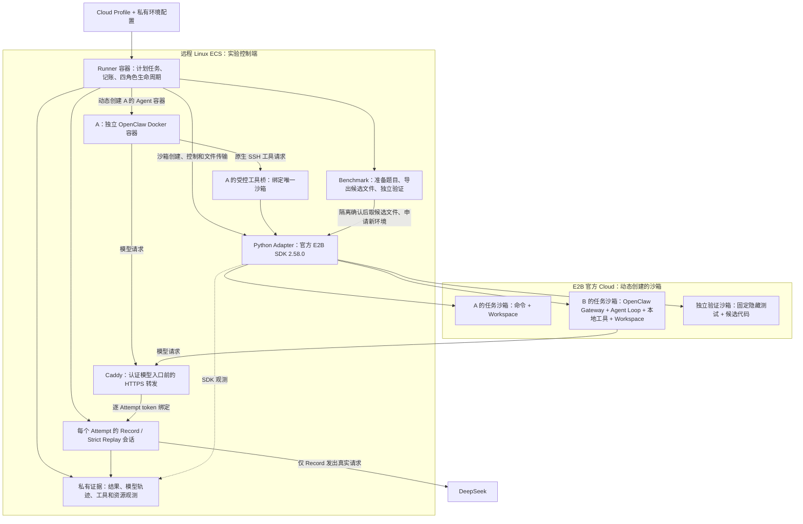
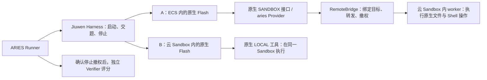
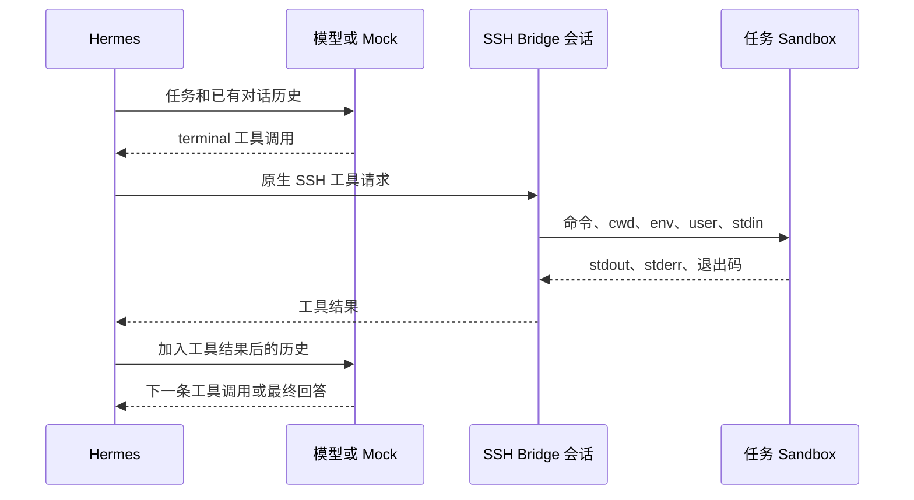

# ARIES 架构入门：一次 Sandbox 性能实验怎样运行

本文面向第一次接触 Agent、Sandbox 和 ARIES 的读者。以 2026-10-24 的工作区为准，区分已有 Docker/Kubernetes 路径、新增云 Sandbox 接线和真实运行证据。

当前项目是 Go 编写的 Agent 实验框架。我们这条工作线的目标，是让相同的 Agent 工作负载在不同 Sandbox 中执行，比较等待、执行、传输、可靠性与资源表现。
当前已接入 E2B 官方 Cloud 和华为 AgentSphere，并支持 OpenClaw 与 JiuwenSwarm Flash 的 A/B 两种位置。下面的早期验收数字属于 OpenClaw；Jiuwen 的最新版本与逐次结果见[原生工具与观测验收](jiuwen-native-runtime-validation-20261027.md)。命令、文件与独立评分均真实执行。

**五项单次基线已通过独立验收：A 录制、A recorded 回放、B 录制、B recorded 回放和 B zero 回放。A 每次 7 轮模型交互、6 次真实工具；B 每次 4 轮、3 次本地工具。五次均通过 12 项独立测试，停止隔离和清理均确认。** 后续三个重复/并发批次、三项组件故障探针、新 Runner 的 A/B recorded 回归及 B Gateway 主动断连检查也已通过，范围见第 8.4 节；完整观测开销尚未测定，历史失败记录仍保留。ECS 发布检查、Python Adapter/模板检查及真实 SDK smoke 已通过。华为云 record3 已完成真实 OpenClaw 录制、12 项独立测试和 7/7 独立复核，后续九项本机协议预检及真实 Sandbox recorded 严格回放也通过，回放的 4 轮/693 帧、12 项独立测试和清理均已复核；这是显式假设 Verifier 出网隔离下的条件性通过，禁止出网尚未实测通过。阿里云、腾讯云是后续适配目标，AWS 已暂不考虑。所有构建、测试、服务与实验只在远程 ECS 执行，本地只编辑和静态审查。

新增 `merge-ranges-portable-v1` 已完成一次真实 E2B A 录制及同 Tape 的 E2B A、华为 A recorded 严格回放：三次各 8 轮模型交互、7 次真实工具、12 项独立测试，联合复核 16/16 通过。华为仍采用明确的 Verifier 出网隔离假设。旧 Tape 的文件系统元数据偏离失败继续保留；单次结果不能推导容量或厂商排名，详见[同 Tape 对照](performance-archive.md#portable-crosscloud)。

OpenClaw、Adapter、Caddy、Runner、Hermes、Bridge 和 fix-git 镜像已在 ECS 归档；早期已验收 E2B Runner 与对应 529 文件源码也已归档并核对哈希。此前发布候选用于华为 record3 和 E2B A/B 回归；新的 portable Runner 通过完整发布检查后用于本轮同 Tape 实验。ECS 服务部署及 Adapter 健康检查已通过，Runner/Adapter/Caddy 镜像已锁定。恢复检查限于同一 Docker daemon，尚未验证干净机器恢复。ECS 公网 IP HTTPS 检查及 B 从 E2B 访问模型入口均已通过。工作站通过已有本地 SOCKS5 代理访问 ECS，已验证连续登录与文件往返；这是开发连接设置，与 Agent 的模型代理不是同一件事。各项证据和归档版本边界见[部署指南](../deploy/e2b/README.md)及[性能与验证档案](performance-archive.md)。

截至首个 A 两次重复批次结束，正式账本累计 15 次创建，15 个沙箱全部确认删除。此前的
12 次来自首次失败 A 与五项成功基线；重复批次新增 3 次。重复批次的结果文件记录一项成功、
一项 Bridge 启动失败，但日志目录冲突及失败清理导致该批原始证据缺失，因此整批未通过验收。
五项既有基线不受影响；修复后的三个重复/并发批次已通过。组件故障检查后 E2B 账本累计 33 条均确认删除；新 Runner A/B 回归后为 37 条，B Gateway 断连检查再新增 2 条，该时点累计 39 条均确认 absent，详见第 8.4 节。后续 portable 实验的新增资源及删除证据单列于[性能档案](performance-archive.md#portable-crosscloud)。旧配置下的 **4/4** 记录保留。
当前累计创建次数只记账、不设硬上限；仍保留所有权账本、并发限制、TTL 和用完即删除的要求。
一次真实成功只证明这条任务链路已跑通，不足以证明重复性、并发能力或性能排名。

## 1. 先认识这些名字

| 名称 | 可以怎样理解 | 在这里的例子 |
| --- | --- | --- |
| LLM，大语言模型 | 根据对话生成文字或工具调用的服务 | DeepSeek，或返回已录制响应的 Replay |
| Agent，智能体 | 不断“请求模型 → 调用工具 → 把结果交回模型”的程序 | Hermes、OpenClaw、JiuwenSwarm Flash |
| Harness，Agent 运行适配层 | 启动和配置 Agent，提交任务，收集结果并停止 Agent | `pkg/harness/hermes` |
| Sandbox，沙箱 | 命令真正运行、文件真正改变的隔离环境 | 本期被测 E2B Cloud；旧路径是任务容器或 Pod |
| Bridge，工具桥接层 | 把 Agent 原生工具请求送到指定沙箱，并收回访问权 | Hermes SSH Bridge |
| Benchmark，基准任务集 | 定义题目、初始环境和评分方法 | 本期修复 `merge_ranges`，旧示例是 `fix-git` |
| Verifier，验证程序 | 独立检查任务最后是否做对 | 任务自己的测试脚本；部分任务集使用独立模型评分 |
| Profile，实验配置 | 一次实验选择什么任务、Agent、环境、模型和并发 | `profiles/hermes-tb2-fix-git-mock.json` |
| Run，实验运行 | 执行一次 profile，产生一个输出目录 | 一次运行包含多个任务执行实例 |
| Occurrence，任务执行实例 | 某一道题的某一次执行 | 同一 `fix-git` 可重复产生 `fix-git-001`、`fix-git-002` |
| Attempt，尝试记录 | 给每个计划执行实例记一笔完整账 | 即使创建环境前失败，也保留唯一身份和失败原因 |
| Arrival，计划到达项 | 调度器计划何时让一个任务实例进入系统 | 计划第 5 秒开始，不保证有容量立即执行 |
| Recorder，记录器 | 保存观测事件，供之后重新计算 | 每行一个事件的 JSONL 文件 |

Agent 与 LLM 是两个部分：OpenClaw/Hermes/JiuwenSwarm 负责工具循环，模型负责提出下一步动作。
Mock 替换的是模型响应来源。Agent、工具、Sandbox 和真实 verifier 仍然参与实验。
后文的 endpoint 指服务访问地址，API 指程序调用接口，e2e 指从约定起点到终点的端到端过程。

## 2. 原有 Docker/Kubernetes 架构

下面画的是当前 Docker 主路径。一个 run 共享一个 Bridge 服务和运行网络；每个 occurrence 有自己的 Harness、Sandbox 和 Bridge 会话。



图中的“借用执行”表示 Bridge 可以在指定环境中执行命令，但不拥有该环境的生命周期。创建和销毁由 Sandbox/Runner 路径负责。
每个 Bridge 会话固定绑定一个 Sandbox；一个会话结束不会把同一 run 的其他会话一并关闭。

当前还有 Kubernetes 路径：Harness、Bridge、Sandbox 放在同一 namespace 中，由相应部署后端管理 Pod。
它支持的任务及模式范围比 Docker 窄，详见[支持矩阵](supported.md)。当前配置会拒绝不支持的混合后端组合。
Docker 路径要求同一台机器的本地 daemon；“用 SSH 登录远程 Linux 再运行 ARIES”与“让本地 ARIES 连接远程 Docker daemon”是不同的部署方式，后者当前不受支持。

## 3. 本期 E2B 总体架构：同一控制端，两种 Agent 位置

先把 ECS 理解成“实验室控制电脑”，把 E2B Sandbox 理解成“被测试的远程工作间”。Docker Compose 负责在 ECS 启动控制软件；E2B 官方 Cloud 提供实验用沙箱。这是两个不同层次。

`agent_type=openclaw` 选择谁产生工作负载，`placement=external/embedded` 选择 Agent 住在哪里，`sandbox_backend=e2b-cloud` 选择工具环境由谁提供。两种位置使用相同调度器、四角色 Runner 和独立评分规则。



图说明各部件的连接方式；实际验收范围以上方状态为准。A/B 是两次实验的替代配置，并非一次任务同时启动两个 Agent。E2B 沙箱不是 Compose 的静态服务。

| 部件 | 通俗解释与具体工作 | 代码位置 |
| --- | --- | --- |
| App / Scheduler | 发试卷的组织者：建立任务身份，等待并发名额，保存每次尝试的结果 | [`internal/app/cloud.go`](../internal/app/cloud.go)、[`execution.go`](../internal/app/execution.go) |
| Runner | 监考员：按固定顺序创建、执行、停止、评分、清理 | [`pkg/runner`](../pkg/runner/runner.go) |
| OpenClaw Harness | Agent 的启动与控制适配器；A 启动 Docker 容器，B 使用已有 E2B 句柄启动 Gateway | [`openclaw`](../pkg/harness/openclaw)、[`openclawcloud`](../pkg/harness/openclawcloud) |
| A 工具桥 | 把原生工具协议转为该沙箱的执行请求，保留命令与二进制输入输出；限制访问并确认撤销 | [`external.go`](../pkg/harness/openclawcloud/external.go) |
| B 配对 Bridge | 不转发每条本地工具命令，但负责绑定同一沙箱、封闭执行入口并确认进程域已停止 | [`embedded.go`](../pkg/harness/openclawcloud/embedded.go)、[`group.go`](../pkg/harness/openclawcloud/group.go) |
| Go E2B 实现 | 对 Runner 提供统一创建、命令、文件、销毁能力，调用受认证的 Adapter | [`pkg/sandbox/e2b`](../pkg/sandbox/e2b) |
| Python SDK Adapter | 使用官方 Python SDK；维护真实沙箱所有权、累计创建计数和销毁确认 | [`adapters/e2b`](../adapters/e2b) |
| 模型代理 | Record 转发 DeepSeek 并录制；Replay 检查完整请求后返回历史响应；每次尝试单独绑定身份 | [`internal/modelreplay`](../internal/modelreplay) |
| Caddy | 让 E2B 内 Agent 能通过 HTTPS 访问模型代理；只转发两个模型路由 | [`deploy/e2b`](../deploy/e2b) |
| Coding Benchmark / Verifier | 先给 Agent 有 bug 的 Python 文件；停止隔离后取回候选文件，在新沙箱用隐藏测试评分 | [`codingcase`](../pkg/benchmark/codingcase) |
| Recorder / Observer | 分别记录调度阶段、模型请求、工具和资源样本，不把不同来源的时钟硬拼成精确耗时 | [`pkg/performance`](../pkg/performance)、[`metrics.go`](../internal/app/wiring/cloud/metrics.go) |

E2B key 只交给 Python Adapter；DeepSeek key 只留在控制端 Record 代理；Agent 只得到该次尝试的临时代理 token。SDK Adapter 和 Docker socket 不对公网开放。具体网络与文件边界见[部署说明](../deploy/e2b/README.md)。

A 与 B 都有真实工具执行，但路径不同：A 的命令需跨 ECS→E2B，B 的 Agent 和工具共享 E2B 的资源。因此两者的延迟差同时受网络、资源位置、提示词和工具输出影响，不能直接称为“桥接开销”。A/B 先各自录制、各自严格回放，再核对能否形成可比的负载。

多云仍使用这些角色边界扩展，不添加空壳 provider。每家正式接入前要验证工作目录、用户、二进制传输、文件权限、退出码和停止隔离；简单 `echo` 成功只证明连通。未来 Activate/Pause 等独立工作负载也不必改造当前 Agent 四角色生命周期。

### 3.1 JiuwenSwarm Flash 怎样接进来

Jiuwen 自己负责“调用模型、选择工具、接收结果、继续推理”。ARIES Harness 负责启动它、交题、收集证据和停止它。Provider 是 Jiuwen 原生的文件/Shell 操作接口；我们的 `aries` Provider 把这些操作送到 Runner 已创建的准确 Sandbox。它不另建题目环境，也不代替 Agent 决策。



A/B 是两次实验的替代配置。A 的 Agent 消耗 ECS 资源，工具消耗目标 Sandbox 资源；B 的 Agent 和工具共同消耗目标 Sandbox 资源，因此报告需要标注 placement。两种模式均沿用四角色，没有增加 RuntimeDriver 或另一套模型服务。

Jiuwen 的 `sandbox.startup_mode=external` 只控制原生 JiuwenBox 是否自动启动；ARIES 的 `placement=external` 才代表 A 模式。Provider 接口能扩展不同类型，但目标协议仍需实现；当前复用的是 `aries` FS/Shell，E2B/华为云生命周期仍由现有云 Adapter 管理。

观测按三层读：原生 Tool span 是 Agent 所见的调用；Bridge 区间是控制端转发请求；worker 区间是 Sandbox 内原生操作请求。它们有精确身份关联，但时钟域和时间范围不同，不能相加或相减当作纯网络/进程耗时。CPU、内存和 I/O 也按控制器、Agent、Sandbox 的实际来源分开。详见[阶段定义](performance-stages.md)与[当前测点和缺口](jiuwen-native-runtime-validation-20261027.md)。

## 4. Runner 为什么只有四个角色

[接口定义](../pkg/runner/interfaces.go)把任务职责分成四类，便于更换实现时保留同一生命周期。

| 角色 | 输入与负责的事情 | 输出 | 不负责的事情 |
| --- | --- | --- | --- |
| `Benchmark` | 题目、初始环境、任务 Sandbox；准备环境，保护评分材料，按原方法评分 | `Task`、环境准备结果、`Evaluation` | 不代替 Agent 解题，不用 Mock 自报完成代替评分 |
| `AgentHarness` | 任务说明、模型配置、工具 endpoint；启动和运行 Agent | Agent 结果、日志、原生遥测、停止确认 | 不创建任务 Sandbox，不决定真实评分 |
| `ToolSandbox` | 任务环境要求；创建并管理环境，也管理按需评估环境 | 可执行/传文件的 `Sandbox` 句柄、停止结果 | 不决定工具调用顺序，不生成模型答案 |
| `ToolBridge` | 一个确切的 Sandbox；授予临时工具访问 | 工具 endpoint、审计材料、撤销确认 | 不拥有 Sandbox，不调度下一道题 |

`Sandbox` 是启动后得到的环境句柄，提供 `Exec`、`Upload`、`Download` 等能力；它不是第五种角色。
部分调用还需要无损流式执行或有限大小下载能力，不能用会损坏二进制数据的文本接口静默替代。

模型服务位于四角色之外。旧配置中模型 runtime 的 `external` 表示使用已存在服务，`managed` SGLang 表示 ARIES 管理 run 级模型进程；这是模型的部署方式，**不要与 cloud 配置中 Agent 的 `placement=external` 混淆**。cloud 路径在 Runner 进程内创建每个 Attempt 的 Record/Replay 会话，不增加第五个 Runner 角色。

部署后端也位于四角色之外。[`pkg/deployment`](../pkg/deployment/deployment.go)提供创建运行环境、执行、文件归档、地址解析和删除等基础能力。
当前 [`pkg/sandbox`](../pkg/sandbox/sandbox.go)利用 Docker 或 Kubernetes 后端实现任务环境管理；Harness 和共享 Bridge 也利用部署能力启动自己的运行环境。
因此，“使用 Docker 部署 Agent”与“使用 Docker 作为被测任务 Sandbox”是两项选择。旧 profile 的支持组合要求一致后端；新的 cloud 接线显式支持 ECS 上的 Docker OpenClaw 调用远端 E2B。

## 5. 从 profile 到结果：一次完整运行

旧入口是 [`internal/app/run.go`](../internal/app/run.go)，cloud 入口是 [`internal/app/cloud.go`](../internal/app/cloud.go)，任务内部顺序都由 [`pkg/runner/runner.go`](../pkg/runner/runner.go)控制。下面先解释通用流程，旧任务集的下载、镜像准备和共享 Bridge 不一定适用于新的 cloud 路径。

| 顺序 | 发生什么 | 为什么需要这一步 |
| --- | --- | --- |
| 1 | 读取 profile、版本文件和显式 overrides，校验组件组合 | 在产生资源之前发现配置错误 |
| 2 | 准备固定版本的数据集、任务镜像、Harness/Bridge 所需材料，加载一次任务目录 | 下载与构建可能很慢，不能混作 Sandbox 本身的创建性能 |
| 3 | 如使用 managed 模型，先启动并等待健康；external 模型由操作者提前提供 | 确保 Agent 有可以请求的模型服务 |
| 4 | Model preflight：检查模型服务与指定 model ID，保存 `live-validation.json` | 模型目录校验通过不代表所有工具调用扩展都已验证 |
| 5 | 打开性能记录器，启动 run 共享网络、Bridge 服务和相应资源观察 | 先准备共同基础设施，再接纳任务 |
| 6 | 调度器建立 arrival 计划，等待计划时间和并发容量 | 区分“想什么时候开始”与“实际什么时候开始” |
| 7 | 为 occurrence 构造独立 Benchmark 状态、Harness、Sandbox 管理器、Bridge 会话及 Runner | 重复同一道题也不能共用可变执行状态 |
| 8 | Runner 创建任务 Sandbox，Benchmark 准备工作目录并清理不应暴露的评分材料 | Agent 得到正确初态，但不能提前看到 verifier |
| 9 | 注册该 Sandbox 的 Bridge 会话，启动 Harness，交付任务说明 | Agent 只通过分配给它的工具入口访问目标环境 |
| 10 | Harness 请求模型、执行工具、回传结果，重复至结束或失败 | 这是实际 Agent 工作负载，Mock 只固定其模型侧动作 |
| 11 | 确认 Harness 已停止，并确认 Bridge 访问已撤销 | 在这两个条件满足之前，不能交付私有评分材料 |
| 12 | Benchmark 独立运行 verifier；必要时请求新 evaluation Sandbox | 保留上游任务集的评分方法，不让 Agent 自己判分 |
| 13 | 清理评估 Sandbox、任务 Sandbox 和各自的临时资源，结束任务观察 | 失败和取消也必须保留清理结果 |
| 14 | 所有已接纳任务结束后，停止共享 Bridge、完成共享观察、移除 run 网络并关闭连接 | 共享资源在所有任务之后释放，不计作虚构的额外任务 |
| 15 | 刷新性能文件和 index，保存 `run-result.json`；managed 模型按自身所有权停止 | 结果包含任务、共享基础设施和记录器各自的状态 |

`aries setup PROFILE` 只执行准备路径，不请求模型 endpoint，也不启动模型运行时。普通 `aries PROFILE` 会检查并完成必要准备后继续运行。

Agent 执行失败与评分失败不是同一件事。在隔离已确认且上下文允许时，verifier 仍能检查失败后留下的状态。
如果 Harness 停止或 Bridge 撤销无法确认，评分会被阻止，不能把这种情况伪装成正常的零分测试。

Terminal-Bench 2 等任务集在任务 Sandbox 中评分；SWE-bench Pro 按其原方法提取补丁，在新环境中运行测试。
评估 Sandbox 仍由 Runner 管理，观测中的 `purpose=evaluation` 将其与 `purpose=task` 分开。

取消命令传输不保证远端进程已经被杀掉。撤销 Bridge 表示关闭工具访问；删除 Sandbox 是另一个需要确认的生命周期操作。

本期 Coding Case 的实际规则更具体：

1. 固定初始题目是 `intervals.py` 的区间合并 bug，提供 4 个公开测试；Agent 可读取、修改、执行 pytest。
2. A 的工具进程、B 的 Gateway 及其后代分别进入 root 控制的 cgroup v2 进程域；Agent 使用专用 UID 60000。停止时关闭新调用入口，再执行 `cgroup.kill` 并确认 `populated=0`。模板不具备该能力时，返回 unsupported，不把健康检查失败当作已停止。
3. Runner 确认 Harness 停止和 Bridge 撤权后，才下载有界候选文件。控制端保存只读副本、SHA-256 和捕获时间；这个时间是保守的产物就绪上界，不是推测 Agent 最后一次写入的时刻。
4. 在新建、禁用网络的验证沙箱内重建已知测试，只导入候选文件。隐藏测试由可信 root 进程持有，候选函数在无提权能力的子进程中执行；全部 12 个预期测试通过且报告完整，才判 PASS。
5. 清理任务沙箱和验证沙箱，并保留清理是否确认的证据。评分通过但删除失败，仍单独报告 cleanup failure。

模板构建与隔离能力探针在 [`adapters/e2b/template`](../adapters/e2b/template)。安装 OpenClaw 不等于获得 cgroup 能力，后者必须在真实 E2B 实例上验证。

## 6. 一条工具命令怎样到达 Sandbox

以当前 Hermes 示例为例，模型返回一个 `terminal` 工具调用，其中含有待执行的命令。
Hermes 原生运行时把工具请求发往分配的 SSH endpoint，Bridge 解析其协议，再使用固定绑定的 Sandbox 执行能力执行命令。
标准输出、标准错误和退出码沿相反方向返回，Hermes 将工具结果加入对话，随后发起下一次模型请求。
图中的 `cwd` 是工作目录，`env` 是环境变量，`user` 是执行用户；`stdin`、`stdout`、`stderr` 分别表示标准输入、标准输出、标准错误流。



Runner 控制这整个阶段的开始与结束，但不逐条代替 Hermes 调用工具。
当前 Bridge 通过 [`pkg/bridge/target`](../pkg/bridge/target/target.go)取得 Docker/Kubernetes 的借用执行路径；协议解析在 [`pkg/bridge/ssh`](../pkg/bridge/ssh/execute.go)。
新 A 路径使用专用 OpenClaw SSH 适配，通过 Go E2B 实现与 Python SDK Adapter 执行远端命令；B 让原生 OpenClaw 在同一沙箱执行本地工具。两者的真实录制与 recorded 回放均已通过；三项组件故障探针也已完成，尚不覆盖整个外置 Agent Loop 的断连实验。

## 7. Mock 怎样让工作负载可重复

现在有两套不同用途的模型替代方式，不能混为一谈：

| 方式 | 响应从哪里来 | 能证明什么 |
| --- | --- | --- |
| Scripted Scenario，旧 `internal/mockmodel` | 人写的步骤和预期标记 | 规定的小工具负载能否跑通；没有真实模型轨迹来源 |
| Strict Trajectory Replay，新 `internal/modelreplay` | 原生 OpenClaw 真实请求 DeepSeek 时保存的请求与 SSE 响应 | 在同一模式下，请求、历史、工具结果与已录制决策是否严格一致 |

cloud 五项 profile 使用第二套。一次真实录制保存多轮完整请求和响应，回放时逐轮检查**全部历史**、模型参数、工具 schema 和工具结果。不一致就 `REPLAY_DIVERGED`，不悄悄跳过旧历史、不继续调用真实模型。当前限定顺序工具调用，复杂并行、上下文压缩等未支持场景必须明确失败。

每个 Attempt 有自己的随机模型 token、Session ID 和游标，控制端按 token 选定会话，不靠“猜这段对话属于谁”。A/B 分别录制自己的 tape；模型会话 ID 和原生 Agent Session ID 也是两种不同身份。

还有一个已复现的原生细节：OpenClaw 会把模型返回的工具调用编号中的 `_` 等字符去掉，再用于下一轮请求。例如模型返回 `call_1`，下一轮可能使用 `call1`。五个 cloud profiles 显式声明固定版本的 `tool_call_id_dialect`，让录制器检查这条确定的对应关系；原始请求和响应仍完整保存。回放时必须与当时实际录到的每轮请求一致，不能把别的编号或工具结果“洗成一样”。碰撞和复杂编号仍拒绝。这项修复已通过 ECS 相关四包 race 测试、vet 和 CLI 构建。

随后的离线原生实验整体失败，容器和进程已清理：录制成功完成 3 轮请求和 2 次真实本地工具，
但回放到第二次模型请求时严格比较失败。第一轮响应取自原始录制，后两轮为合成内容，
没有新增 E2B 或真实模型调用。已看到第一个工具的 `ls` 输出中文件时间发生变化；
由于没有完整 replay HTTP 请求，尚不能断定它是唯一原因。

第二个离线实验已通过：使用原生 `skipBootstrap` 关闭自动初始化，给 3 份公开题目
文件和工作目录固定修改时间，录制与回放各完成 3 轮，真实本地工具继续执行，清理确认。
这里使用同一个容器、未变的父目录，模型响应仍是一轮真实材料加两轮合成内容；
没有经过 Gateway、E2B 或独立评分，因此该探针只证明这组离线输入可以重复。
生产代码接入初始化开关与准备阶段的时间设置后，完整 ECS 发布检查与新 Runner
构建/归档通过；随后 A 真实录制和跨实例回放通过。没有删除请求或工具结果中的字段。

为避免原生会话随机 ID 和消息时间前缀导致回放偏离，cloud A/B 的录制与回放采用同一组原生会话 key/UUID，并使用 OpenClaw 自带的 `envelopeTimestamp=off`。每次仍创建独立 Gateway 和私有目录，模型 token、ARIES Attempt ID、请求幂等 ID 继续独立生成。A 请求固定容器主机名 `aries-workload`；B 录制和新实例回放均观察到 `e2b.local`，当前代码不修改 guest hostname，后续实例仍须核验。这些是运行输入设置，不是从模型请求里删除字段。

Replay 时序分为 `recorded`（保留代理实际观测到的原始 SSE 相对间隔）、`zero`（不增加人为等待）、`synthetic`（显式配置模拟延迟）。代理接收 SSE 的时间含网络与服务端影响，不是模型内部 token 生成时刻；zero 也仍有解析、传输与调度开销。严格回放能减少模型决策变化，不能消除模板、网络和资源争用差异。

最新 A 的完整真录制已通过 ECS 本机协议回放：7 轮、1175 个 SSE 事件，zero/recorded
两种时序、完整历史/旧工具结果/schema 偏离拒绝、两个独立会话与重试检查均通过。
可以把它理解为“检查录音播放器和校验规则”；该协议检查本身没有让 Agent 重新做题。
随后真实 A 回放在新 E2B 中完成同一任务，7 轮请求严格匹配、6 次工具继续执行、
12 项独立测试通过。原轨迹中的两次工具错误也原样重现，不能把它们改成成功来凑结果。
B 自己的 4 轮/3 次工具轨迹也已通过协议校验和真实 recorded/zero 回放；它与 A 的动作不同，不能直接用
两次耗时相减推算桥接成本。B 的原生事件保存命令及结果元数据，未独立保存完整工具
输出正文，这一观测边界需要保留。详见[真实协议证据](implementation/model-replay.md)。

详细契约与真实验收缺口见[模型录制与回放](implementation/model-replay.md)。以下保留旧脚本 Mock 的说明，供阅读 IDE 中的 `internal/mockmodel/server.go` 和 Hermes profile。

[`aries-mock-model`](../cmd/aries-mock-model/main.go)是单独启动的 HTTP 服务，实现固定工作负载所需的模型发现和 Chat Completions 响应，包括 JSON 与 SSE（服务端逐段发送事件）的流形式。
[`internal/mockmodel`](../internal/mockmodel/server.go)读取 fixture——描述工具步骤的 JSON 文件——并从请求历史判断执行到哪一步。
它不依赖一个所有请求共用的“下一步计数器”，因此并发会话和重试不会靠共享计数推进彼此的脚本。

每一步固定工具名称与参数，并检查之前工具结果是否包含预期标记。不符合约定的历史会失败，不会直接宣布脚本成功。
这一检查只能证明指定步骤达到 fixture 的条件；真实任务是否完成，仍由 verifier 判断。

当前 [Hermes fixture](../configs/mock/hermes-sandbox-probe.json)只有两步：

1. 查看工作目录与操作系统，并返回环境探测标记。
2. 创建临时文件、读回并校验内容、删除文件，然后返回文件操作标记。

对应 [profile](../profiles/hermes-tb2-fix-git-mock.json)借用了 `fix-git` 的任务环境，但脚本没有解决该 Git 任务。
所以“Mock 两步执行成功、真实 verifier 没通过”可以同时成立，不能为得到 reward `1` 而绕过评分。

模型 ID 包含 fixture 原始字节 SHA-256 的短前缀；完整 hash 在 Mock 启动日志中。修改命令、延迟甚至 JSON 空白都会改变 ID，profile 必须同步。
ARIES 不自动收集这个外部服务的启动日志，应把 fixture 与完整 hash 一起保留。

当前 Mock 仅支持严格的短工具轨迹，不是任意对话模拟器。示例关闭上下文压缩和子 Agent；额外用户消息、辅助模型调用或后台命令轮询可能不符合其协议。
没有生成真实 token usage，`response_delay_ms` 也只是固定响应延迟，不能据此评价 LLM 推理性能。
若 Benchmark 使用模型评分，judge 必须配置为独立的真实评分服务，不能默认继承这个 Mock。

## 8. 观测分层：时间、正确性与资源分开看

cloud 新增 W0 记账：计划中的每个 occurrence 都先建立 Attempt，即使构造失败、超时或根本未获得名额，也保留记录。`TaskID` 表示逻辑题目，`OccurrenceID` 表示本轮某次执行，`AttemptID` 加上 Run 身份；Agent 和模型代理的 Session ID 另存，不能互相替代。

| 观察项 | 从哪里到哪里 | 解释限制 |
| --- | --- | --- |
| 排队 | 计划到达 → 获得并发名额 | 调度器满额会等待，不能称为严格开环发压 |
| 环境 | 发起创建 → 沙箱返回；另记准备和 Harness 启动 | 返回快不证明宿主机是冷启动，冷暖状态不明就 unknown |
| Native Agent | 控制端调用 `client.Agent` → 调用返回 | 成功时已收到原生终态；断线或超时返回只结束控制端等待，不证明沙箱内 Agent 已完成或停止。外层 `Harness.Run` 还可能含产物收集 |
| 模型 | 代理接收请求、观察 SSE、响应结束 | 代理侧边界；TTFT 不等于模型内部计算耗时 |
| 工具与 SDK | 实际桥接调用、SDK 控制请求、原生工具证据 | B 本地工具不经过 SDK，不能用 SDK 命令数量冒充 B 的 Tool Call 数 |
| 隔离 | 发起 Stop/revoke → 两项均正向确认 | nil 返回、健康检查失败都不能单独充当证据 |
| 产物 | 隔离后捕获可信的不可写候选副本 | 保守就绪时间；不从最终文本推断 |
| 验证 | 独立 Evaluate 开始 → verifier 报告完成 | 外层耗时含候选导出、新环境准备和报告回传，不是纯 pytest 时间；产物就绪另有时间点 |
| 清理 | 释放资源开始 → 实际结束/失败 | 失败也保留结果，不能隐藏在成功率里 |

`attempts/s`、实际执行吞吐、完成吞吐、独立验证成功吞吐分别计数。Goodput 要额外显式填写 SLO：**产物就绪不晚于计划到达 + SLO，且最终独立评分 PASS**。Verifier 可以晚于 SLO 才完成。未填写 SLO 时省略 Goodput；已填写时，缺少产物证据的任务不计入合格数，汇总仍可输出 `0`，但证据不足不等于已确认违反 SLO。速率使用包括排队与收尾的有效观测窗口，不能只挑最快一段作为分母。

E2B 资源采样保留官方 SDK 原始字段与时间戳，约每 5 秒请求快照。真实 SDK smoke 已取得 1 个 CPU、内存与磁盘使用/容量样本；这不证明短任务峰值或采样精度。返回的旧样本可能重复，短峰值可能漏掉；不能把多次轮询当作相互独立的新样本。disk/network I/O 与 B 中 Agent/Tool 各自资源占比目前为 `UNSUPPORTED`。A 的 Docker Agent 资源单独采样，不能拿它的 CPU% 与 E2B 的另一种计数直接相减。

以下解释原有 P1a 阶段记录与离线工具，它们继续使用，但不自动代表所有 cloud 证据已经完成关联。

P1a 是观测基础的第一部分：只在控制端进程记录调度和 Runner 阶段，原来的 Bridge 审计、Hermes 遥测与资源采样继续保留。
`JSONL` 表示每行一个完整 JSON 对象，便于保留原始事件和离线重算。

### 8.1 调度事件

[`execution.go`](../internal/app/execution.go)保留现有固定并发和阻塞 admission——等待并发槽位——的行为，增加以下记录：

| 事件 | 含义 |
| --- | --- |
| `arrival_planned` | 此 occurrence 已有计划、身份和计划 offset |
| `arrival_admitted` | 得到并发容量，附计划到达至此刻的排队耗时 |
| `arrival_dispatched` | 即将执行该 occurrence 的回调 |
| `arrival_finished` | occurrence 回调返回，附发起至返回的耗时和分类结果 |
| `arrival_not_started` | 已计划但因取消或 loop 截止而未执行，不添加虚构 TaskResult |

有限任务批次与到达计划会预先分配全部 occurrence/arrival ID；loop 仅为已经产生的候选分配身份。
计划 offset 以本轮调度开始为基准；`schedule_anchor_offset_ns` 把这个基准对应到记录器的时间轴，避免把两套起点直接相减。
取消可能发生在未来 arrival 的计划时间之前，因此未发起项没有伪造的负排队耗时。

当前 arrival replay 仍可能被满容量阻塞，实际发起会晚于计划时间。P1a 让这个差异可见，**没有实现严格开环发压器**。
也没有把未发起项计为云 API 错误。具体回放配置见[配置文档](configuration.md#replay-task-arrivals)。

### 8.2 Runner 阶段事件

阶段以 `operation_started` / `operation_finished` 配对，并带 `operation_id`、父操作 ID、occurrence 身份和用途。
当前有 `occurrence.build`、`task.e2e`、`sandbox.start`、`sandbox.prepare`、`bridge.register`、`harness.start`、`agent.run`、`harness.stop`、`bridge.revoke`、`benchmark.evaluate`、`sandbox.stop`。
评估 Sandbox 的 start/stop 用相同操作名、不同 `purpose` 记录；失败路径中的清理尝试也保留独立操作。

这些名称对应真实代码边界：`sandbox.start` 是整个 `ToolSandbox.Start`，尚未拆成云 create、SDK 重试和就绪探针。
`agent.run` 仍是完整 Harness 调用，可能包含产物收集；新增 `TaskTiming.RuntimeExecutionDuration` 使用 Harness 实际报告的原生任务窗口，缺失时不由外层耗时补齐。`task.e2e` 包含任务最终清理，但不包含整个 run 的预下载、模型 preflight 或共享基础设施生命周期。
`arrival_finished` 的范围比 `task.e2e` 更外层，还包含 occurrence 构造及任务观察收尾；父子耗时不能相加成另一份总耗时。

记录器使用进程内单调时间计算 duration，UTC 时间用于展示。`emitter_id` / `clock_domain` 标识这条时间轴。
[`pkg/performance/recorder.go`](../pkg/performance/recorder.go)使用有界缓冲保存事件；溢出、写入或刷新失败会通过 index 与最终状态体现，不静默当作完整数据。
OpenTelemetry 的 trace 是跨服务请求链路，span 是其中一个操作区间。这份 JSONL 尚未接通跨进程 trace 传播，也不会采集命令正文或原始 provider 错误作为通用字段。

### 8.3 离线汇总能做与不能做的事情

[`aries-perf`](../cmd/aries-perf/main.go)读取一个 run 的性能目录并把汇总 JSON 写到标准输出，不修改原始记录。
它检查 manifest/index、计数、事件配对和 arrival 状态链；有缺失、重复或异常时返回不完整状态和非零退出码，同时尽可能保留可恢复的汇总。
操作按逻辑任务、操作名和用途分组；arrival 按逻辑任务分组。实现见 [`summary.go`](../pkg/performance/summary.go)。

- 成功耗时给样本数、最小值、p50、p95、最大值；p50 表示半数已观测样本不超过这个值。
- p99 只有达到 1000 个有效成功观测时才显示。这是描述统计的展示门槛，不保证尾部精度，也不证明 1000 个样本相互独立。
- `successful_duration_ns` 只描述成功操作；失败、取消、超时和不完整项另列计数，不能从成功延迟推断所有请求的体验。
- `admission_queue_ns` 描述有效的已接纳项，不要求它后来执行成功；未接纳项另列 `not_started`。
- 分位数使用排序后的 nearest-rank，不平均各个 worker 的 p95，也不把超时 deadline 当作完成耗时。

当前没有自动置信区间、跨时间块统计检验、四云综合排名、吞吐/goodput 曲线或图形仪表盘。新吞吐和 Goodput 数值位于 `run-result.json` 的 `attempt_summary`，不是这个旧汇总工具重新计算的结果。
cloud SDK、原生工具和模型证据分别留存，尚未全部接入这份 P1a 汇总。完整 Trace 关联必须检查身份、覆盖率、丢失和时钟来源，不能以“已经生成文件”替代准确性验证。

真实 A3 的后处理已确认 28 条 Runner 事件完整、配对无误。这次产物 E2E 为 40.633 秒，
验证 E2E 为 45.974 秒，完整观测窗口 48.099 秒；三个窗口重叠，不能相加。
另一个直观例子是资源采样：任务沙箱 10 次 SDK 查询返回 45 条累计读数，但只有 9 个
不同采样时间；验证沙箱虽然查询了 2 次，却没有读数。这些都不能当成独立重复实验，
缺失读数也不代表资源消耗为零。单次通过用于确认链路，不能推出容量或厂商排名。

五项基线的时间边界校准已在 ECS 完成，归档于
`/opt/aries-artifacts/five-baseline-boundary-calibration-1/analysis.json`。
每项均有 28 条 Runner 事件、12 对操作开始/结束；校准检查了嵌套区间、模型身份与
SDK 重复时间戳，原始文件哈希未变。A/B recorded 回放的最大本地发送延后分别为
3.489 ms、1.268 ms；它们衡量代理相对录制计划的发送时刻，不是 Agent 收到响应的时刻。
这项检查没有测出完整观测开销，也没有拼出跨机器的全局关键路径。

最新 E2B A/B 回归与 Huawei record3 的 W3 增量已在 ECS 的
`/opt/aries-artifacts/runtime-w3-current-runs-1/` 完成：24 个输入文件哈希不变，
逐轮整理首 SSE/内容/工具增量、原生工具耗时和资源覆盖。三次任务分别返回 44、50、10 条
资源读数，实际只有 8、9、10 个不同时间戳；E2B 两次评分环境均无读数，不能填零消耗。
Huawei 的 `ts` 单位和更新周期未知；5 秒是控制端查询设置。原生工具墙钟耗时、控制端
事件接收间隔和模型代理时序分别报告，不跨域相减。Agent/Tool 资源拆分目前未采集，
不推断供应商永远不支持。已有字段的来源、单位、重复和缺测已明确；全局关键路径、瞬时峰值
及完整观测开销作为后续精度提升，不增加本期 P0 退出门槛。明细与哈希见
[性能与验证档案](performance-evidence.md#当前三次已接受运行的-w3-离线增量)。

### 8.4 重复、并发和故障路径的实际结果

2026-10-23，ECS 上进一步完成 A 外置两次顺序回放、B 内嵌两次顺序回放，以及 B 并发度 2、共三个任务的回放。每个任务都有独立模型会话，真实工具继续执行，每项均通过 12 项独立测试。A 每项为 7 轮模型交互、1175 个 SSE 分片，B 每项为 4 轮、573 个分片。

下表的产物延迟从任务计划到达开始计时，因此包含排队。吞吐使用整个批次跟踪到终态的观测窗口，包含收尾时间；它不是固定时长的稳态容量测试。

| 条件 | 已验证任务数 | 各任务产物延迟（秒） | 各任务排队（秒） | 已验证成功吞吐（任务/秒） |
| --- | --- | --- | --- | --- |
| A recorded，顺序执行 | 2 | 45.158、88.353 | 0、50.290 | 0.02110 |
| B recorded，顺序执行 | 2 | 39.340、87.334 | 0、44.676 | 0.02141 |
| B recorded，并发度 2 | 3 | 41.592、34.079、72.852 | 0、0、40.308 | 0.03833 |

Runner 的同一时钟证明并发组中两个 Agent 确实同时执行，第三个任务等待容量释放。这里只能描述本次小批次结果，不能推出最大容量、可靠的尾延迟或厂商排名。A/B 的模型轨迹不同；早期五项基线与这三个批次的 Runner/Adapter 版本也有变化，不能将它们混成同条件重复样本。未配置 SLO，Goodput 仍未计算。

统一汇总位于 ECS 的 `/opt/aries-artifacts/runtime-performance-summary-1/`：`attempts.csv` 提供逐任务表，`analysis.json` 保存阶段、模型、SDK 操作、资源采样重复/缺失及输入哈希，`analysis-source.py` 保存实际执行的分析脚本。共覆盖五项既有基线和上述三组批次、12 个已接受任务；这是明确选择的成功实验集合，不是全部历史任务的成功率分母。此前 A 重复实验的失败及原始证据丢失仍保留为失败，没有补造或改写。

另外，`/opt/aries-artifacts/e2b-w2-faults-1/` 保存三项真实云端组件故障检查：SSH 工具连接中断后，进程组和脱离会话的子进程可停止；内嵌 Agent 超时后，只有确认停止才导出候选并评分；精确注入停止 RPC 不可用时，Runner 阻止评分并保留清理失败状态，最终删除整只沙箱。后两项使用脚本模型触发真实 Gateway/Tool，不是 DeepSeek 或严格回放的任务成功样本；第一项也不代表整个外置 Agent Loop 的断连实验。该检查后 E2B 账本累计 33 条资源记录均确认 absent。

最新发布候选随后完成 E2B A/B recorded 回归，证据位于 `/opt/aries-artifacts/e2b-runner-regression-ab-1/`。A、B 各一次，严格核对已有轨迹并真实执行工具，每项均通过 12 项独立测试，停止、撤权和清理确认。新增 4 个 Sandbox 全部删除，当时正式账本累计 37 条均 absent。该结果用于新 Runner 兼容性回归，不与旧版本批次混算性能；具体时延与证据见[性能与验证档案](performance-archive.md)。

随后 `/opt/aries-artifacts/e2b-w2-gateway-disconnect-1/` 通过真实 B Gateway 主动断连检查：
控制端关闭 WebSocket 后，Runner 保留执行结果未知的失败，再正常执行 Stop/revoke。
评分前两次独立观察确认 cgroup 为空、UID 进程为零、心跳停止；新建 Verifier 对未修复产物
评分，12 项测试中 11 项失败、score 0，符合故障预期但不算成功任务。任务和评分两个 Sandbox
均删除，当前账本 39 条全部 absent。这只覆盖控制端主动断连，不代表全部网络故障；证据
SHA 与独立复核见[断连故障档案](performance-evidence.md#内嵌-gateway-真实断连故障)。

华为兼容性检查与上述 E2B 性能集合分开。早期已实测创建、文件、进程、cgroup，以及带完整访问凭据的 18789 HTTP/WebSocket 测试服务；该测试服务本身不是完整 OpenClaw 协议验收。该账户的服务端返回 ENVD 版本 0.6.1，实际监听进程版本 0.8.0，镜像自带文件版本 0.10.0；用户已确认平台注入 ENVD，但尚不清楚 API 版本字段的具体含义。这三个值分别记录，SDK 使用真实服务端返回值，后续按实测能力适配，版本差异本身不阻塞接入。

Gateway 的 `/metrics` 已成功读取一次 CPU、内存、磁盘快照；来源是沙箱内 ENVD，采样更新周期未知，不能写成控制面 SDK 的五秒采样。另一次公网模板检查明确提交了 `allow_internet_access=false`，该沙箱仍两次成功建立到 ECS 公网 443 的 TCP/TLS 连接。因此这项断网检查为 FAIL，不能据此接受独立 Verifier 的禁止出网要求。证据与执行脚本归档于 ECS 的 `/opt/aries-artifacts/agentsphere-network-metrics-1/`，本次两个沙箱及模板均经删除后 GET 404 确认。有效出网隔离、资源采样更新周期和测量精度仍未全面验收；后续完整 OpenClaw 任务的条件性结果见下文。

后续显式 `network.denyOut` 诊断在首个阳性对照创建时遇到 `500 / AgentSphere.0513 / snapshot not found`，没有到达网络检查，故 `denyOut` 仍为未验证。该失败保存在 `/opt/aries-artifacts/agentsphere-explicit-network-1/`；独立对账确认 running/paused 列表为空，并删除了本次模板，原始失败记录未改写。

ENVD 三处版本不一致已按用户要求记为遗留项，不继续追查 API 字段含义，也不为版本差异重复创建沙箱。实际版本通过沙箱内 `/proc/net/tcp{,6}` 找到监听 49983 的 socket，再匹配 `/proc/<pid>/fd` 获取进程；当次 PID 为 104，`/proc/104/exe` 指向 `/opt/sandbox-runtime/bin/envd`，执行 `/proc/104/exe -version` 返回 0.8.0。二进制路径与 SHA256 在读取前后未变。原始证据为 ECS 的 `agentsphere-compatibility-4/runtime-identity.json`；PID 仅属于当次实例，不能硬编码到适配器。

华为基础适配代码使用同一个 Runner，按 `sandbox_backend=huawei-agentsphere` 选择独立 Adapter，创建前核对 provider，凭据与资源账本独立。初次离线候选 `agentsphere-adapter-candidate-3/` 通过 Huawei 13 项、原 E2B 23 项、Go 目标单测/race、构建/lint及镜像内 HTTP 检查。后续 candidate-4 修复了包装器依赖不存在的 `/home/user`：包装器从 `/` 启动，实际任务仍使用其指定目录；新增回归先复现旧代码失败，修复后 E2B 24 项和 Huawei 13 项检查通过。当时 Runner 沿用 candidate-3，生产 E2B 镜像未替换。

candidate-4 的真实云 Adapter 协议 smoke 随后通过，证据位于 `/opt/aries-artifacts/agentsphere-adapter-live-4/`：八项检查均通过，只创建一个沙箱。完整凭据的 Gateway HTTP 返回 200 且测试内容匹配，保留路由去掉认证或仅去掉 ENVD token 均返回 401，WebSocket 返回 101 并收到预期帧。无头请求返回 400 只属于缺路由诊断。文件、命令、受管进程和指标接口通过；沙箱独立 GET 404、模板删除、容器及临时凭据清理均确认。受管 PID 消失不等于全部后代隔离，单次指标快照也不确定采样周期。此前三个失败 smoke 的记录保留。

随后单次真实 Huawei Embedded 运行已完成，但结果为 FAIL，证据在
`/opt/aries-artifacts/agentsphere-embedded-record-1/`。Gateway 启动以退出码 78
失败，原生日志报告三个 core library 目录缺少插件 manifest，模型会话只有开始和结束，
没有模型请求或工具执行。停止隔离和清理成功；独立 Verifier 的新沙箱创建另被
`network_isolation_unsupported` 拒绝，不能计为已验证任务。该次一只沙箱和模板均删除。
ECS 原始上游镜像与华为派生镜像中，这三个 library 目录本来就没有插件 manifest；
不能据此断言华为导入丢文件。
作业汇总脚本还因未处理失败 tape 的 `turns=null` 出现 TypeError，原失败保持不变，
诊断依据原始 run-result、模型 events 和 Gateway 日志。

启动失败的原因现已确认：文件系统用 inode 标识文件，华为 guest 的两个目录
`/app` 和 `/app/extensions` 原本具有不同 inode，但 Node 转成普通 number 后
两者都变成 `9223372036854776000`。OpenClaw 将这个碰撞误判为源码目录挂载，
于是把三个普通库也作为插件扫描，要求它们提供本来就不需要的 manifest。
实际 bigint inode 和挂载表共同确认了误判。

ECS 的 `agentsphere-overlay-probe-1/` 在相同镜像、无网络容器中完成三条件复现：
普通目录启动成功，模拟源码挂载后复现退出 78，再开启原生
`OPENCLAW_DISABLE_BUNDLED_SOURCE_OVERLAYS=1` 后恢复启动。
真实 guest 的 `agentsphere-native-overlay-1/` 及其 `review.json` 进一步确认：
该设置关闭开发源码覆盖发现，正常的 69 个编译后插件候选与原始镜像集合完全相同。
诊断沙箱、模板、容器和临时凭据均已清理，没有模型调用。
共享 Gateway launcher 已加入此设置，外置和内嵌路径保持一致；Runner candidate-5
已通过 ECS 编译、单测、race、lint 和真实容器集成检查，镜像已归档。第二次正式
华为任务 `agentsphere-embedded-record-2/` 已越过插件启动失败，但连接未获
`operator.write`，因此模型记录仍为零轮。日志报告不可信代理头，当时客户端没有
原生设备身份，需要按原生授权机制处理；保留权限检查。该次沙箱、模板、容器和
临时凭据已清理，独立 Verifier 仍因出站隔离不受支持而失败。

后续 `gateway-device-auth-probe-2/` 在 ECS 的同镜像、无网络容器中验证了
原生设备配对：带代理头且只有 token 的连接丢失写权限；精确核对设备公钥和
配对请求后，原生 CLI 批准对应请求，连接获得 read/write；错误 nonce 和签名
均被拒绝。CLI 凭据只通过环境传入，容器已删除。这证明了可采用的认证路径，
Go 客户端和 Embedded 配对接入现已完成；ECS 的
`agentsphere-device-assumption-check-1/` 已通过 6 个 Go 包的 race 测试、Huawei
15 项和原 E2B 24 项单测/已安装 SDK 检查，无跳过。该定向检查没有模型或云沙箱
调用。随后 `gateway-go-device-auth-probe-1/retry-1/` 已通过真实 Go/native 互通：
Go 客户端识别配对请求，原生 CLI 精确批准该请求，同一设备身份重连后获得 read/write。
`agentsphere-runtime-release-1/release-images-1/` 已通过发布候选检查并归档镜像；
此前 fixture、离线元数据归档等失败记录保留，未改写为成功。

正式 `agentsphere-embedded-record-3/` 随后通过 7/7 独立复核：4 轮真实模型交互、
3 次原生工具调用，独立 Verifier 的 12 项测试全部通过。评分前确认 Agent Stop
和工具撤权，任务与新建评分 Sandbox 共 2 个，均经删除及独立 GET 404 确认，
模板、容器和临时凭据也已清理。此前 record1、record2 的失败仍保留。

这是公共模板上的单次真实录制，出网隔离为显式 `assumed/unverified`，不是已通过的
禁止出网检查，也不是华为严格回放验收。禁止出网请求默认在分配前返回 422；用户
显式启用华为 profile 和 Adapter 的隔离假设开关后，保留真实隐藏测试的条件性结果。
该例外不放宽 Agent Stop、工具撤权、评分或清理要求。时延、非成功操作和 Trace
边界见[性能与验证档案](performance-archive.md)，接入与镜像见[华为部署指南](../deploy/agentsphere/README.md)。

该真实录制随后通过 `/opt/aries-artifacts/agentsphere-record3-protocol-check-1/` 的 9/9
本机协议预检，包含完整 Tape、校验和拒绝、zero/recorded、历史和工具结果偏离及会话并发。
它未运行真实 Harness/Tool/Sandbox，不能代替华为严格回放验收；源轨迹保持不变，
后续真实回放已完成这一检查，没有通过归一化隐藏请求偏离。

`agentsphere-embedded-replay-1/` 使用同一真实 Tape，在新建 Huawei Sandbox 中运行
真实 OpenClaw 和工具，4 轮、693 帧、3 次 exec 全部严格匹配；本次 hostname 与录制相同。
评分产物与 record3 的 hash 一致，12 项独立测试全通过，7/7 独立复核通过。
未注入真实模型 Key、没有调用真实模型。Stop/撤权确认后才评分，两个 Sandbox、
临时模板、容器和凭据均已清理。到产物就绪 39.459349 秒，到验证完成 42.253704 秒；
Trace 导出 756 个事件，跨域时钟仍分开呈现。出网隔离仍是显式未验证假设，
这次回放不证明私网禁网，也不代表多次重复或容量测试。

网关关闭公网访问和沙箱禁止出网是不同边界：前者控制外部访问服务入口，后者控制沙箱主动连接外部。不能用网关入口关闭代替出站隔离实测；任务沙箱需要访问模型，独立评分沙箱则遵守原有禁止出网要求。

2026-10-24，另一个显式版本 `merge-ranges-portable-v1` 完成 A 外置同 Tape 对照。
真实 E2B 录制的 Tape SHA-256 为
`07be09fa95cb3678c94c43accdc4b96ae079d6ae2352505091eeff134e6065bd`，
随后在新建 E2B 和华为 Sandbox 中分别 recorded 回放。三次各 8 轮、7 次真实工具、
12 项独立测试，联合复核 16/16 通过；工具错误步骤、完整历史和结果均保留并严格匹配。
停止与撤权、独立评分及资源清理均确认，华为出网隔离仍为假设。
原录制通过离线复核接管，未因脚本校验问题重新调用模型或修改 Tape；旧工作负载的
跨云偏离失败也未改写。单次实测、校验脚本修正和资源账本见[对照与出处](performance-archive.md#portable-crosscloud)。
A 的原生工具明细来自独立 telemetry 复核；现有 Trace 尚未合入 A 的工具片段，
导出完整不代表新增细分观测已实现。

专用 VPC、子网和零出站安全组已在 ECS 上创建并归档，未使用用户示例中的任意资源。
首次 private 模板构建最终返回 error，尚未进入私网沙箱执行；同镜像公共沙箱的文件、
命令和公网连接检查通过。用户已购买 SWR/OBS VPCEP，回读确认 accepted 状态、
同一专用 VPC 和对应路由。随后 `agentsphere-vpc-egress-3/` 在镜像 pull/flatten
阶段失败：终态日志记录向 `169.254.169.253:53` 查询 SWR 域名超时，底层原因
尚未归因。本次 private Sandbox 创建数为零，临时模板经 DELETE 204、GET 404
确认删除。第四次 `agentsphere-vpc-egress-4/` 复测仍在同一 DNS 查询阶段失败，
未创建 Sandbox，临时模板也已删除；VPC、子网、安全组及 VPCEP 保留。按用户要求，私网问题记遗留并继续
其他主线。网络资源就绪不等于评分隔离有效，归档证据见
[专用网络实验](../deploy/agentsphere/README.md#专用网络的首次模板实验)。
先完成私网构建再收紧出站的方案尚未实跑，不计作隔离通过。

### 8.5 Replay 服务本身消耗多少资源

为了区分负载生成器和被测沙箱，ECS 另外执行了独立 Replay 进程实验：同一份真实 B 轨迹，zero、recorded 各 5 次，逐轮核对 4 轮请求及 573 个 SSE 帧。完整服务进程的 CPU 中位数分别为 156.275 ms 和 214.611 ms；recorded 相对帧计划的最大本地发送延后为 1.862437 ms。全部服务退出、监听清理通过，没有新建云沙箱或调用模型。

这测的是 Replay 服务从加载到退出的总体成本，包含既有观测代码；还不能单独回答“打开观测多花多少”。也不包含真实 Agent、工具或公网网络，不能直接从任务延迟中减掉。原始材料归档于 `/opt/aries-artifacts/replay-cost-calibration-1/`，方法和限制见 [Replay 进程实测](implementation/model-replay.md#ecs-独立-replay-进程成本实测)。

## 9. 代码与配置导航

| 入口或目录 | 负责什么、输入输出 | 阅读时注意 |
| --- | --- | --- |
| [`cmd/aries`](../cmd/aries/main.go) | 接受命令与 profile，选择具体实现 | 不在这里执行每一步任务生命周期 |
| [`pkg/config`](../pkg/config/config.go) | 解析、默认值和校验，输出运行配置 | 区分配置选择与实际支持矩阵 |
| [`internal/app`](../internal/app/run.go) | 准备、preflight、共享设施、调度、最终存档 | 一个 run 的组织者，不代替 Agent 工具循环 |
| [`internal/app/wiring`](../internal/app/wiring) | 将配置翻译成具体组件及依赖 | 新 provider 还需要接入构造路径，仅实现接口不够 |
| [`pkg/runner`](../pkg/runner/runner.go) | 从四角色构造任务生命周期，输出任务结果 | 隔离确认、独立评分和清理的顺序在这里 |
| [`pkg/benchmark`](../pkg/benchmark) | 将不同任务集适配为统一任务与评分接口 | 保留各任务集原本评分方法 |
| [`pkg/harness`](../pkg/harness) | 启动 Agent，传入模型/工具设置，收集结果 | Hermes 与 OpenClaw 有各自原生协议 |
| [`pkg/bridge`](../pkg/bridge) | 共享服务、任务会话、SSH 适配、借用执行及审计 | 工具访问权与 Sandbox 所有权分开 |
| [`pkg/sandbox`](../pkg/sandbox) 与 [`pkg/deployment`](../pkg/deployment) | 管理任务环境；旧路径调用 Docker/Kubernetes，cloud 选择 E2B 或华为 Adapter | E2B 基线、重复/并发、组件故障及新 Runner A/B 回归通过；华为 B 录制/回放、A 录制及 portable 同 Tape A 回放条件性通过，出网隔离仍未实测通过 |
| [`pkg/model`](../pkg/model) 与 [`internal/modelruntime`](../internal/modelruntime) | 模型请求设置、传输及受管模型进程 | 不属于 Runner 的第五个角色 |
| [`pkg/monitor`](../pkg/monitor) | 周期采集可得 CPU、内存等资源数据 | 秒级采样不能替代亚秒操作计时 |
| [`pkg/performance`](../pkg/performance) | 原始阶段/arrival 记录及离线完整性和统计分析 | 与资源采样、模型遥测分别解释 |
| [`internal/mockmodel`](../internal/mockmodel) | fixture → 固定模型响应 | 不创建 Sandbox，不代替 verifier |
| [`internal/modelreplay`](../internal/modelreplay) | 真实请求录制与严格历史回放 | 每 Attempt 独立会话；不能与旧脚本 Mock 混称 |
| [`profiles/cloud`](../profiles/cloud) | 旧 E2B A/B 基线、华为 A/B 配置及四份 portable A 录制/回放配置 | 使用 `aries cloud`；原 workload 与 portable-v1 显式区分，不能混用 Tape。portable 的 E2B 录制与 E2B/华为回放已验收，华为 portable 录制入口尚未单独实跑；隔离假设默认关闭，私有凭据与远程地址来自 `.env` |
| [`adapters/e2b/template`](../adapters/e2b/template) | 构建固定 OpenClaw 环境并探测真实隔离能力 | 构建产物不等于能力验证通过 |
| [`deploy/e2b`](../deploy/e2b) | 远程 ECS 镜像、Compose、HTTPS 与实验步骤 | 所有命令只在 ECS 执行 |

先从 [Mock profile](../profiles/hermes-tb2-fix-git-mock.json)看配置：`benchmark` 选题，`harness` 选 Agent，`bridge` 选对应适配，`sandbox` 选环境，`runtime/model` 指定响应服务，`execution` 控制并发与到达，`output_dir` 指定产物根目录。
[`configs/versions.json`](../configs/versions.json)固定镜像及任务集版本；[`configs/mock`](../configs/mock)固定模型侧工具步骤；`overrides_file` 显式指定资源等覆盖，空字符串表示不使用覆盖文件。
Harness 与 Sandbox 的 CPU/内存限制分别配置。详细字段及路径解析规则以[配置文档](configuration.md)为准，不要假设所有相对路径都相对 profile 所在目录。

## 10. 一次实验结束后看哪里

以下为代表性目录；具体文件取决于 Harness、Benchmark、观测能力及运行是否到达对应阶段。

```text
output_dir/<run-id>/
  live-validation.json        模型检查结果
  run-result.json             任务、共享基础设施、性能记录器结果
  aries.log                   整体生命周期日志
  performance/
    manifest.json             本次记录的 schema、身份、时间锚点、构建信息
    runner-events.jsonl       调度与 Runner 原始事件
    index.json                最终写入/丢失/失败计数及完整性状态
  infrastructure/bridge/     共享 Bridge 身份、日志与资源观察
  <occurrence-id>/
    harness/                  Agent 配置、运行结果、日志和遥测
    bridge/                   该会话的工具调用审计与目标绑定
    sandbox/                  任务环境相关产物
    monitor/                  任务组件资源样本与观察结果
    evaluation/               verifier 输出与分数
    evaluation-sandbox/       需要独立评估环境时的相关产物
```

cloud 路径额外保存 `cloud-profile.json`、每次尝试的 `model/tape.json`（录制）、`model/events.jsonl`、`sandbox-metrics.jsonl`、`e2b-operations.jsonl` 及其 index，以及 `cloud-observation.json`。A 将 `native-version.json` 保存在 attempt 目录，启动失败清理临时 Harness 目录时也保留这份检查证据；B 保存 `native-tool-events.jsonl` 及其 index。失败在某阶段之前，后续文件可能不存在，这表示没有证据，不应自动补零。实际文件清单以组件结果中的 LogPaths 和对应 README 为准。

SDK 操作记录分别包含控制端调用耗时、Adapter 内 SDK 调用耗时，以及存在可信结束帧时的 guest 单调耗时。guest 区间从启动子进程前到 `wait` 完成，包含输出管道排空，后台后代保留管道也会延长它；它不是 CPU 使用时间。B 原生工具的可选 `durationMs` 则来自 guest 墙钟，不能与这个单调计时混称同一指标。操作 index 为 incomplete 或出现额外 `.incomplete` 标记时，不能当完整测量；B 的 complete 也仅指已收事件完整，正式验收仍要核对真实工具数量与模型调用身份覆盖。

P1a 的 arrival 与阶段事件都在 `runner-events.jsonl`，目前没有独立 `arrivals.jsonl`。
当前 manifest 也不是完整实验条件归档：fixture 全 hash、云地域、模板摘要、资源规格等仍需按实验设计另外保存，不能仅凭 manifest 宣称四云条件一致。

建议先看 `run-result.json` 的 attempts、attempt_summary、model_sessions，以及任务内 harness、isolation、evaluation、cleanup、infrastructure 和 performance，再看性能汇总。Verifier PASS 证明题目做对；若模型会话回放不完整或发生偏离，该次严格回放实验仍不能宣称通过。
`performance.status` 成功表示记录器完成工作，不表示题做对；`aries-perf` 的 `status=complete` 表示记录通过其完整性检查，不表示所有操作成功。
`Evaluation.Status` 反映评分过程状态，是否完成任务还要结合具体分数或 reward 解释。

在 ECS 的已有运行目录上，可以这样读取离线汇总：

```sh
./bin/aries-perf runs-mock/REPLACE_WITH_RUN_DIRECTORY
```

这个命令不发起模型或云调用。先检查汇总的 `status` / `problems`，再看计数与成功耗时。
缺少 index 通常意味着未正常收尾，不能因为最后一行 JSON 恰好合法就当作完整实验。
资源数据要先看 `monitor/index.json` 的覆盖及状态；unsupported、缺失和 CPU 首个基线样本不能解释为实际空闲或零消耗。
更多产物解释见[运行结果指南](run-results.md)。

## 11. 部署到远程机器之前需要准备什么

当前控制端固定为远程 Linux ECS。工作站只编辑与同步源码；格式化、编译、单测、镜像构建、部署、SDK smoke 和正式实验都在 ECS。不会以工作站的测试结果代替 ECS 验收。

1. 填写私有 `.env` 中的 ECS SSH host/user/port、私钥**路径**或已有 ssh-agent，以及可写的远程目录。A 还需要 ECS 私网 IP，供其 Docker Agent 访问私有工具桥。
2. ECS 安装 Docker Engine、Compose；测试需要与 [`go.mod`](../go.mod) 一致的 Go 与 Python/pytest。只同步旧 Git HEAD 会漏掉本轮未提交实现，源码同步必须覆盖当前工作区并排除凭据、缓存和旧运行数据。
3. 使用 [E2B 模板步骤](../adapters/e2b/template/README.md)构建与探测模板，再填写 `E2B_TEMPLATE_ID`。基础连通性 smoke 使用默认模板也不等于正式 A/B 隔离能力通过。
4. 准备 E2B 可访问的 HTTPS 模型 origin 和入站 80/443；填写 `ARIES_MODEL_PROXY_PUBLIC_URL`。可以直接用公网 IP，无需域名；此时另填 `ARIES_MODEL_PROXY_TLS_NAME=同一裸IP`，由 Caddy 申请并续签公网 IP 证书。域名方式才需要 DNS。签发与 E2B 内证书校验仍须按[部署指南](../deploy/e2b/README.md)实测，不得将 SDK Adapter 或 Docker socket 暴露到公网。
5. 在 ECS 构建并测试，再按[部署指南](../deploy/e2b/README.md)先运行 A record、B record，检查独立评分、隔离与清理，随后分别回放和运行 B zero 条件。完整五项通常需要 10 次创建，另计 smoke；累计计数只记账，每项仍须确认清理结果。
6. 保留模板/镜像身份、真实版本、SDK、实际可得地域与规格、并发、观测等级、错误和缺测。不能把配额限制、模型慢或控制端 CPU 不足直接归因给 Sandbox。

使用旧脚本 Mock 时，启动方法仍见[配置示例](configuration.md#scripted-mock-model)；它由操作者管理，不是新 cloud 流程的默认模型服务。Kubernetes 使用其[专门指南](../k8s/README.md)，本期 cloud 路径不要求先部署 Kubernetes。

分析先核对正确性和证据完整性，再比较同模式的 real/recorded/zero，以及逐级并发下的排队、执行、模型等待和资源变化。先小样本找阻断，再重复实验；仅有一次成功样本不能支持 p95 或性能排名。跨模式优先列出差异条件，只有同一条因果链上边界明确、时钟兼容的阶段才能用于瓶颈归因，不能相减两个总体 p95 来估算网络成本。

## 12. 容易误读的结果

| 看到的现象 | 应该怎样理解 |
| --- | --- |
| Mock 最终说“完成” | 脚本走完；任务正确性仍看真实 verifier |
| Agent 成功退出 | 工具循环结束；还要看隔离、评分、清理是否成功 |
| Sandbox 创建返回得快 | 当前记录的是该层调用；未来还要统一探针测可执行性，不能直接称物理冷启动 |
| 新建了一个 Sandbox ID | 新实例成立；宿主机缓存、快照和预热池是否冷仍未知 |
| 四家都写 2 vCPU | 请求规格相似；底层 CPU、限流、存储与实际资源不自动等价 |
| 成功操作 p95 很低 | 只说明成功条件下的延迟；还必须看超时、失败、未发起比例 |
| 计划每秒发一个任务 | 满容量时当前 scheduler 会等待，实际到达服务端的速率可能降低 |
| 每条命令都记录了时间 | 同一 Sandbox 内命令可能相关，不能据此扩大“独立实例”样本数 |
| `sandbox.start` 加 `task.e2e` | 前者已包含在后者内，相加会重复计算 |
| Bridge 日志和 Hermes span 都在 | 不代表已能一一关联，也不能跨进程墙钟相减算精确网络耗时 |

理解整体关系后，下一步可按“[配置](configuration.md) → [任务生命周期](design.md) → [性能实验设计](design/sandbox-performance.md) → [结果解释](run-results.md)”继续阅读。
