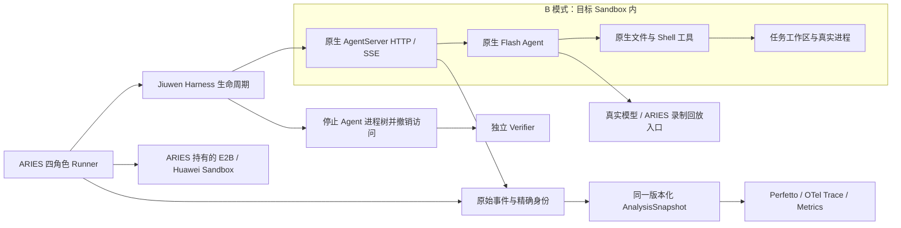

# JiuwenSwarm Flash × ARIES：源码审查与实施方案

初审：2026-10-26；状态更新：2026-10-27。用户已在审查期间明确授权持续实施 openJiuwen 接入和可观测性增强；附件原先“仅讨论”的阶段约束已由这次授权更新。本文区分源码事实、设计选择与实际验收，不能把协议测试当作真实 Agent/Sandbox 成功。

## 基线与审查结论

ARIES 当前 HEAD 为 `e686735fe0196aacfb799c8d528848dcad026d83`，实际基线包含现有工作区增强，不能只按该提交描述能力。当前冻结 release21，共843个源文件，五项 ECS 工程门禁通过；image5 双云 A/B 四组原评分各12/12，A身份和请求计时贯通，E2B A 实际 TP/Jaeger/Prometheus 后端对账通过，见[最新验收与边界](../jiuwen-release21-cloud-validation-20261027.md)。初审时的 release14 及其采集修复证据保留在[验证报告](../observability/VALIDATION_AND_REPRODUCE.md#native-tool-retention-release14)。

直接审阅的公开 JiuwenSwarm `dev-stable` 固定在 `e2c9d519498080e249e34f16a80c8c97f0cd1962`。`uv.lock` 固定 agent-core `3460150aa5f319b0b8f84a4ed10eec0a08b0feb1`、runtime-foundation `503700c0e93ef54cb45a41474ae36f104c1642e7`、deepsearch `05d846214487c603a31022c3d46782675d34d4f9`。agent-core 也已直接阅读；其他两项目前仅核对锁文件，不能宣称审计过全部依赖。Python要求 `>=3.11,<3.14`。

**结论：A/B 均采用原生 Flash + 原生 AgentServer HTTP/SSE；A 复用官方 SysOperation 扩展点注册 `aries` FS/Shell provider，B 使用目标Sandbox内的原生 LOCAL 工具。** A/B 均已有两云真实解题验收，尚未宣称完整观测或生产就绪。保持四角色 Runner、原有 Benchmark/Verifier、真实工具与模型录制回放，不重写原生 Agent loop，无需增加 RuntimeDriver 或复制 OpenClaw Gateway。

## 已确认的源码事实

| 事实 | 源码依据及含义 |
| --- | --- |
| 用户确认的 YAML 是有效入口 | `server/handlers/_shared.py:resolve_agent_request_mode` 在 Flash 开启、普通 Agent 请求且非 code work mode 时返回 Flash adapter；`interface_flash.py:create_instance` 合并 Flash override。采用 `flash.enabled=true`、`flash.skill_selection.enabled=false` 和普通 `mode=agent`。 |
| Flash 仍是原生 Agent loop | `JiuwenSwarmFlashAdapter` 继承 Deep Adapter；关闭 task loop 不等于只调用一次模型。六个基本工具由 `SlimSysOperationRail` 提供，底层 ReAct 仍负责多轮与工具调度。 |
| skill_selection=false 不等于禁用 skill 工具 | 禁用的是可选技能筛选扩展，原生 skill toolkit 仍存在。不能把 benchmark 配置描述为“无 skills”。 |
| 存在不同入口的路由例外 | `_uses_explicit_officeclaw_mode`、mode matrix 和 CLI 校验有各自语义。初版使用普通 Agent 的原生 HTTP 入口，不将 OfficeClaw/CLI 的例外套到已确认的 YAML 主路径。 |
| HTTP/SSE 已由上游实现 | `server/agent_http_routes.py` 的 sessions、chat/completions、interrupt，以及 `agent_http_server.py` 共用原生 handlers。HTTP 默认关闭，health仅证明服务存活；启动时可自动换端口，必须核对实际地址。 |
| 会话 ID 不代表独立冷启动 | `AgentManager.get_agent` 缓存按 channel/mode/project；session.create还可能命中 prewarm。独立进程、配置目录和项目目录才构成初版冷启动边界。 |
| Sandbox 扩展点是 SysOperation provider | agent-core 的 `sandbox_registry.register_provider` 与 FS/Shell provider 是原生扩展点。JiuwenBox/Yuanrong 协议不是 E2B API，不能仅替换 URL。 |
| 不完整配置可能选到 LOCAL | `interface_deep.py:_create_sys_operation` 仅在 enabled、URL、type 都满足时创建 Sandbox operation，否则走 LOCAL。A 必须验证实际 provider；B 的 LOCAL 必须位于目标 Sandbox 内。 |
| Linux自动启动会覆盖enabled=false | 真实入口第二轮已复现：`agent_ws_server.py` 的内部JiuwenBox启动路径在Linux按显式startup_mode=internal启动，enabled门控仅在Windows生效；随后回写enabled=true。B必须同时配置 `sandbox.enabled=false`、`sandbox.startup_mode=external`，避免测到嵌套JiuwenBox。该行为以实现和实测为准，部分上游生命周期文档有旧说明。 |
| 文件工具已有远程分支，但仍需核对宿主路径假设 | FlashRead 在本地 stat 失败时仍通过 provider 读取；FlashEdit 的 SANDBOX 分支用远程 FS 探测存在性，不走仅限 LOCAL 的缓存/CAS 路径。固定上游版本的 FlashGlob 仍本地读取 `.gitignore`，glob查询与 modified_time排序数据来自 provider；image5 显式补丁已把辅助读取改走远端 FS 并通过真实双容器检查。不能笼统说所有文件工具仅支持本地。 |
| 原生取消不证明进程树停止 | interrupt由 SessionManager 取消任务；AgentServer stop有若干记录异常后继续的路径。SSE断连、取消回执、health不通均不能替代 ARIES 的 cgroup 清空与访问撤销。 |

源码入口：[Flash adapter](https://github.com/openJiuwen-ai/jiuwenswarm/blob/e2c9d519498080e249e34f16a80c8c97f0cd1962/jiuwenswarm/server/runtime/agent_adapter/interface_flash.py)、[请求路由](https://github.com/openJiuwen-ai/jiuwenswarm/blob/e2c9d519498080e249e34f16a80c8c97f0cd1962/jiuwenswarm/server/handlers/_shared.py)、[HTTP routes](https://github.com/openJiuwen-ai/jiuwenswarm/blob/e2c9d519498080e249e34f16a80c8c97f0cd1962/jiuwenswarm/server/agent_http_routes.py)、[SysOperation构造](https://github.com/openJiuwen-ai/jiuwenswarm/blob/e2c9d519498080e249e34f16a80c8c97f0cd1962/jiuwenswarm/server/runtime/agent_adapter/sysop_builder.py)、[锁文件](https://github.com/openJiuwen-ai/jiuwenswarm/blob/e2c9d519498080e249e34f16a80c8c97f0cd1962/uv.lock)。

## 当前 ARIES 可复用的能力

`pkg/runner/interfaces.go` 和 `pkg/runner/runner.go` 已分离 Benchmark、AgentHarness、ToolSandbox、ToolBridge。顺序是准备环境、绑定工具访问、启动和运行 Agent、确认 Harness Stop、确认 Bridge revoke、独立 Evaluate、清理。模型 handler 位于四角色之外，每个 attempt 有独立 session。保持这一边界。

现有 E2B/Huawei Sandbox 的 Exec/ExecStream、上传下载、provider endpoint 解析、所有权账本与确认删除继续复用。现有 OpenClaw embedded 的非特权身份、root控制的 admission/cgroup 和 `populated=0` 确认可以抽取共用；其 Gateway协议、OpenClaw设备配对、命令解析不能用于 Jiuwen。

现有 Benchmark、私有评分、候选文件采集、八阶段、controller资源采集、版本化 AnalysisSnapshot、Perfetto/OTLP出口继续复用。`internal/app/wiring/cloud` 与 `pkg/config/cloud.go` 已显式接入 Jiuwen A/B，A 分支自release19接入，当前 release21 加入精确身份与请求级观测；工程验证与真实云验收分开记录，不通过给 Jiuwen伪造 OpenClaw类型接入。

## 三种方案对比

| 方案 | 工具真实路径 | 优点 | 代价与结论 |
| --- | --- | --- | --- |
| 原生 AgentServer HTTP/SSE，B 嵌入式 | Flash原生LOCAL工具 → 目标Sandbox内文件/进程 | 不替换工具实现，文件路径与metadata一致；利用原生初始化、会话、模型和事件 | Agent自身也消耗Sandbox资源，必须单列placement。首选真实基线。 |
| 原生 AgentServer HTTP/SSE，A 外置 | Flash SysOperation → ARIES provider → Bridge → 目标Sandbox | 可单独测外置Harness与Sandbox；保留四角色 | release21 五门禁与两云 A record2 原12/12通过；各8个ToolCall、11次Provider调用精确关联。Glob/后台取消有显式原生补丁和专项证据；[新归档](../jiuwen-release21-cloud-validation-20261027.md)保留请求计时、资源和全局 coverage unknown。 |
| Python直接嵌入 Flash Adapter | ARIES进程辅助程序 → Adapter/原生Session → 工具 | 可以少一个HTTP服务边界 | create_adapter不是完整运行时，需自行接管session/checkpointer/资源与停止；私有初始化依赖多。暂不采用。 |

原候选方案的角色划分与真实工具方向保留；Gateway改为可选，先用已有AgentServer接口。原生JiuwenBox不作为E2B替身，也不让Agent创建ARIES账本外的Sandbox。模型调用用原生客户端，不仿造Flash loop。不为接入删除后台工具、并行工具或将原生ToolResult归一化。

## A 的原生扩展点与当前边界

本轮直接核对上述两个固定提交后，A 的实现为：原生 AgentServer/Flash 位于 ECS Docker，使用官方 `OperationMode.SANDBOX` 与新增 `aries` FS/Shell provider，经 RemoteBridge 调用精确的 Runner-owned 云 Sandbox。Jiuwen 已有通用扩展能力；新增的是适配本次 ARIES Sandbox 的连接层，不是另一套 Agent 或工具实现。B 继续让 Agent 与原生 LOCAL 工具位于同一云 Sandbox。

以下为 release19 历史接入证据；当前 release21 四组结果及修复见[新验收](../jiuwen-release21-cloud-validation-20261027.md)。A 配置、wiring 和生命周期已随release19通过五项ECS工程门禁。`jiuwen-external-native-3`还通过实际Docker原生Agent、独立host worker、两次受控模型交互、真实远端文件和后台进程终止验收；该夹具没有云Sandbox或原题评分。随后两云A record1均完成真实DeepSeek解题、原Verifier12/12、5轮完整Tape及独立回收确认，见[A云验收](../jiuwen-external-cloud-validation-20261027.md)。两份轨迹不同，未作同Tape性能排名；华为Verifier出网仍为假设。证据与限定范围见[release19实施记录](../implementation/jiuwenswarm-flash-progress-20261026.md#jiuwen-release19-a)。

| 直接源码结论 | A 的含义与边界 |
| --- | --- |
| 官方 Registry 的 `sandbox_type` 是字符串键，`register_provider` 接受自定义名称；缺失的 provider/operation 明确报错。固定依赖随包注册的内建 provider 为 `aio`、`jiuwenbox`、`yuanrong`。 | 内建列表不是禁止扩展的枚举。ARIES 注册 `aries` 的 FS/Shell，不替换原生 Agent loop，不把 JiuwenBox/Yuanrong URL 当作 E2B API。[Registry 第45–72行](https://gitcode.com/openJiuwen/agent-core/blob/3460150aa5f319b0b8f84a4ed10eec0a08b0feb1/openjiuwen/core/sys_operation/sandbox/sandbox_registry.py#L45)、[固定内建注册入口第6–8行](https://gitcode.com/openJiuwen/agent-core/blob/3460150aa5f319b0b8f84a4ed10eec0a08b0feb1/openjiuwen/extensions/sys_operation/sandbox/providers/__init__.py#L6)。 |
| `PreDeployLauncherConfig` 接收既有服务地址，launcher 的 `launch` 返回该地址；`sysop_builder` 将它放入 SANDBOX card。 | `pre_deploy` 是原生连接方式，不决定 Agent 在哪台机器，也不授予 provider 云资源所有权。ARIES 的 `placement=external` 才表示 Agent 在任务 Sandbox 外。[配置第72–81行](https://gitcode.com/openJiuwen/agent-core/blob/3460150aa5f319b0b8f84a4ed10eec0a08b0feb1/openjiuwen/core/sys_operation/config.py#L72)、[launcher 第7–12行](https://gitcode.com/openJiuwen/agent-core/blob/3460150aa5f319b0b8f84a4ed10eec0a08b0feb1/openjiuwen/core/sys_operation/sandbox/launchers/pre_deployment_launcher.py#L7)、[SANDBOX card 第797–812行](https://github.com/openJiuwen-ai/jiuwenswarm/blob/e2c9d519498080e249e34f16a80c8c97f0cd1962/jiuwenswarm/server/runtime/agent_adapter/sysop_builder.py#L797)。 |
| `SlimSysOperationRail` 给 read/write/edit/glob/grep/bash 六个工具注入同一个 SysOperation；动手类 rail 保留 Agent 的 SANDBOX operation。 | 六工具的 FS/Shell 主调用走远程 provider。原生默认 `AGENT_FILE_READ_BACKEND=local` 则把人格、上下文和记忆读盘 rail 留在 Agent 本地；这是原生内部状态路径，不是工具回退。不能推导全部记忆操作均本地：晚绑定说明明确记忆搜索/写入工具仍跟 Sandbox。[六工具第48–75行](https://github.com/openJiuwen-ai/jiuwenswarm/blob/e2c9d519498080e249e34f16a80c8c97f0cd1962/jiuwenswarm/agents/harness/flash/rails/slim_sys_operation_rail.py#L48)、[默认后端第2997–3024行](https://github.com/openJiuwen-ai/jiuwenswarm/blob/e2c9d519498080e249e34f16a80c8c97f0cd1962/jiuwenswarm/common/config.py#L2997)、[动手rail保留第8148–8155行](https://github.com/openJiuwen-ai/jiuwenswarm/blob/e2c9d519498080e249e34f16a80c8c97f0cd1962/jiuwenswarm/server/runtime/agent_adapter/interface_deep.py#L8148)、[记忆读盘边界第8174–8194行](https://github.com/openJiuwen-ai/jiuwenswarm/blob/e2c9d519498080e249e34f16a80c8c97f0cd1962/jiuwenswarm/server/runtime/agent_adapter/interface_deep.py#L8174)。 |
| FlashGlob 的 `search_files` 和排序所用 `modified_time` 来自 provider，但顶层 `.gitignore` 由本地 `Path.is_file/read_text` 读取。 | A 若两边同路径的 `.gitignore` 不一致，过滤结果会不同；不能把主查询远程当作全部辅助 I/O 远程。当前 image5 显式补丁把该辅助读取改为远端 FS，原生工具与真实文件保留；9 项真实双容器检查及完整双云 A/B 回归通过。以下链接仍指未经补丁的原始基线。[本地读取第104–118行](https://github.com/openJiuwen-ai/jiuwenswarm/blob/e2c9d519498080e249e34f16a80c8c97f0cd1962/jiuwenswarm/agents/harness/flash/tools/flash_glob_tool.py#L104)、[远程查询与过滤第270–286行](https://github.com/openJiuwen-ai/jiuwenswarm/blob/e2c9d519498080e249e34f16a80c8c97f0cd1962/jiuwenswarm/agents/harness/flash/tools/flash_glob_tool.py#L270)、[排序第319–322行](https://github.com/openJiuwen-ai/jiuwenswarm/blob/e2c9d519498080e249e34f16a80c8c97f0cd1962/jiuwenswarm/agents/harness/flash/tools/flash_glob_tool.py#L319)。 |

还需区分原生 `sandbox.startup_mode=external`：它仅阻止 AgentServer 自动拉起内部 JiuwenBox，不是 ARIES A 的开关（[固定源码第867–882行](https://github.com/openJiuwen-ai/jiuwenswarm/blob/e2c9d519498080e249e34f16a80c8c97f0cd1962/jiuwenswarm/server/agent_ws_server.py#L867)）。B 同时设 `sandbox.enabled=false`，选 LOCAL；A 则设 `enabled=true`、`type=aries` 和本次 Bridge URL，并读回实际 native 配置。两者的任务 Sandbox 均只由 Runner 创建、评价和删除。

release19 曾暴露个人版不自动加载 `AGENT_EXTRA_RAILS`、4/4 ToolCall ID unavailable、Glob 宿主辅助读取和后台 interrupt 跨进程缺口。**当前 image5/release21 已使用显式原生上下文与远端 Glob/session-cancel 补丁闭合这些具体接入问题**：两云 A 各 11 次调用全部精确关联；9 项双容器专项覆盖后台、其他 session 保活及取消失败，最后仍由 ARIES 确认进程组为空与 revoke。原生个人版空 rails 和本地 shell registry 的事实保留，不能把新增补丁归功于原始基线。[当前问题台账](../observability/OPEN_ISSUES_AND_RESOLUTIONS.md#jiuwen-a-native-gaps)列出未完成的 Agent→Bridge 提交计时、guest 细分和全局覆盖。

用户提出“Jiuwen 原生支持任意 Sandbox”的源码核对结论：**已有通用注册接口，可由 Provider 接入其他实现；是否开箱可用取决于相应 Provider 是否已实现。** 原始内建列表没有 E2B/AgentSphere 专用适配。当前 ARIES 的 `pkg/harness/jiuwenswarm/remote/provider.py:configure` 注册 `aries/fs` 与 `aries/shell`，沿用官方 `PreDeployLauncherConfig` 连接本次 Bridge。无需另写 Agent Loop。`pre_deploy.launch` 只返回既有地址，自定义类型的 delete 不负责云资源回收；创建、停止隔离、评分与删除仍归 ARIES Runner，不能把“能接入”视为自动具备所有云生命周期语义。

## 接入与停止契约

每个 attempt 独立 AgentServer 进程、私有HOME/配置、项目和会话。原生项目绑定要求 project_id，不能仅传 project_dir；Harness用原生项目路径建立/核对绑定。运行端口由部署解析，不猜测宿主loopback可达。外部控制接口走现有provider认证路径，原生无鉴权HTTP不直接暴露公网。

原生启动还会重新加载 `get_env_file()` 指向的配置目录 `.env` 并覆盖bootstrap变量；因此模型配置必须写在该私有规范路径，不能只提供另一个 `--dotenv` 文件。真实首轮因此在模型请求前失败，原失败记录保留；这不是Flash YAML入口失效。

客户端按原生 HTTP envelope 解包 `data.result`，检查每帧 request/session身份；私有证据保留工具、最终回答、暂停和终态原帧，模型token/context更新不占工具证据预算。选择数量、实际保留数量和截断分别报告。只有成功终态才算运行结束；EOF、断连、HITL等待、服务端失败不能算成功。一次非幂等提交失败不自动重试，仍保留运行所有权用于停止。原生SSE的sequence未必是独立递增producer计数，不能据此宣称无掉事件。

本实现的Stop关闭本attempt的新调用准入并取消控制端请求，继而终止受控cgroup，确认无进程并join在途调用，收集所需产物后才允许Verifier。App在Harness返回时关闭模型新请求准入。原生interrupt不是当前停止路径的必要步骤，也不是隔离证明。超时保留所有权与失败状态；不能用HTTP成功回执或Sandbox最终删除替代评分前隔离。借用Sandbox不能误删；主Sandbox最终由Runner清理。

原生完整行为保持，但初版无人值守case遇到需要人工回复会明确失败并留存事件，不自动批准权限或编造回答。独立Verifier始终负责题目正确性，Agent成功终态与reward分开。

## 模型与回放

先以真实DeepSeek完成一条Flash多轮真实工具任务，重新录制Flash自己的Tape，再在相同配置/镜像执行Strict Replay；不复用OpenClaw对话Tape。原生模型BaseURL/API key映射到现有每attempt模型入口，原始文本、工具调用与返回内容不改写。

现有 `internal/modelreplay/server.go` 同一session只允许一个在途模型请求；Tape是单条对话历史。单轮多个ToolCall已受支持，但原生subagent并行的多条模型历史不能混成一条或静默串行化。先测真实Flash case是否触发；需要时按明确agent/session父子身份扩展录制，不预造多Agent框架。触发未支持的模式时保留UNSUPPORTED，不能当Strict成功。

原生工具可能输出duration、时间戳等动态信息，严格回放资格要真实验证。已有Workload Replay可作为单独实验模式，但不降低Strict匹配，不把Workload成功重命名为Strict。

## 可观测性同步实施

统一沿用 run/attempt/native session/request/tool_call/invocation/execution身份。新client记录请求发送、响应头、首SSE、终态、消费结束的本地单调时间；这是控制端观察边界，不冒充guest执行边界。原生工具开始/结束与进程实际退出、stdout/stderr drain分别采集。

原生OTel的W3C传播和request/session上下文可复用，但必须核验tool call ID与实际执行。原生Trace并不自动等于ARIES可信快照；导入先校验身份、clock、丢失与覆盖分母，再统一生成Perfetto、OTLP和Metrics。没有可靠clock anchor的区间保持独立域，不做跨机相减；没有数据保持未知。

资源至少区分controller、Agent cgroup、任务进程和Sandbox整体。CPU累计、RSS采样峰值、IO累计及网络归属单独说明；不能将共享Sandbox网络字节默认归给单工具。展示Attempt→阶段→Runtime中的模型/工具，重叠区间不能直接相加或从E2E扣除得到“纯loop”。

新原生采集误计数修复只处理工具记录额度，20k非工具事件定向验证与真实普通负载分别归档。完整性complete不等于coverage complete；P0/P1的已有遗留逐项保留在[问题台账](../observability/OPEN_ISSUES_AND_RESOLUTIONS.md)，不重复回到用户已要求暂缓的文件IO专项。

## 分阶段交付与退出条件

| 阶段 | 修改范围 / 目的 | 验收与风险 | 回退边界 |
| --- | --- | --- | --- |
| 1 原生入口 | `pkg/harness/jiuwenswarm`原生协议client、上游pin、ECS依赖准备 | 原生envelope/流式终态/取消/错误/错session测试；实际Flash adapter与有效配置回执。仅fixture通过不算Agent成功。 | 新模块尚不替换已有Harness。 |
| 2 B生命周期 | native启动配置、共享containment、cloud wiring/config、专用镜像 | 真实Sandbox文件写入/exec，多轮模型；取消、Stop超时、残留子进程与Verifier门；provider确认回收。 | 新agent type显式选择，旧OpenClaw/Hermes保持。 |
| 3 观测与模型 | 原生事件导入、身份映射、资源归属、现有录制/回放管线 | 真录制→Strict→原评分，原始工具分母对账；两种Trace共用snapshot；Jaeger查询、Metrics对账。 | 单独标记observer失败，不改题目得分。 |
| 4 A与发布 | SysOperation FS/Shell provider，桥接身份与真实进程；回归和运行文档 | 原生read/write/edit/glob/grep/bash在目标Sandbox；并行/后台/取消；E2B与Huawei同case、同CPU/Mem，磁盘差异说明；五项ECS发布检查。 | A/B各自能力矩阵，不伪装为全部通过。 |

Cold基线是新进程/新配置目录/新session；需记录原生prewarm命中与实际adapter缓存。Warm以后单独实验，不混入冷启动统计。正式样本冻结上游提交、uv锁、镜像digest、有效配置、case、模型或Tape，以及观测级别。

目前无需追加用户决策：已批准实施、YAML入口已确认、E2B/Huawei及真实模型/回放范围已明确。若真实Flash case需要多条并发模型历史，或provider限制导致原生工具语义必须改变，再提交具体证据和契约选项；不能自行弱化。依赖安装、真实启动、真实跨云与故障验收的实际状态由后续实施记录报告，本文不将设计当作结果。
