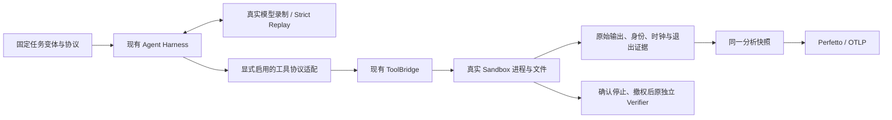

# 可复现 Agent 工作负载变体：设计与实施边界

日期：2026-10-26。状态：**已批准并实施；大文本v2同Tape跨云验收通过，SQLite v3录制通过、Strict自回放失败；全量与P0未完成。** 六个选定主用例当前跨云3/6：fix-git、async两个原始任务，加大文本v2独立变体；原始任务本身仍2/6，变体单独命名和统计，不覆盖原生失败。大文本v2的两次E2B、一次华为Strict回放均原5/5，各23轮、20exec及2job/2wait通过并确认删除，见[三次同Tape对照](../repro-variants-performance-20261026.md#text-v2-huawei-replay-1)。SQLite v2安装mtime失败保留；[v3新录制](../repro-variants-performance-20261026.md#sqlite-v3-e2b-record-1)原3/3、41轮完整Tape、38exec+2wait通过并确认删除，同Tape [Strict自回放已FAIL](../repro-variants-performance-20261026.md#sqlite-v3-e2b-replay-1)：turn24/request25因make install日志被tail读回的3处mtime偏离；22exact exec+2wait已执行，原0/3，清理确认，不计跨云成功。下文历史状态保留其当时范围。

采用的成熟工程模式是“后台句柄、状态查询、最终结果分离”，参照 [Google AIP-151](https://google.aip.dev/151)，只在现有native工具中复用promise，不引入新任务服务，也不声明实现了Google Operations协议。[MCP 2025-11-25 Tasks](https://modelcontextprotocol.io/specification/2025-11-25/basic/utilities/tasks) 仍标记为experimental，不能当作已成熟的通用标准；跨运行稳定逻辑句柄是本Benchmark的显式契约，并非这些标准或ARIES原生保证。环境冻结参照 [Reproducible Builds的环境边界](https://reproducible-builds.org/docs/perimeter/)，不把它扩张为冻结真实时钟、PID或任意新文件日期。Temporal复用已完成Activity结果的历史恢复不适用于本实验：这里每次必须真实执行Sandbox工具。

## 1. 先区分两个测量问题

原case本身有效。这次失败是“完整历史逐字一致”的回放契约与真实环境动态输出之间的冲突，不应笼统归因于case设计错误；此前模型封口与验收字段错误则属于已定位的系统缺陷。

**原生任务实验**回答“这个 Agent 在这套运行环境中能否完成原题，耗时多少”。保留原生工具、后台、poll、PTY、模型真实响应；每次模型决策可以不同，不能将不同工作量的时长直接当作云性能差异。

**可复现变体实验**回答“同一份真实 Agent 决策和实际工作量，在不同 Sandbox 中执行要多久”。必须先由真实模型在声明的变体协议下解题并通过原评分，再用同一份新 Tape 严格回放。旧 Tape 不迁移、不补写，不将参考解转换为模型轨迹。变体不是原生协议等价证明，也不称为未修改的官方基准成绩。

两组结果分开统计，分别保留失败分母。变体不能替代原生功能验收；原生路径仍须持续测试。相同的变体 ID、协议、任务材料、Tape、CPU/内存规格和 placement 构成性能对照组，镜像内容与必要适配显式冻结。按用户确认的资源口径，磁盘等平台差异作为结果说明，不因差异本身阻断比较或判样本失格；真实工作量、Strict和原评分仍须满足。

**录制复用规则：同一工作负载版本保留一份选定的合格真实 Tape，后续同环境复核、多云对照和性能重复实验均复用它。** 合格要求原评分通过、Tape完整，并通过下文规定的新Sandbox严格回放；录制成功不自动证明可复现。仅修观测或传输实现且模型可见契约不变时，优先使用原Tape回归；任务说明或模型可见工具协议改变则建立新版本并重新录制。旧录制失败、Tape不完整或包含已修复的基础设施错误时，保留原因，修复后重新实录。偏离必须保留并定位，不靠更换Tape筛选成功结果。重复回放仍真实执行工具，不调用上游LLM，也不减少原定复现次数。

## 2. 已确认的差异，以及尚未实测到的风险

| 类型 | 真实证据 | 为什么单独修初始环境不够 |
| --- | --- | --- |
| 初始元数据 | 大文本录2→放2第一工具的根目录日期为18:34→18:48；DB早期回放同类失败 | 可以在准备阶段声明并设置相关目录mtime，但必须实际读回，不能从输出修改文本 |
| 运行中新建文件元数据 | SQLite录2→放2第三工具展示新目录，日期18:37→18:49，Strict确实拒绝下一请求 | 文件由真实工具运行时创建；统一初始目录mtime无法决定其新时间 |
| 后台标识与状态描述 | 大文本录2含随机会话名和PID；SQLite录2含两组会话名/PID及idle秒数 | 这些值属于真实运行实例。当前回放在更早步骤已失败，不能声称后面每一项也已实测偏离 |
| 观察时刻与输出前缀 | 原生自动yield、poll/log消费运行中的状态和已有输出 | 快慢不同可能改变running/exited、读到的字节前缀和调用数；稳定句柄仍不能保证完整历史相同 |

原件对账：`/opt/aries-artifacts/tb-six-replay-review-3/evidence.json`，43项检查通过，SHA `9bd8bebfefdfa6ff8ea8540983aebe8d01c141e90e5d89930bfa81f80420501f`。这是已有真实证据复核，0次新增Agent运行。完整结果见[性能归档](../tb-six-performance-20261026.md)。

## 3. 建议的最小方案

### 3.1 先声明工作负载，再录制

为两个任务各新增一个带版本的变体身份，保留上游题目、初始错误/数据、私有测试、原时间预算和资源声明。新增说明只约束**交互和观测方式**，不提供修复算法、答案、测试内容或成功命令序列。记录题目差异、工具协议版本、镜像摘要和说明文本SHA。

对于不需要文件日期来解题的检查，引导 Agent 读取真正需要的名称、类型、权限、大小、内容或哈希，避免无目的输出 `ls -la` 的日期。Agent 仍自行选择并执行命令；系统不改写它的命令或输出。若它依然读取动态日期或其他不稳定字段，该次轨迹保留并评估，不事后挑删字段。任务确实依赖时间语义时保留原生测试，不宣称该变体适用。

SQLite v2 的实际回放表明，`make install` 自身也会打印新文件时间，单纯指导目录检查不够。独立 `terminal-result-v3` 只补充公开日志说明：不需要在对话展示的构建、安装等冗长输出可完整保存在工作区日志，必须保留底层命令真实退出状态；失败须明确报告并用真实工具检查诊断。它不改写模型可见 ToolResult、不提供解题步骤，不增加日志自动归档能力，也不保证 Agent 一定遵守。原题七文件、私测、预算、协议、镜像及 v1/v2 原件保持；v3材料静态核验及新E2B真实录制已通过：原3/3、41轮完整Tape、38exec+2wait；同Tape Strict自回放已失败：日志虽被保存，随后tail回读仍带入安装产物mtime。公开指引不能保证消除动态输出；原3/3录制和0/3回放分别保留，华为对照未运行。附录 SHA `7fae98659041edf2600c81f7e78d3a2036cae7ff3b536d4f59f9d3102789cccc`，证据见[复现档案](../observability/VALIDATION_AND_REPRODUCE.md#replay-variants-release8-results)。新说明需要新录制，不能修补旧 Tape。

固定 Git 日期或初始目录mtime只作为显式、可审计的任务准备参数；不冻结系统时钟，不伪造运行中stat结果，不扫描新文件强改mtime。性能计时始终使用真实单调时钟。

### 3.2 后台工具：稳定的控制句柄，真实的进程

建议为变体增加一个明确版本的后台控制协议，而不是修改原生默认协议：后台启动返回会话内稳定的**逻辑句柄**，它由已确认的调用身份确定，并绑定本次实际进程。句柄不是PID；真实PID、随机原生会话名、开始/结束时刻、idle信息保存在运行证据中。同Tape对应逻辑调用在不同Attempt中返回相同逻辑句柄；内部映射按Attempt隔离，隔离键不进入模型可见句柄。重试和同轮多工具不得覆盖彼此。

模型在此新协议下获得真实的启动成功/失败与可用于后续控制的句柄，不获得用于描述实例的随机PID/idle文字。启动拒绝、命令错误、退出码、超时、取消和截断必须明确表达，不能统一成成功。命令自身输出的PID、时间或进度仍原样返回；不能把协议适配扩展成任意stdout过滤器。

这是**已获批准、改变模型可见ToolResult的独立协议**，尚需候选实测。录制和回放都使用它；Strict仍逐字核对新协议下的完整历史。保留原生事件→逻辑句柄→Bridge/SDK/guest身份关系，不用命令哈希或时间近邻关联。

### 3.3 按真实终态消费结果，避免依赖poll恰好赶上的进度

对编译、宏处理等会终止的后台作业，建议变体支持显式“等待此句柄真实终态并取得最终结果”。调用可以阻塞，但必须受原任务预算和取消约束。实现优先复用原生等待能力；若原生只有返回进度的poll，新增一个小的变体专用等待入口，不能让Agent隐藏地接收录制进度或假装进程已退出。

后台启动与最终等待分开，期间仍可执行其他工具，保留真实并行。启动接口的确认是“启动已确认”，不依据返回瞬间是否已退出改变文字；实际早退及退出码仍在证据和后续真实终态结果中体现。等待成功只能依据已证明的终态和输出收尾；取消、超时、管道未排空均不能伪装成完整输出。沿用原停止/撤权门，不以逻辑句柄消失代替进程停止证明。

原生poll/log/kill/PTY继续存在。该变体的可比较轨迹以显式启动→必要其他工作→终态读取为约定；若 Agent 使用实时poll/log/PTY而产生动态结果，保留原件并如实判定回放资格，不能禁用或伪造这些工具。交互式服务、必须按实时进度做决策的任务不纳入此最小变体的确定性承诺。

**最终输出也可能不确定。** 实时编译日志、并行输出、路径、双流顺序与截断仍可能偏离；本方案不承诺解决任意程序的确定性。不重新开启通用I/O框架，不顺手重写现有输出协议。出现真实差异时先定位，只有独立审阅通过的契约变更才进入新版本。

## 4. 测量含义与架构边界

仍然只有四角色Runner。变化限于候选Harness工具协议、变体说明和对应身份/证据接线；MockLLM matcher、评分算法、调度器不改。根据实际源码核验能否复用原生wait后确定最小实现，不预建通用RuntimeDriver、调度器或重试框架。

模型等待、后台启动、真实进程执行、显式等待、输出收尾、停止、Verifier分别保留各自边界。等待耗时包含作业尚未完成的时间，不能再次与进程时长相加；句柄转换成本属于Harness/工具路径。不同机器的时钟不直接相减。

变体会改变模型获取进度的方式，可能改变Agent循环次数和重叠关系。因此新Tape与旧Tape只作功能与行为说明，**不能直接比较两者Runtime来证明性能提升**。云间比较使用同一新Tape；原生模式性能另列。录制SSE时序与模拟时序继续明确区分。

## 5. 获批后的验收顺序

| 步骤 | 必须通过 | 失败如何处理 |
| --- | --- | --- |
| ECS定向协议验证 | 原生模式回归；句柄会话隔离、并行启动、重试、早退、非零退出、取消、超时、截断；禁止伪造终态 | 修复系统并重测，保留每个失败；不能只测试新协议快乐路径 |
| 真实录制 | 两个原题各由真实模型完成，原私有评分全过，Tape完整；声明所有变体差异 | Agent失败与系统失败分开，继续定位；不注入参考解或降低评分 |
| 同环境新Sandbox回放 | 每个冻结Tape至少两次独立回放；全历史、ToolCall决策/结果、因果身份、原评分、停止与删除确认一致 | 逐项记录首个差异和后续未执行范围；不筛掉慢机器或失败样本 |
| E2B/华为云同Tape | 在相同变体及placement下实际执行，原Verifier全过；未知配额/时钟明确保留 | 跨云环境能力差异先修复或明确阻断；不借另一Tape通过冒充可比 |
| 观测对账 | 同一Snapshot导出双Trace，准确展现进程与等待重叠、终态与缺测；新增适配成本可见 | Trace通过不提升业务失败为成功，不拼假时间线 |

事先登记镜像、Tape、资源、时限、重复次数和样本纳入规则。上述是功能与复现资格验收，不足以发布p99、容量或云排名。全部实现、编译、真实测试在ECS开展，Sandbox用完确认删除。

## 6. 已批准的决策与验收边界

已批准“**原生完整模式保留；两项独立变体采用有限元数据读取建议、稳定逻辑句柄、显式真实终态读取；重新真实录制与严格回放**”。实现开关为 `harness.replay_tool_protocol=terminal-result-v1`，首版限定external、`aries-ssh-identity-v1` 和 `stdout-stderr-v1`，省略即保留原生默认。大文本v2已按同Tape两次E2B / 一次华为完成限定验收；其他轨迹的R12缺口仍保留，不宣布原生任意后台轨迹可严格复现或P0全部完成。

先核验并实现最小原生等待接入，再做上述真实验收。保留原始PID、时间和实时poll的原生路径不承诺跨实例逐字相同；原生失败事实继续保留。

## 7. 源码核对与最小闭环落点（2026-10-26，只读分析）

本节核对了现行 `experiments/r01` patcher、固定 OpenClaw 2026.7.1 编译源码归档及上述43项真实对账证据；没有执行新实验。原生源码来自 `r07-native-boundaries-source-1/evidence.json` 所列镜像，五个文件逐一SHA相符；既有patcher追加身份、拒绝观测和前台结果呈现，没有后台wait或稳定句柄。以下限定已批准候选的实现范围。

| 问题 | 已核对的真实源码落点 | 最小处置与闭环条件 |
| --- | --- | --- |
| 初始目录日期 | `TaskTemplateBinding.InitialDirectoryMtimeUnixNS` → `ExternalBridge.Start` → `prepareDirectoryMtimes`；在Bridge准备后设置，保留atime并逐项读回 | 复用现成binding字段，为新录制预先声明有关目录，不新增时间服务。DB既有回放通过仍保留历史样本选择说明；大文本不能只过首条就宣布全轨迹修好 |
| 运行中新文件日期 | SQLite录2/放2在 `call_00_VsW6JJrWydHFmv4Y4vAe5153` 结果处确认日期变化；初始mtime准备不覆盖后续创建 | 已批准的变体说明只建议读取必要的名称、类型、大小、内容，Agent仍自主选命令。若仍输出动态时间，保留Strict失败；不改写stdout、追改mtime或修补旧Tape。必须使用独立新录制 |
| 随机会话与PID | `runExecProcess` 无外部稳定session参数，直接调用 `createSessionSlug()`；后者用随机词和随机回退。`createToolIdentity` 的 `native_invocation_id` 也是UUID | 变体逻辑句柄基于原ToolCall身份及该调用的显式重试序号；不能用随机invocation UUID或全局启动顺序。局部映射仍绑定真实native session/PID，按Attempt隔离；原生标识保留证据 |
| 没有公开终态wait | `createExecTool` 的yield上限120秒；`createProcessTool` 的 `resolvePollWaitMs` 上限30秒，没有 `wait` action。`runExecProcess` 已返回 `promise`，内部等 `managedRun.wait()` 后还执行 `finalizeSandboxExec` | 在现有exec/process边界为变体保留这一个promise，增加显式终态读取，受原预算/取消约束。不能循环poll并偷偷丢掉中间结果，也不能将 `session.exited` 当作finalize完成 |
| poll/log结果会随读取时刻变化 | `poll` 在active分支消费 `drainSession`；finished分支直接返回最多2000字符tail；`log` 默认最后200行。即使已退出，两条poll路径也不一定返回相同正文 | 变体终态读取使用同一最终快照，明确输出上限、截断、退出码；原生poll/log/PTY保持可用但不承诺其进度轨迹确定。已批准将 `stdout-stderr-v1` 扩用于此变体后台最终结果，候选仍待ECS验证 |
| 异步完成消息也进入历史 | `maybeNotifyOnExit` 默认启用，文本含 `session.id.slice(0,8)`，通过 `enqueueSystemEvent` 和 `requestHeartbeat` 发送；时间也取决于真实完成时刻 | 变体复用已有 `notifyOnExit:false`，由终态读取呈现结果；原生默认不变。此项与句柄/wait一起获批，候选不能只改ToolResult后漏掉此入口 |

内部wait可复用，但不是无限保证：`supervisor` 的普通child路径等真实close，强制kill还存在定时fallback。新入口必须保留取消/失败及终态未知，正常完成结合现有A侧guest退出、pipe EOF回执核验；不能把fallback或缺失回执包装成“已完整读取”。后台启动应确认“已接纳启动”，真实早退在终态读取返回，避免把已退出进程硬标为仍运行。PID若由程序自己打印，仍是原始输出，不在协议字段转换范围内。

**本次已批准的模型可见变化限定为：**独立变体的说明文字；稳定逻辑句柄及真实终态读取；变体后台最终输出沿用已声明的固定双流呈现；关闭这些作业的异步完成提示并由wait返回。原生工具、原题/私测、Strict matcher、真实进程与停止门保持原样。新增入口只放现有native工具适配和配置处，不建RuntimeDriver或新supervisor。已从固定镜像补取 `bash-tools.schemas-uMBuZvTL.js` 及publication3四个模块，来源manifest SHA `446dcc70284b44762378bced204c96acbf35e21052ea3aae6f6c6fa332ce961e`；原 `process.action` 为字符串，新增wait无需另建工具注册框架。源码导出仅create/cp/rm，未执行应用。

| 真实case | 可立即推进而不改ToolResult | 已批准变体必须完成 |
| --- | --- | --- |
| DB | 现有同Tape成功证据保留；后续新录制统一预先声明初始元数据，避免再按成功Tape倒填实验条件 | 若新轨迹暴露后续动态字段，同样归因，不拿旧成功覆盖 |
| 大文本 | 现成初始mtime配置可解决已确认的第一处差异；录2还含后续新文件日期与 `lucky-otter/pid1499`，只修首条不足以闭环 | 同一新变体完整录制→至少两次新Sandbox Strict→华为同Tape；核验宏原评分5/5及全部调用，不能只验第一个ls |
| SQLite | 初始元数据方案不能解释运行中新建目录；原3/3评分与旧失败保留 | 同一协议同时验证新文件日期读取、两次后台启动、poll/idle替代及完整编译输出；新录制与Strict、原评分3/3全部通过才关闭该变体缺口 |

当前对账已证明的是首个日期偏离；后台句柄、idle和后续文件时间是录制中观察到的风险，尚未逐项获得新的跨实例失败证据。新方案不保证任意编译日志或交互式PTY逐字相同，也不把变体通过改写为原生路径完全确定。

## 8. 独立候选与验证状态

候选落在 `experiments/r01/replay_tool_protocol.mjs` 与哈希固定的 `replay_tool_protocol_patch.py`：只对publication3镜像增加显式开关，复用真实 `run.promise` 和现有最终输出renderer。后台接纳文字使用ToolCallID及该调用序号生成逻辑句柄；实际PID、原生随机session和wait调用身份仅写私有证据。重复wait读取同一最终结果；超时/取消只结束等待，不伪装已杀进程或已完整收尾。`process` 的旧控制操作仍经原生实现执行。

ECS恢复后，第二轮隔离验证已通过：6项helper测试、既有26项原生默认矩阵及4路B并行检查、16次真实Bridge派发的变体工具探针。覆盖早退、非零退出、并发与重复调用身份、等待取消/超时、finalize失败、截断、真实pipe收尾及工具环境移除控制开关；原矩阵既有finalize/yield限制仍保留。16次exec均按原生身份、SSH请求和Bridge执行ID精确对账。证据 `/opt/aries-artifacts/repro-workload-2/evidence.json`，SHA `aa51406b7dce9efd214b9d0a7d5f55299e84540ba47aa1bada3714c9e0412839`。候选镜像ID为 `sha256:39c688b7c67c279e803bb01cdfa651d7a146f12436a8f47b11f79195167b12ed`，后续固定发布复用该镜像。

首轮失败原件保留在 `repro-workload-1`：启动接纳后立即kill可能发生在SSH/Bridge派发前，16次接纳只有15次真实派发；此路径没有完整guest身份，不能宣称完整覆盖。第二轮取消探针先取得guest的真实ready输出再kill，仅验证已派发取消；另修正了对账脚本未容纳Bridge新增 `ssh_request_id` 的字段比较，原五项身份仍逐字段相等。两轮镜像ID相同，未修改业务实现来凑通过。

每次wait具有自身ToolCallID、独立invocation ID和原生进程单调时钟，仍引用原exec身份。上述早期候选探针没有Sandbox/模型调用，当时不能替代真实Agent双Trace闭环。随后大文本v2完成两次E2B与一次华为同Tape回放、原评分及双Trace对账；SQLite v3完成真实录制、原评分及双Trace对账，随后自回放因日志mtime偏离失败；已执行22exec和2wait的限定对账不改变原0/3，最新证据见本文开头。私有日志收取和已有调用配对不证明全局覆盖；原生区间缺可信UTC锚点、producer分母缺失等仍明确保留。
