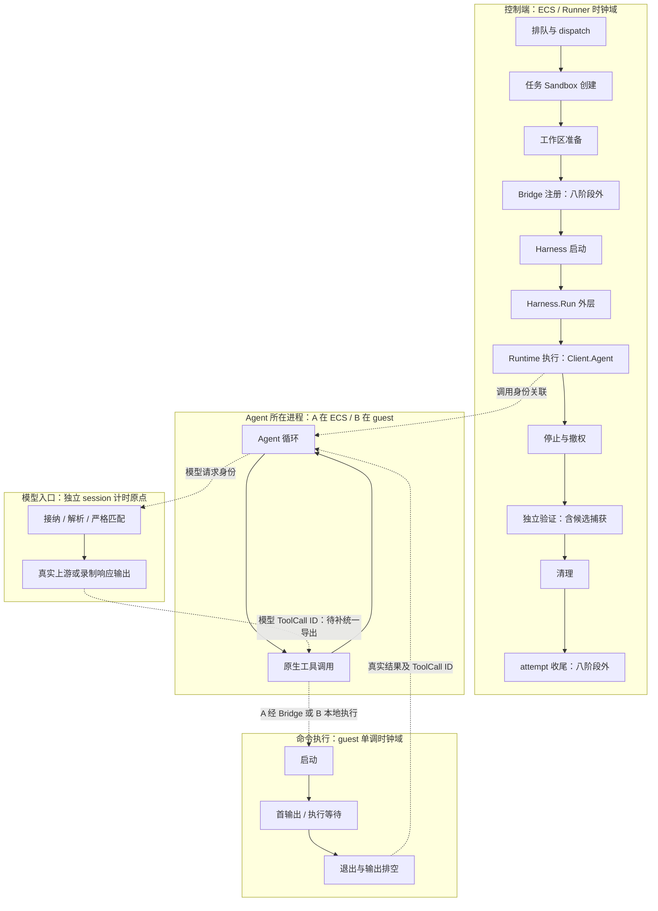

> 历史草案（2026-10-24）。已由[双轨修订设计](runtime-observability.md)取代；以下保留修订前内容，不作为当前能力状态或实施授权。

# Agent Runtime 细分观测设计

**状态：待用户审阅，未实施。** 本设计阶段不新增细分埋点、不启动细分观测实验，不修改 Agent、工具或模型语义。Huawei A 沿用既有观测的独立测试另行验收，不代表本文新增能力已经实施。

本页是**本轮细分观测的评审入口**。沿用[早期 Sandbox 设计](sandbox-performance.md)中的固定真实工作负载、同进程单调计时、保留失败、独立验证和确认清理原则，不把其历史缺口或规划当作当前实现。阅读入口：[性能报告](../performance-archive.md) · [八阶段说明](../performance-stages.md) · [现有结果与 Trace](../run-results.md)。

## 1. 要回答什么问题

用户看到“Runtime 执行用了 20 秒”，应能继续展开：整项任务的阶段与结果 → 模型和工具的因果 → 命令的等待、执行、CPU 与输出。每层说明失败、缺测及是否可比。

先把边界测清，再解释原因；差值不能自动命名为“网络开销”“平台排队”或“Agent Loop 开销”。本期保留四角色 Runner 和 Chrome Trace / Perfetto 离线导出，不引入 Collector、在线 UI 或 RuntimeDriver。Activate、Pause、Checkpoint 等专项 Operation Benchmark 不在范围内。

### 三个容易混淆的词

| 名称 | 小白理解 | 不能替代什么 |
| --- | --- | --- |
| 墙钟耗时（wall time） | 从开始等到结束，手表走了多久 | 不是 CPU 一直工作了多久 |
| CPU 时间 | 进程实际获得 CPU 执行的累计时间；多核可超过墙钟时间 | 不能用墙钟时间减去模型等待来得到 |
| 观察区间 | 采集端看到“开始”和“结果”的间隔 | 不一定是远端进程的真实生命周期 |

例如一个命令等待磁盘或睡眠一秒，墙钟会增加，CPU 可能只用了很少时间。输出管道迟迟没有关闭，也会延长控制端等待，但不说明直接子进程仍在计算。

## 2. 当前确实有什么

以下根据本仓源码核对；“已有”只说明代码提供该能力，某次实验是否采齐仍要检查原始产物和完整性索引。历史实验不能靠新设计补出未记录的数据。

| 能力 | 当前事实与边界 | 本次拟补 |
| --- | --- | --- |
| 八阶段 duration | `TaskTiming` 和 attempt 排队字段已有；部分开始时刻没有独立导出 | 保留原字段含义，增加真正的子操作 |
| 调度事件 | 计划、接纳、开始、终态及调度 anchor 已记录；容量满时 admission 阻塞 | 分清本地排队与 dispatch，不改发压策略 |
| Runner Trace | `performance.Begin/End` 有 operation / parent ID、单进程时钟域及完整性计数 | 在同一 recorder 下记录新子操作 |
| Gateway Agent 协议 | `Agent` 已区分发送、accepted 和 terminal，校验请求 ID / runId | 导出这些实际边界；当前没有逐项时间字段 |
| 模型事件 | 有请求、拒绝、重试、首 SSE / 内容 / reasoning / tool delta、frame 收发时序 | 补接纳、解析、匹配和上游调用边界，以及稳定请求身份 |
| 模型 CPU / 内存 | 部分模型事件附进程累计 CPU、堆、RSS 等 | 明确共享进程范围；不能冒充单请求资源消耗 |
| B 原生工具事件 | 按 session、native runId、ToolCall ID 收集 start/result；`command_output.end` 可选带 `durationMs`，不覆盖所有工具生命周期 | 补控制端收包/消费边界，导出精确模型—工具关联 |
| A 原生工具证据 | 当前 Harness 收集原生产物；不能假定拥有 B 的实时 collector 同款事件流 | 优先读取原生 ID；不能获得同口径时明确缺测 |
| Bridge audit | 有命令 hash、退出码、字节、执行 duration；时间戳和序号在结束后写入 | 补执行身份与真实起止，避免把入队写日志时间当开始 |
| Sandbox / SDK 操作 | `e2b-operations.jsonl` 有成对调用、客户端 duration、SDK 调用及部分 guest duration | 接入离线展示；当前通用 Trace 未合入这些操作 |
| guest 执行自计时 | Adapter 路径有 `guest_duration_ns`；A 工具含 groupScript 包装与原命令/排空，B 原生工具不经同路径 | 区分启动、首输出、退出、排空；CPU 需另证实可采 |
| 资源采样 | monitor 默认秒级采样，云指标保留厂商口径 | 与时段关联；不把采样峰值当真实瞬时峰值 |
| 离线 Trace | 读取 Runner、模型、B 原生工具，保留 source SHA 和缺测诊断 | 增加子阶段和经过证明的关联；旧数据继续 UNALIGNED |

源码：[字段](../../pkg/core/attempt.go)、[调度](../../internal/app/execution.go)、[Recorder](../../pkg/performance/recorder.go)、[Gateway](../../pkg/harness/openclaw/gateway/agent.go)、[模型](../../internal/modelreplay/server.go)、[B 工具](../../pkg/harness/openclaw/native_tools.go)、[Bridge](../../pkg/bridge/ssh/execute.go)、[SDK 观测](../../pkg/sandbox/e2b/observation.go)、[guest](../../adapters/e2b/guest_exec.py)、[资源](../../pkg/monitor/recorder.go)、[Trace](../../pkg/performance/trace.go)。

## 3. 整体 Trace 如何组织

**Span（跨度）**是同一时钟域内有真实开始、结束的操作。**关联箭头**只说明“这个结果导致下一步”，不意味着已测到两台机器之间的传输耗时。

图中虚线是拟建立或核实的因果关系，不能全部理解成当前 Trace 已有的边。同进程真实嵌套用 parent ID；跨进程用明确关联记录，不凭时间接近伪造父子跨度。报告显示测量进程、时钟域和关联可信度。共享准备在调度前、共享清理在全部 attempt 返回后；失败可以提前转入清理。

## 4. 八阶段及细分跨度映射

规范阶段名保持不变。当前字段来自 `attempts[].queue_duration` 和 `tasks[].timing.*`，原始 JSON duration 数值单位为**纳秒**，字段名本身没有 `_ns`；分析产物里的 `_ns` 是派生键。下表的新子操作名称均是**设计名称，不是已实现事件或配置项**。

| 阶段 | 当前边界 / 字段 | 拟展示的子操作及限制 |
| --- | --- | --- |
| 排队 | `scheduled_at → admitted_at`；`queue_duration` | 调度器等待容量；接纳后的 `dispatch_delay` 单独显示，不塞回排队，也不称云平台队列 |
| 任务 Sandbox 创建 | Start 调用前后；`sandbox_create_duration` | `sandbox.create.request`、已有就绪等待或查询；只有实现真实存在时才记录。模板 build 不在任务创建内 |
| 工作区准备 | PrepareSandbox 调用；`sandbox_prepare_duration` | `workspace.init`、`file.upload`、权限设置与完成检查；逐项包装现有调用，不增加隐形探针 |
| Harness 启动 | Harness.Start 调用；`harness_start_duration` | 配置、进程启动、ready、认证；A/B Connect 所属阶段不同，不为报表搬动执行逻辑 |
| Runtime 执行 | `Client.Agent` 调用；`runtime_execution_duration` | 请求发送、accepted 观察、terminal 观察；内部模型/工具用真实 ID 关联，不把累计时间当互斥子段 |
| 停止与撤权 | 顺序 Harness.Stop、Bridge.Stop；`stop_revoke_duration` | 已有 `harness.stop`、`bridge.revoke`；拟细分停止请求、进程组退出确认和本地调用收尾 |
| 独立验证 | Evaluate 调用；`verifier_duration` | `candidate.capture`、评分 Sandbox 创建/准备、`verifier.exec`、`verifier.report`；candidate 捕获仍在父跨度内 |
| 清理 | Runner finish；`cleanup_duration` | 评分 Sandbox 回收、必要的 Stop/revoke 重试、任务 Sandbox 删除请求与消失确认 |

额外保留 `bridge.register`、attempt 初始化/收尾、run 级共享准备/清理和观测落盘。八阶段相加不等于整次 run；不将这些剩余工作强塞给相邻阶段。

现有 `agent.run` Trace 覆盖整个 `Harness.Run`，比 Runtime 窗口更宽；新增 Runtime 子跨度时保留旧含义，结果收集、事件 drain 在外层展示。任务清理也不等于全部 Close：attempt 还关闭模型会话、观测和传输，run 处理共享资源；幂等 Stop 再次调用不等于重复云删除。

源码边界：[Runner](../../pkg/runner/runner.go)、[codingcase 验证](../../pkg/benchmark/codingcase/codingcase.go)、[cloud 生命周期](../../internal/app/cloud.go)、[attempt Close](../../internal/app/wiring/cloud/cloud.go)。

## 5. A/B 链路分别怎样计时

### A：Agent 在 ECS，工具远程执行

链路为：Agent 原生工具 → ECS 侧转发客户端 → SSH/Bridge → Adapter / SDK → guest 命令 → 输出沿原路返回。

- Harness.Start 结束不代表后续 Gateway Connect 已计完；当前 A 在 Harness.Run 开头 Connect，再进入 Client.Agent。
- A 的原生工具墙钟可能覆盖 SSH 建连、命令准备、远程执行与收流，因此它不等于 guest 执行时间。
- Bridge 当前 `duration_ms` 从已解析命令进入 execute 开始，到执行返回及记录前处理结束；不含此前完整 SSH 建连/握手。
- Bridge audit 的 `timestamp` 是记录入队时刻，不能用它拼出命令开始或网络到达时刻。
- 拟分别测量客户端连接/握手、Bridge 收到执行请求、调用 Sandbox、首非空输出、终态及输出排空。每个测量留在其所属进程。
- ToolCall → 转发调用的原生 ID 通路尚未证实完整。若固定原生客户端没有元数据入口，先明确“关联缺失”，不能修改 shell 内容藏 ID 或按重复命令猜配对。

### B：Agent 与工具在 Sandbox

链路为：ECS Gateway 客户端 → 云网关 → guest OpenClaw；工具由 guest 内原生执行路径运行，再通过 Gateway 发事件给 ECS。

- B 的 Gateway Connect / 认证在 Embedded.Start 内；Run 使用已连接客户端。
- B 的用户工具通常不经过 ARIES Adapter 的 Exec，所以 `e2b-operations` 中准备/诊断命令不能冒充 Agent 的原生工具调用。
- 当前 collector 在 `RecvEvent` 返回后记 `host_observed_offset_ns`；它包含事件在客户端队列里等待的影响。
- 拟在 Gateway 收到完整消息、放入本地事件队列和消费事件处记录同一控制端时钟边界。收包→消费差值可以称“本地事件队列/分发等待”。
- guest 的 `native_timestamp_ms` 到 ECS 收包不能跨机相减来命名“云网关延迟”。只有控制端往返可直接观察，无法拆开的服务器和网络部分继续未知。
- 原生 `command_output.end` 不证明所有后台进程退出；隔离仍依赖实际 Stop / cgroup 确认。

源码：[A Harness](../../pkg/harness/openclaw/harness.go)、[Gateway 收发队列](../../pkg/harness/openclaw/gateway/client.go)、[B Embedded](../../pkg/harness/openclawcloud/embedded.go)、[进程组停止](../../pkg/harness/openclawcloud/group.go)。

## 6. 拟增加的细分边界

### 6.1 调度与 Gateway：明确“谁在等”

调度器继续报告 planned → admitted、admitted → attempt started，以及 attempt 初始化。当前容量限制会阻塞 admission，不能标成已经实现的非阻塞开环压测。

Gateway 拟保留调用开始、Send 返回、读到 accepted、读到 terminal，以及消费响应的控制端时刻；请求 ID / native runId 来自真实协议。Send 返回不代表 Agent 已接受；Send→accepted 含通信和服务端工作，不能称纯服务器队列。accepted→terminal 也只是观察窗口。发送结果不明时保留未知，不为补 Trace 自动重发。

### 6.2 模型：把接纳、校验与响应等待分开

拟在当前 ServeHTTP / record / replay 的现有分支中记录以下边界，不增加模型请求，不改变返回内容或流式顺序：

| 子项 | 真正可测的起止 | 解释限制 |
| --- | --- | --- |
| 接纳与请求读取 | 本次请求获准处理 → 请求体读完 | 不含此前网络或鉴权全部成本；busy 当前是拒绝，不是排队 |
| 解析与严格匹配 | 读取完成 → 请求解析、历史和 Tape 校验完成 | JSON / 匹配开销，不是模型推理 |
| 上游调用等待 | 发起上游 HTTP 调用 → 获得响应头 | 包含连接、传输和服务端等待，不是纯网络或纯推理 |
| 首响应观察 | record：接纳 → 上游首个完整 SSE / 内容 / reasoning / ToolCall delta；replay：接纳 → 对应 frame 输出 flush 完成 | 当前 first_* 在 record 的 send 前、replay 的 flush 后；不可混比，SSE 也不是 token |
| 流式接收与输出 | 各 frame 的上游接收、下游 write/flush 完成 | flush 返回不证明 Agent 已消费；两者之间包含本地解析和输出处理 |
| 整个模型请求 | 接纳 → 请求处理终态 | 继续保留现有 request duration，失败也单列 |

当前 `request_started` 在严格匹配之后，`request_finished.duration_ns` 从更早的接纳处计时，必须分名。回放单列 `recorded / zero / synthetic`，保留计划/实际发送 offset 和迟到量。recorded 来源是代理收到完整 SSE 的时序，不是 token 时钟；zero 仍有解析、写出和调度成本。

record/replay 共同的发送侧比较使用同口径 `frame_sent.actual_offset_ns`（接纳 → flush 完成），不要把两种模式的 first_* 当成同一边界。首内容等分类若比较发送侧，需由其 frame 身份关联同次 frame_sent；缺失则留空。

record 模式下相同请求的缓存重送也走 replay 分支，`first_*` 在 flush 后记录，`timing_source` 为 `cached_retry_*`。因此按实际时序来源和接收/发送边界分组，不能只看 profile 的 mode；缓存重送不计作一次新的真实上游等待。

上游未公开的服务端排队、prefill、decode 和 GPU 时间继续为 `unsupported`。不从总请求等待中猜分这些项。

### 6.3 工具：区分等待、执行、CPU 与传输

| 指标层 | 起止 / 采集位置 | 可否称 CPU 或纯网络 |
| --- | --- | --- |
| 原生工具 wall | A 取原生 `toolResult.details.durationMs`；B 取 `command_output.end` 可选 `durationMs`，collector 写为 `native_duration_ms` | 两者都不可以；须固定工具类型与版本，不普遍代表全部 ToolCall 生命周期，也不证明后台命令完成 |
| 控制端工具观察区间 | 同一 collector 收到 start → result | 两者都不可以；包含事件传递与消费影响 |
| Adapter RPC | Go 发起一次 action → 响应解码完成 | 客户端等待，含 SDK 等嵌套操作 |
| SDK 调用 | Adapter 进入 SDK 方法 → 方法返回 | `commands.run` 返回不是命令进程退出 |
| guest 执行 wall | Adapter wrapper 的 Popen 前 → 输出排空后 wait 返回 | A 包含 groupScript Python、cgroup、准入锁、UID 切换、原命令与排空；不是纯用户程序 wall 或 CPU，B 无同口径 |
| 命令 CPU | 拟采集同一已归属进程/进程树的累计 user/system CPU | 只有覆盖范围和终态证实后才报告，否则未采集 |
| 文件传输 | 真实 upload/download 调用前后，附有效字节数 | 是文件 API 吞吐，不是网卡或磁盘的纯带宽 |

拟在现有受管命令路径追加“启动调用返回、首非空 stdout/stderr、直接子进程退出、输出排空”事件。stdout 和 stderr 分开记；命令没有输出时显示“不适用/无输出”，不填首输出 0。

**直接子进程退出与输出排空可能分离。** 当前 guest wrapper 先读到两个管道 EOF，再 wait；后代持有管道会延长时间。分离两边界需要保留原执行、信号、stdin EOF 与字节语义，不能只把现有总 duration 拆成假数字。

B 原生工具路径没有同款 wrapper。优先核对固定 OpenClaw 原生事件是否公开这些点；若没有，首轮只显示可得的 command duration 和 start/result 观察区间，其他明确缺测，不强行注入会改变工作负载的 shell 包装器。A 包装边界见 [processGroup.command](../../pkg/harness/openclawcloud/group.go)。

CPU 采集也不以共享进程或整个 Sandbox 的差分替代单个工具。Agent、模型代理、采样器和并行工具可能同时消耗 CPU；共享资源曲线只作上下文证据。

“客户端等待 − guest wall”最多是两个不同边界测量的差，不能命名纯网络、纯调度或精确 Harness 开销。若边界、覆盖和误差未经证明，主报告不展示这种归因差值。

## 7. 如何证明是同一轮模型、同一个工具

沿用现有身份，不建立通用注册中心。拟新增的字段只写在真实事件边界，公共 Trace 不包含 prompt、命令正文、Tool Result、环境变量、token 或原始错误。

| 身份 | 用途与约束 |
| --- | --- |
| `run_id / attempt_id / occurrence_id` | 一次运行与一次任务尝试；相同题目重复执行也必须区分 |
| `model_session_id` | 关联当前显式模型会话；不是 native Agent session |
| 模型请求实例 ID + turn | 拟新增；同一 turn 的重送仍有独立请求实例，不能覆盖前一次等待 |
| native session / runId | 绑定 Gateway accepted 与原生事件；不可拿 ARIES run_id 代替 |
| `tool_call_id` | 原生 start/result 配对，并通过 Tape 已验证的调用关系连接模型响应与下一轮真实结果 |
| 稳定步骤 ID | 对比工作负载中的同一逻辑步骤；T1/T2 仅是展示顺序，不足以证明跨云步骤相同 |
| command / process 执行 ID | 仅在受管执行层有真实可传递身份时建立；不能仅靠 PID、时间相近或命令 hash 猜测 |

稳定步骤 ID 可以由固定工作负载版本和预定义步骤给出，再保存它与实际 Tape turn、ToolCall ID 的对应证据。私有核对覆盖命令、参数、cwd、输入和预期错误；hash 用于核对内容，不单独证明调用关系。

模型侧从完整响应解析 ToolCall ID，结合下一请求中的真实 Tool Result 证明因果；首个 ToolCall delta 不代表参数完整或工具开始。当前 `openclaw-2026.7.1` dialect 是固定原生 ID 规则，不允许任意改写 ID 或结果；保存规则名与映射来源，不能唯一对应就标 `unlinked`。

同样的模型请求重送可能只是重发缓存响应，不一定产生新的工具执行；并行或多次同名命令也不能靠名称合并。先保留所有真实实例，再判断对应关系。

源码：[Tape 及因果检查](../../internal/modelreplay/tape.go)、[请求重送与匹配](../../internal/modelreplay/server.go)、[原生事件索引](../../pkg/harness/openclaw/native_tools.go)。

## 8. 时钟与关键路径

### 同进程可以对齐，跨机器不能硬拼

- 新增控制端事件优先共用现有 recorder 的单调时钟原点；只有在同一进程内持有真实 anchor 时才做显式转换。
- 模型 Server 和 collector 虽可能与 Runner 在同一进程，现有文件却没有可证明的共同单调 anchor。新记录可以补，旧记录不能用各自 UTC 起点倒推出精确 anchor。
- Tape.StartedAt 是另外一次取时，不能代替模型 `s.started` 的同一 anchor。新模型事件应显式给出可验证的原点关系。
- guest、Adapter、Agent 进程各保留 emitter / clock domain / sequence。NTP、相同 UTC 格式或相近时间不足以保证跨机相减准确。
- 跨域用 ID 表示因果、分别展示各自 duration；在没有误差界限与同步证明时继续标 `UNALIGNED`，不合成全局精确关键路径。

### 父子与并行都不能直接相加

父跨度包含子操作；模型和工具累计是 Runtime 内部活动量。**纯示意算例，不是实验结果**：两次工具分别 80 ms、110 ms，重叠 30 ms，则累计 190 ms、区间并集 160 ms。两者均不能自动当作任务关键路径。

只有同一可信时钟域、完整覆盖且已知依赖的区间，才计算并集或路径。缺少调用链时显示“已观察区间”和“未归属区间”，不能把 Runtime 的剩余值标成精确 Agent Loop CPU 开销。

按每次调用分解后再看分布；不能用“Runtime p95 − Tool p95”计算 p95 开销，也不能把不同实例的 p95 取平均充当全局 p95。

## 9. 公平比较的准入条件

**同题不等于同工作负载。** 当前工具表中调用数、错误位置或命令内容不同的轨迹可以帮助诊断，不能直接用累计时长给云厂商排名。

A/B 均纳入实现与测试，各自建立 placement 匹配的同 Tape 跨云组；不将不同架构混排成 Sandbox 厂商排名。

| 比较方式 | 能回答什么 | 需要控制什么 |
| --- | --- | --- |
| 同模式、跨厂商、同 Tape | 相同模型决策与真实工具路径下的环境差异 | 同 placement、版本、dialect、Tape SHA、时序模式、步骤与结果校验 |
| 同厂商 record / recorded | 已录轨迹能否真实重跑，录制与回放路径的表现 | 同环境/规格/版本；真实上游与回放不是同一种模型等待来源 |
| 同厂商 recorded / zero | 移除主动等待后，该真实工作流如何变化 | 同 Tape、输出内容与工具；zero 仍不是零成本 |
| A / B | 放置方式及转发链路改变的整体影响 | 单独的架构实验；当前 replay 要求 placement 匹配，不能直接互换 Tape |
| 同题、不同 Tape | 任务完成行为或诊断差异 | 明确轨迹不同；不作为固定工具负载的跨云排名 |

跨云主对照必须真的让各云接受**同一份不可变 Tape**。真实工具、文件和独立 Verifier 均继续执行；全历史、工具参数和 Tool Result 偏离就拒绝，不 mock 工具、不截断旧历史、不删除错误步骤。

hostname、绝对路径或版本信息若造成严格偏离，应报告不可比。若需可移植工作负载，事先设计固定环境和确定性输入，形成新的版本与录制；不能事后归一化已有结果来让旧 Tape 通过。

已有实际例子：本轮华为 A 原样回放 E2B A Tape 时，`ls -la` 的目录大小和块数不同，第三轮请求被严格拒绝，见[失败归档](../performance-archive.md#华为-a跨云严格回放失败)。因此还需在正式计量前做跨云轨迹可复现性检查：共同基准应事先选用不依赖此类平台元数据的步骤；检查失败的原轨迹保留，不能改写成通过记录。

当前 Tape 录制/校验只支持**顺序、单工具轨迹**。并行工具、多个 ToolCall 或上下文压缩导致的历史变形不能因为 Trace 能显示并行就宣称已支持严格回放；保留为能力边界，不在本轮偷换验收。

每组固定并归档：初始文件与测试 hash、Agent/Harness/SDK/镜像版本、请求及实际资源规格、区域和 ECS 位置、连接/缓存状态、并发与到达方式、超时与重试、观测级别和模型时序。有效硬件不同仍须披露，不能只因“2 CPU”就认定底层等价。

步骤检查预期退出码、错误语义、重试和覆盖率；预期错误、意外失败均保留耗时，未执行步骤不填零。独立验证使用同样的候选捕获和可信测试。Huawei 出网假设按 `infrastructure.network_policy` 分组；当前吞吐不会自动剔除假设样本，必须注明条件性，不能称隔离已实测。

## 10. 失败、缺失与观测开销

任务结果与观测完整性是两条轴：任务失败可以有完整 Trace；任务成功也可能缺失事件。分别报告，不能用一个 PASS 盖住另一项。

| 情况 | 报告方式 |
| --- | --- |
| 完成且有起止 | 显示测量值及成功/预期错误/意外失败；不只保留成功调用 |
| 超时或取消 | 记录截至停止等待的观察耗时、期限与原因；真实完成时刻未知，不把 deadline 当准确完成时间 |
| 只有开始，没有终态 | `incomplete`；可显示“至少等待到最后观察点”，不造结束跨度 |
| 未执行 | `not_executed`，缺少该项数值；不填零 |
| 原生接口不提供 | `unsupported`；说明具体边界缺什么 |
| 未开启采集 | `not_collected`；不把它当平台不支持 |
| 有记录但身份关联不足 | 保留原测量，标 `unlinked`；不画确定因果箭头 |
| 丢事件、截断、写入失败 | 索引及 Trace 标不完整；不能靠忽略记录恢复“完整” |

覆盖率必须带分子分母：①成对工具调用数 / 已观察到的工具开始数；②精确关联到模型与后继结果的调用数 / 应关联调用数；③已完成且符合预期的步骤数 / 工作负载计划步骤数。另列未关联、未执行和缺失终态数量；分母不可证明时显示未知，不宣称 100%。

当前模型在匹配前被拒绝时，不一定有成对 request_started/finished 和完整请求 duration。新设计应记录拒绝边界；历史拒绝不能补测为零或塞入成功分布。

采集采用现有有界机制，保持溢出/丢失可见。核心开始、终态、身份不采样；首输出只记第一次，输出只记字节与摘要。原始 payload 继续留在受控私有证据，公共 Trace 和表格只投影必要字段。

观测本身会占 CPU、锁、磁盘和网络。验收须在同 Tape、同并发条件下比较当前基线与细分采集，报告模型代理/控制端资源与事件完整性；不能假定埋点免费，也不能用另一次空载耗时机械扣除本次开销。

## 11. 报告长什么样

报告保持“先判断能否比较，再看慢在哪里”的顺序；原始 run 不修改，派生 summary、Trace 和报告存独立 analysis 目录并保留源文件 SHA。

**页面一：实验条件与八阶段。** 顶部列厂商、A/B、工作负载/Tape SHA、recorded/zero、版本与规格、并发、网络策略、有效任务数、验证与清理结果、观测完整性、可比/不可比原因。

八阶段采用当前规范名称，点击后展开子项。旁边单列产物延迟、验证延迟、完整观测窗口；窗口仍为调度开始→所有 attempt 返回，不包含 run 级共享准备/清理。

**页面二：同一步骤的工具对照。** 下表是**界面示意，所有数字均为虚构，不是实验结果**；真实报告只给通过准入检查的同组样本并排展示。

| 步骤 / 实例 | 预期与实际 | 原生工具 wall | 控制端观察区间 | guest 执行 wall | 命令 CPU | 关联证据 |
| --- | --- | ---: | ---: | --- | --- | --- |
| S01 / 厂商甲 B | 预期成功，实际成功 | 210 ms | 245 ms | 未采集 | 未采集 | Tape turn + 原生 ToolCall 精确对应 |
| S01 / 厂商乙 B | 预期成功，实际成功 | 230 ms | 260 ms | 未采集 | 未采集 | 同上 |
| S02 / 厂商甲 B | 预期退出 1，实际退出 1 | 80 ms | 95 ms | 未采集 | 未采集 | 同上；预期错误保留 |
| S02 / 厂商乙 B | 未执行：此前严格偏离 | — | — | — | — | 本 attempt 不进入完整轨迹耗时比较 |

原生工具 wall 与控制端观察区间分别比较，不把两列相减标作网络耗时。表尾显示匹配步骤数 / 计划步骤数、预期错误数、意外错误数与缺失原因。

**页面三：单 attempt 时间线与诊断。** 按时钟域显示 Runner、模型、工具、Adapter/Bridge 与可用 guest 事件；点击 ToolCall 展示对应 turn、步骤 ID、退出码、各层 duration 和未采集项。

可靠的关联用实线；未对齐时钟保留独立泳道并标 UNALIGNED。无法建立关联的操作列入单独清单，不能默默从时间线消失。

批次统计给出样本数、成功/失败/超时数及同口径分布。小样本只作描述；成功吞吐依赖独立验证，无预先配置的时限 SLO 时不自行定义 Goodput。

## 12. 待审阅的实施顺序与验收

以下是审阅通过后的建议顺序，**不是本轮已获授权执行的实现任务**。全部构建、测试和实验仅在远程 ECS；本地只编辑。

**先整理已有证据，再增加埋点。**第一步按实际 ID 整理已有阶段、模型与工具事件，生成逐步骤表、独立时钟域时间线、关联覆盖率和缺测清单；保留源 hash。可证明的关联才连线，B 无原生接口的进程细项继续缺测，不以“拆完全部 part”为首版承诺。实施顺序如下：

| 建议阶段 | 最小范围 | 通过标准 |
| --- | --- | --- |
| 预备：已有证据整理 | 使用现有原始事件与身份，输出可比步骤、各层已有计时和缺测清单 | 每个展示值可追溯到源文件和边界；未关联、未采集、未执行不能合并为零 |
| 一：控制端边界与身份 | Runtime 子跨度、Gateway 发送/accepted/terminal/消费；模型接纳/解析/匹配、请求 ID 和 anchor；验证子项 | 起止身份唯一、顺序正确；拒绝/超时/溢出不造终态；旧字段与严格匹配语义不变 |
| 二：关联与离线报告 | Tape → 原生 ToolCall → 下一轮结果；已有 SDK/Bridge 证据展示，A 缺少 ID 如实标明 | 一条真实多轮轨迹逐轮对应；重复命令、重送、预期错误、未结束事件可解释；错误 session / ID 拒绝关联；旧 schema 保留缺测 |
| 三：命令细分与公平实测 | 在不改原生命令语义的路径补首输出/退出/排空/CPU；顺序单工具同 Tape 跨云 | argv/cwd/env/stdin/二进制输出/退出码不变；延迟输出、后台持管道、取消和超时语义正确；同轨迹严格通过、同独立验证通过、资源回收确认 |

新增埋点的主要落点：[gateway/agent.go](../../pkg/harness/openclaw/gateway/agent.go)、[gateway/client.go](../../pkg/harness/openclaw/gateway/client.go)、[modelreplay/server.go](../../internal/modelreplay/server.go)、[codingcase.go](../../pkg/benchmark/codingcase/codingcase.go)、[Recorder](../../pkg/performance/recorder.go)。报告沿用 `aries-perf --trace`；无法采到的 B 子项继续缺测，不同 Tape 历史结果仍只作诊断。

每阶段先做必要的针对性正确性检查，再做同条件采集开销对照；样本量、并发和允许扰动阈值事先确定，避免为追求漂亮数字不停重测。失败也保留原始事件、源 hash 与可诊断原因。

## 13. 待我们确认的五件事

1. 是否先交付“控制端子阶段 + 模型/工具精确关联 + 离线报告”，把无法无侵入采集的 B 进程 CPU 明确留为缺测？
2. A/B 各自的同 Tape 跨云组采用哪些确定性步骤和预期错误清单？两组都实现和测试，placement 与 Tape 分别固定。
3. 主对照采用 recorded 还是 zero，另一种是否作为辅助组？两种均保留真实工具与严格请求历史校验。
4. 首批正式比较的重复次数、并发档位和时限 SLO 如何设定？预算不足时只报描述性样本，不宣称容量或 p99 稳定性。
5. 细分观测允许的扰动阈值是多少？建议先测量并披露开销，再决定哪些细项默认开启，不以任意扣减掩盖扰动。
