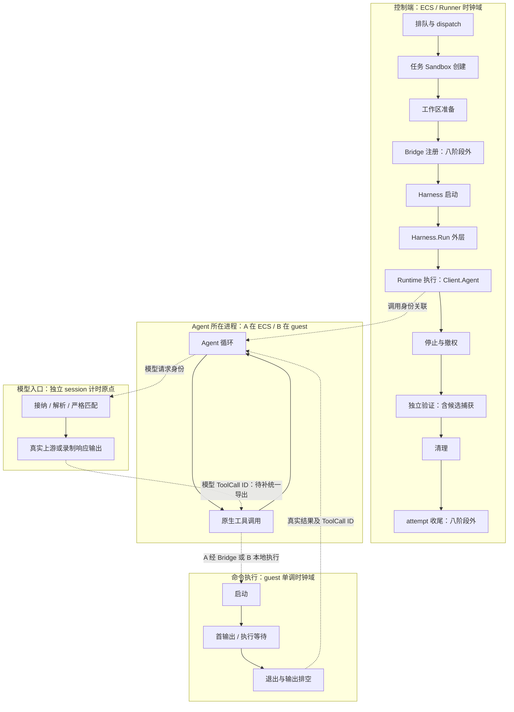
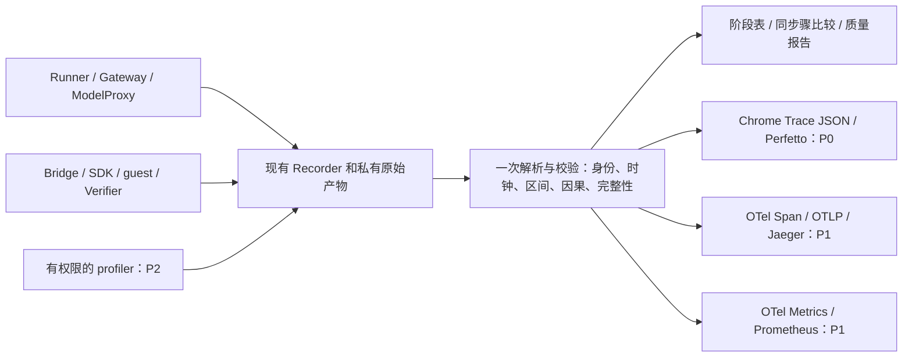

# Agent Runtime 细分观测设计：Perfetto 与 OpenTelemetry 双轨修订

**状态：设计基线已获批准，P0 分阶段实施与验证中。** 修订日期：2026-10-24。本文保留批准时的源码审阅和拟议方案，表中“已有/拟新增”指当时基线；当前实现、测试和阻断以[实施报告](../observability/OBSERVABILITY_IMPLEMENTATION_REPORT.md)及[R01–R18台账](../observability/OPEN_ISSUES_AND_RESOLUTIONS.md)为准。不能据设计条目宣称已实现或P0全部完成。

这是基于用户附件《Codex ARIES Observability Dual Track Design 20261024》的修订稿。附件作为设计输入；实现事实以当前源码和验收证据为准。原始 HEAD 为 `e686735fe0196aacfb799c8d528848dcad026d83`，本页还审阅了其上大量未提交改动，**不是仅描述该上游提交**。未覆盖其他工作。

[性能报告](../performance-archive.md) · [八阶段逐项说明](../performance-stages.md) · [结果与已有 Trace](../run-results.md) · [修订前草案](runtime-observability-20261024-v1.md)。本轮跨云任务已先完成，文档输入及校验保存在 ECS `/opt/aries-artifacts/portable-delivery-2/`；新设计不倒填历史测量。

## 1. 审阅结论与已确定范围

被测对象是 **Sandbox 在真实 Agent 工作负载下的性能**。ARIES 编排实验，Agent 产生可重跑的负载；模型、Harness 与控制器的耗时必须显式区分，避免把它们误算为 Sandbox 性能。不建设 Agent 排行榜或通用运行平台。

三项正式能力共用原始证据和解释规则：

| 阶段 | 正式目标 | 对使用者的意义 |
| --- | --- | --- |
| P0 | 现有事件整理、身份与时钟契约、A/B ToolCall 关联、Chrome Trace / Perfetto 离线分析 | 看清任务每段耗时；能证明关联才展示同一个工具的各层耗时 |
| P1 | OpenTelemetry Trace → OTLP → Jaeger；OTel Metrics → Prometheus 指标闭环 | 按任务查询调用关系、错误与分布；验证 Trace 与指标口径一致 |
| P2 | 经权限核实的 perf/eBPF 等进程或系统剖析 | 对少数已定位问题查看 CPU 栈、调度与 I/O；不阻塞 P0/P1 |

Perfetto 是时间线阅读器，不会自动采集 CPU；Jaeger 是 Trace 后端，不代替 Metrics 存储。P1 第一版采用**任务结束后的证据导出**，不宣称实时在线链路或告警；先不增加常驻 Collector，若实际传输/认证能力需要再提出。

保留四个可替换角色：**Benchmark、AgentHarness、ToolSandbox、ToolBridge**；Runner 是编排器，Verifier 属于 Benchmark 独立评估边界。附件将 Runner 列为四角色之一，这里按实际接口修正。模型代理仍是基础设施，不增加第五角色或 RuntimeDriver。

`agent_type / placement / sandbox_backend` 继续独立。A 为 ECS Agent + 远端工具；B 为 Sandbox 内 Agent + 本地工具。当前 OpenClaw、E2B 和华为已有验收；华为评分出网隔离仍为显式、未实测假设。阿里云/腾讯云尚未实测，AWS 已按用户决定排除本轮。Activate/Pause/Warm/Flatten/Checkpoint 专项 Workload 不在本期。

墙钟时间是“等了多久”；CPU 时间是“实际用了多少处理器时间”；控制端观察区间是“采集端何时看到开始和结果”。三者分别命名。不能用“总时间减模型减工具”得到 Agent Loop CPU，也不能用 RPC 与 guest 的差值称纯网络延迟。

## 2. 当前确实有什么

以下根据本仓源码核对；“已有”只说明代码提供该能力，某次实验是否采齐仍要检查原始产物和完整性索引。历史实验不能靠新设计补出未记录的数据。

| 能力 | 当前事实与边界 | 拟补阶段与边界 |
| --- | --- | --- |
| 八阶段 duration | `TaskTiming` 和 attempt 排队字段已有；部分开始时刻没有独立导出 | 保留原字段含义，增加真正的子操作 |
| 调度事件 | 计划、接纳、开始、终态及调度 anchor 已记录；容量满时 admission 阻塞 | 分清本地排队与 dispatch，不改发压策略 |
| Runner Trace | `performance.Begin/End` 有 operation / parent ID、单进程时钟域及完整性计数 | 在同一 recorder 下记录新子操作 |
| Gateway Agent 协议 | `Agent` 已区分发送、accepted 和 terminal，校验请求 ID / runId | 导出这些实际边界；当前没有逐项时间字段 |
| 模型事件 | 有请求、拒绝、重试、首 SSE / 内容 / reasoning / tool delta、frame 收发时序 | 补接纳、解析、匹配和上游调用边界，以及稳定请求身份 |
| 模型 CPU / 内存 | 部分模型事件附进程累计 CPU、堆、RSS 等 | 明确共享进程范围；不能冒充单请求资源消耗 |
| B 原生工具事件 | 按 session、native runId、ToolCall ID 收集 start/result；`command_output.end` 可选带 `durationMs`，不覆盖所有工具生命周期 | 补控制端收包/消费边界，导出精确模型—工具关联 |
| A 原生工具证据 | 当前 Harness 收集原生产物；不能假定拥有 B 的实时 collector 同款事件流 | 优先读取原生 ID；不能获得同口径时明确缺测 |
| Bridge audit | 有命令 hash、退出码、字节、执行 duration；时间戳和序号在结束后写入 | 补执行身份与真实起止，避免把入队写日志时间当开始 |
| Sandbox / SDK 操作 | `e2b-operations.jsonl` 有成对调用、客户端 duration、SDK 调用 duration 及部分 guest duration；SDK/guest 未全带可对齐起止 | 接入离线展示；当前通用 Trace 未合入这些操作 |
| guest 执行自计时 | Adapter 路径有 `guest_duration_ns`；A 工具含 groupScript 包装与原命令/排空，B 原生工具不经同路径 | 区分启动、首输出、退出、排空；CPU 需另证实可采 |
| 资源采样 | 通用 monitor 秒级；cloud 路径每 5 秒轮询并在销毁前额外读一次，非厂商更新频率 | 与时段关联；不把重复快照或采样最大值当真实峰值 |
| 离线 Trace | 读取 Runner、模型、B 原生工具，保留 source SHA 和缺测诊断 | 增加子阶段和经过证明的关联；旧数据继续 UNALIGNED |

源码：[字段](../../pkg/core/attempt.go)、[调度](../../internal/app/execution.go)、[Recorder](../../pkg/performance/recorder.go)、[Gateway](../../pkg/harness/openclaw/gateway/agent.go)、[模型](../../internal/modelreplay/server.go)、[B 工具](../../pkg/harness/openclaw/native_tools.go)、[Bridge](../../pkg/bridge/ssh/execute.go)、[SDK 观测](../../pkg/sandbox/e2b/observation.go)、[guest](../../adapters/e2b/guest_exec.py)、[资源](../../pkg/monitor/recorder.go)、[Trace](../../pkg/performance/trace.go)。

关键可复核位置（行号以本次工作区为准，函数名为稳定定位）：

| 位置 / 函数 | 已确认事实 | 状态与证据边界 |
| --- | --- | --- |
| [Recorder](../../pkg/performance/recorder.go) `Open:104 / Begin:280 / End:297` | schema v1；独立 emitter/clock；4096 槽有界队列；落盘索引含 dropped/write_failed | 已有；核心事件尚不保证零丢失，关闭后追加当前直接返回，不能称完整投递协议 |
| [阶段字段](../../pkg/core/attempt.go) `TaskTiming:18`；[Runner](../../pkg/runner/runner.go) `runTask:127` | 停止、撤权、独立验证、清理边界分离 | 已有；保留字段与计算方式 |
| [模型](../../internal/modelreplay/server.go) `ServeHTTP:254 / record:440 / replay:514` | 全请求比较；首响应在不同路径有不同采集位置；session 内拒绝 busy | 已有；拟新增 request instance 与更细边界 |
| [Gateway](../../pkg/harness/openclaw/gateway/agent.go) `Client.Agent:27` | Send、accepted、terminal 已有协议分支 | 已有逻辑；逐点观测拟新增，不能用 Send 返回当 accepted |
| [B collector](../../pkg/harness/openclaw/native_tools.go) `observe:116` | 精确 session/runId/toolCallId；控制端消费时刻与可选 native duration | 已有；不是 guest 进程退出证据 |
| [Bridge](../../pkg/bridge/ssh/execute.go) `execute:91`；[audit](../../pkg/bridge/ssh/audit.go) `enqueue:122` | duration 与结束后入队 timestamp 含义不同 | 已有；A ToolCall → execution 身份尚未贯通 |
| [SDK 观测](../../pkg/sandbox/e2b/observation.go) `beginAt:190 / end:207` | RPC 成对记录、SDK 与可选 guest duration | 已有；通用 Trace 尚未合入，不把 SDK 返回当进程终态 |
| [分析](../../pkg/performance/summary.go) `Analyze:92`；[Trace](../../pkg/performance/trace.go) `ExportTrace:61` | 校验 Runner 后导出 Runner、模型、原生工具来源 | 已有；尚无统一模型→工具因果图、OTLP exporter 或 Metrics 闭环 |
| [依赖](../../go.mod) | OTel API 为间接依赖；go.sum 中出现 SDK 不等于本项目已集成导出 | P1 新能力；不得把依赖存在写成 Jaeger 验收 |

已有测试涵盖 [Recorder 溢出](../../pkg/performance/recorder_test.go)、[时钟/身份/缺终态](../../pkg/performance/trace_test.go)、[整段旧历史拒绝](../../internal/modelreplay/server_test.go)、[首响应口径](../../internal/modelreplay/observations_test.go)、[Gateway 单次发送与反序事件](../../pkg/harness/openclaw/gateway/agent_test.go)。这些是现有覆盖，不代表下文新方案已验收。

以下把实现与证据分开，避免“代码存在 = 已验证”的误读：

| 能力 | 代码存在 | 本轮实际产物 | 已验收范围 | 数据质量边界 |
| --- | --- | --- | --- | --- |
| 八阶段/模型/严格回放 | 是 | portable 三任务有 | 16 项复核、同源值/请求与结果 | 不代表云内部可见 |
| A 原生工具明细 | 私有 telemetry 已有 | 7 个真实 Tool Result 和 duration | 顺序、完整结果和完成语义匹配 | 未合入通用 Trace；无完整 Bridge 身份链 |
| B 原生工具 collector | 是 | 既有 B 实验有 | 历史来源/配对检查，详见性能附录 | 控制端消费区间；guest 进程终态未知 |
| Chrome Trace 现有导出 | 是 | portable 各 741 事件 | 支持来源导出完整 | complete 不等于所有必需源覆盖；缺 A native index 目前只记 limitation |
| 新统一快照/新 clock/全链关联 | 否 | 无 | UNRUN | 设计目标，不能借旧 PASS 证明 |
| OTLP/Jaeger/Metrics 闭环 | 否 | 无 | UNRUN | 尚未安装/查询 |
| perf/eBPF | 无本项目验收 | 无 | UNRUN | 权限与能力尚未确认 |

现有实证：portable-v1 的 E2B 录制→E2B 回放→华为 A 回放均为 8 轮模型/7 工具/12 独立测试，16 项复核通过；同一 Tape 不变且两次预期失败保留。三份 Trace 各 741 事件，**A 工具明细尚未进入通用 Trace**。原始失败及新的工作负载版本见[同 Tape 归档](../performance-archive.md#portable-crosscloud)。这证明一个顺序样例的复现性，不证明 P0 细分采集或全厂商性能排名。

## 3. 整体 Trace 如何组织

**Span（跨度）**是同一时钟域内有真实开始、结束的操作。**关联箭头**只说明“这个结果导致下一步”，不意味着已测到两台机器之间的传输耗时。

图中虚线是拟建立或核实的因果关系，不能全部理解成当前 Trace 已有的边。同进程真实嵌套用 parent ID；跨进程用明确关联记录，不凭时间接近伪造父子跨度。报告显示测量进程、时钟域和关联可信度。共享准备在调度前、共享清理在全部 attempt 返回后；失败可以提前转入清理。

### 统一证据到三种输出

这是逻辑模块图，不要求拆成多个服务。A 的执行数据链是 `原生 ToolCall → ECS 转发客户端 → SSH Bridge → Adapter/SDK → guest`；B 是 `guest 原生 ToolCall → guest 本地执行器`。两者都向模型提交真实 Tool Result，Runner 在停止与撤权确认后才给独立 Verifier 候选产物。B 不经过 Adapter 的工具，不能用旁边的准备命令填充其执行跨度。

日志保留受控的错误类别、请求实例/执行身份及源文件引用；私有 Replay 内容与公开 Trace 投影隔离。P1 先让 Jaeger Span 可回到原有日志/证据，不顺带建设新的集中日志平台；若需要 OTel Logs，是另行审阅范围。

## 4. 统一事件、身份与时钟契约

优先复用已有字段。定义一个**版本化的分析快照**，而非新的事件总线或注册中心：包含区间、瞬时事件、因果边、资源读数、质量报告和输入清单。两个 Trace 导出器只接受该已校验快照，不各自读命令日志猜匹配。

| 字段组 | 来源与最小契约 |
| --- | --- |
| 版本与证据 | 保留原始 `schema_version`；另设分析 schema 版本、解析器/导出器版本、source file SHA、记录序号、私有 evidence_ref。未知版本拒绝解析，不覆盖历史文件 |
| 事件身份 | 现有 `emitter_id + sequence` 足够时直接派生 event_id；emitter 每次进程启动不同。缺进程实例证据时不靠 PID 复用推断 |
| 任务身份 | run_id、attempt_id、occurrence_id、logical_task_id/arrival_id、purpose(task/evaluation)。experiment_id 可由实验清单定义，不强加到所有旧记录 |
| 模型身份 | model_session_id、独立 model_request_instance_id、turn_id、frame_index。相同 turn 的重送是不同请求实例；缓存响应和工具执行分别计数 |
| Agent/工具身份 | native_agent_session_id、native_run_id、tool_call_id；执行层另有 execution_id/process instance。缺失保留 null，不把 model session 当 Agent session |
| 跨运行步骤 | 固定 Tape SHA + turn + ToolCall ID 作为同一逻辑调用的键；一次实际执行再带 attempt/execution instance。T1 仅显示编号，命令 hash 仅比内容 |
| 时钟与计时 | clock_domain、monotonic offset（ns）、原点关系、可用 UTC anchor、alignment_status/误差界。每项 duration 带 measurement_scope、producer_location、单位和来源 |
| 结果与完整性 | 操作结果 success/error/timeout/cancelled 与 expected_error 判据分开；后者只能来自冻结 workload/Tape。complete/incomplete/dropped 是观测质量，不能覆盖业务结果 |
| 关联 | exact_id、verified_mapping、heuristic_candidate、unlinked；保存两端身份及映射规则版本/证据。只有前两者进入正式因果图 |

缺测采用正交属性：`not_executed` 表示确知没执行，`unsupported` 表示接口不提供，`not_collected` 表示未开启，`unlinked` 表示身份不足，`clock_unaligned` 表示时间轴无法拼接。可同时出现，例如一个真实成功工具有 duration，但与 Bridge unlinked、与 Runner clock_unaligned；不能压成一个布尔值。

原始 `TaskTiming`、RunResult 和 Trace 旧字段含义不变。若新增必填字段或改变事件语义，发布新 raw schema 并保留旧解析器；可选扩展也先检查旧消费者容忍性。分析快照不回写原始 JSONL，旧 anchor 缺失永远不补造。

**时钟契约：**同一进程的新事件尽量共用 Recorder anchor；不能仅因进程相同就拼接两个无 anchor 的旧文件。跨进程/主机只连可证明的因果边；NTP 和 UTC 格式不是精度证明。校准结果需包含适用时间窗、漂移与误差上界，只有误差小于预先声明的分析粒度才允许该粒度的时间差。没有校准就保留各自时长，不输出全局精确关键路径。

Trace/Metrics 不投影 prompt、模型全文、Tool Result、命令正文、密钥、原始环境变量、敏感 URL。ID/路径使用受控标识；hash 不是脱敏的万能替代品，低熵命令 hash 不进入公开标签。私有 Tape 保留完整内容供严格复核。

来源清单按真实产物定位，不要求每条历史任务都有全部来源。下表中 `<occurrence>` 为运行目录内的任务目录；私有路径只在受控分析中展开：

| 生产者 / 真实来源 | 文件或入口 | 时钟/范围与当前缺口 |
| --- | --- | --- |
| Runner/调度器 | `performance/runner-events.jsonl`、`manifest.json`、`index.json`；`run-result.json` | Recorder 单调时钟；结果文件只提供身份和结果，不能当另一个时钟 |
| ModelProxy | `<occurrence>/model/events.jsonl`、私有 `tape.json` | session 原点；已有 first_* 接收/发送不同，详见第 7 节 |
| A Harness | `<occurrence>/harness/telemetry/*.jsonl`、`telemetry.index.json` | 原生 ID/完整结果/可选 duration；没有统一 start/result 事件就不绘制该跨度 |
| B Gateway collector | `native-tool-events.jsonl` 及其 index，由 Harness artifacts 指向 | 控制端消费单调时钟；guest native wall/duration 单列 |
| SSH Bridge | 组件 artifact 目录的 `tool-calls.jsonl` | 结束后入队 timestamp、既有执行 duration；拟补真实 execution ID/起止 |
| Sandbox 客户端/Adapter | `<occurrence>/e2b-operations.jsonl`、`e2b-operations-index.json` | RPC 本地起止；SDK/guest duration 层次各自独立，当前缺完整 process 身份传播 |
| Verifier | RunResult evaluation/timing、候选 SHA、独立测试报告 | Runner/Benchmark 测 Evaluate 总窗；细项拟同 Recorder 追加，不从 JUnit 拼控制面时间 |
| 资源采样 | cloud 的 `<occurrence>/sandbox-metrics.jsonl`；通用 monitor 的 `resources.jsonl` 与索引 | 保留采集端和厂商采样时刻/频率；不强行并成每工具资源 |

## 5. 八阶段及细分跨度映射

规范阶段名保持不变。当前字段来自 `attempts[].queue_duration` 和 `tasks[].timing.*`，原始 JSON duration 数值单位为**纳秒**，字段名本身没有 `_ns`；分析产物里的 `_ns` 是派生键。下表的新子操作名称均是**设计名称，不是已实现事件或配置项**。

| 阶段 | 当前边界 / 字段 | 拟展示的子操作及限制 |
| --- | --- | --- |
| 排队 | `scheduled_at → admitted_at`；`queue_duration` | 调度器等待容量；接纳后的 `dispatch_delay` 单独显示，不塞回排队，也不称云平台队列 |
| 任务 Sandbox 创建 | Start 调用前后；`sandbox_create_duration` | `sandbox.create.request`、已有就绪等待或查询；只有实现真实存在时才记录。模板 build 不在任务创建内 |
| 工作区准备 | PrepareSandbox 调用；`sandbox_prepare_duration` | `workspace.init`、`file.upload`、权限设置与完成检查；逐项包装现有调用，不增加隐形探针 |
| Harness 启动 | Harness.Start 调用；`harness_start_duration` | 配置、进程启动、ready、认证；A/B Connect 所属阶段不同，不为报表搬动执行逻辑 |
| Runtime 执行 | `Client.Agent` 调用；`runtime_execution_duration` | 请求发送、accepted 观察、terminal 观察；内部模型/工具用真实 ID 关联，不把累计时间当互斥子段 |
| 停止与撤权 | 顺序 Harness.Stop、Bridge.Stop；`stop_revoke_duration` | 已有 `harness.stop`、`bridge.revoke`；拟细分停止请求、进程组退出确认和本地调用收尾 |
| 独立验证 | Evaluate 调用；`verifier_duration` | `candidate.capture`、评分 Sandbox 创建/准备、`verifier.exec`、`verifier.report`；candidate 捕获仍在父跨度内 |
| 清理 | Runner finish；`cleanup_duration` | 评分 Sandbox 回收、必要的 Stop/revoke 重试、任务 Sandbox 删除请求与消失确认 |

额外保留 `bridge.register`、attempt 初始化/收尾、run 级共享准备/清理和观测落盘。八阶段相加不等于整次 run；不将这些剩余工作强塞给相邻阶段。

现有 `agent.run` Trace 覆盖整个 `Harness.Run`，比 Runtime 窗口更宽；新增 Runtime 子跨度时保留旧含义，结果收集、事件 drain 在外层展示。任务清理也不等于全部 Close：attempt 还关闭模型会话、观测和传输，run 处理共享资源；幂等 Stop 再次调用不等于重复云删除。

源码边界：[Runner](../../pkg/runner/runner.go)、[codingcase 验证](../../pkg/benchmark/codingcase/codingcase.go)、[cloud 生命周期](../../internal/app/cloud.go)、[attempt Close](../../internal/app/wiring/cloud/cloud.go)。

## 6. A/B 链路分别怎样计时

### A：Agent 在 ECS，工具远程执行

链路为：Agent 原生工具 → ECS 侧转发客户端 → SSH/Bridge → Adapter / SDK → guest 命令 → 输出沿原路返回。

- Harness.Start 结束不代表后续 Gateway Connect 已计完；当前 A 在 Harness.Run 开头 Connect，再进入 Client.Agent。
- A 的原生工具墙钟可能覆盖 SSH 建连、命令准备、远程执行与收流，因此它不等于 guest 执行时间。
- Bridge 当前 `duration_ms` 从已解析命令进入 execute 开始，到执行返回及记录前处理结束；不含此前完整 SSH 建连/握手。SDK 明细当前只有调用 duration，不能凭相邻日志反算为绝对起止跨度。
- Bridge audit 的 `timestamp` 是记录入队时刻，不能用它拼出命令开始或网络到达时刻。
- 拟分别测量客户端连接/握手、Bridge 收到执行请求、调用 Sandbox、首非空输出、终态及输出排空。每个测量留在其所属进程。
- ToolCall → 转发调用的原生 ID 通路尚未证实完整。若固定原生客户端没有元数据入口，先明确“关联缺失”，不能修改 shell 内容藏 ID 或按重复命令猜配对。

源码进一步确认：当前 [SSH 客户端](../../pkg/bridge/ssh/openclaw/client/invocation.go)固定七项参数，[Config](../../pkg/bridge/ssh/openclaw/client/transport.go)仅有地址/用户，[服务端](../../pkg/bridge/ssh/server.go)只接受 exec，没有现成逐调用 ToolCall ID 元数据通道。顺序执行也不能证明按序配对永远正确。

Bridge 下游已有真实 [Process UUID](../../pkg/sandbox/e2b/client.go)，但 operation log 未落 process/execution/parent ID。最小计划是在执行接纳时建立 execution ID，经现有 context 与受管调用传递，并明确记录它与 Process UUID、RPC 实例的绑定；不改 core.Command 或命令正文。原生 ToolCall→SSH 仍是单独调查门，不能把下游可关联说成整条已通。

### B：Agent 与工具在 Sandbox

链路为：ECS Gateway 客户端 → 云网关 → guest OpenClaw；工具由 guest 内原生执行路径运行，再通过 Gateway 发事件给 ECS。

- B 的 Gateway Connect / 认证在 Embedded.Start 内；Run 使用已连接客户端。
- B 的用户工具通常不经过 ARIES Adapter 的 Exec，所以 `e2b-operations` 中准备/诊断命令不能冒充 Agent 的原生工具调用。
- 当前 collector 在 `RecvEvent` 返回后记 `host_observed_offset_ns`；它包含事件在客户端队列里等待的影响。
- 拟在 Gateway 收到完整消息、放入本地事件队列和消费事件处记录同一控制端时钟边界。收包→消费差值可以称“本地事件队列/分发等待”。
- guest 的 `native_timestamp_ms` 到 ECS 收包不能跨机相减来命名“云网关延迟”。只有控制端往返可直接观察，无法拆开的服务器和网络部分继续未知。
- 原生 `command_output.end` 不证明所有后台进程退出；隔离仍依赖实际 Stop / cgroup 确认。

源码：[A Harness](../../pkg/harness/openclaw/harness.go)、[Gateway 收发队列](../../pkg/harness/openclaw/gateway/client.go)、[B Embedded](../../pkg/harness/openclawcloud/embedded.go)、[进程组停止](../../pkg/harness/openclawcloud/group.go)。

## 7. 拟增加的细分边界

### 7.1 调度与 Gateway：明确“谁在等”

调度器继续报告 planned → admitted、admitted → attempt started，以及 attempt 初始化。当前容量限制会阻塞 admission，不能标成已经实现的非阻塞开环压测。

Gateway 拟保留调用开始、Send 返回、读到 accepted、读到 terminal，以及消费响应的控制端时刻；请求 ID / native runId 来自真实协议。Send 返回不代表 Agent 已接受；Send→accepted 含通信和服务端工作，不能称纯服务器队列。accepted→terminal 也只是观察窗口。发送结果不明时保留未知，不为补 Trace 自动重发。

### 7.2 模型：把接纳、校验与响应等待分开

拟在当前 ServeHTTP / record / replay 的现有分支中记录以下边界，不增加模型请求，不改变返回内容或流式顺序：

| 子项 | 真正可测的起止 | 解释限制 |
| --- | --- | --- |
| 接纳与请求读取 | 本次请求获准处理 → 请求体读完 | 不含此前网络或鉴权全部成本；busy 当前是拒绝，不是排队 |
| 解析与严格匹配 | 读取完成 → 请求解析、历史和 Tape 校验完成 | JSON / 匹配开销，不是模型推理 |
| 上游调用等待 | 发起上游 HTTP 调用 → 获得响应头 | 包含连接、传输和服务端等待，不是纯网络或纯推理 |
| 首响应观察 | record：接纳 → 上游首个完整 SSE / 内容 / reasoning / ToolCall delta；replay：接纳 → 对应 frame 输出 flush 完成 | 当前 first_* 在 record 的 send 前、replay 的 flush 后；不可混比，SSE 也不是 token |
| 流式接收与输出 | 各 frame 的上游接收、下游 write/flush 完成 | flush 返回不证明 Agent 已消费；两者之间包含本地解析和输出处理 |
| 整个模型请求 | 接纳 → 请求处理终态 | 继续保留现有 request duration，失败也单列 |

当前 `request_started` 在严格匹配之后，`request_finished.duration_ns` 从更早的接纳处计时，必须分名。回放单列 `recorded / zero / synthetic`，保留计划/实际发送 offset 和迟到量；当前 synthetic 是逐帧延迟配置，不代表 token 速度。recorded 来源是代理收到完整 SSE 的时序，不是 token 时钟；zero 仍有解析、写出和调度成本。

record/replay 共同的发送侧比较使用同口径 `frame_sent.actual_offset_ns`（接纳 → flush 完成），不要把两种模式的 first_* 当成同一边界。首内容等分类若比较发送侧，需由其 frame 身份关联同次 frame_sent；缺失则留空。

record 模式下相同请求的缓存重送也走 replay 分支，`first_*` 在 flush 后记录，`timing_source` 为 `cached_retry_*`。因此按实际时序来源和接收/发送边界分组，不能只看 profile 的 mode；缓存重送不计作一次新的真实上游等待。

上游未公开的服务端排队、prefill、decode 和 GPU 时间继续为 `unsupported`。不从总请求等待中猜分这些项。

### 7.3 工具：区分等待、执行、CPU 与传输

| 指标层 | 起止 / 采集位置 | 可否称 CPU 或纯网络 |
| --- | --- | --- |
| 原生工具 wall | A 取原生 `toolResult.details.durationMs`；B 取 `command_output.end` 可选 `durationMs`，collector 写为 `native_duration_ms` | 两者都不可以；须固定工具类型与版本，不普遍代表全部 ToolCall 生命周期，也不证明后台命令完成 |
| 控制端工具观察区间 | 同一 collector 收到 start → result | 两者都不可以；包含事件传递与消费影响 |
| Adapter RPC | Go 发起一次 action → 响应解码完成 | 客户端等待，含 SDK 等嵌套操作 |
| SDK 调用 | Adapter 进入 SDK 方法 → 方法返回 | `commands.run` 返回不是命令进程退出 |
| guest 执行 wall | Adapter wrapper 的 Popen 前 → 输出排空后 wait 返回 | A 包含 groupScript Python、cgroup、准入锁、UID 切换、原命令与排空；不是纯用户程序 wall 或 CPU，B 无同口径 |
| 命令 CPU | 拟采集同一已归属进程/进程树的累计 user/system CPU | 只有覆盖范围和终态证实后才报告，否则未采集 |
| 文件传输 | 真实 upload/download 调用前后，附有效字节数 | 是文件 API 吞吐，不是网卡或磁盘的纯带宽 |

拟在现有受管命令路径追加“启动调用返回、首非空 stdout/stderr、直接子进程退出、输出排空”事件。stdout 和 stderr 分开记；命令没有输出时显示“不适用/无输出”，不填首输出 0。

**直接子进程退出与输出排空可能分离。** 当前 guest wrapper 先读到两个管道 EOF，再 wait；后代持有管道会延长时间。分离两边界需要保留原执行、信号、stdin EOF 与字节语义，不能只把现有总 duration 拆成假数字。

B 原生工具路径没有同款 wrapper。优先核对固定 OpenClaw 原生事件是否公开这些点；若没有，首轮只显示可得的 command duration 和 start/result 观察区间，其他明确缺测，不强行注入会改变工作负载的 shell 包装器。A 包装边界见 [processGroup.command](../../pkg/harness/openclawcloud/group.go)。

CPU 采集也不以共享进程或整个 Sandbox 的差分替代单个工具。Agent、模型代理、采样器和并行工具可能同时消耗 CPU；共享资源曲线只作上下文证据。

“客户端等待 − guest wall”最多是两个不同边界测量的差，不能命名纯网络、纯调度或精确 Harness 开销。若边界、覆盖和误差未经证明，主报告不展示这种归因差值。

## 8. 如何证明是同一轮模型、同一个工具

沿用现有身份，不建立通用注册中心。拟新增的字段只写在真实事件边界，公共 Trace 不包含 prompt、命令正文、Tool Result、环境变量、token 或原始错误。

| 身份 | 用途与约束 |
| --- | --- |
| `run_id / attempt_id / occurrence_id` | 一次运行与一次任务尝试；相同题目重复执行也必须区分 |
| `model_session_id` | 关联当前显式模型会话；不是 native Agent session |
| 模型请求实例 ID + turn | 拟新增；同一 turn 的重送仍有独立请求实例，不能覆盖前一次等待 |
| native session / runId | 绑定 Gateway accepted 与原生事件；不可拿 ARIES run_id 代替 |
| `tool_call_id` | 原生 start/result 配对，并通过 Tape 已验证的调用关系连接模型响应与下一轮真实结果 |
| 稳定步骤 ID | 对比工作负载中的同一逻辑步骤；T1/T2 仅是展示顺序，不足以证明跨云步骤相同 |
| command / process 执行 ID | 仅在受管执行层有真实可传递身份时建立；不能仅靠 PID、时间相近或命令 hash 猜测 |

稳定步骤 ID 可以由固定工作负载版本和预定义步骤给出，再保存它与实际 Tape turn、ToolCall ID 的对应证据。允许修复重试的动态工作负载没有固定工具次数时，计划步骤分母为 unknown；同 Tape 回放则以不可变 Tape 的应执行实例数为准，不能新增“最后必须 pytest”之类未声明任务约束。私有核对覆盖命令、参数、cwd、输入和预期错误；hash 用于核对内容，不单独证明调用关系。

模型侧从完整响应解析 ToolCall ID，结合下一请求中的真实 Tool Result 证明因果；首个 ToolCall delta 不代表参数完整或工具开始。当前 `openclaw-2026.7.1` dialect 是固定原生 ID 规则，不允许任意改写 ID 或结果；保存规则名与映射来源，不能唯一对应就标 `unlinked`。

同样的模型请求重送可能只是重发缓存响应，不一定产生新的工具执行；并行或多次同名命令也不能靠名称合并。先保留所有真实实例，再判断对应关系。

源码：[Tape 及因果检查](../../internal/modelreplay/tape.go)、[请求重送与匹配](../../internal/modelreplay/server.go)、[原生事件索引](../../pkg/harness/openclaw/native_tools.go)。

## 9. 时钟与关键路径

### 同进程可以对齐，跨机器不能硬拼

- 新增控制端事件优先共用现有 recorder 的单调时钟原点；只有在同一进程内持有真实 anchor 时才做显式转换。
- 模型 Server 和 collector 虽可能与 Runner 在同一进程，现有文件却没有可证明的共同单调 anchor。新记录可以补，旧记录不能用各自 UTC 起点倒推出精确 anchor。
- Tape.StartedAt 是另外一次取时，不能代替模型 `s.started` 的同一 anchor。新模型事件应显式给出可验证的原点关系。
- guest、Adapter、Agent 进程各保留 emitter / clock domain / sequence。NTP、相同 UTC 格式或相近时间不足以保证跨机相减准确。
- 跨域用 ID 表示因果、分别展示各自 duration；在没有误差界限与同步证明时继续标 `UNALIGNED`，不合成全局精确关键路径。

### 父子与并行都不能直接相加

父跨度包含子操作；模型和工具累计是 Runtime 内部活动量。**纯示意算例，不是实验结果**：两次工具分别 80 ms、110 ms，重叠 30 ms，则累计 190 ms、区间并集 160 ms。两者均不能自动当作任务关键路径。

只有同一可信时钟域、完整覆盖且已知依赖的区间，才计算并集或路径。缺少调用链时显示“已观察区间”和“未归属区间”，不能把 Runtime 的剩余值标成精确 Agent Loop CPU 开销。

按每次调用分解后再看分布；不能用“Runtime p95 − Tool p95”计算 p95 开销，也不能把不同实例的 p95 取平均充当全局 p95。

## 10. 两个 Trace 导出器的最小设计

下表是逻辑接口设计，不是新增代码/API 承诺：

| 操作 | 输入 | 输出和失败行为 |
| --- | --- | --- |
| 解析与校验 | 不可变原始文件 + schema/版本清单 + 显式实验条件 | 已校验快照、源哈希、诊断；缺项保留，非法身份拒绝建立关系 |
| Chrome Trace 导出 | 同一快照中的区间、事件、已验证边、clock/domain 质量 | trace JSON + analysis manifest；不再次匹配工具命令或创造开始/结束 |
| OTel Trace 导出 | 同一快照 + 经过版本检查的显式目标配置 | OTLP Spans + export manifest；记录成功/部分拒绝/超时、重试及未交付数量 |
| Metrics 导出 | 同一快照的计数/分布/资源读数及统计窗口 | 版本化指标快照、传输结果与核对清单；不从 Jaeger span 时长重新统计业务成功数 |

### P0：Perfetto / Chrome Trace

沿用 `aries-perf --trace` 入口与现有 `pkg/performance`。有真实起止才生成 complete slice；仅 duration 无可信开始位置时放指标/详情，不从一个结束后的日志时间反算起点。真实瞬时事件单独展示；未结束操作显示缺终态标识，不生成到超时点的假完成跨度。

Chrome Trace 的 `ts/dur` 单位为微秒，原始纳秒值与量化误差仍留 manifest；显示格式不代表测量精度。同一时钟域用泳道与真实依赖展示嵌套/并行，按需导出计数器；不嵌套的并行操作分轨或用真实异步关系，不能全部塞进一条同步线程栈。跨域默认独立文件/时间视图并在关联清单按 ID 跳转；已有全域独立零点文件保留兼容且明确不可横向读同时性。未经校准的跨域不画有时间长度含义的 flow。不同 pid/tid 只是泳道，不会在 Perfetto 中自动生成独立时钟；原生 ClockSnapshot 只有真实校准记录时才可使用。参见 [Chrome JSON 支持](https://perfetto.dev/docs/getting-started/other-formats)与[时钟同步](https://perfetto.dev/docs/concepts/clock-sync)。

每条可见操作可追到 attempt、tool ID、measurement_scope、source SHA、质量和关联方式。Perfetto 的交互/flow 能力须由实际导入验证；不声称它能直接展示尚不存在的 sidecar UI。最小关联清单可以是 Markdown/JSON，无需新网页。

### P1：OTel / OTLP / Jaeger

首版导出已结束任务的证据，明确 `export_mode=offline`。采用标准 OTLP，优先 HTTP/protobuf；具体 SDK/导出器版本在 P1 固定并做兼容测试，不能从 go.sum 推定当前可用。同样的数据不能在两个导出器里再各算一次时长。先冻结 OTLP payload 与 manifest，再独立上传；使用标准消息编码，不从当前 SDK 时钟重建历史操作。OTLP file-exporter 规范仍为 Development，不能假设任意 SDK 已有开箱即用的文件导出器。参见 [OTLP 文件规范](https://opentelemetry.io/docs/specs/otel/protocol/file-exporter/)与 [Jaeger OTLP 接口](https://www.jaegertracing.io/docs/2.20/architecture/apis/)。

- 同域有真实父子操作时保留 parent；跨域只有确定因果且未对齐时，保留各自操作，通过 Span Link/外部关联清单表达，避免伪造端到端 waterfall。Link 可跨 trace，但不校准时钟，具体规则遵循 [OTel Tracing API](https://opentelemetry.io/docs/specs/otel/trace/api/)。缺边不能创建虚构业务 span 来把图接起来。
- OTel 时间戳需要 Unix epoch。只有可信本地单调时长和本地 UTC anchor 时，才由该域 anchor 转换；标明跨域 offset 未知。连本地 epoch anchor 都没有的旧记录保留在离线视图，不造 1970 或以导出时间冒充执行时间。
- 资源属性固定 service.name/service.version、部署环境、组件位置/backend；attempt/tool 等放 Trace 属性，不能自动复制为全部 Metrics labels。内部操作默认 INTERNAL；已观测的出站请求可标 CLIENT、已观测的入站处理可标 SERVER，不要求双方都可见。未观测的云服务端不生成 Span。
- 预期 pytest exit 1 仍是失败的工具操作，增加 expected-error 属性；独立 Verifier PASS 与其并存，不能把子工具全部刷绿。错误只导出受控类别，不上传原始异常正文。
- ID 使用保存的映射或有命名空间/版本/碰撞检查的确定映射。重复导出同一 raw 保持 Span 身份，并记录 export attempt；**不能保证后端 exactly-once**。超时可能已经接收，必须验证重复/部分拒绝并保留清单，不能无限重推。
- Jaeger 展示或时钟偏移修正不作为测量证据。按锁定版本检查 Span Links 呈现、查询时间窗、时间精度和 clock-skew adjustment；原始 OTLP 数据与 Perfetto 区间逐项核对，基准验证实例显式禁用时间修正（已查文档字段 `max_clock_skew_adjust: 0s`，部署前再按固定版本核对）。这是避免 UI 移动时间，不是校准机器时钟。参见 [Jaeger clock skew 配置](https://www.jaegertracing.io/docs/2.19/deployment/configuration/)。无法清楚显示跨域 Link 时以关联清单说明，不把 UI 不支持当作没有因果。
- 导出使用有界超时/批量/重试，记录 flush/shutdown、后端接收和查询验证。导出失败独立于任务正确性，原始证据仍完整保留；不存在“Jaeger 收到了就等于永久落盘”的假设。检查 OTLP partial_success；收到非空 partial_success 后不重试原请求，包括 rejected 为 0 但带 warning 的响应。保留拒绝数/警告并查询核对，部分拒绝不能当完整成功。参见 [OTLP 交付语义](https://opentelemetry.io/docs/specs/otlp/)。

P1 在 ECS 容器化验证最小 Jaeger OTLP 后端，一次 A、一次 B 可按真实身份查回；不连接云服务内部不可见 Span。此阶段未实施，也未启动任何后端。

## 11. Metrics、资源与容量分析

业务指标复用现有 RunResult、attempt 记录和经过校验的区间；资源指标复用 monitor/SDK 原始读数。规范化计算只做一次。OTel Metrics 是传输/数据模型，Prometheus 是查询存储；Trace 是诊断依据，不能取代独立验证的成功计数。

| 指标 | 定义及可否由已有产物获得 |
| --- | --- |
| planned / admitted / started / terminal | 可从现有调度/attempt 记录核对；包含构造失败、取消和未开始，互相不能混为分母 |
| 执行吞吐 | 明确 Harness 成功终态数 / 完整观测窗口；不称验证通过吞吐 |
| Validated Throughput | 保留当前 `attempt.Validated` 计数 / 完整观测窗口：评估及 Verifier 成功、isolation confirmed、HarnessStopped、BridgeRevoked。该旧字段不要求 cleanup 成功/Trace 完整，也不能独立证明华为 egress；附加质量与网络分组，不修改旧分子 |
| Goodput | 保留现有定义：Validated 且候选已证实（ArtifactProven）、产物延迟不超过显式 deadline 的任务数 / 完整观测窗口。现有 deadline 终点是稳定候选，不是验证完成；无 SLO 则未配置，不填 0。若需验证完成时限，另命名指标 |
| 失败/Strict Divergence | 各状态完整计数，并明确分母为适用的真实尝试；失败也留 duration 分布，不因回放提早结束当性能提升 |
| 阶段/排队分布 | 现有 duration 可用；按 workload/Tape、placement、模式、结果和质量分组，histogram 桶预先固定，不相减分位数 |
| CPU | 累计 CPU 秒与区间增量、wall 和核数分开；1 核忙满/总配额归一化两种百分比明确命名。counter reset/进程重启分段 |
| memory / I/O / network | 实有 usage/peak/bytes/wait 才输出；采样最大值不称真实峰值。云 SDK 没提供的字段 unsupported，不能补 0 |
| 观测成本 | ECS Runner/模型代理与采集器 CPU、RSS、写入字节/频率、事件 drop；与 Sandbox 资源分开，不扣减成“净性能” |

现有 [monitor.cpuPercent](../../pkg/monitor/recorder.go) 首次 0 是 CPU 差分基线占位，分析层须标“利用率不可计算”，不能据此认定空闲；后续为单核 100% 口径。旧原始值不改。[cloud 采样器](../../internal/app/wiring/cloud/metrics.go) 每 5 秒轮询不是厂商每 5 秒更新，华为 nominal interval 未提供；仅依据已验证语义的 provider sample ID/时间戳识别重复快照；相同数值但不同采样时刻必须保留。华为时间戳语义未确认时只标重复候选，独立样本数和更新周期仍 unknown。秒级采样可能错过短峰；累计 CPU 在任务后采样可看见增量，但共享 Sandbox/cgroup 含 Agent、并行工具与采集器，不能归属单条工具。支持列必须按 backend、placement、resource scope、权限和实际源逐项核验；类型定义含 GPU 不等于已测 GPU。L1 对受管进程统计 user/system CPU 的可行性另做原型，B 没有同语义接口就保持未采集。

P1 选择**有界的批次离线指标导出**，避免短任务在首次 scrape 前消失。固定快照的 measurement window、计数和直方图 count/sum/buckets，使用标准 OTel Metrics 数据类型；不把读取旧数据时 Counter.Add 的当前时间伪装成历史采样。首版选择 OTLP/HTTP → Prometheus 原生接收器：在受控实例启用 `--web.enable-otlp-receiver`，接收路径 `/api/v1/otlp/v1/metrics`；累计 Sum、显式桶 Histogram、真实采样 Gauge，先不依赖实验性 delta 转换。每批验收用独立 TSDB 数据目录，保留原始时间窗，按绝对时间查询；旧数据/乱序接受窗口需显式核对，不能默认任意历史数据能导入。参见 [Prometheus OTel 指南](https://prometheus.io/docs/guides/opentelemetry/)、[OTel Metrics 模型](https://opentelemetry.io/docs/specs/otel/metrics/data-model/)及[TSDB 乱序配置](https://prometheus.io/docs/prometheus/latest/configuration/configuration/#tsdb)。不默认增加 Collector 或 Pushgateway。

累计流契约：每批、每组固定标签只输出一个末态 Sum/Histogram；startTimeUnixNano=真实统计窗口起点，timeUnixNano=终点，分组先合并计数和桶并保留 attempt 成员清单。不同 attempt 的独立累计快照不得写成同一流，资源 Gauge 保留自身真实采样时间和归属。不同批次不得复用冲突的流身份或把 reset 当增量。

一次输出先核对 OTLP 内容，再核对后端实际查询值。重导出不累计成新的成功任务；按稳定批次/导出清单判重并测试乱序与重复接收。后端未提供 exactly-once 时保留不确定交付，不自行宣称幂等。末态只有一个样本时直接按完成数/观测窗口报告吞吐，不用 rate()/increase() 补造趋势。历史报告仍以不可变快照为权威；Prometheus 看板不是更改原始成功数的入口。

低基数标签只保留受控 backend、placement、model mode、workload version、phase、outcome、scope 等。Tape SHA、镜像、区域、规格、实验到达策略放有界实验清单/Trace 资源属性；attempt/session/tool/命令不得贴到每条 time series。相同标签的并行实验需按有限实验目标/隔离命名空间区分，不能混为一条 counter。Exemplar/Trace 跳转以锁定后端实际能力验证，首版有 evidence ID 清单即可。

容量结论必须记录 offered/planned、实际接纳、执行、终态、queue、取消、观测窗口和负载发生器饱和情况。当前 admission 会等待容量，不是独立持续到达的开环；本期不偷偷重写发压器。并发槽直到整个 attempt 返回才释放，包含验证和清理，不等于同时运行的 Agent 数。现有 `summary.SuccessfulDurationNS` 仅统计 succeeded；新增按结果分组时不能悄悄改旧字段含义。单任务或极小样本只报告描述值，不给容量、稳态 p99 或厂商因果排名。

## 12. 内部魔改版线索的取舍

**依据 GLM 摘要，未直接核验内部源码。** 下列内部路径/算法只是二手线索；不声称当前仓库存在 `pkg/monitor/otel.go`，不合并两套实现。

| 内部线索 | 当前对应位置 | 决策 | 原因 |
| --- | --- | --- | --- |
| JSONL artifact 后处理为 OTel Span | `pkg/performance/trace.go`、`summary.go` | ADAPT | 借鉴离线输出，但复用统一校验快照；明确不是在线 Trace |
| `modelStartTS` 取上一条消息 | `modelreplay.Server.record/replay` | REJECT | 上一事件不是真实 HTTP 开始；保留真实接纳/接收/发送分界 |
| Bridge 日志 timestamp 减 duration 反算 startTS | `ssh.execute` 与 `audit.enqueue` | REJECT | 两字段时点和范围不同；拟补真实同域 begin/end，旧值只作各自证据 |
| Tool ID 优先，命令/退出码/5 秒邻近 fallback | `native_tools.go`、`tape.go` | DIRECT_DESIGN（精确 ID）/ REJECT（自动 fallback） | 保留精确关联原则；时间窗口无法解决同命令、重试和并行冲突 |
| no-op Bridge 导致 Embedded 无 tool.exec | B native collector 与 Gateway | ADAPT | B 用其真实原生事件，不造 Bridge span；A/B 范围分别命名 |
| ResourceSource/Sample + JSONL/index、cgroup 指标 | `pkg/monitor` 与 provider ResourceSource | REFERENCE_ONLY | 当前已有类似结构，先核对真实覆盖；不重复建采集器，不由类型推断 GPU/host 权限 |
| 缺 artifact 静默跳过、wall clock 直接拼接 | `performance` 完整性和多 clock domain | REJECT | 缺源、drop、无 anchor 必须可见；不造完整瀑布 |
| 可信 A 身份贯通、Metrics/OTLP 后端实证 | 当前无完整闭环 | MISSING | 分别作为 P0/P1 验收门，不借内部报告补成已实现 |

DIRECT_DESIGN 只认可设计原则，不代表内部实现通过测试；ADAPT 只复用思路，REFERENCE_ONLY 不承诺迁移。

## 13. 公平比较的准入条件

**同题不等于同工作负载。** 当前工具表中调用数、错误位置或命令内容不同的轨迹可以帮助诊断，不能直接用累计时长给云厂商排名。

A/B 均纳入实现与测试，各自建立 placement 匹配的同 Tape 跨云组；不将不同架构混排成 Sandbox 厂商排名。

| 比较方式 | 能回答什么 | 需要控制什么 |
| --- | --- | --- |
| 同模式、跨厂商、同 Tape | 相同模型决策与真实工具路径下的环境差异 | 同 placement、版本、dialect、Tape SHA、时序模式、步骤与结果校验 |
| 同厂商 record / recorded | 已录轨迹能否真实重跑，录制与回放路径的表现 | 同环境/规格/版本；真实上游与回放不是同一种模型等待来源 |
| 同厂商 recorded / zero | 移除主动等待后，该真实工作流如何变化 | 同 Tape、输出内容与工具；zero 仍不是零成本 |
| A / B | 放置方式及转发链路改变的整体影响 | 单独的架构实验；当前 replay 要求 placement 匹配，不能直接互换 Tape |
| 同题、不同 Tape | 任务完成行为或诊断差异 | 明确轨迹不同；不作为固定工具负载的跨云排名 |

跨云主对照必须真的让各云接受**同一份不可变 Tape**。真实工具、文件和独立 Verifier 均继续执行；全历史、工具参数和 Tool Result 偏离就拒绝，不 mock 工具、不截断旧历史、不删除错误步骤。

hostname、绝对路径或版本信息若造成严格偏离，应报告不可比。若需可移植工作负载，事先设计固定环境和确定性输入，形成新的版本与录制；不能事后归一化已有结果来让旧 Tape 通过。

历史实际例子：华为 A 原样回放旧 E2B A Tape 时，`ls -la` 的目录大小和块数不同，第三轮请求被严格拒绝，见[失败归档](../performance-archive.md#华为-a跨云严格回放失败)。因此还需在正式计量前做跨云轨迹可复现性检查：共同基准应事先选用不依赖此类平台元数据的步骤；检查失败的原轨迹保留，不能改写成通过记录。

设计初稿的 Tape 仅支持顺序单工具；现已按真实原生能力扩展为[v2同轮多ToolCall](../observability/VALIDATION_AND_REPRODUCE.md#r01-multicall)，v1原件保持兼容。严格比较完整解析JSON内容及数组顺序，不是HTTP原始字节相等；多调用逐ID核对，不能按时间或命令猜配。上下文压缩仍不支持。Trace能显示并行不代表回放已经通过，当前真实A协议验收与其它未验placement分别留证。

每组固定并归档：初始文件与测试 hash、Agent/Harness/SDK/镜像版本、请求及实际资源规格、区域和 ECS 位置、连接/缓存状态、并发与到达方式、超时与重试、观测级别和模型时序。有效硬件不同仍须披露，不能只因“2 CPU”就认定底层等价。

步骤检查预期退出码、错误语义、重试和覆盖率；预期错误、意外失败均保留耗时，未执行步骤不填零。独立验证使用同样的候选捕获和可信测试。Huawei 出网假设按 `infrastructure.network_policy` 分组；当前吞吐不会自动剔除假设样本，必须注明条件性，不能称隔离已实测。

现已新增 [portable-v1 单次跨云组](../performance-archive.md#portable-crosscloud)：事先改变工作负载指令，重新真实录制，未改旧 Tape/工具输出/Strict matcher。三次运行顺序均为读源码→失败测试→修复→失败复测→再修复→成功复测→只读检查。最后只读检查在原录制里，验收脚本原来误要求最后一步必须 pytest；这是事后修正脚本，原 FAIL 与复核保留，不能声称所有判据事先冻结。可复现性成功不抹去旧轨迹失败或选择偏差。

`tape_compatibility_rate` 按预先登记的 Tape × placement × backend 组合报告：完整严格通过组合 / 已实际执行兼容性检查组合，同时列计划、UNRUN、基础设施失败、Strict Diverged 数；重复尝试单列 attempt rate，不能重试到通过后只保留一次。基础设施失败无法判定语义兼容时标未知，并同时给全尝试完成率，不能偷偷缩小分母。没有完整尝试清单则该率 unknown。

正式性能主表仅比较通过严格完整轨迹和同等验证条件的样本，同时必须附全样本失败/排除清单；它估计的是可兼容子集性能。条件性隔离结果和确认隔离结果不能合并为 fully-verified Goodput。

## 14. 失败、缺失与观测开销

任务结果与观测完整性是两条轴：任务失败可以有完整 Trace；任务成功也可能缺失事件。分别报告，不能用一个 PASS 盖住另一项。

| 情况 | 报告方式 |
| --- | --- |
| 完成且有起止 | 显示测量值及成功/预期错误/意外失败；不只保留成功调用 |
| 超时或取消 | 记录截至停止等待的观察耗时、期限与原因；真实完成时刻未知，不把 deadline 当准确完成时间 |
| 只有开始，没有终态 | `incomplete`；可显示“至少等待到最后观察点”，不造结束跨度 |
| 未执行 | `not_executed`，缺少该项数值；不填零 |
| 原生接口不提供 | `unsupported`；说明具体边界缺什么 |
| 未开启采集 | `not_collected`；不把它当平台不支持 |
| 有记录但身份关联不足 | 保留原测量，标 `unlinked`；不画确定因果箭头 |
| 丢事件、截断、写入失败 | 索引及 Trace 标不完整；不能靠忽略记录恢复“完整” |

覆盖率必须带分子分母：①成对工具调用数 / 已观察到的工具开始数；②精确关联到模型与后继结果的调用数 / 应关联调用数；③已完成且符合预期的步骤数 / 工作负载计划步骤数。另列未关联、未执行和缺失终态数量；分母不可证明时显示未知，不宣称 100%。

当前模型在匹配前被拒绝时，不一定有成对 request_started/finished 和完整请求 duration。新设计应记录拒绝边界；历史拒绝不能补测为零或塞入成功分布。

采集采用现有有界机制，保持溢出/丢失可见。核心开始、终态、身份不采样；首输出只记第一次，输出只记字节与摘要。原始 payload 继续留在受控私有证据，公共 Trace 和表格只投影必要字段。

观测本身会占 CPU、锁、磁盘和网络。验收须在同 Tape、同并发条件下比较当前基线与细分采集，报告模型代理/控制端资源与事件完整性；不能假定埋点免费，也不能用另一次空载耗时机械扣除本次开销。

质量门槛按具体主张检查，不用“Trace complete”一个字覆盖全部能力：正式宣称某条全链路已关联时，该链应有 100% 可证明的精确 ID/映射、无重复或串 session、无缺终态/drop；分母必须来自冻结 Tape 或另一可信生产清单。只以观测到的 start 为分母会漏掉整对丢失，因此同时报告“配对率”和“应采集覆盖率”。分母未知时后者 unknown。

P0 采集不主动采样核心身份与终态，但有界队列仍可能溢出；必须暴露并使受影响的观测判为 incomplete，不能声称永不丢。Close 顺序应先停止生产再 drain；关闭后仍来的事件和 flush 超时须记录，不能靠阻塞 Agent 来换取漂亮完整率。任务业务结果保持独立。

## 15. 报告长什么样

报告保持“先判断能否比较，再看慢在哪里”的顺序；原始 run 不修改，派生 summary、Trace 和报告存独立 analysis 目录并保留源文件 SHA。

**页面一：实验条件与八阶段。** 顶部列厂商、A/B、工作负载/Tape SHA、recorded/zero、版本与规格、并发、网络策略、有效任务数、验证与清理结果、观测完整性、可比/不可比原因。

八阶段采用当前规范名称，点击后展开子项。旁边单列产物延迟、验证延迟、完整观测窗口；窗口仍为调度开始→所有 attempt 返回，不包含 run 级共享准备/清理。

**页面二：同一步骤的工具对照。** 下表是**界面示意，所有数字均为虚构，不是实验结果**；真实报告只给通过准入检查的同组样本并排展示。

| 步骤 / 实例 | 预期与实际 | 原生工具 wall | 控制端观察区间 | guest 执行 wall | 命令 CPU | 关联证据 |
| --- | --- | ---: | ---: | --- | --- | --- |
| S01 / 厂商甲 B | 预期成功，实际成功 | 210 ms | 245 ms | 未采集 | 未采集 | Tape turn + 原生 ToolCall 精确对应 |
| S01 / 厂商乙 B | 预期成功，实际成功 | 230 ms | 260 ms | 未采集 | 未采集 | 同上 |
| S02 / 厂商甲 B | 预期退出 1，实际退出 1 | 80 ms | 95 ms | 未采集 | 未采集 | 同上；预期错误保留 |
| S02 / 厂商乙 B | 未执行：此前严格偏离 | — | — | — | — | 本 attempt 不进入完整轨迹耗时比较 |

原生工具 wall 与控制端观察区间分别比较，不把两列相减标作网络耗时。表尾显示匹配步骤数 / 计划步骤数、预期错误数、意外错误数与缺失原因。

**页面三：单 attempt 时间线与诊断。** 按时钟域显示 Runner、模型、工具、Adapter/Bridge 与可用 guest 事件；点击 ToolCall 展示对应 turn、步骤 ID、退出码、各层 duration 和未采集项。

可靠的关联用实线；未对齐时钟保留独立泳道并标 UNALIGNED。无法建立关联的操作列入单独清单，不能默默从时间线消失。

批次统计给出样本数、成功/失败/超时数及同口径分布。小样本只作描述；成功吞吐依赖独立验证，无预先配置的时限 SLO 时不自行定义 Goodput。

P0 先输出 Markdown 同步骤表、关联清单和 Perfetto 文件；P1 增加 Jaeger 查询入口与 Metrics 查询结果。两种 Trace 显示同一 operation ID、duration/单位、状态、源哈希；任意差异先判导出一致性未通过，不以某个 UI 的图形为准。异常和质量表始终保留，部分链路可见不等于整个 Sandbox 内部可见。

## 16. 最小改动计划与阶段退出条件

以下是**待审阅后的实施计划**，本轮不改这些代码。所有后续构建、测试、实验仍在远程 ECS；云端资源用后删除或暂停并确认，无关 VPC/子网/安全组/VPCEP 保留。

| 阶段 | 真实修改边界（拟） | 最小退出条件 |
| --- | --- | --- |
| P0.1 整理与契约 | `pkg/performance/{summary,trace,recorder}.go`、`cmd/aries-perf/main.go`；复用现有模块形成校验快照 | 旧 schema 回归；每个数值有源/范围/单位；A 原生产物可核对但不编造时间跨度 |
| P0.2 真实边界 | `internal/modelreplay/server.go`、`gateway/{agent,client}.go`、`openclaw/native_tools.go`、`codingcase.Evaluate` | 共享或明确关联的 clock anchor；请求实例、发送/接纳/消费、Verifier 子项可解释；失败/拒绝不漏记 |
| P0.3 A/B 因果 | `openclaw/harness.go`、原生工具转发协议、`bridge/ssh/{execute,audit}.go`、`bridge/ssh/openclaw/client/`、`sandbox/e2b/observation.go`；按能力适配两个 Adapter | 先核实原生 ID 入口；精确身份走受支持元数据通道而非 shell 正文，A 全链与 B 原生链覆盖声明分别通过；重复/并发/重试不得误配 |
| P0.4 离线对照 | 同一 `pkg/performance` 分析快照 → Chrome Trace + 表格/质量清单 | 真实 A/B 导入 Perfetto，区间/缺失与原始证据一致；一个顺序同 Tape 跨云对照不改 Strict 语义 |
| P1 Trace + Metrics | 在 `pkg/performance`/CLI 增加薄导出器和显式目标配置；ECS 最小容器后端及导出清单 | 一次 A、一次 B 的 OTLP/Jaeger 查询成功；指标计数/直方图与 Verifier 对账；失败/重复/关闭有证据 |
| P1 可行命令资源 | `adapters/e2b/guest_exec.py`、华为复用/适配路径和已证实的原生接口；不强制包装 B | 仅在语义不变且归属可信时提供 CPU/首输出/退出/排空，否则明确缺测 |
| P2 按需剖析 | 先能力探测与权限审阅，后选择最小外部 profiler 产物接入 | 实际 CPU/调度/I/O 证据、目标进程/内核归属、开销与时钟映射通过；未授权 host 永不采 |

P0.3 是实质性能力门槛：如果固定 OpenClaw 不能把 ToolCall 身份传到转发层，先报告具体断点与可行原生扩展方案，**不能以 heuristic、单并发或命令 hash 宣称完成 A 全链路**。可先完成其余独立子项，但这项保持 BLOCKED/UNRUN，任何需要改 Agent 工具协议的方案单独供审阅。

不改四角色接口职责、occurrenceRunner 的任务隔离边界、现有调度到达语义、完整 Strict matcher、原生 argv/cwd/env/stdin/信号/输出/退出码、独立 Verifier、现有 TaskTiming 和历史数据。未来 Operation Benchmark 可用独立 workload 与相同 recorder/导出器；不为 Activate/Pause 预建通用生命周期框架。

观测级别建议：baseline 保留正确性/成本/清理的最小证据；L0 控制面和原生事件；L1 有权限且可归属的 guest 进程资源；L2 perf/eBPF 系统诊断。级别不是“全开才可信”，每个报告说明实际覆盖；OFF/ON 实验不能关掉 Strict Replay 或独立 Verifier。

## 17. 三个小 PoC 与验收矩阵

本节保留设计时的验收计划和UNRUN起点；**当前逐项状态以[实施台账](../observability/OPEN_ISSUES_AND_RESOLUTIONS.md)及[真实证据](../observability/VALIDATION_AND_REPRODUCE.md)为准**，不能把本表起点当最新进度，也不能把局部PASS升级为整个PoC通过。状态统一 PASS / FAIL / UNRUN / BLOCKED，额外记录执行方式（单测/受控集成/真实云端）。所有产物在 ECS 独立 analysis 目录，带源码/输入/脚本/镜像 SHA 与终态，失败原样保留。

| PoC | 最小条件与步骤 | 通过标准 | 失败可诊断证据 |
| --- | --- | --- | --- |
| A：真实回放与身份 | 一条真实多轮 Tape、原 Harness、真实 Sandbox；先原样回放，再在受控协议测试改变旧历史/结果；另测双 session、重送、多调用、压缩、SSE 来源 | 原样决策/结果/因果严格一致；历史偏离拒绝，session 不串；多调用逐ID/顺序校验，未支持的压缩明确拒绝；recorded/zero/synthetic 与接收/flush 时序区分 | turn/request instance、ToolCall/结果摘要、拒绝原因、frame 目标/实发时刻、映射清单、完整 Tape SHA |
| B：生命周期与 A/B 工具链 | A、B 各一条；受控注入 Stop 超时、残留 Gateway、在途工具/子进程持管道；尝试候选捕获及独立评分 | 停止请求返回不等于隔离；未确认则 Verifier BLOCKED；可恢复路径完成确认、封存同一候选、新 Sandbox 评分与回收；A/B 身份链按实际能力而非猜配 | Stop/revoke 请求及确认、process/execution 身份、在途表、候选 hash、Verifier admission、清理与资源消失证据 |
| C：测量和双出口 | 固定 Tape/资源/并发；真实 record 仅作参照，recorded 为主，zero 辅助；baseline/L0 对照，评分开/关诊断分组；P1 再查 Jaeger/Prometheus | 起止与层级不矛盾，Perfetto/OTLP 同源值一致；有评分组才计验证吞吐；并发/采集开销与掉数可见；不同 clock 不造关键路径 | 原始事件、质量分母、每层 duration、控制器/代理资源、配对样本、后端查询结果、export 清单、UNRUN/BLOCKED 原因 |

有无评分是诊断维度；SkipEvaluation 组不能贡献 verified throughput/Goodput，也不能减少正式成绩的验证标准。真实云端并发先按 1、2 做有界功能验收；这不叫容量压测。正式重复次数、并发上限和扰动阈值需在实验清单预先固定，不看到结果后更改。

| 必测反例 / 精度检查 | 执行层级 | 需要证明的事 | 新设计状态 |
| --- | --- | --- | --- |
| 相同命令两次、同名重试、反序完成、跨 attempt/session | 构造事件单测 + 受控集成 | 唯一身份配对；冲突拒绝；不能靠命令/时间配对 | UNRUN |
| 并行工具与异步命令 | 构造事件/原生能力集成 | Trace表达、Tape支持及真实执行分别验收；多调用逐ID匹配，未测异步分支不外推 | 设计起点UNRUN；当前A多调用限定PASS见实施台账 |
| busy、上游失败、缓存重送、断流、旧历史改变 | HTTP 协议集成 | 每次请求身份唯一；缓存无新增上游计数；Strict 拒绝不 fallback | UNRUN |
| stdout/stderr、无输出、后台持 pipe、信号/取消/超时 | 真实受管进程集成 | 首输出、直接子进程退出、排空不同；原字节及操作语义不变 | UNRUN |
| 只有 begin、缺整对、重复、JSONL 截断、队列丢失/flush 超时 | 故障注入 | 质量分母/缺失可见；未知终态不能补完整 span | UNRUN |
| UTC 跳变、无 anchor、父子重叠、并行 union | 构造事件单测 | 单调 duration 稳定；无校准跨域差值被拒；不相减 p95 | UNRUN |
| B 无 Adapter exec、A 仅 telemetry duration | 原始产物回归 | 缺测不填零；不能借准备命令或日志时间造工具执行 | UNRUN |
| E2B host/GPU/I/O/profiler 不可用 | SDK/权限能力检查 | unsupported 与未采集区分；不安装越权探针 | UNRUN |
| baseline/L0、并发 1/2、同 Tape | 获批后的真实云端 | 完整决策/结果/评分/清理不变；开销有样本/次序/误差，不机械扣除 | UNRUN |
| OTLP 断开、部分拒绝、重复导出、Jaeger 查询/精度/links | ECS 后端集成（P1） | ID 稳定，交付状态准确；原始证据保全，两出口同源 | UNRUN |
| 指标暂时性失败、counter reset、直方图/历史窗口、重复写入 | ECS 指标集成（P1） | 后端 count/sum/bucket 与快照一致；无重复任务/高基数爆炸 | UNRUN |

CPU/内存开销需分别测压测器、模型代理和被测 Sandbox。开关对照采用同 Tape 同规格、交错或预先固定顺序、多次成对运行；报告分布与完整性，不把环境抖动当采集成本。开销阈值未确定前只给描述值，不宣称满足某个百分比目标。

## 18. 尚未通过的门槛与待审阅选择

现阶段未通过的证据门槛：A ToolCall 身份到 Bridge/guest 的贯通、统一 clock anchor 与新边界、Perfetto 新投影、OTLP/Jaeger 实际查询、Metrics 对账、采集扰动，以及 guest/host 资源与 profiler 权限。DeepSeek 服务端排队/prefill/decode/GPU、云平台内部调度/宿主指标没有接口证据时均 unsupported。华为禁止出网与 ENVD 版本差异继续各自留档，设计不以它们已解决为前提。

已经确定的双轨目标、P0/P1/P2 和严格回放不再重新提问。以下仅是下一阶段实验配置的建议，未自动开始实验：

1. 主比较建议 recorded，zero 作为压力边界诊断；真实 record 只提供源轨迹/参照，不能与 replay 的等待来源混为一组。
2. 建议先做并发 1/2 的功能验收；正式重复次数、并发上限、预算与吞吐稳态窗口另在实验清单冻结。
3. Goodput 暂不启用；沿用现有稳定候选 deadline 口径，需预先确定明确时限后才计算。若研究验证完成时限，另命名和定义，不覆盖已有 Goodput。
4. 观测开销先做成对测量；需要确定容许的延迟/吞吐/CPU 扰动和丢失门槛。没有阈值不能宣称性能合格。
5. 若 A 原生接口缺少受支持的 ID 通路，需审阅最小原生扩展与版本固定方案；在此之前只交付可证明部分，不能降低关联标准。
