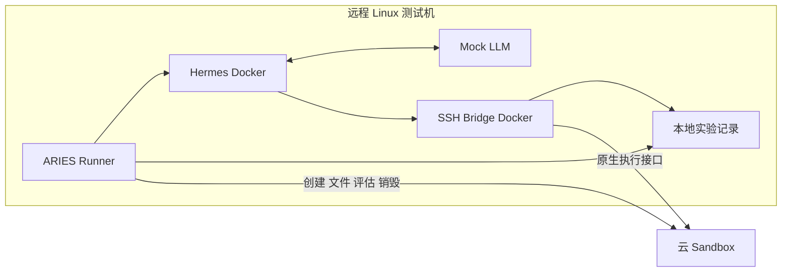

# 多云 Sandbox 性能观测与分析设计

状态：本页保留早期多云设计快照，Hermes 拓扑、五项基线及“故障/并发待完成”等叙述不能作为当前验收状态。本轮细分观测的评审入口为 [Agent Runtime 细分观测设计](runtime-observability.md)（待用户审阅，未实施）；当前实测结果以[性能报告](../performance-archive.md)及[性能证据附录](../performance-evidence.md)为准，架构与产物分别见[架构指南](../architecture-guide.md)和[运行产物说明](../run-results.md#performance-records-and-offline-summaries)。

早期目标是在 ARIES 的真实 Agent、工具执行和独立评分流程中，比较 E2B、阿里云、腾讯云、华为云的 Sandbox 性能。AWS 暂不纳入。原方案固定远程 Linux 测试机、Hermes、Docker Bridge 和 Mock LLM；这一工作负载选择已由上面的当前 P0 方案取代，每个任务实例仍使用新的云 Sandbox。

核心产出是可复算的逐次测量、明确的计时边界、性能与可靠性并列的报告。首先回答三个问题：等待沙箱可用需要多久，实际工作执行得怎样，并发增加后哪里变慢或失败。

## 早期架构参考



新增云 Sandbox，直接实现既有 [ToolSandbox 与 Sandbox 接口](../../pkg/runner/interfaces.go)，保留 Runner 的四个角色。Bridge 保留原生 SSH 适配，增加远端执行 backend；共享经过契约测试的底层客户端实现。Harness 和 Bridge 的本地部署，与 Sandbox 的远端身份、模板、凭据和路由分别管理。

Agent 停止、Bridge 撤销访问确认之后，才运行真实 verifier。评估需要的新 Sandbox 单列 `purpose=evaluation`。LLM mock 只固定工具轨迹；预设动作的 reward 不解释为模型能力。模板构建、发布和依赖预下载在测量前完成，耗时单独存档。

## 业界方法及采用范围

以下来源提供方法依据；本项目的阶段名称、样本门槛和验收规则属于本设计，不是这些项目的兼容性或认证声明。

| 方法或技术 | 本项目采用的部分 | 适用边界 |
| --- | --- | --- |
| [ComputeSDK Sandbox 基准方法](https://github.com/computesdk/benchmarks/blob/master/METHODOLOGY.md) | 从创建请求到首次成功执行的 TTI，固定工作负载，保留逐次数据 | 借鉴测量定义，不移植其 SDK、排行榜或综合分数；另测文件、持续执行和销毁 |
| [Modal 就绪阶段设计](https://modal.com/blog/unpacking-sandbox-startup-latency) | 分开创建返回、可以执行、应用准备完成 | 厂商内部 scheduled/boot 事件不可见时不推断；本项目使用一致的可执行性探针 |
| [OpenTelemetry 上下文传播](https://opentelemetry.io/docs/concepts/context-propagation/) | 操作 span、父子关系、请求关联；内部边界采用 W3C trace context | 云平台未接入时只能观测客户端调用；现有 Hermes span 不自动构成贯通链路 |
| [Prometheus 分布统计](https://prometheus.io/docs/practices/histograms/) | Counter、Gauge、Histogram 的语义与可聚合延迟分布 | 不平均各 worker 的 p95；首版统计以完整原始事件为准 |
| [OpenTelemetry 采样](https://opentelemetry.io/docs/concepts/sampling/) | 将诊断 trace 的采样与实验统计分开 | 按慢请求或错误保留的 trace 不能作为总体分位数和错误率的样本 |
| [k6 开环与闭环模型](https://grafana.com/docs/k6/latest/using-k6/scenarios/concepts/open-vs-closed/) | 分开固定并发和固定到达率，检查慢服务引起的发压不足 | 借鉴负载模型；不直接用 HTTP 压测替换 ARIES 的有状态 Agent 工作流 |
| [SeBS 实验结构](https://arxiv.org/html/2012.14132v2) | 分开客户端等待、程序执行和资源指标，用代表性工作负载解释差异 | 其对象是 FaaS；本项目不直接移植平台冷启动实现或历史结果 |
| [OpenTelemetry eBPF 权限要求](https://opentelemetry.io/docs/zero-code/obi/security/) | 后续按需诊断有权限的测试机 | 不把托管云宿主机的内核观测作为四云共同前提 |

首版采用完整、版本化的 JSONL 操作记录，按 OTel 的关联模型设计，可选输出 OTLP。已有 Hermes OTel 产物继续保留。Prometheus、Grafana、集中 trace 后端可在需要持续运行或多机查询时接入；它们不替代实验记录。首版不新增观测服务集群，不要求在沙箱安装常驻采集 agent。

P1a 仅实现同进程 context 中的操作关联，尚无 OTLP 出口或跨进程 trace 传播。其最小 manifest 记录 schema、时钟域和可得的 Go 构建信息；下文完整实验 manifest 在 P1b/P2 补齐。P1a 离线分位数仅是样本描述，不包含置信区间或独立性审核。

## 设计启动时的数据与缺口

| 现有产物 | 当前可解释的内容 | 不能直接推导的内容 |
| --- | --- | --- |
| [Runner 任务结果](../../pkg/runner/runner.go) | 任务总耗时，以及 harness、评分、隔离、清理结果 | 创建、就绪、准备和销毁各自耗时；精确的计划到达排队时间 |
| [Bridge 工具日志](../../pkg/bridge/ssh/execute.go) | 已解析命令进入执行至执行返回的耗时、字节数和退出码 | 完整 SSH 接入耗时、远端纯计算耗时；[audit timestamp](../../pkg/bridge/ssh/audit.go) 是结束后入队写记录的时间，sequence 也是完成顺序 |
| [Hermes OTel](../../pkg/harness/hermes/harness.go) | model、tool、API 的原生 span | span 可能缺失或截断；不能作为完整操作计数，也没有与每条 Bridge 操作的可靠一一映射 |
| [资源采样](../../pkg/monitor/recorder.go) | CPU 累计量、内存、观测覆盖率 | 秒级采样不能测亚秒启动；首个 CPU 差分样本建立基线，当前写出的 0 不表示测得空闲 |
| [到达调度](../../internal/app/execution.go) | 到达 offset 回放和并发上限 | 槽满时 admission 阻塞；缺少持久化的计划、发起、未发起、队列记录，不能据此宣称严格开环发压 |

上表说明设计启动时的基线缺口。P1a 已补有限计划的全部终态、调度 anchor 与 Runner 各实际调用阶段；仍保留阻塞 admission。`sandbox.start` 只能代表现有接口调用，不宣称已具备统一云就绪探针。现有 `HarnessResult.Duration` 包含产物收集，任务总耗时包括最终清理。新的性能边界单独定义，不重新解释旧字段。

## 测量边界与时钟

每个耗时在实际执行该操作的进程内，以保留单调时钟信息的 `time.Now()` 和 `time.Since()` 计算，再写入 `duration_ns`。UTC 时间仅用于定位、展示和事件关联。Go 时间序列化不会保留单调时钟；不能用不同进程、云服务或 guest 的墙钟相减推算网络或排队耗时。[Go 时间语义](https://pkg.go.dev/time#hdr-Monotonic_Clocks)

主视角是测试端实际等待的时间，包含客户端和网络。另设 guest 内固定工作负载的自计时作为辅助证据；它包含约定程序本身的时间，不等于物理宿主机 CPU 时间。记录计时方式和测量层，不把两者混成同一条延迟分布。

父阶段包括子操作。例如 `sandbox.start` 包含 create 和就绪探针，`agent.run` 包含模型及工具等待。报告展示嵌套关系，不把父子耗时相加。同一 emitter、同一 clock domain 内的并行子操作可用区间并集及已知依赖分析关键路径；跨进程只展示可靠的因果关联和各自测得的耗时，不根据墙钟拼接精确关键路径。不能把各操作时长之和称为总耗时，也不能用 p95 相减分解 p95。

## 观测点与指标

下表的名称是提议的事件或指标名称，不是当前 profile 支持的字段。

| 观测点 | 起止边界 | 输出与解释 |
| --- | --- | --- |
| `arrival.queue` | 计划到达至实际 admission 获得容量 | 排队延迟；所有计划 arrival 预分配 ID，未开始者同样有终态记录 |
| `occurrence.setup` | 获得容量至 Runner 生命周期开始 | 区分本地构造、观测器启动和任务加载，避免算进云创建 |
| `sandbox.create` | 调用创建方法前至拿到可归属实例身份或确定失败 | 逻辑操作时长，另记 SDK/RPC attempt；返回 ID 不等于就绪 |
| `sandbox.tti` | 创建方法调用前至统一探针首次成功完成 | 探针须有预期退出码和输出；名称为新实例 TTI，不自动称物理冷启动 |
| `sandbox.prepare` | benchmark 开始准备至准备、清理私有 verifier 路径和工作目录检查完成 | 与 TTI 分开；从创建开始到此时的 parent interval 称任务环境就绪耗时 |
| `bridge.register` | 注册借用访问至得到可用工具 endpoint | 记录框架接入开销，独立于云实例可执行性 |
| `exec.total` | 发起一次逻辑执行至收到退出码并结束输出流，或明确失败 | 区分 transport 失败、remote exit、取消、超时；记录有效和截断字节 |
| `exec.first_stdout`、`exec.first_stderr` | 本次执行开始至第一个非空对应输出 payload | 不把协议头、进程 ID、心跳当输出；无输出记 null 和原因 |
| `exec.first_marker` | 执行开始至收到固定工作负载约定的完成前标记 | 仅专用探针支持，用于比较交互响应；任意任务无此定义时记不适用 |
| `file.upload`、`file.download` | 操作开始至数据完整传输或失败 | 按实际 payload bytes 计算吞吐；校验哈希另记 `file.verify`，并提供传输加校验的 parent interval |
| `sandbox.workload` | 已就绪实例开始固定工作负载至工作完成 | 包括短命令、文件、计算及任务轨迹；按 workload 分组比较 |
| `sandbox.delete.request` | 发出删除请求至控制面响应 | 只表示删除请求阶段，不作为确认删除 |
| `sandbox.delete.confirm` | 逻辑 Stop 开始至确认实例不存在或达到清理期限 | 保存所有查询 attempt、最终证据；不能以健康探针失败代替删除确认 |
| `task.e2e` | Runner 生命周期开始至清理完成或明确失败 | 保留完整用户体验；同时列出 agent、隔离、verifier、产物收集和清理阶段 |
| `arrival.e2e` | 计划到达至已开始任务终态，或未开始项的取消/拒绝终态 | 单独展示含本地队列的用户等待；不能用它替代云调用延迟 |

就绪探针采用固定的短命令及固定输出标记。保存探针定义、轮询间隔、各次 attempt 和超时；观测到的 TTI 包含轮询等待与网络，不能称作精确的服务器 ready timestamp。探针间隔一致，探针负载计入辅助调用数。不能声称能控制厂商内部预热池、物理宿主机缓存或真正冷启动状态。

例如 [E2B runtime](https://github.com/e2b-dev/runtime) 描述了预启动快照恢复、按缺页加载和写时复制；新实例 ID 不能证明资源处于完全冷态。因此同时报告创建至首个固定工作负载完成的实际区间，避免懒加载成本仅从 create 阶段移到 exec 后被遗漏。

执行流必须一直计时到终态；HTTP headers 返回不是命令完成。若采集 HTTP TTFB，它表示响应 headers 的首字节，不能当首个 stdout 或有效输出。[Go HTTP trace 定义](https://pkg.go.dev/net/http/httptrace#ClientTrace)

新建后的第一次用户命令、同实例的后续命令分别统计，并记录此前已运行过哪些就绪/准备探针。不要将已被探针使用过的执行通道称为从未使用的冷通道。暂停恢复、快照和预建池只在后续能力组单列。

## 资源与可靠性观测

| 维度 | 记录内容 | 可比性要求 |
| --- | --- | --- |
| CPU | 可得的累计 CPU seconds、采样间隔、分配 vCPU、限流计数 | 平均消耗核数为 CPU 时间增量除观察时长；配额利用率再除有效 vCPU。厂商只提供百分比时保留原始口径，不伪造累计值 |
| 内存 | 当前值、采样最大值、limit，标明 RSS/working set/cgroup 等来源 | 不同口径不直接排名；采样最大值称观测到的峰值，短任务可能漏峰 |
| 磁盘与文件系统 | 实际容量、读写工作负载吞吐、可得的 I/O 计数 | 标明 tmpfs、页缓存、持久性及 fsync 策略；文件 API 吞吐不解释为磁盘带宽 |
| 网络 | 客户端发送/接收字节、DNS/TLS/连接复用诊断、控制面/执行面 endpoint 区域 | 固定测试机与端点条件；不从总延迟简单减 RTT 得出云内部耗时 |
| 测试端 | Runner、Bridge、Mock 的 CPU/内存、队列、在途数、导出积压 | 识别客户端饱和；与 sandbox guest 资源分开保存 |
| 失败与清理 | rate limit、超时、调用方取消、连接故障、非预期 exit、结果不符、删除未确认 | 非零退出码按 workload 预期判断；取消传输不等于远端命令终止 |

统一使用 `measured`、`unsupported`、`not_collected`、`incomplete`、`failed` 等可区分的观测状态。数值不存在时为 null；0 仅代表有效测量为零。厂家原始资源指标、guest 指标和本地观测分别注明 source、单位、采样周期及字段含义。

## 数据和关联设计

沿用现有结果、资源、Bridge audit 和 Hermes span 文件。拟增加以下产物，最终路径在实现时集中定义：

| 产物 | 用途 |
| --- | --- |
| `performance/manifest.json` | 实验版本、条件、工作负载、测量策略、来源和文件索引 |
| `performance/arrivals.jsonl` | 每个计划 arrival 的 offset、admission、发起和未开始原因 |
| `performance/runner-events.jsonl` | Runner 阶段及主进程 provider 调用 |
| 每个 Bridge 的 `performance/events.jsonl` | Bridge 操作及同进程 provider attempt；每个文件只有一个进程写入 |
| `performance/summary.json` 和表格报告 | 从上述原始记录派生，可使用同一分析版本重算 |

P1a 将 arrivals 和 Runner 事件统一写入同一 `runner-events.jsonl`，避免一个进程维护重复事件流；另有 `index.json` 记录收尾状态和丢失/写入计数。`aries-perf` 从单次记录生成 JSON 汇总，`summary.json` 由调用者保存。Bridge 文件、表格图形和完整 manifest 暂未实现。

最小事件字段：

```text
schema_version, event_type, operation, phase, purpose
run_id, logical_task_id, occurrence_id, arrival_id
sandbox_instance_id, provider_sandbox_id
operation_id, parent_operation_id, attempt
emitter_id, clock_domain, sequence
started_at_utc, duration_ns, observed_offset_ns
status, error_class, exit_code
stdin_bytes, stdout_bytes, stderr_bytes, payload_bytes
first_stdout_ns, first_stderr_ns, first_marker_ns
provider_request_id, trace_id, span_id, measurement_status
```

`observed_offset_ns` 只在同一 emitter 的已记录 anchor 内有意义。arrival 的计划与实际时刻应由同一个调度进程关联记录。开始/终态通过 operation ID 配对；进程崩溃后缺少终态记 incomplete，不伪造 duration。首次输出为空需有原因，例如 `no_output`、`timeout`、`unsupported`。

manifest 保存代码 commit 和未提交改动指纹、schema/分析器版本、完整 fixture SHA-256、任务与数据版本、各云 template ID 和构建材料摘要、请求与有效资源规格、架构/内核/运行时、区域和测试机、SDK/协议版本、连接复用、观测开关、负载模型、随机种子、期限、重试/轮询策略。环境差异不能通过同名 template 掩盖。

一个逻辑调用可以有多个 RPC attempt，分别记录退避和 SDK 隐式重试；主指标包含全部等待，attempt 指标用于定位问题。不因创建结果不明而自动重复创建新实例。partial allocation 和 cleanup-unconfirmed 保留可追踪身份。

Runner 和 Bridge 的内部控制边界传播 trace context；Bridge 在执行前分配 operation ID，经同进程 context 传给 provider。现有 SSH/harness 不一定能传原生 tool call ID：可先关联到 occurrence，详细映射明确标记缺失。不得修改命令参数来藏 trace 信息，也不凭重复命令 hash 或时间接近猜测一一对应。厂家 request ID 只是服务端诊断关联键，不证明已拿到服务器 span。

核心事件和操作计数不采样；可选 trace 的 head/tail sampling 独立配置。指标标签仅用受控的 provider、region、operation、workload 类别、有限 outcome 等；run、task、sandbox ID 以及错误详情放事件或 span。HTTP 路径采用模板，不把实例 ID 变成无限标签。Prometheus 出口优先验证 native histogram 兼容性；否则统一显式桶。报告分位数直接从原始数据计算。

写入采用有界缓冲，记录队列积压、丢失、导出和 flush 错误。核心记录缺失会使该实验的完整性检查不通过；不能静默丢掉慢请求。保留计数和开始记录辅助发现缺失。日志正文、凭据和命令原文不进入通用性能标签，现有私有证据机制保持独立。

## 工作负载与实验矩阵

首批保持一个 Linux CPU 架构、固定软件/数据/资源规格、Hermes 版本、Mock fixture 和 verifier。默认无随机模型延迟；若实验加入固定延迟，它属于单独的 workload 配置，纳入 fixture hash。

相同 fixture 不自动证明实际工作量相同。每个 occurrence 记录实际执行的工具轨迹摘要、输入数据摘要和完成步数，检查命令顺序与参数是否符合预定 workload。意外改变执行计划时标明可比性问题；超时或失败造成的提前结束仍保留在可靠性分母，不能因为步骤未完成就删除样本。

| 工作负载 | 观察目标 | 首版范围 |
| --- | --- | --- |
| 协议正确性 | argv、cwd、env/user、二进制流、stdin EOF、权限、退出码和清理 | 前置验收；有语义差异的适配不进入同组排名 |
| 新实例就绪 | 每次创建新实例并执行统一探针 | TTI、成功率、删除确认；镜像/模板预先发布 |
| 短命令与流式响应 | 无输出命令、短输出命令、固定间隔多块输出、二进制校验 | 首次与后续执行分组；流测试只存关键事件和计数，不逐 chunk 写日志 |
| 文件与目录 | 固定不可压缩数据及哈希；文件 API 与 tar 目录轨迹分别测量 | 可先选 4 KiB、1 MiB、16 MiB，按四云共同上限确认后锁定；小文件数量及权限固定 |
| 固定 Agent 轨迹 | 相同工具顺序和参数、真实文件/命令、独立 verifier | 主端到端实验；当前 `fix-git-mock` 仅探测，不视为成功解决任务的基准 |
| 计算与本地 I/O | 固定计算、内存访问、文件系统程序的本地自计时 | 后续诊断组；程序/编译选项/线程数/缓存策略固定，可评估 Google Benchmark、fio 等现成工具 |

后续存储诊断可借鉴 [Tensorlake SQLite sandbox benchmark](https://github.com/tensorlakeai/sandbox-sqlite-bench) 的不同事务及持久化模式：每轮新建数据库，锁定 SQLite 版本、PRAGMA、缓存和输入规模，校验结果。借鉴 workload，不采用其厂商排名或少量重复的统计口径。

两条测量路径分别报告：直接 provider 操作用于定位创建/执行/传输；完整 ARIES 路径用于衡量真实 Agent 体验。直接路径调用同一适配器，不另建一个功能不同的执行系统。只对同一调用内实际测得的嵌套区间做分解，不拿两条独立实验的分位数相减计算 Bridge 开销。

每个对比组固定 provider 产品/region、资源和架构、template 基线、workload、实例状态、客户端位置与版本、并发/到达率、deadline、观测模式。记录厂商有效 CPU/内存与客户请求的差别；不能只因都写了“2 vCPU”就断言底层硬件等价。

主报告采用同一测试机视角，网络计入体验。若后续在各云就近部署测试机，另建实验组，并记录测试机本身差异。外部 git、包仓库、对象存储访问不进入最小基线；需要测这些依赖时单独构建代表性场景，固定源与缓存条件。

准备/预热阶段事先规定并记录，不事后删除慢样本。新实例组始终新建；重复命令组保留同实例，但标明命令序号和状态。借鉴 [NIST 随机区组设计](https://www.itl.nist.gov/div898/handbook/pri/section3/pri332.htm)，按时间块轮换、随机化云厂商测试顺序，避免固定顺序带来的时段偏差，并检查测试端没有成为瓶颈。

## 负载模型和统计分析

单个 Agent 内的工具调用保持因果顺序，属于闭环工作流。跨任务/会话采用两种明确分开的实验：固定在途并发，以及与响应无关的预定到达。后者分别记录计划、实际发起、完成、超时和未发起数量，观察排队和限流。

[k6 对 coordinated omission 的说明](https://grafana.com/docs/k6/latest/using-k6/scenarios/concepts/open-vs-closed/)指出闭环系统在响应变慢时可能自动降低压力。本设计在保留真实 Agent 因果顺序的同时，以会话到达计划和完整 admission 记录识别这种偏差。

当前 arrival replay 仍受阻塞 admission 影响。首步先补完整记录，报告其实际语义；真正的开环发压需要单独实现和验收非阻塞的计划产生及有界队列。队满时排队、拒绝或丢弃的策略必须预先声明，并保留每个计划项终态；禁止自动降速后仍把目标速率写成实际速率。用户等待从计划到达计时，调用延迟从实际发起计时，二者并列。

报告按以下顺序形成：

1. **先校验实验有效性。** 环境/fixture 是否匹配，计划数、操作开始/终态、数据覆盖和销毁证据是否完整。单独显示未发起、未确认清理和观测丢失。
2. **再报告可靠性。** 阶段成功率、超时率、限流率、结果校验失败率和清理未确认率；同时给出分子分母。成功完成、任务评分通过、隔离通过、清理确认分别统计。
3. **报告延迟分布。** n、p50、p95、p99、最大值、ECDF 和置信区间。成功操作分位数明确标为条件分布；失败/超时单列观测到的等待时长，不当作正常完成样本。
4. **报告容量。** 目标到达率、实际发起率、完成吞吐、满足正确性及事先约定延迟门槛的 goodput、在途量与队列随时间变化。门槛未约定时只报正确完成吞吐。
5. **解释差异。** 查看同次操作的阶段与 attempt，结合测试端及 guest 资源；区分客户端排队、建连、重试、准备、执行和回收。不把相关性直接写成云内部根因。

所有计划 arrival 都进入 admission 统计分母，包括取消前尚未启动的项；某个执行阶段的成功率则以实际进入该阶段的操作为分母，另外给端到端计划完成率。发压端没有发出的请求归入调度/测试端结果，不能算作云 API 错误。未定义的后续工具调用不能凭空计为计划请求。取消后等待 drain 的时间单列。

超时后的真实完成时间未知，记录为右删失；不能把 deadline 填作准确完成时间，也不能把超时设为 0 或从失败率移除。首版不为超时样本合成 p99；输出“成功延迟分布＋超时比例＋截止时间”，必要时后续加入显式假设下的生存分析。

正式报告从合并后的原始样本计算分位数，采用固定、版本化的经验分布 nearest-rank 定义 `x[ceil(p*n)]`（样本升序、下标从 1 开始）。同口径 histogram 可以聚合，但据此估算的分位数须标明近似值及桶配置，仅作监控诊断，不能替代原始样本结果。跨 workload、实例状态或区域不混合分位数；不平均各 worker 的 p95，不做任意加权综合排名。

先做小规模 pilot 估计方差及费用，再预注册样本量、时间块、随机顺序和停止条件。本项目建议：pilot 每组约 30 个独立新实例；正式比较在多个时间块内扩大样本，p99 至少 1000 个有效独立单位才作为常规展示，仍须报告区间宽度。这是报告门槛，不是精度保证；预算不足时以 p50/p95 和原始 ECDF 为主。

同一 Sandbox 的大量命令不当作大量独立实例。置信区间按实例/时间块重采样，保留组内相关性；云间比较在相同 workload、规格和时间块下报告差值或比例及区间。多次运行的 p95 不取算术平均。异常点保留，只有预先定义且可证明的实验错误可排除，并提供排除清单与未排除结果。

独立同分布的新实例样本可参考 [NIST TN 2119](https://nvlpubs.nist.gov/nistpubs/TechnicalNotes/NIST.TN.2119.pdf) 的顺序统计量/二项分布方法给分位数区间；失败率附 Wilson 或小样本精确区间。密集重复命令与共享时间块需另外处理相关性，不能直接套独立样本公式。明确给出分析方法、有效样本单位和区间估计的假设。

吞吐的测量窗口、warm-up 和 drain 分开记录：固定窗口吞吐以窗口内完成数除窗口长度，同时报告窗口内发起和在途数；有限批次完成率以该批全部计划项跟踪到终态。不要用“发起窗口内的成功数”除含任意长 drain 的总时长混造一种吞吐。

## 报告展示和诊断顺序

首版生成可离线阅读的表格与图，不要求在线仪表盘：

- 条件与有效性表：规格、版本、样本数、覆盖、失败及清理状态。
- 延迟 ECDF 和尾部视图：创建 TTI、执行、文件、删除分别展示；标注超时比例。
- 代表性操作的嵌套时间线：创建、探针、准备、Agent、Verifier、清理，附可关联的 attempt。
- 负载曲线：到达率/并发与 p95、goodput、错误率、队列长度的关系。
- 资源曲线：按组件和来源绘制；没有数据的指标留空并解释可用性。

定位顺序为：检查语义及数据完整性 → 测试端队列/CPU → 连接与重试 → Sandbox 就绪/命令/文件 → guest 资源 → 清理。无厂商内部事件时，将“服务端排队或启动变慢”保留为待厂商证据确认的解释。

## 实施与验收

| 阶段 | 交付物 | 验收依据 |
| --- | --- | --- |
| P0 设计基线 | 本观测方向、阶段顺序和统计边界 | 已批准开始；账号、实测预算及正式实验条件仍须落实 |
| P1a 调度与生命周期 | 调度记录、Runner 阶段、完整性检测和离线描述统计 | 模拟后端验证边界；成功、失败、取消和未开始项可对账；旧字段语义不变 |
| P1b 工具与实验条件 | Bridge 关联、exec/首输出/文件观测、fixture 与配置指纹、开销校准 | 跨进程身份可靠、无缺失数据填零、固定实际工具轨迹；真实目标负载下验证开销 |
| P2 E2B 完整链路 | 独立云 Sandbox、模板映射、借用执行、真实 verifier | 执行/文件契约通过；创建失败可追踪，删除终态可确认；相同轨迹可重复 |
| P3 四云适配 | 阿里、腾讯、华为各自配置与能力结果 | 每家通过同一验收矩阵；不支持项明确；相同条件下有可复算数据 |
| P4 性能实验 | 分组对比与解释报告 | 预先固定条件与停止规则、事件完整、清理可确认、统计方法可重现 |

P1b 加入观测开销 A/B 校准：固定工作负载对比最小记录与完整观测，随机化顺序，记录 CPU、写盘及延迟变化。建议把目标负载下的开销控制在预设预算内（例如中位延迟增加不超过 5%，绝对增量也报告）；此值是待确认的工程目标，P1a 不宣称已达到。超过预算先调整采集方式或下调负载，不能静默校正实验成绩。

验收还需覆盖：时钟调整不改变 duration、嵌套耗时不重复相加、并发身份不串用、空输出不是零延迟、超时与非预期退出区分、取消不被写成远端已停止、异步删除返回不被写成资源已不存在、事件缓冲溢出可见、统计结果可从原始文件复算。

本提案不更改现有支持矩阵或配置格式，也不表示四云已通过联调。后续实现发生行为变更时，按仓库要求同步相关 `.agents`、配置和支持文档。
