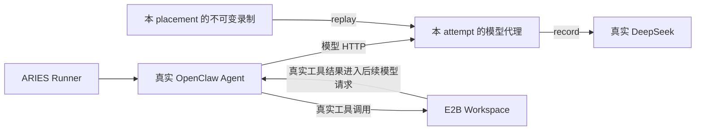

# 模型录制与回放

默认与本文历史成功记录均为 Strict Replay。显式 Workload Replay 是独立模式，工程及真实验收状态见下节，不回填既有 Strict 成功数。

## 终帧交付与正常断开

录制在上游完整 SSE 校验和 HTTP EOF 后才向下游发送原始 `[DONE]` 及其后的合法注释帧；此前内容仍逐帧透传。数据在 DONE 后出现、残缺尾帧、上游读失败或提前取消仍使录制失败。上游收到帧的时间与实际下游 Flush 时间分别保留，不能把等待 EOF 的时间伪装成模型生成时间。

录制、回放和缓存重试在全部原帧写入并 Flush 成功后完成该请求，不因客户端随后正常关闭而反向改判失败。Flush 成功仍仅表示发送端边界，不证明 Agent 已消费；写入/Flush 错误仍失败。旧失败 Tape 不修补、不改判。此修复由 ECS 的 `terminal-delivery-fix-1` 定向、完整包及 race 回归验证，新真实云验收单独记录。

历史单轨迹入口仅支持流式 Chat Completions。PPT 华为 A `record-2` 实测在第六次模型请求触发原生 `task_tool` 子 Agent 的 `stream=false`，被该入口拒绝；原失败记录不改判。

## Jiuwen 子 Agent 与非流式 JSON

云配置显式使用 `model.session_protocol=jiuwen-tool-branches-v1` 时，原生扩展在 `TaskTool.invoke` 的实际 `tool_call_id` 上建立分支，沿异步上下文通过原生 `before_model_http` 事件加入 `X-Aries-Model-Branch` 请求头。主会话为 `main`，子会话为父路径加调用 ID。入口只接受父会话已返回的真实 `task_tool` ID；不按提示词哈希、时间邻近、随机 UUID 或请求内容猜会话。请求头不转发至真实模型，原生任务参数、工具结果和调用方式保持不变。

每条分支有独立历史与回放游标；并行子会话可以交错发送请求。Tape v4 将主轨迹及所有子轨迹封装为一份不可变文件；子轨迹使用支持 SSE/JSON 的 v3 表示。非流式响应保存并交付原始 JSON 字节，使用真实完整响应接收、写入及 Flush 边界，不构造 SSE 帧或 TTFT。Strict 仍比较完整请求，旧历史和工具结果变化仍失败。遗漏录制过的子会话、子会话失败或未终结不能形成完整成功回放；旧 v1/v2 Tape 保持原格式。

该协议的 ECS 定向测试覆盖并行、缓存重试、旧历史偏离、未知或遗漏分支、完整封包与 A/B 应用入口；固定 image8 的原生 TaskTool 和 OpenAI 客户端 HTTP 构造也已通过受控 fixture。release27 合并版本已通过并冻结 build/test/test-race/lint/integration 五门禁，证据位于 `/opt/aries-artifacts/release27/`；定向证据仍在 `/opt/aries-artifacts/jiuwen-model-branches-1/`。

release27 华为 A/B PPT `record-3` 均已完成真实 DeepSeek、Sandbox 工具和独立结构评分，五页 `final.pptx` 通过，Stop/revoke 与清理确认通过。两份完整 v4 Tape 分别有 64/61 个主会话轮次，子分支和 JSON 完成数均为 0，因此这两次通过不构成真实云端 JSON/子 Agent 路径验收，也不是 MockLLM 回放或同 Tape 跨云对照。B 的 Trace 另有公开端口误脱敏导致的观测失败，不影响上述录制状态；详见 [PPT 复测报告](../jiuwen-pptx-capacity-20261027.md)。随机提示路径、提示时间及 sticky 子 Agent 跨新调用恢复旧历史等尚未完成跨云验收，不能据此承诺所有原生工作流已可 Strict 回放。

同一 placement 的跨云对照必须引用同一 Tape 文件 SHA-256；各云独立录制不能替代。A/B 使用各自固定的一份 Tape，主会话和子会话不得拆成另选的录制材料。独立 `aries-model-replay` CLI 仍为单轨迹入口；新分支协议当前通过 `aries cloud` 接入。

## Jiuwen原生历史接入

固定版本Flash实际使用`system,user,user`初始请求，并将最后一条临时user附件移到下一轮新增assistant/tool消息之后。原录制入口不支持这种结构，真实云record3在本地拒绝，未向DeepSeek生成。两组受控请求的附件相同，但record4真实生成后，原生异步runtime state使附件的模式名由`agent`更新为“智能体模式”；旧fixed-tail假设因此再次拒绝。四轮原失败、原评分和清理均保留。

`history_dialect=jiuwenswarm-e2c9d519-request-tail-call-goal-v2`只作用于**录制及Tape加载的因果检查**，绑定原生源码和lock；识别原生单个request-only尾user附件及其renderer外壳，允许附件内容按轮更新。持久历史前缀、assistant内容/reasoning、工具ID/名称和每个真实结果的关联仍校验；漏结果、改旧历史或多插消息仍拒绝。具体Harness自动选择，Tape声明纳入内容校验；没有新的宽松匹配配置。早期`request-tail-v1`、`fixed-tail-v1`声明保持原含义，默认历史规则和OpenClaw旧Tape不改。

v2补充固定原生`extract_call_goal`的精确行为：模型响应中的顶层`call_goal`、`callGoal`用于展示，原生会在工具执行前同时移除，不论值的类型；下一请求的assistant历史因此没有这两个字段。录制器只在响应与后续历史的因果核对中，对临时解码副本执行同样的移除。命令、description、display_name、嵌套字段仍精确核对；原SSE、原参数和每轮请求均不修改。record5的61帧真实响应及第二请求已离线复现旧版拒绝，新候选通过，并有执行参数、结果正文和历史偏离仍拒绝的回归。证据`/opt/aries-artifacts/jiuwen-call-goal-1/evidence.json` SHA `5629ba36e06770631285062420dc45df7624152a6db054b788ad1fe8622b6f46`。这是协议兼容修复的定向验证，record5仍为原评分1/12、Tape不完整的失败样本；候选完整发布和新云端闭环另验。

每轮完整请求原样保留；Strict仍比较当前请求与该轮录制的全部字段，包括附件正文，不通过移除尾提示、归一化文字或重排后比较。request-tail候选已用record4真实首轮SSE及第二请求离线复现旧拒绝，验证新录制因果校验接受、Strict仍拒绝正文或历史偏离；ECS unit/race/vet通过，完整发布门禁和云重测另验。该离线fixture补充了明确的合成最终回答以验证Tape收尾，不冒充真实解题轨迹。证据`/opt/aries-artifacts/jiuwen-request-tail-2/evidence.json` SHA `903a5fefc41355f2c0efc32ebd0675488a2341afe1c4e2fb76e1b9d2132f93a9`。原生随机路径和提示时间导致的跨冷启动Strict偏离是另一个已知阻塞，不能用此协议适配掩盖；[独立变体设计](../design/jiuwen-reproducible-prompt-context.md)待审阅。

<a id="workload-replay-policy"></a>

## 显式工作量回放策略

`aries cloud` 的 `model.mode="replay"` 可设置 `model.replay_policy="workload"`；省略或填 `strict` 保持完整请求严格匹配。录制时不允许设置此字段，独立 `aries-model-replay` CLI 仍使用 Strict。release12已通过[ECS五项工程门禁](../observability/VALIDATION_AND_REPRODUCE.md#workload-replay-release12)，并完成[DB两云Workload](../workload-db-performance-20261026.md)和[SQLite两云Workload](../workload-sqlite-performance-20261026.md)的真实工具、原评分、终态、双Trace及清理验收。DB各原7/7、11工具；SQLite各原3/3、40工具结果。SQLite首轮Snapshot重载失败及华为缺shell配置失败保留，修复后独立新轮通过；不重写历史失败或增加Strict成功数。

Workload 允许双方均为字符串的 `role=tool` 消息正文不同，包括更早历史中的正文；缺字段、null、数组或对象不会因此放行。OpenClaw 的其他字段继续精确匹配。Jiuwen 固定原生上下文的候选扩展见下一节，不改变 Strict 或旧 Tape。调用 ID、名称、参数、顺序、assistant 决策、模型参数和工具 schema 继续精确匹配。录制 Tape、实际请求、真实工具输出与录制模型响应均不改写，失败不会自动切换策略。cached retry 仍按完整实际请求识别，不按去掉正文的请求去重。

`request_matched.tool_content_differences` 记录每个发生差异的 JSON pointer、UTF-8 字节数及双方 SHA-256，不收录工具正文。它描述本次完整历史比较，同一旧结果在后续请求中可重复出现，不能把条目数相加当独立工具数。`model_sessions`、请求边界及索引均记录 `replay_policy`；分析器 v1.8.0 将同一份校验后证据投影到 Perfetto 与 OTLP。历史原件没记录策略时标 `unknown`，不能猜为 Strict；record 标 `not_applicable`。不为没有区间的事件伪造 Span。

模型匹配完成只证明决策输入契约满足。工作量性能合格还须对账真实派发、终态及退出证据、后台作业依赖、原独立 Verifier、停止撤权和清理；原录制包含的诊断失败保留，不把所有非零退出一律拒绝，也不把未执行或退出状态变化当成相同工作量。Strict 原成功在同次运行满足共同验收门时可满足工作量判定，但新建 Sandbox 的另一轮实验仍须实际验证。Strict 和 Workload 分开统计，不把 Workload 成功改称 Strict 成功。

<a id="jiuwen-原生-ppt-的非-strict-接入"></a>

### Jiuwen 原生 PPT 的非 Strict 接入

本轮优先完成用户 PPT 任务，Strict 不作为功能交付门槛。沿用已有 `model.replay_policy=workload`，不新增绑定文件，不修改原生提示或执行时钟。仅在固定 `JiuwenHistoryDialect` 主 Agent 中，额外允许已核验原生 formatter 的系统日期、私有运行根路径及初始 user JSON 的 timestamp 变化；任务正文、附件及其他 user 字段仍相等，运行时附件也仍精确比较。子 Agent 不自动继承此提示例外。完整历史在每轮都比较，旧历史的非允许变化仍失败。

任务绑定来自实际首轮 user 题目，而非只相信 profile 名称。Tape 的 placement、Harness 源码/lock、模型、dialect 和分支协议检查继续执行。旧 Tape 的 ToolCall 参数若含旧运行路径，仍原样执行，不重写命令；实际失败输出留证，并由独立 PPT Verifier 判断业务是否完成。

提示例外记录在 `request_matched.prompt_context_differences`，与 `tool_content_differences` 分开。每条保存类别、JSON pointer、UTF-8 长度及双方 SHA-256，不输出正文。分析快照验证后共享给 Perfetto 与 OTLP，不在两个出口各自处理差异。release29 的 ECS 五项发布检查和两份真实 Tape 的首请求检查已通过；真实工具执行、PPT 评分和清理尚需本轮云回放证据，不能用首请求通过替代。[验证与未验范围](../observability/VALIDATION_AND_REPRODUCE.md#jiuwen-workload-release29)。

四份 `profiles/cloud/jiuwenswarm-{e2b,huawei}-{external,embedded}-pptx-workload-replay.json` 为独立非 Strict 示例。A 两云使用同一份 A Tape，B 两云使用同一份 B Tape，保留原 SHA。示例 `timing=zero` 去掉回放器计划等待，不代表工具耗时为零；若改用 `recorded`，需作为另一组时序实验报告。示例中的占位 Tape 路径必须替换，不能把配置存在当作已完成回放。

### 如何使用工作量回放

在 ECS 使用已通过发布检查的版本，为已有合格真实 Tape 创建一份独立 replay profile。保留原任务及变体、placement、Harness/native 版本、工具 schema 和执行参数；修改 profile 时注意相对文件路径是相对 profile 所在目录解析的。模型部分明确设置 `mode: "replay"`、`replay_policy: "workload"`、非空 `tape_file` 和原回放时序（本批为 `timing: "recorded"`）。`--tape` 覆盖已通过配置校验的 `tape_file`，不能代替 profile 中的这个必填字段。为新运行使用独立 `name` 和输出目录。工具协议跟随该 Tape：原生同步工具 Tape 不应套用后台 `terminal-result-v1` 协议。

用现有入口执行，无需新建 MockLLM 服务或改动 Strict 配置：

```sh
./bin/aries cloud --env-file /path/to/private.env --tape /path/to/qualified/tape.json /path/to/workload-replay.json
```

跨云时选用对应 provider、凭据引用与任务 binding，保持已确认的 CPU/内存规格一致，记录磁盘和文件系统差异。模型会话走完、命令退出 0 或原评分通过，都不能单独替代完整验收；本批真实运行的结果、工具差异和对账方法见 [SQLite 验收记录](../workload-sqlite-performance-20261026.md)。发现工具终态差异时保留该轮结果并定位，不能修改旧 Tape 或事后改判为 Strict。

模型代理接在 **OpenClaw 的模型 HTTP 入口**，既可由 `aries cloud` 在 Runner
进程内使用，也可通过独立的 `aries-model-replay` CLI 启动。
它替换模型响应，Agent Loop、工具执行及 Sandbox 仍由原组件运行。
它不执行工具、不评分，也不把模型的最终回答当作任务成功。
原来的 `aries-mock-model` 保留，用于脚本工作负载检查。

协议包、每 attempt 的 cloud 接线和 Compose 定义已写入源码；之前的 ECS 完整
单测与 race 已通过。首次真实 A 录制 **FAIL** 的原始证据保留。修正原生 ID 方言和
输入初始化后，第三次包装作业中的真实 A 任务已成功：7 轮 DeepSeek、6 次工具调用，
完整 tape 含 1175 个 SSE 事件；独立验证 12 项公开及隐藏测试全部通过，隔离和清理已确认。
随后 A 在新 E2B 实例中的 recorded 回放也通过：7 轮完整请求匹配、6 次真实工具、
12 项独立测试通过，隔离和清理确认。B 已完成真实录制及独立验收：4 轮 DeepSeek、
3 次本地工具、573 个 SSE 事件，12 项独立测试通过，另有协议校验 PASS。
B 的新实例 recorded 回放也已通过完整请求、工具元数据、候选、12 项测试与清理核验。
B zero 回放也通过；随后 A C1×2、B C1×2、B C2×3 三个批次和三项 W2 组件故障
探针完成验收。W3 汇总五项基线与三个批次、共 12 个已接受任务，不代表全历史成功率、
整个外置 Agent Loop 的断连覆盖、完整观测开销或全局关键路径。
当前结果与范围见[架构指南 §8.4](../architecture-guide.md#84-重复并发和故障路径的实际结果)。
本包的模拟上游测试不能作为该验收证据。所有编译、测试、格式化、服务启动
与实验只在用户指定的远程 Linux ECS 执行；工作站仅编辑和静态审阅。

## 接入位置与会话边界



A 模式与 B 模式先分别录制、分别回放，不要求共享 tape。
每个 Handler 显式绑定 `run_id`、`attempt_id`、`session_id`、`placement`
和 Harness 版本，并拥有自己的轨迹游标。`aries cloud` 在一次 run 中共享
`127.0.0.1:8082` listener，经 HTTPS ingress 暴露固定的 `/v1` 路径。
它为每个 attempt 独立生成高熵 bearer token，按 token 摘要选择 Handler，
然后由 Handler 再校验认证；不通过 prompt、连接顺序或全局游标猜会话。
临时 token 不能从公开 session ID 推导，也不会记录到 tape/events。
同一 session 同时出现第二个请求会收到 `SESSION_BUSY`，没有隐藏排队。

库接口是 [`modelreplay.New(Options)`](../../internal/modelreplay/server.go)，
返回实现 `http.Handler` 的 `Server`。Cloud app 在 attempt 结束时撤销路由、
取消在途模型请求，再调用 `Close()` 等待已进入 Handler 的请求退出并收尾。
`New` 不启动监听、不读取环境变量，也不改变 Runner 的四角色生命周期。
独立 CLI 是单实例封装，一个 listener 只绑定一个 attempt；先完成 HTTP
shutdown，再调用 `Close()`。它默认绑定 `127.0.0.1:8000`，拒绝非 loopback 地址。
E2B 远端访问使用 [Compose 的 HTTPS ingress](../../deploy/e2b/README.md)，
仍校验每 attempt token；工具不会自动注册域名、建立公网隧道或关闭认证。

当前 ARIES OpenClaw 配置使用 `openai-completions`；原生 pin 为
`2026.7.1`，实际镜像 digest 固定在 `configs/versions.json`。Cloud 保留 DeepSeek 的请求/历史方言，
仅把模型 transport 指向代理。代理接受
`POST /v1/chat/completions`、`stream: true`；A/B 已完成真实多轮录制及云端 recorded 回放。
`GET /v1/models` 是受认证的目录查询，返回配置或 tape 的模型名，不推进轨迹。
Gateway WebSocket 的 `agent` 调用与模型 HTTP 是两个不同的接口。
仅替换 `pkg/model` 的评分客户端不能拦截 Agent 模型流量。

## 原生输入稳定性与实测边界

固定 OpenClaw 版本还不足以让新建实例产生相同模型请求。已直接阅读官方
`v2026.7.1`（commit `2d2ddc43d0dcf71f31283d780f9fe9ff4cc04fe4`）源码，发现：

- 原生 system prompt 的 Runtime 段包含 `sessionKey`、`sessionId` 和 `host`。
  Cloud A/B 的录制与回放现在都使用固定原生输入：session key 为
  `agent:main:aries-workload`，session ID 为
  `8ad5eb11-e541-4cbf-8ae0-1f9e2822c342`。Gateway 原样发送可选 `sessionId`；
  普通 profiles 仍省略该字段，保留原生新会话 ID 生成行为。
  依据：[Runtime prompt](https://github.com/openclaw/openclaw/blob/2d2ddc43d0dcf71f31283d780f9fe9ff4cc04fe4/src/agents/system-prompt.ts#L1375)、
  [原生会话选择](https://github.com/openclaw/openclaw/blob/2d2ddc43d0dcf71f31283d780f9fe9ff4cc04fe4/src/gateway/server-methods/agent.ts#L2306)。
- 用户消息默认会加入实际时间前缀。Cloud A/B 现在通过原生
  `agents.defaults.envelopeTimestamp="off"` 在录制与回放两端关闭该前缀，
  普通 profiles 不设置此项。旧 tape 必须重新录制；代理不删除已录请求中的时间。
  依据：[模型消息边界](https://github.com/openclaw/openclaw/blob/2d2ddc43d0dcf71f31283d780f9fe9ff4cc04fe4/src/agents/embedded-agent-runner/run/attempt.ts#L2635)。
- Linux 的 host 来自真正的 `os.hostname()`，仅设置 `HOSTNAME` 环境变量不会
  固定该值。A 的 cloud harness 请求原生容器 hostname `aries-workload`，
  A 的真实录制与跨实例回放已通过完整请求匹配。B 真实录制和新实例回放均观察到
  hostname `e2b.local`；当前代码没有更改 guest hostname，后续实例仍需核验。
  不能用会关闭原生工具的 raw/none
  prompt 模式替代 Agent 基线。
  依据：[原生主机名读取](https://github.com/openclaw/openclaw/blob/2d2ddc43d0dcf71f31283d780f9fe9ff4cc04fe4/src/infra/machine-name.ts#L26)。

这些输入只由 cloud wiring 的 `WorkloadInputs` 传入 A/B；每次 attempt 仍启动
独立 Gateway，使用独立 runtime／私有状态目录。原生 session ID 相同不意味着
共享会话状态；ARIES Attempt 身份、模型认证 token、轨迹会话绑定和 Gateway
idempotency key 继续独立唯一。`agent-result.json` 的
`requested_native_session_id` 只证明请求输入，不替代原生实际请求验收。

每次新实例仍须验证原生请求及实际 hostname，发现其他动态字段就明确报告。
工具输出和上下文压缩仍按下面的严格规则处理；不会忽略 system prompt、放宽
严格匹配或改写模型请求。配置接线及新增单测已在 ECS 通过；A/B 的真实端到端
recorded 回放及 B zero 回放已通过，其他时序与故障场景仍需独立验收。

## 后台最终结果协议候选

`harness.replay_tool_protocol=terminal-result-v1` 是显式选择的新候选协议，借鉴
后台 operation handle 与等待最终结果的做法。它只允许 external placement，
并要求 SSH 原生身份协议及 `stdout-stderr-v1`；使用时还必须选择包含对应实现的
固定 native 镜像。省略字段时，现有配置和原生行为保持不变。

控制器把协议版本注入 Harness 进程，不替 Agent 执行工具，不关闭后台或 PTY，
不改写 Strict 请求。`harness/replay-tool-protocol.jsonl` 与独立 index 用于保留
原生证据；文件缺失是未采集，收取失败是观测失败，不能据此改判 Agent 解题结果，
也不能据一次文件收取成功宣称完整覆盖。真实验收仍须核对原生调用分母、结果与因果关系。

此候选需要新录制的 Tape。后台最终结果接口不保证跨运行字节一致；文件时间、
程序输出等差异仍会被完整历史匹配拒绝。原题、私有 Verifier 和独立评分不变。
已完成的真实范围包括：[大文本 v2](../repro-variants-performance-20261026.md#text-v2-huawei-replay-1) 同 Tape 两次 E2B、一次 Huawei Strict 回放，各有 2 个后台 job、2 次 wait、原评分 5/5；[SQLite v3](../workload-sqlite-performance-20261026.md) 两云 Workload 回放，各有 2 个后台 job、2 次 wait、原评分 3/3，终态与原录制精确一致。SQLite 的 Strict 时间戳偏离仍保留为失败。上述协议生命周期验收不代表所有后台/PTY 分支均已验证；原生后台时钟未对齐的区间仍不计入主时间轴覆盖。

## 严格范围

Cloud 的模型请求入口在本次真实 `Harness.Run` 返回后同步关闭，然后按原流程
执行 Harness Stop、Bridge 撤销与独立评分。关闭时已经接纳的请求继续完成；其
历史偏离、传输错误或取消仍保留为模型会话失败。关闭后到达的请求返回
`ADMISSION_CLOSED`，保留实际 HTTP 接收/拒绝事件，但不进入模型轮次、不调用上游，
也不修改已完成的 Tape。`request-boundaries-index.json` 的
`admission_closed_offset_ns` 记录实际单调关闭时刻；Snapshot 以
`model.admission_closed` 时点呈现，不构造跨度。最终归档仍在原清理边界执行。
仅收到模型 `stop` 响应不会关闭入口；Harness 尚未返回时的非法续轮仍按原严格规则失败。
这项候选的工程及真实重录/回放结果以统一验收档案为准，不据源码声明已验证。

当前支持文本 Chat Completions、单 Agent、每轮一个或多个 function tool call、
顺序多轮模型请求；工具由原生 Agent 按其调度策略执行。完整 JSON 请求包括模型参数、全部 messages、system/developer
消息、tools/schema、reasoning 历史；对象键顺序和外层 JSON 空白不影响匹配。
重复 JSON 键直接拒绝；数组顺序和字符串内容保持严格一致。

录制时，下一轮必须保留之前的完整历史，并追加上轮 assistant 的完整调用数组及每个调用的
真实 tool result。SSE 片段按 `tool_calls[].index` 聚合，调用按原索引排序；结果按确切 ID 一一核对，
允许录制实际结果到达顺序，但回放不重排、不放宽顺序比较。缺失、重复、未知结果和调用 ID 碰撞均拒绝。
调用 ID 按明确声明的方言核对；函数名、参数、assistant 文本及
DeepSeek reasoning 历史必须对应原响应。回放时每轮对照该轮的**完整实际录制请求**，包括更早的
工具结果；不会只检查最后一轮，也不会使用 `contains` 匹配。

这些情况明确失败或不支持：

- 历史或工具结果变化、模型参数变化、工具 schema 变化：拒绝回放。
- context compaction、额外 user 消息、子 Agent、图像、
  非流式请求、非 Chat Completions 协议：`UNSUPPORTED` 或请求偏离。
- 不会忽略 system、tools、时间戳、路径或工具输出。唯一已声明的 ID 方言如下；
  特殊 ID（例如含 `|`）、碰撞、重复原 ID 等仍不支持。

新录制使用 Tape v2：每轮 `tool_calls` 数组保存全部调用，最终纯文本轮省略该字段。
Tape v1 继续读取其原 `tool_call` 单值，保留原 JSON 形状及校验和；不迁移、不重签历史原件。
两种版本的字段不能混用。模型首工具增量观测覆盖所有索引，仍区分 upstream receipt、
downstream flush 和 cached retry，SSE 时序模式不变。

多调用解析/因果/严格回放与原 v1 兼容已在 ECS 通过定向工程测试；真实 A 链路验收状态及源码 SHA
以[统一复现档案](../observability/VALIDATION_AND_REPRODUCE.md#r01-multicall)为准。

### 真实模型多 ToolCall 解题工作负载

`merge-ranges-multicall-v1` 沿用原 merge-ranges 的坏代码、4 项公开测试、8 项
私有测试和独立 Verifier。任务说明要求 Agent 在同一轮 assistant 响应中分别
调用 `exec` 读取 `intervals.py` 与 `test_public.py`，收到两个真实结果后运行
原公开测试、自主诊断修复，再复测。任务说明不提供修复代码；工具决策来自真实模型。
原 `merge-ranges` 和 `merge-ranges-portable-v1` 的说明及既有 Tape 保持不变。

使用 [真实录制 profile](../../profiles/cloud/openclaw-e2b-external-multicall-record.json)
和 [严格回放 profile](../../profiles/cloud/openclaw-e2b-external-multicall-replay.json)。
先在远程 ECS 配置现有云端入口并录制，再将 replay profile 的 `tape_file` 指向
该次完整 Tape。录制与回放使用相同的冻结运行时、任务版本和模型参数；回放不调用
上游模型，仍实际执行工具并使用新的独立验证 Sandbox。

这项验收必须同时满足：真实响应至少一轮含两个独立 ToolCall；原任务的修复结果
在录制和回放中均通过 12/12 独立测试；全量请求、工具结果和 Tape 因果严格匹配；
停止、撤销与清理均确认。模型只发出顺序单调用时，即使解题成功，也不能算作
多 ToolCall 验收通过。应保留该次实际结果，不改写响应、不拼接 Tape，也不通过
降低 Verifier 标准补齐证据。两个同轮调用不自动证明 guest 并行执行；并发程度
按有可靠共享时钟的真实观测单独报告。尚未执行的真实录制与回放保持 UNRUN。

### 固定 OpenClaw 的 Tool Call ID 方言

`model.tool_call_id_dialect`（独立 CLI 为 `--tool-call-id-dialect`）省略时要求
原响应 ID 精确一致。五个 cloud profiles 显式选择 `openclaw-2026.7.1`，仅允许
Harness 版本 `2026.7.1`。声明写入 tape 并纳入 checksum；回放配置必须一致。

该原生版本会在发出下一轮请求时删除 ID 中的非 ASCII 字母数字字符。
本期仅支持原 ID 非空、长度不超过 40、字符属于 ASCII 字母数字及 `_`、`-`，
删除 `_`、`-` 后非空且与全部既有调用 ID 不碰撞的子集。只从原始 SSE ID
推导唯一预期值，assistant 与 tool 两侧都必须精确等于该值。没有“原值或清理值
任选”的后备匹配；不复制原生碰撞哈希、重复编号、时间戳或 pairing repair。
源码依据：[固定 commit 的原生算法](https://github.com/openclaw/openclaw/blob/2d2ddc43d0dcf71f31283d780f9fe9ff4cc04fe4/src/agents/tool-call-id.ts#L35)。

这只影响录制及 tape 加载时的因果验证，不改写代理收到的请求或返回的 SSE。
回放仍严格比较完整实际请求，因此“不同拼写清理后相同”的 ID 也会偏离。
旧失败 tape 保持 incomplete，不能补字段后冒充成功录制。

ECS `/opt/aries-artifacts/native-protocol-diagnostic-1/` 已在固定镜像、无网络容器中
重现原生转换：第一轮使用真实 A 的原始 72 个 SSE 事件，第二轮两侧 ID 从 32
字符变为 30，其他所检查历史/参数/schema 一致。工具在该容器执行，时序为立即
发送；这不是完整真实轨迹回放，也没有重现正式 A 的 Gateway/SSH/E2B 全链路。
首次正式 A 的第二次原始 HTTP 请求未留存。方言修复已在 ECS
`/opt/aries-artifacts/native-id-dialect-validation-2/` 于 2026-10-22
18:15:27–18:15:33 UTC 通过 modelreplay、cloud app、config、独立 CLI 四包的
race 测试、vet 和 CLI 构建。证据已取回核对，ECS 格式化后的 10 个 Go 文件已同步
工作站；首轮校验的语法错误及失败证据保留。这不是新一轮完整 release 验证。

随后 `/opt/aries-artifacts/native-dialect-roundtrip-1/` 的离线原生往返于
18:18:46–18:19:14 UTC 结束，整体 **FAIL，清理已确认**。录制阶段接受 3 轮请求，
执行 2 次真实本地工具，生成完整 tape；第一轮使用原始 72 个 SSE 事件，后两轮
响应是合成内容。回放在 `turn=1`（第二次模型请求）报 `REPLAY_DIVERGED`，
随后保持 session 失败。整个探针没有创建 E2B 或调用真实模型，不能替代正式 A/B 验收。

只读分析已确认：录制侧原生工具文本与 tape 中的 HTTP 工具文本一致；回放侧
第一个工具文本为 1553 字节，与录制的差异仅出现在 `ls` 展示时间，包括目录自身、
`.git`、原生初始化 Markdown 文件及一个仅以文件名摘要标识的条目。
但完整 replay HTTP 请求没有捕获，拒绝返回的具体字段路径尚未解析，**不能据此
断言时间戳是唯一偏离原因**。原始失败产物保持不变。

第二个离线探针 `/opt/aries-artifacts/native-dialect-roundtrip-2/` 于
18:35:00–18:35:26 UTC **PASS**：record/replay 各接受 3 轮并成功结束，无请求拒绝，
2 次真实本地工具调用完成，4 个进程组、监听端口及容器均确认不存在。
两阶段共用增加原生 `skipBootstrap=true` 的配置，以及固定 mtime 的 3 份公开
输入（含任务 README）和工作目录；`/workspace` 父目录在同一容器内保持不变。
第一轮 72 个原始 SSE 事件未改，后两轮仍为合成响应；没有真实模型、E2B、
Gateway/SSH 或 Verifier。这证明该离线输入组合能严格往返，不能替代跨实例或
正式云端验收，也未执行生产侧新增的环境时间设置脚本。

Cloud 原生 `skipBootstrap` 接线和任务公开输入/目录 mtime 设置已写入生产源码；
这批新改动已在 ECS `/opt/aries-artifacts/native-input-release-1/` 于
18:38:24–18:44:35 UTC 通过完整 `make build/test/test-race/lint/integration`，
以及格式化、Runner 构建和 save/load 身份检查。所有作业进程组已退出，Docker
容器/网络前后集合一致；529 文件的格式化源码归档已取回并核对。
当时镜像为 `aries-e2b-runner:native-inputs-1`，当前已由后续 `bridge-evidence-1`
发布替代并激活；各自不可变 ID 和归档见
[部署记录](../../deploy/e2b/README.md)。这次发布检查没有云端或真实模型调用，
发布检查本身不代表正式实验通过。随后真实 A 任务于 18:53:52 UTC 开始，独立验证通过；
结果在 `/opt/aries-agent-bench/runs/20261022T185352.745645061Z-openclaw-e2b-external-record/`，
作业与清理证据在 `/opt/aries-artifacts/e2b-formal-external-record-3/`。
输入设置不改写请求、SSE 或工具结果，不放宽严格回放。

这份 A3 真录制随后在 ECS 通过离线协议检查，证据位于
`/opt/aries-artifacts/formal-a3-model-protocol-check-1/`，执行时间为
2026-10-22 19:08:34–19:08:51 UTC。原 tape SHA-256 为
`01d761e39ae8b4a20e491d821c3dbf35c5af16431ba407cdc89b024cca6fd3d3`。
`Load` 的 checksum/完整性/因果校验通过；主动损坏 checksum 被拒绝。
7 轮请求及 1175 个原始 SSE 事件分别完成 zero 和 recorded 回放。
修改更早历史、旧 tool result 或 schema 都返回 409，之后继续拒绝请求；
两个并发的独立 Handler 各完成 7 轮及 7 次最新请求重试，游标和身份未串用。
录制时序实测最大 flush 迟到约 2.27 ms；这是这次本机实验的观测值，未设精度 SLO。

这项检查只向本机协议入口提交已录请求，不重新执行 Agent、工具或 E2B；
两个 Handler 使用独立 loopback listener，不能替代共享 cloud 路由的并发验收。
该历史版本尚不支持上下文压缩及并行工具；当前多调用支持另见上方严格范围。子进程组已退出，正式账本前后完全相同（4/4 absent），
没有新模型或云调用。该项历史检查本身不证明真实 Sandbox 回放；后续结果如下。

### 真实 A/B 验收

2026-10-23 的 A 回放 run 为
`20261023T015907.662466731Z-openclaw-e2b-external-replay`，独立验收在
`/opt/aries-artifacts/e2b-formal-external-replay-1/review.json`，六项检查全部通过。
它使用上述 A3 原 tape，在新 E2B 任务与验证沙箱中运行，Replay 不持有 DeepSeek key。
7 轮请求成功完成、1175 个帧事件与源 tape 的字节长度、数量和 recorded offsets 一致；
6 次真实工具的命令、调用 ID、结果正文及错误标记与原生录制证据一致。原轨迹两次
预期工具错误仍保留，最终候选 SHA 一致且独立 12 项测试通过。正向隔离与清理确认，
账本从 4 增至 6，所有记录均 absent，原 tape 不变。完整 replay HTTP 请求和发出的
原始 SSE 未另外归档；严格请求匹配依据实际 Handler 运行及成功会话/观测证据。

B 录制 run 为 `20261023T022605.576605763Z-openclaw-e2b-embedded-record`，
`/opt/aries-artifacts/e2b-formal-embedded-record-1/review.json` 的七项独立检查全部通过。
真实 DeepSeek 完成 4 轮、3 次 native exec、573 个 SSE 帧；一次工具 exit 1 被后续步骤
修复。新验证沙箱的 12 项测试通过，候选文件捕获发生在正向隔离后，账本从 6 增至 8，
所有记录均 absent。B tape 的 checksum/因果及协议回放另已通过。

B recorded 回放 run 为 `20261023T023947.417753785Z-openclaw-e2b-embedded-replay`，
`/opt/aries-artifacts/e2b-formal-embedded-replay-1/review.json` 的七项检查全部通过。
4 个完整请求被严格 Handler 接受，573 个帧事件与原 tape 的录制目标 offset 一致；
3 次原生工具的命令及结果元数据重现，包括原有的一次工具错误。候选哈希与 B 录制
一致，新验证沙箱的 12 项测试通过，隔离与清理确认。账本 8→10、全部 absent，
源录制和已读证据保持不变，回放没有真实模型调用。

B zero 回放 run 为 `20261023T024511.324592751Z-openclaw-e2b-embedded-replay-zero`，
`/opt/aries-artifacts/e2b-formal-embedded-replay-zero-1/review.json` 的七项检查全部通过。
仍使用同一份 B tape：4 个完整请求严格接受，573 个帧的 `timing_source=zero`、
目标 offset 全为 0；3 次工具元数据与原录制一致，包含原有的一次错误。候选哈希、
12 项独立测试、停止隔离与清理均通过，账本 10→12、全部 absent，原证据不变。
zero 只去掉人为模型等待，实际解析、传输、排队和工具开销仍存在。

B 的原生事件记录命令、结果错误标记、退出码和原生时长，未保存完整原生结果正文；
不能声称已独立比对全部 Tool 输出。位置证据是 Gateway 启动时的 guest cgroup/UID
快照、原生 exec 配置与事件，停止证据依赖成功的 Stop 契约；没有每个 Tool 的 PID
快照或单独留存的 `populated=0` 原文。这些单次基线不包含故障注入；后续 W2 组件探针
另行保存正向停止证据，不能追认成每个基线 Tool 的独立观测。A/B 使用不同真实轨迹，
各自通过不能解释为相同工作量下的性能排名。详细窗口和证据目录见[部署记录](../../deploy/e2b/README.md)。

偏离返回 `409 REPLAY_DIVERGED`，提供字段位置；任意自定义字段名以摘要表示，
错误消息不带原始 prompt、工具输出或响应正文。偏离后的 session 终止，不能
偷偷跳过到后续轮次。Replay 模式在构造时禁止上游 URL/key/client，无法 fallback
到 DeepSeek。

## 重试、取消与完整性

只有最近一个**已完整交付**请求的相同语义请求可重试；返回同一响应，不推进
turn，也不再次付费调用上游。更早的请求、改变内容的重试都会偏离。
断连、请求超时或不完整交付使 session 失败；不猜客户端是否收到了最后一帧，
不在原 session 自动恢复。需要新的 attempt/session 明确重跑。

录制集只在 `Close()` 后落盘；正常最终 `stop`、完整 SSE 结束和无 session 失败
才会标记 `complete: true`。中途停止、只完成部分工具调用或断流都产生 incomplete
结果，`Close()` 返回错误，加载器拒绝将其回放。异常进程退出可能没有 tape，
仅有已有 observation 文件；当前没有崩溃恢复协议。

每轮和整份 tape 都有 SHA-256，加载时检查 checksum、版本、因果链、SSE 完整性
和时序。Replay 深拷贝录制集，调用者之后修改原对象不会改变运行中的回放。
Checksum 能发现损坏，不能证明录制者身份或证明上游一定是真实模型。
真实 DeepSeek 验收仍需配置、网络调用和 Agent/Verifier 证据共同支持。

## SSE 与计时

每个 frame 保存原始 SSE 事件字节（含换行）以及从本机请求 admission 到
完整事件收取的单调时间偏移。网络 read 的任意分片会重新组合为 SSE 事件；
这里的 frame **不是 token，也不是原始 TCP 包**。Tool arguments 可以跨事件到达。

长多轮录制使用以下共用容量，录制与加载采用相同常量：

| 资源 | 旧容量 | 当前容量 |
| --- | --- | --- |
| 每轮请求 / SSE 响应原始字节 | 16 MiB | 64 MiB |
| 单个完整 SSE 事件 | 1 MiB | 8 MiB |
| 全部请求与 SSE 原始字节之和 | 128 MiB | 256 MiB |
| Tape JSON 文件加载 | 256 MiB | 512 MiB |
| 全部 SSE 帧数 | 65,536 | 2,097,152（`256 MiB / 128 B`） |
| 模型边界观测队列 | 4,096 个事件 | 16,384 个事件 |

帧容量的 128 B 是容量额度，不是实际帧长度或内存用量测量。
32 KiB 的读取缓存只影响分片，跨缓存的长事件会完整拼接；工具调用索引仍独立
限制在 0–65,535，默认 128 轮、可配置上限 1,024 轮及具体 profile 的轮数不变。
容量扩大修复了长多轮录制在字节预算尚充足时被旧 65,536 帧总数提前中断的问题。
已有 Tape 仍兼容；不丢帧、不抽样、不修改原始请求、SSE、Strict 匹配或下表的计时语义。
边界观测队列仍非阻塞，满队列仍明确累计 dropped；扩大容量不代表保证观测零丢失。

| 模式 | 等待行为 | 解释 |
| --- | --- | --- |
| `zero` | 不增加人为等待 | 包含真实 HTTP、程序和观察开销；不能当真实模型节奏 |
| `recorded` | 按录制事件 offset 等待 | 来源是代理实际观察到的上游事件时间，不是模型内部 token 时间 |
| `synthetic` | 首帧 delay + 帧序号 × interval | 人工设置的事件节奏，明确与真实录制区分 |

已经晚于目标时间的帧立即发送；不会为“追赶时钟”丢帧。
每次发送后记录实际 offset 与目标 offset，可以计算发送迟延。
等待受 context 取消约束；HTTP 读写和上游调用有 request timeout。

每次实际交付请求另有以下首次输出事件，缺失就保持缺失：

| 事件 | 触发条件 |
| --- | --- |
| `first_sse` | 首个完整 SSE 事件，可能只是 heartbeat、role 或空 delta。 |
| `first_content` | 首个含非空 `content` 字符串片段的事件。 |
| `first_reasoning` | 首个含非空 reasoning 字符串片段的事件。 |
| `first_tool_call_delta` | 首个含非空 tool ID、函数名或参数片段的事件；不代表参数已完整或工具已开始执行。 |

Record 的这些事件使用 `received_offset_ns`，表示代理收到完整上游事件的时间；
`frame_sent` 另记下游 write/flush 返回后的 `actual_offset_ns`。Record 不把
上游接收时间伪装成计划发送时间。Replay 的首次输出与 `frame_sent` 使用
`target_offset_ns` 和 `actual_offset_ns`，分别表示计划时间和真实 flush 返回时间。
Record 中已完成请求的缓存重试不再次访问上游，帧事件的 `timing_source` 使用
`cached_retry_` 前缀，没有上游接收时间。Cloud 当前为 `cached_retry_zero`；
独立 CLI 使用自身 `--timing` 设置（默认 `recorded`），保留对应 target/actual。

这些 offset 从**本次请求 admission** 开始，包含读取/验证请求的时间；
`observed_offset_ns` 则从 session 创建开始，不能直接当作请求延迟。
`request_started` 事件在请求验证后写出，也不等于前述 admission 锚点。
这是代理边界的首次输出延迟，不是模型内部首 token、TCP 首字节或 Agent 已消费
输出的时间。原始字节数、SSE 帧数都不等于 token 数。首次事件不额外采样
进程资源；事件写入和回放解析仍有观察开销，尚未独立校准。

## 私有产物与凭据

输出目录必须不存在，创建权限为 `0700`；文件为 `0600`，不会覆盖已有录制。

| 文件 | 内容 |
| --- | --- |
| `tape.json`（record） | 版本、原始身份、模型、上游 host、完整请求、原始 SSE 帧、偏移、finish reason、工具调用、checksum、complete |
| `events.jsonl` | 当前身份、请求/重试/拒绝/结束、帧目标与实发时间、字节数、session 完整性与进程资源采样 |

请求 Authorization、Cookie 等任意客户端头不会落盘或透传上游；上游认证由
服务端独立注入。已知 access token/upstream key 出现在 payload 时中止该轮，
不静默改写语义后继续。未知业务秘密无法可靠自动识别，因此 tape 始终是私有
实验资产，不应提交 Git 或作为公共日志。失败上游的任意 HTTP 错误正文不落盘。

协议库不读取环境变量或 `.env`，也不创建子进程。独立 CLI 只读以下命名变量；
cloud CLI 还可用 `--env-file PATH` 从私有文件按字面值读取配置，文件键优先，
缺失键才查进程环境，不执行 shell、不插值、不调用 `os.Setenv`。
不要把完整 `.env` 注入 Agent/Sandbox。OpenClaw 只需要代理 access token；
真正的 DeepSeek key 留在 record 服务。环境变量名称如下，文档不包含值：

- `DEEPSEEK_API_KEY`：仅 record 服务使用。
- `DEEPSEEK_BASE_URL`：record 上游 API root；未配置时为 `https://api.deepseek.com`。
- `DEEPSEEK_MODEL`：用户明确选择的模型，未配置就拒绝启动。
- `ARIES_REPLAY_ACCESS_TOKEN`：独立 CLI 的 bearer token，至少 16 字节。
  Cloud 不用这个共享 token，按 attempt 生成临时值，并以
  `ARIES_MODEL_PROXY_ACCESS_TOKEN` 注入对应 OpenClaw。

资源字段为 **所在进程整体** CPU 累积、Go heap、进程峰值 RSS 与 goroutine
快照。Cloud 内嵌代理时也包含 Runner 的工作；多个 session 共用进程时不能
归因到单个 session，更不能把这些值当代理独占资源。它们在请求/session
事件采样，未在每帧做资源采样，也不代表 Sandbox 指标或准确的区间峰值。
JSONL 写入、解析和资源采样本身有开销，实发时间会反映部分影响；当前没有
专门的 observer-overhead 校准或跨机单向网络时钟校准。

### ECS 独立 Replay 进程成本实测

2026-10-23 在 ECS 使用已发布 Runner 中的 `aries-model-replay`，对同一份真实
B 录制轨迹交错运行 zero、recorded 各 5 次。每次启动独立服务进程，客户端仅
访问 loopback，完整核对 4 轮请求语义和 573 个 SSE 帧的原始字节。
本实验没有启动 Agent、执行工具、创建 Sandbox 或访问真实模型。

| 条件 | 样本数 | 完整进程 CPU 中位数 | 进程峰值 RSS 中位数 |
| --- | --- | --- | --- |
| zero | 5 | 156.275 ms | 35,430,400 bytes |
| recorded | 5 | 214.611 ms | 35,561,472 bytes |

CPU 来自父进程 `wait4` 的 user+system，覆盖轨迹加载、校验、服务启动、请求处理、
日志及退出刷新，不含独立客户端。RSS 是整个进程生命周期的高水位。
recorded 的 5 次运行中，单帧发送相对目标时间的最大延后为 1.862437 ms；
zero 的处理/写出偏移不是录制时序误差。这些是单机、小样本描述统计，不能
从云端 Agent 延迟中直接扣除，也不能据此推断容量或跨机器关键路径。
未做关闭观测的对照，因此尚未分离日志、解析和采样各自的增量开销。

原始请求、响应、事件、实际执行脚本及汇总保存在 ECS
`/opt/aries-artifacts/replay-cost-calibration-1/`，`evidence.json` 状态为
`MEASURED_LOCAL_REPLAY_PROCESS_ONLY`。10 个服务进程均退出 0，进程组和监听均确认
消失；原始 tape、发布证据和 E2B 所有权账本未变。

## ECS 上的检查与运行骨架

完整 Agent/Sandbox 实验使用 `aries cloud` 与
[五个 cloud profiles](../../profiles/cloud/)，见
[配置](../configuration.md#e2b-cloud-workload-profiles)和
[ECS 部署与五项矩阵](../../deploy/e2b/README.md)。五项通常需 10 次创建，另计
SDK smoke 和模板启动验证各 1 次。失败及成功的 A 各创建任务和独立验证沙箱各 1 个，
当时旧配置下记为 **4/4，四个均已删除**；历史记录保持不变。
随后 A 回放、B 录制及 B recorded/zero 回放各增加 2 次创建，累计 12 次、全部 absent。
当前累计创建计数仅用于记账，不设次数上限；并发、TTL、所有权与清理要求仍然有效。
离线协议检查不创建沙箱。SLO 须显式配置，Goodput 还需要稳定产物时间及独立验证通过。

以下是**独立协议 CLI** 的检查和运行骨架，不会替你启动 Agent 或 Sandbox，
也不会自动接入 Compose 固定的 8082 上游。命令只在目标 ECS 执行；目录与
端口由部署方分配，输出目录的父目录先存在。
先使用部署机制只向该服务注入所需环境变量，避免把私有文件整体 `source`
后传给全部服务。下面不展开任何凭据。

```sh
gofmt -w internal/modelreplay cmd/aries-model-replay
GOCACHE=$PWD/.cache/go-build GOMODCACHE=$PWD/.cache/go-mod \
  go test -race ./internal/modelreplay ./cmd/aries-model-replay
GOCACHE=$PWD/.cache/go-build GOMODCACHE=$PWD/.cache/go-mod \
  go vet ./internal/modelreplay ./cmd/aries-model-replay
GOCACHE=$PWD/.cache/go-build GOMODCACHE=$PWD/.cache/go-mod \
  go build -o bin/aries-model-replay ./cmd/aries-model-replay

bin/aries-model-replay --mode record --listen 127.0.0.1:8000 \
  --output runs/record-a --run-id run-a --attempt-id attempt-a \
  --session-id agent-a --placement external \
  --harness-version 2026.7.1 --tool-call-id-dialect openclaw-2026.7.1

bin/aries-model-replay --mode replay --listen 127.0.0.1:8001 \
  --tape runs/record-a/tape.json --output runs/replay-a \
  --run-id replay-a --attempt-id replay-attempt-a --session-id replay-agent-a \
  --placement external --harness-version 2026.7.1 \
  --tool-call-id-dialect openclaw-2026.7.1 --timing recorded
```

两条服务命令分别启动持续服务；真实 Agent 完成后发送 SIGTERM，检查进程退出
状态与 `session_finished`。Record 没有完整最终响应时不会以退出 0 冒充成功。
B 模式使用自身真实录制及 `--placement embedded`。在这个独立 CLI 用法中，
新 attempt 使用新的 output 目录与单会话 listener；不要用上次 session 的
listener 接纳另一个 Agent。Cloud 的共享 listener 则按前述 token 路由隔离。

测试中的 HTTP 上游全部由 `httptest` 构造，是协议 UT。它们覆盖碎片化 SSE、
三种时序、完整历史/schema 篡改、独立并发 session、重试、取消、断流、
完整性校验、凭据保护；不启动 Sandbox，也不证明 OpenClaw 原生集成通过。
真实验收仍按 A/B 各自的 Coding Task、DeepSeek 多轮调用、真实 E2B 工具执行、
独立隐藏测试与清理证据分别判断。五项单次正常路径及 B 通过 HTTPS 访问模型入口
已验收；后续三个重复/并发批次、W2 组件故障探针及 W3 汇总见本文开头。
完整 SSE 取消传播与观测开销仍未独立验证，不能从这些通过项推定。动态路径、时间戳或
原生额外请求若导致历史变化，当前实现会拒绝，不会静默放宽匹配来宣布通过。
`run-result.json` 的 `model_sessions` 与 task 的 Harness/Isolation/Evaluation/
Cleanup 分开记录；模型 session 完整不能替代其他环节的证据。

源码：[录制与服务](../../internal/modelreplay/server.go)、
[tape 校验](../../internal/modelreplay/tape.go)、
[SSE 解析](../../internal/modelreplay/stream.go)、
[CLI](../../cmd/aries-model-replay/main.go)、
[cloud 会话接线](../../internal/app/cloud.go)、
[协议测试](../../internal/modelreplay/server_test.go)、
[首次输出观测测试](../../internal/modelreplay/observations_test.go)。
