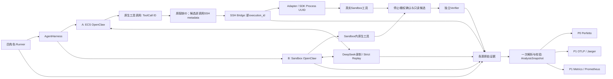

# 可观测性分阶段实施报告

**新增华为 A recorded 回放已完成：** 同 A Tape、release29、4u8g，Attempt 1065.757 秒、Runtime 1007.439 秒、64 请求 / 72,102 帧、独立五页非空评分及资源清理通过。模型入口累计 961.625 秒包含录制时序等待，32 条 Sandbox 命令累计 11.876 秒属于内部区间，不重复加总。新样本后端查询 UNRUN，global coverage unknown；与原 8 次 zero 尝试分开统计。E2B A recorded 也已成功、评分与清理通过：Attempt 1105.656 秒、Runtime 1034.892 秒，32 条命令 ID / 退出码与华为一致；两云 recorded 各一次单列，加上 E2B B5，本期共 11 次回放尝试、10 次功能成功和 1 次首请求失败。[全局至 Sandbox 的分层数据与 Dashboard](../jiuwen-pptx-workload-performance-20261027.md)。

**Jiuwen PPT Workload（release29）：真实 3 PASS / 1 FAIL。** 华为 A、E2B A 共用 A Tape，各 78 ToolCall / 32 命令；华为 B 使用 B Tape，80 / 39。三组命令返回码对账、独立五页非空 PPT 评分、停止撤权和清理通过，可作同 placement 的本轮单次工作量对照。E2B B 首轮因原生系统提示的 Linux 内核版本不同而拒绝，0 Tool / 0 命令、score=0，停止及清理成功。差异已由实际失败请求的完整 system SHA 重建确认，模式附件一致。release30 仅扩展固定原生环境段的 Linux 内核元数据例外，五项工程检查和冻结 PASS；两 B2 真实回放均 61/61、独立 score=1、停止及清理通过。当前选定 A29/B30 四组合功能已齐，八次 zero 尝试共七次功能 PASS / 一次 FAIL。华为 B2 的 80 Tool / 39 命令与四投影通过；E2B B2 原生 18,489,919 字节文件下载失败，80 Tool 的 native 关联未知、四投影 exit=1，39 条 process 原值及返回码对账不丢弃。**该 B30 组合完整观测及性能对照未闭环；后续 B5 修复见下段**。同版本同 Tape 的 E2B B3 已再次功能、评分与清理通过，但 18,489,969 字节 native 下载再次失败，四投影失败；两次观测失败均保留，底层根因未确认。华为 A29 本次原 Snapshot 的 Perfetto / Jaeger / Prometheus 实际查询已 PASS（见[回执](VALIDATION_AND_REPRODUCE.md#jiuwen-workload-a29-backends)），其余本次后端 UNRUN；已成功样本 global coverage unknown，E2B B2 / B3 incomplete。Strict、实际提示、工具和 Tape 不变。[本轮数据与原件](../jiuwen-pptx-workload-performance-20261027.md)、[契约](../implementation/model-replay.md#jiuwen-原生-ppt-的非-strict-接入)、[工程与待验范围](VALIDATION_AND_REPRODUCE.md#jiuwen-workload-release30)。[华为 B record4](../jiuwen-pptx-capacity-20261027.md#huawei-b-record4)是另外一次真实模型录制，不与回放混计。

**下载与采集预算修复 B5 已真实通过：** release31 五项 ECS 门禁及冻结通过；原 B Tape 61/61、独立评分及清理通过，18,489,897 字节 native Trace 完整，Producer 332/332/332、80 Tool 精确关联、39 命令与四项离线投影通过。B2/B3 的读取失败和 B4 的 5 秒采集超时均保留历史失败；B5 不回填旧样本，不与华为 B30 混作同版本实验。最新已修复这两项采集故障；实际后端查询仍 UNRUN、global coverage unknown，未宣称完整生产观测能力验收。[B5 阶段与证据](../jiuwen-pptx-workload-performance-20261027.md)。

**Jiuwen 命令进程计时（release23）限定 PASS：** A/B 已接入原生创建、首输出、直接子进程退出及管道关闭，与请求计时分开。ECS 五项发布门、E2B/华为 A/B 四组真实模型任务均通过，原 Verifier 各 12/12；15 个进程、105 条事件精确关联并完整收尾，8 个 Sandbox 独立确认删除。四组各自冻结 Snapshot 的实际 Perfetto/Jaeger/Prometheus 查询均通过：2,035 个 Jaeger span、31 个进程 histogram 样本、18 个有值 metrics 流对账，5 流保持 NOT_COLLECTED，临时后端已清理。[本轮真实数据与 SHA](../jiuwen-release23-cloud-validation-20261027.md)、[边界与版本](../jiuwen-process-observation-20261027.md)。整体 integrity=complete / coverage=unknown；华为评分出网仍 assumed，独立真实模型轨迹不能作性能排名，不宣称生产化全部完成。

**历史 release21：** 五项 ECS 门禁、image5 双云 A/B 四组真实模型任务均通过，原 Verifier 各 12/12，8 个 Sandbox 回收确认。两组 A 各 8 个原生 ToolCall、11 次 Provider 调用精确贯通，Bridge 准备已纳入阶段；E2B A 同一快照通过实际 TraceProcessor、Jaeger 与 Prometheus 查询对账。[阶段、资源、证据与限定范围](../jiuwen-release21-cloud-validation-20261027.md)。[工程记录](../jiuwen-native-runtime-validation-20261027.md)保留模型错误负例和生产目录修复。全局 coverage 仍 unknown，P0/P1 的其他退出条件不据此关闭，不宣称生产化全部完成。以下旧版本结果保持原范围。

**Jiuwen A 增量（release19）：** E2B 与华为各一次原生 DeepSeek 解题均通过原 Verifier 12/12，完整 Tape 各 5 轮；每轮 4 次真实 Bridge 调用起止对齐，两个 Sandbox 独立删除确认。SDK 审计分别 27/27/27、25/25/25；同快照四出口通过。Bridge 的原生 ToolCall ID 仍全部 unavailable，全局 coverage unknown，本轮后端验证 UNRUN；`bridge.register` 有原始计时但未纳入八阶段字段。见 [A 模式独立归档](../jiuwen-external-cloud-validation-20261027.md)，不升级 P0 或生产可用结论。以下 release18 为 B 模式原证据。

**Jiuwen增量（2026-10-27）：** [release18](VALIDATION_AND_REPRODUCE.md#jiuwen-release18)的812文件组合（相对release17叠加14文件）已完成五门禁冻结。E2B record7与华为record2均通过原12/12、score1，完整Tape分别9/7轮；每轮Stop/revoke、两个Sandbox独立删除及cleanup=[]均确认。两份真实模型轨迹不同，仅作双云功能验收，不是同Tape性能对照；华为评分出网仍为显式假设。Strict replay3与record1–5旧失败保留；校验模式讨论延后，固定提示变体暂停，历史六例Strict仍3/6。

新两云运行分别保存44/35个官方Span、8/6个authoritative Tool Span；sampled SDK Span的started/ended/exported分别44/44/44与35/35/35，missing/unexpected均0；`jiuwen_sampled_sdk_span_exports`专项integrity/coverage complete，global coverage仍unknown。未采样/未插桩行为、guest进程计时、跨机时钟与有界flush不在该证明内。 Agent cgroup四边界与按设备块I/O、provider整台Sandbox采样分开；整机采样最大值和cgroup生命周期内存高水位不是Runtime峰值，网络/逐Tool归因仍不支持。历史record5的11个Span已完成TP/Jaeger和Prometheus独立补验（1184项零失败），首轮Metrics FAIL保留；该后端结论不移用到新样本。

[producer审计的前置定向证据](VALIDATION_AND_REPRODUCE.md#jiuwen-producer-audit-candidate)保留Go unit/race/vet、Python 12项和限定bootstrap配置测试范围；正式release18与两云新验收另列。详见[实施证据](../implementation/jiuwenswarm-flash-progress-20261026.md)、[逐轮结果](../jiuwen-cloud-validation-20261027.md)和[测量口径](OBSERVABILITY_SCHEMA_AND_MEASUREMENT.md)；实时后端/持久化与R01–R18其余退出条件未关闭，P0仍PARTIAL。

**采集误计数已修复（release14）：** DB新录制的4096条超限是原生工具采集器把模型流事件也计入工具记录额度，并非云配额。已改为只计算保留的工具记录，真实超限和序号/错误检查仍保留。旧版20,000条非工具事件回归复现失败，修复后通过，ECS五项发布检查全部通过；真实大文本同Tape回归23/23轮、20exec+2wait、原5/5及确认回收通过；原生1371输入保留64条工具记录完整。双Trace13179项对账通过，但4个无UTC锚后台区间未进入主Trace、coverage仍unknown。旧DB缺失数据不能补回，原5/7不变；独立Recorder队列和R05文件I/O遗留未改。[代码范围、证据与验证状态](VALIDATION_AND_REPRODUCE.md#native-tool-retention-release14)。

**最新增量（2026-10-26）：大文本v2同Tape双云闭环通过，SQLite v3录制通过、自回放失败。** 当前六个选定主用例 Strict 跨云完成 **3/6：fix-git、async两个原始任务＋大文本terminal-result-v2独立变体**；原始任务本身仍2/6，旧失败和分母保留。 下述release5为此前原题批次。 release5 / native publication3 的 fix-git、cancel-async-tasks 均已按同题同 Tape 在 E2B 与华为完整通过。三题共7次真实尝试：5次成功、1次华为DB元数据偏离、1次华为async评分中断；八阶段、逐工具SDK/guest耗时及7份同快照Perfetto/OTLP与TraceProcessor对账已归档。失败和不完整源保留，见[同Tape双云性能与证据](../tb-crosscloud-performance-20261026.md)。CPU/内存同规格作为资源比较条件，磁盘差异仅说明，不据单次样本排名。

独立变体 release8 五项 ECS 工程检查已通过，host 拒绝身份及原生持久化三字段修复已合并。SQLite随后同Tape真实回放在第六请求因运行中`/tmp`日期偏离而FAIL，未到达后台wait；C++显式根目录初始mtime读回通过，新录制原6/6，但SDK wait成功后自身stdin取消被误报SSH255，1条exec缺辅助初始化关联，整体FAIL；原生调用的开始与错误终态事件均存在。两次清理均确认。ExecStream最小收尾修复及release10五项发布检查已通过。CPP v2新华为录制原6/6、34/34 exec精确；同Tape回放前5轮/5exec精确，第6请求因gdb内部合流输出的两行提示位置变化而Strict偏离、原5/6，两次删除确认，完整回归仍未通过。后台协议均未触达，全链保持incomplete。SQLite v2新E2B录制已通过原3/3、35完整模型轮、36/36 exec精确及1次真实后台wait映射；录制Snapshot integrity complete、coverage unknown；同Tape回放第24请求因make install自动输出安装mtime而失败，已执行24exec+1wait、原0/3、删除确认。8193B截断的三个字段在两次真实后台结果中均保留正确。大文本v2已完成真实录制、两次同Tape E2B和一次华为Strict回放，原评分均5/5、各23完整轮、20/20 exec及2job/2wait通过，删除确认；三次回放均0次上游调用，[三次阶段/工具对照](../repro-variants-performance-20261026.md#text-v2-huawei-replay-1)已归档。SQLite v3[新E2B录制](../repro-variants-performance-20261026.md#sqlite-v3-e2b-record-1)原3/3、41轮完整Tape、38/38 exec及2job/2wait通过并删除确认；同Tape [Strict自回放已FAIL](../repro-variants-performance-20261026.md#sqlite-v3-e2b-replay-1)：turn24/request25因make install日志被tail读回的3处mtime偏离；22exact exec+2wait已执行，原评分0/3，停止/撤权及删除确认，剩余16次exec未执行。不改旧Tape或matcher。DB原5/7、大文本原5/5但Tape不完整等旧失败保留。见[逐次结果](../repro-variants-performance-20261026.md)及[release8后真实证据](VALIDATION_AND_REPRODUCE.md#replay-variants-release8-results)。R01–R18、P1/P2退出条件完整保留；P0 PARTIAL、R05暂停、R13暂缓。

下节19目录、18Attempt及后文87次PASS是此前封存分母，新增尝试另列。六题闭环仍未完成；**P0 PARTIAL、R05暂停、R13暂缓**，R01–R18及P1/P2未验范围、退出条件均保留。

**R01新缺口已局部修复：** DB record2中脚本预检拒绝漏记终态，已在原生validator边界补齐；原异常、前台/后台/PTY语义保持，ECS原版/候选探针对照通过，独立新镜像已发布。DB record3已使用新镜像，但唯一拒绝是既有elevated分支，新增validator拒绝仍只有定向探针覆盖；旧缺口不回填、R01全范围未关闭；见[修复与发布证据](VALIDATION_AND_REPRODUCE.md#r01-script-preflight-rejection)。

**R03诊断闭环：** [release13](VALIDATION_AND_REPRODUCE.md#record-failure-release13)已通过最终4Go组合的五项ECS门禁。模型record失败的安全原因分类贯通原边界事件、同一Snapshot与Perfetto/OTLP；未知任意文本不透传，Tape失败语义、匹配与时序保持。旧DB末帧精确首因仍unknown，C++旧HTTP 402有独立原始header证据；新录制结果单列。

**Workload Replay 真实增量（与 Strict 分开）：** 显式 `model.replay_policy=workload` 已通过 [release12 五项 ECS 工程门禁](VALIDATION_AND_REPRODUCE.md#workload-replay-release12)，完成 [DB](../workload-db-performance-20261026.md)、[SQLite v3](../workload-sqlite-performance-20261026.md)和[C++ v2](../workload-cpp-performance-20261026.md)同Tape跨云功能对照：分别各12轮/11工具/原7/7、41轮/38exec+2wait/原3/3、35轮/34exec/原6/6。真实终态、停止撤权、独立评分与删除确认通过，正文差异留证。**Strict仍3/6，另有3/6完成Workload功能对照；不能计成Strict 6/6。** C++整体观测incomplete；其他成功样本的全链coverage仍unknown。双Trace对账只证明保留数据的投影一致，不将功能成功升级为全观测通过。C++新E2B共享TTL3600秒，实际全程288.328秒；旧4200创建拒绝与新Strict的GDB地址差异失败均保留。SQLite首轮Snapshot重载FAIL、华为缺profile文件FAIL修复后新轮通过；[SQLite v4新录制](../sqlite-v4-performance-20261026.md)原2/3、Tape不完整单列，不覆盖v3。全部历史失败保留，未改旧Tape或Strict matcher，P0仍PARTIAL。

## 六个真实 Agent 用例：release4封存批次（2026-10-26）

新增6次真实运行已完成，固定release-4与native publish-3，6个Sandbox均确认删除。合计19个实验目录、18条原Attempt、17次执行Agent、12次原评分通过；原driver有7次PASS，另2次录制的验收脚本错误已旁路复核通过，旧FAIL保留且不增加Attempt。git/async/db已有选定同Tape完整Strict回放；text/SQLite新录制评分通过，但新回放实际失败；C++当时的4200秒创建请求被项目上限拒绝，Agent未启动；该记录不能证明任务在3600秒内跑不完。详见[逐次结果、八阶段与工具耗时](../tb-six-performance-20261026.md)。

release-4固定605文件，manifest SHA `d61c2a1245ded2f561843143276a177e1d45540250b10f8e922012a41e318710`；ECS五项Go门禁证据 `e3f38350de19c89c40d43a0a45e4db73c7e573e05c1133c8cfb801d3336b4ec0`。原生-3四错误等价、两套26场景及4个B并行限定检查通过，原finalize/yield限制保留；原生-1 guard选择错误、-2矩阵JS权限EACCES失败未删除。native publish-3已成功，证据 `9046876419563e64ed6accd257964e430386d7d50b86f27cf7d9845776fcf0d1`；新6次云运行均使用此版本。

系统修复已有真实覆盖：Harness.Run返回时CloseAdmission；原生明确派发前拒绝与身份记录；显式初始目录mtime；SDK创建错误诊断。text/SQLite录2分别5/6次真实迟到请求正确拒绝且Tape完整。SQLite新29条exec中28条精确执行、1条明确拒绝；拒绝不造guest区间。DB选定历史Tape在显式初始mtime下真实重跑，12轮/11工具/原7项评分通过；另一次新录制900秒超时仍保留。

新私有验收器暴露字段错误：读取status而实际字段为coverage_status。仅修这一处，ECS正例及15项负例通过；旧KeyError与FAIL原件保留，新增旁路复核，随后确实执行新Sandbox回放，未用离线复核替代真实测试。text/SQLite回放的首个差异分别为初始根目录时间、运行中新建目录时间；不是MockLLM自行换决策。

六次新运行均完成同快照Perfetto/OTLP离线投影和真实TraceProcessor核对。DB超时来源incomplete，仅判不完整来源投影通过；其余complete/unknown。新运行的后端发送/查询与UI仍UNRUN，不能用旧后端验收回填。

上述封存批次当时仅提交[变体设计](../design/reproducible-agent-workloads.md)审阅；用户随后已批准独立实施与真实闭环，当前候选状态见本文开头。原case有效，原生完整功能与变体比较分开，Strict、真实工具、原独立Verifier不降级。**P0仍PARTIAL**，R05 I/O支线暂停，R13多任务等待单任务阶段交付，P1/P2未验范围与退出条件保留。[封存版本与实际证据](VALIDATION_AND_REPRODUCE.md#tb-six-current)。

## 决策摘要：本轮收口范围

以下区分“已验范围完成”和“P0整体完成”。已通过范围封存；只有新改动影响它、实际失败或明确缺失的验收证据才重开。主线继续推进真实回放、阶段/工具分析和统一快照出口。文件I/O支线按用户要求留档，停止追加实现和实验。

| 项目 | 当前判定 | 可以据此宣称什么 | 保留的限制 |
| --- | --- | --- | --- |
| R01 | 已声明身份通路限定PASS | 固定native逐调用身份贯通SSH/Bridge/SDK/guest；真实录制、严格回放、同Tape华为A与跨任务并发均有证据；同名重叠/反序、重连/重试、错metadata及取消按各自协议或真实Agent层级验收 | 不能把ToolCall ID当全局主键；归档外全部原生事件的漏采分母unknown。未要求每个协议负例重复整个模型/评分链 |
| R05 | 部分PASS，生产有界文件I/O仍BLOCKED | 两类writer的队列、独立计数、短写/落盘错误及关闭状态可识别；业务与观测错误分开，已修L1写入阻塞资源删除的问题 | 普通文件Write/Sync永久挂起、崩溃耐久、late marker自身持久化未闭合；独立worker八案例只是PoC，不是生产解法 |
| R07 | 已声明测量范围限定PASS | A受管wrapper区分启动、首输出、观察退出和pipe EOF；B非PTY原生路径采集直接子进程及自然EOF，E2B/华为B均已真实回放；语义对照及指定取消/隔离反例保留 | 观察退出不是内核精确退出；缺证据的PTY、任意后代终态与单Tool CPU保持unknown/unsupported，不新增通用监管框架 |
| R15 | 冻结A/B baseline/L0范围限定PASS | A与B分别四对实测，全部尝试、失败、共享CPU/RSS/GC/文件写入及阶段差值留档 | 四对不能证明稳态容量/p99或性能合格；L1/L2、独立guest logger成本、区域/冷热控制仍未验，不由这些后续项重开旧四对 |

**A/B目前能看什么：** 两者均有八阶段原值、模型/工具消费者/控制器区间及独立Verifier结果。A还具备精确下游身份与guest相对耗时；B还具备原生直接子进程首输出、退出和EOF。没有跨主机锚点的时间不相减，未执行阶段不填零，ToolResult返回不代替停止隔离。

**此前真实多工具验收版本：** `ff02d056…`，Runner `c22987f0…`、分析器 `4ad358dc…`，录制/回放及双Trace对账见下节；后续TerminalBench与跨云结果分别使用自身release4/5证据，release7工程验收不回填旧运行。

**此前版本：** 新多调用候选manifest `821eefe8…`、Runner `59a7d4f4…`、Replay CLI `2a62394f…`已完成下述定向门禁、同源码五门禁及真实A应用验收；完整构建的Runner为`6d05bc49…`、Replay为`c0b73038…`、分析器为`a64695de…`，保留各编译路径产生的原二进制哈希，未替换既有服务。此前云验证运行时为568文件manifest `3b6450a8…`、五门禁证据`bd4acb1c…`，B四模块manifest `c972e462…`。并发与取消验收使用分析器v1.4.0/binary `86de3551…`；此前P1a候选2与P1b保持同parser，binary分别为 `6240fd06…`、`6722ecf6…`，各自定向门禁证据保留。当前P1c候选2使用 `aries-analysis-v1.5.0-resource-streams`、binary `a4a4c0f6…`，ECS定向unit/race各300项通过（含子测试），vet/build通过。P1c未重建Agent运行时或改原云实验版本；本轮模型代理增量单列，不回填旧五门禁或R15结果。具体测试证据与所有历史失败见下文及[复现档案](VALIDATION_AND_REPRODUCE.md)。

**P0仍为PARTIAL。** R05生产文件I/O的有界关闭是已确认的可靠性阻断；本轮已由真实CLI补齐取消/未启动账本与失败Trace的限定验收，见下文。解决前不宣称全链完成，也不以“配对率100%”掩盖未知分母。现有R05 PoC尚不满足生产退出条件；问题及证据保留，不继续占用主线。

**P1a/P1b/P1c离线已测范围限定通过；P2仍PLANNED/UNRUN。** 同冻结A/B及取消Snapshot已完成OTLP/Jaeger与Metrics/Prometheus真实查询对账；P1c进一步接入可验证时间和单位的真实归档资源样本。两种Trace共用快照，Metrics保留原分母和窗口，失败/缺测未被重分类。显式SLO的真实Goodput、实时与生产耐久未验；P2先核实实际权限，P0仍PARTIAL。

## 当前主线增量

按用户最新决策，当前先闭合真实 Agent 单任务可靠性（含多 ToolCall 自主修复与 Strict 回放），完成当前目录六个真实 Agent 用例的完整一轮，再交付可展示的系统实现与测试报告。之后才恢复多任务、到达速率和容量工作；R13 候选已单独保存并从当前调度/观测核心撤出。系统、环境或适配故障必须修复并用真实 Sandbox 重测，保留全部失败尝试；不能以节省费用替代必要验证，也不能改原 Verifier 或塞入参考解制造成功。已通过范围只有代码变更、实际失败或明确证据缺口才重开。R05 文件 I/O 支线保持遗留。

**真实 DeepSeek 同轮多工具自主修复与 Strict Replay 已通过。** 新任务 `merge-ranges-multicall-v1` 只改变题目流程说明，原坏代码、公开/隐藏测试与独立 Verifier 不变。真实模型首轮发出两条独立读取命令，随后自主修复：第一次公开测试失败、中间一次复测仍失败、最后复测成功，失败工具结果均完整保留。录制和严格回放各 7 轮/758 帧/7 次真实 exec，独立 Verifier 均 12/12；14/14 归档调用精确贯通原生→SSH→Bridge→SDK→guest，ToolResult 与候选哈希一致。4 个 Sandbox 均独立 NotFound，无补杀或清理错误。旧受控协议样本的 score 0 保持原值。

两次实际 Perfetto 导入分别 469 区间/50 flow、454 区间/43 flow，起止/时长误差 0ns；对应 OTLP 为 469/454 Span、50/43 parent，均从同一份各自 Snapshot 投影。两份离线对账分别 1924/1864 项通过；完整性 complete、全局 coverage unknown。当前运行的后端发送/UI、华为/B 同 Tape 与观测扰动未验；不外推 P0 完成或生产容量。

[真实版本与复现证据](VALIDATION_AND_REPRODUCE.md#r01-real-multicall)。

**真实应用级多调用验收已限定PASS。** 原Tape直接经过真实`app.RunCloud`调度和四角色Runner：1条计划/接纳/执行/完成、1条`verification_failed`、0条验证成功，三次真实exec与原ToolResult严格一致。1010项对账通过：3/3原生→SSH→Bridge→SDK→guest精确身份、真实八阶段、同一Snapshot的221个Perfetto区间/27条flow及221个OTLP Span/27个parent；TraceProcessor导入误差0ns。2个Sandbox独立NotFound，无补杀，既有服务未改。因原录制为OpenAI请求方言，私有验收入口只将`NewAttempt`的Provider恢复为`openai`，并非未经适配的原CLI。此受控模型没有修复题目，原Verifier12项中11失败、score0保持；该历史记录的真实Agent解题验收当时尚未执行；后续成功另见上节，不回填此协议样本。

同一581文件源码`821eefe8…`已完成build/test/race/lint/integration五门禁（`70686b13…`）。本次Snapshot完整性complete、全局coverage仍unknown；后端实际发送/UI、本版扰动及华为/B多调用仍未验。来源、时间与复现见[应用级归档](VALIDATION_AND_REPRODUCE.md#r01-multicall-app)。

**R01同轮多工具增量已限定通过。** 固定OpenClaw实际源码支持同轮多调用，原限制位于ARIES SSE/Tape；现已实现Tape v2完整调用数组、按索引聚合与严格逐ID因果校验，v1原件兼容，回放仍精确比较全部历史/结果顺序。ECS定向unit/race各309项、vet与两个CLI构建通过；原真实v1 Tape的7轮/735帧按字节兼容通过。E2B A受控录制/Strict Replay各3轮/9帧/3exec，含同轮两次相同命令；125项复核、6/6精确身份链，4个Sandbox已独立NotFound。未修复题目，原Verifier各12项中11失败，score0保持，不新增成功任务。完整源码/原FAIL/清理见[复现](VALIDATION_AND_REPRODUCE.md#r01-multicall)。

原直接四角色Runner记录是协议范围，没有app Attempt/排队及完整Snapshot；后续独立应用验收见上，不回填旧原件。该历史协议样本未覆盖真实模型；后续E2B A真实模型验收见上节，华为/B多调用及新代码扰动仍UNRUN。SDK在途重叠不冒充guest并行时长，同命令新调用不冒充失败自动重试。R05支线仍暂停、P0仍PARTIAL，真实Agent测试材料维持独立分类。

**P1c：已声明资源采样→Snapshot→Prometheus查询限定PASS。** 7份真实原件的原业务字段保持不变，3份旧冻结Snapshot的原ID及9份Trace/Metrics投影JSON全等。新解析保留19个独立owner资源流，其中13流可投影、6流NOT_COLLECTED；456个历史点分别送入13个独立TSDB，首发与人工重发26次查询、2108项对账全部通过。每轮合计90条owner内序列/456样本，值误差0，后端毫秒截断误差为−998796～0ns；重发不增加采样分母，也不将不同owner合并。工程/投影/后端review2证据分别为 `2ee63b22…` / `6bd8164e…` / `3668a152…`，版本、原件和复现见[统一归档](VALIDATION_AND_REPRODUCE.md#p1c-resource-prometheus)。

候选1误将monitor原生0基序号按1基解析的FAIL已修并保留；后端首轮TIME_WAIT冗余预检FAIL亦保留。review2的26次查询为本轮验收，删除该预检后的review3另26次查询及首轮2次查询单列历史，不新增性能样本；全部27个实际创建的临时后端已清理，0新Sandbox/0模型调用。4个华为流的时间戳单位未证、2个E2B评分流无读数，均不造点；controller累计读数为observed Gauge，lifetime RSS不是任务峰值，monitor占位CPU百分比不导出。单Tool归属、IO/network、短任务峰值、真实Goodput与生产实时/耐久仍未验，不以本次导出闭环外推。

**P1b：原账本与八阶段Metrics已完成真实Prometheus查询。** 同A/B/取消冻结Snapshot每份导出6指标/29点，在3个独立TSDB分别首发、人工重复：117条业务序列/117历史样本保持不变，count、sum、逐le桶及原速率值误差0。A的16个阶段成员、B的8个、取消任务的8个已测与8个缺测均精确保留；同一快照的Perfetto/OTLP Trace全等。时间按后端毫秒精度截断，原ns与monotonic窗口不改；没有伪造实时曲线。发送200仅accepted_unverified，6次实际查询/2130项检查补足验证。

固定Prometheus3.15.1另用独立合成夹具检验历史、重复、乱序、同时间冲突拒绝、累计reset及窗外拒绝，223项复核通过；Gauge `_ratio`命名的首次误判原FAIL保留，修正检查器后只复核原件。ECS工程/投影/后端SHA及全部清理见[复现](VALIDATION_AND_REPRODUCE.md#p1b-offline-prometheus)。4个临时容器和监听均清理，0新Sandbox/0模型调用。未采资源不发Gauge；未配置SLO不发Goodput，两者不能借协议夹具宣称真实验收完成。原网络隔离假设与全链coverage unknown保留。

**P1a：统一快照的离线OTLP与Jaeger查询已限定PASS。** 新增`LoadSnapshot/ValidateSnapshot/ProjectOTLP`和`aries-perf --otlp --from-snapshot`、冻结Snapshot的Perfetto投影及单次`--otlp-send`入口。ECS候选2定向unit/race各254项通过（含子测试）、vet/build通过；分析器manifest `5915320c…`、binary `6240fd06…`，没有更改Agent运行时、Tape、工具、Verifier或停止门。三个真实历史样本分别导出A 845、B 795、取消784个Span；原Perfetto JSON全等、重复导出字节一致，原Snapshot ID、source SHA、时间和业务结果保持不变。B的7个及取消样本的3个无锚原生区间留在Snapshot和排除清单，不伪造epoch；三者完整性complete、coverage仍unknown。

固定Jaeger 2.22、clock-skew调整为0s，首次与重复共6次发送/查询通过，v3接口起点/终点/时长误差均0ns。重复发送实际产生1690/1590/1568条存储行，唯一Span ID仍845/795/784：稳定身份不等于exactly-once，重复行不新增成功任务。真实样本只有86/31/18条parent关系、Links均0；另有显式synthetic协议夹具验证同trace/跨trace Link和legacy FOLLOWS_FROM，不能算真实业务因果实证。候选1因SDK结构体属性读回后字段排序改变而校验失败，原FAIL保留；候选2严格恢复已知类型后仍验证原ID，未重签或放宽。证据、SHA、复现及传输边界统一见[验证归档](VALIDATION_AND_REPRODUCE.md#p1a-offline-jaeger)。本轮0新Sandbox/0模型调用；临时Jaeger容器与两个监听端口已清理。P1a限定范围之外的实时/SSE事件投影、大批量、认证和生产耐久未验。

**B原CLI取消与排队分母已验收封存。** 固定568文件运行时、schema2模板和原B Tape，原CLI计划2个任务、并发1；首个真实工具结果通过下一轮Strict匹配后，只发送一次SIGINT。原账本保留1个canceled、1个not_started，完成/独立验证成功/整体成功均0；61项复核通过。Stop/revoke确认，Evaluate在已取消上下文中返回，Verifier未运行；1个Sandbox已独立NotFound、无需补杀，0上游LLM。原件、源码、Tape及生产服务未改。运行SHA `107f9d0975dfebadc217752032bb38a037b83720b5aeffb929dcf351d6118829`，复核SHA `40d77d4bd4cefbe0a25ab88c4275abe95e2bb63558d1c0e8a6b5f111582191a7`。

本次模型只完成1轮、匹配2轮、发送48帧，保持session incomplete/failed，不能算完整回放。首工具10条真实原生回调与消费者身份精确一致；同一Snapshot保留两Attempt的八阶段，未启动者全为not_collected。实际TP对账控制器784区间与原生3区间、18flow、12来源，导入误差0ns；完整性complete/覆盖unknown，无诊断，UI未执行。TP SHA `692218816456403e825327628f90a4069fc41c2e720987d0928fc77adcc28d59`。这是首工具完成后取消Agent流程的用例，不替代下述在途工具取消或旧失败；没有新增产品机制。见[复现](VALIDATION_AND_REPRODUCE.md#r04-cli-cancel)与[阶段表](../performance-archive.md#r04-cli-cancel)。

**R01完整A跨任务并发范围已验收封存。** 原CLI以attempts=2/concurrency=2运行同名任务，复用568文件运行时、原A镜像/模板与不可变Tape，源码未改。两任务分别完成7轮/735帧、6次真实exec及12项独立Verifier；从Tape响应事前登记的12次调用逐条贯通native producer→SSH→Bridge→SDK→guest receipt，模型会话和scope分别归属各自Attempt。212项离线复核一次通过，原Stop/revoke与清理成功，4个Sandbox独立NotFound，0上游LLM。运行SHA `02242069258cfd48aeaa0a486f550cc89860d2427f8008b81e32744121280400`，复核SHA `c160e55bca80d202830b71db2084d843deb51c745aae00f9507bd2cf72a981dc`；见[复现](VALIDATION_AND_REPRODUCE.md#r01-native-concurrent)与[性能归档](../performance-archive.md#r01-native-concurrent)。

实际`agent.run`调用区间重叠18.540939532秒；本次SDK `exec.wait`区间没有重叠，不能宣称guest工具同时执行。ToolResult的content逐字及原业务字段相同，实测durationMs不作字节相等。实际TraceProcessor对账通过：845区间、86flow、2995事件、38来源，12条Snapshot身份与原件复核全等，单控制器时钟的起止/时长导入误差均0ns；Snapshot complete/unknown、无诊断，TP验收证据SHA `4dfd3eb3ecf0a7edfe4d6244df0c49ec7b33720783c7531d13c21bba8b307a7f`。本次UI未验，不造guest时间线。此单次跨occurrence并发范围不再重复；同一Agent多工具并行、工具重试与容量矩阵未新增，P0仍PARTIAL。

**此前B在途工具显式取消验收已补齐。** 复用568文件运行时和schema2 E2B模板，真实Agent发出一个预登记ToolCall；确认父进程及setsid子进程存活、心跳变化后，仅取消Harness.Run。原Stop/revoke后，评分前两次确认PID/start身份消失、cgroup空、UID60000进程为0、心跳停止，两个Gateway监听拒绝连接，控制器通道已结束。原始独立Verifier正常运行，未修复候选12测试/11失败/得分0；两个Sandbox均独立NotFound，25项原件复核通过，0上游LLM。实验SHA `fd90659a…`、复核 `df9fb091…`，见[复现](VALIDATION_AND_REPRODUCE.md#r07-b-native-cancel)和[阶段耗时](../performance-archive.md#b-native-cancel)。本次没有产品源码改动；旧B超时正向证据继续保留，本次增量是当前组合的显式取消与原生身份。

**限制单列，停止验收不替代Trace完整性。** Gateway日志只保留spawn与stdout首输出两个回调（同一ToolCall，间隔26.008256ms）；没有child exit/EOF，原生collector仍failed/incomplete。直接Runner夹具没有应用层Attempt账本，v1.4导出只含控制器来源，complete/unknown不是全链完整；辅助分析器误以为这份输出包含native来源而要求incomplete，原FAIL保留。该直接Runner样本没有完成取消场景全链Snapshot/TP验收；上方新的CLI用例另有真实账本，不能回填或覆盖该旧FAIL。本次故障不计入成功任务；P0仍PARTIAL，R01/R05/R15已封存范围不重开。

**当前B观测版本的R15四对实测已完成。** 固定568文件运行时、同schema2 E2B模板、原B Tape和recorded时序，仅改变baseline/L0，8/8严格回放及各12项独立Verifier通过；16个Sandbox全部确认删除，0上游模型。共享控制器CPU/RSS/GC/分配及四类JSONL实际Write/Sync计数完成采集，479项原件与算术独立核对通过，四份L0双时钟Trace实际TP均0ns误差。运行证据 `6b7aeaab…`、配对分析 `d83825d0…`。Runtime差值中位数−128.122ms、范围−174.334～+23.511ms；Attempt中位数+118.271ms、范围−7.252～+7.379秒，不能称“负开销”或性能达标。峰值RSS配对差值中位数+4.178MiB。完整[八阶段/资源表](../performance-archive.md#r15-b-native-paired)与[复现](VALIDATION_AND_REPRODUCE.md#r15-b-native-paired)已归档。没有产品源码/运行时变更；仅删除实验驱动误拒绝TIME_WAIT的冗余bind预检查。首轮1条baseline成功和7条准备失败、2个已删除Sandbox单列保留，未混入四对。此范围关闭，独立guest logger/Adapter成本、L1/L2及性能阈值仍未验收；P0继续PARTIAL。

**E2B B 主线已补齐同版首输出回放。** 本轮没有改变产品源码、Runner二进制或解析器；从原E2B固定模板派生已在华为B验收的四模块候选，完成启动探针及一次原Tape真实严格回放：4轮/573帧/3exec/12项独立验证，30回调精确关联。正式运行2个Sandbox与启动探针均确认删除，0上游LLM，既有服务未改。实际TraceProcessor验证控制器795与native7区间、31flow、12来源，导入误差0ns。E2B B与华为B现在都有相同口径的首输出/直接子进程exit/自然EOF观测；两者原Tape不同，不能直接排名。新运行证据 `be619aff…`、TP证据 `77b751fb…`，见[复现](VALIDATION_AND_REPRODUCE.md#r07-e2b-first-output)与[阶段/工具表](../performance-archive.md#e2b-b-first-output)。当前投影未改，复用同版已验UI能力；本次E2B UI单列UNRUN。P0整体仍PARTIAL，不重开已通过的正常B路径。

**最新R07主线：B首输出已实现并完成真实回放。** `first_output_patch.py` 在固定native child的既有data回调记录两路首个非空chunk，原decoder/listener/ToolResult和PTY不动；事件schema2、分析器v1.4.0兼容旧schema1。ECS原版/候选9组对照通过，新增73条回调中10条首输出；performance包unit/race各225项（含子项）、vet/build通过。仅离线解析器3个Go文件改变，真实Runner复用已通过五项门禁的568文件版本，不声称重新跑了整套门禁。

新镜像 `ba1c0c46…` 实际华为B同Tape严格回放通过：4轮/693帧/3exec/12项独立验证，Stop/revoke确认；30条原生回调精确关联，首输出分别3.408/438.164/280.955ms，T1实际exit→最后EOF为2.797ms。2个Sandbox和临时模板已删除，0上游LLM。证据SHA `9fd94c87a04401e12e71e4d547eb23facdd3c5507a6f4b1d0c512950a46e957e`；同Snapshot两域786区间、31flow、12来源实际TP对账，0ns导入误差。实际Perfetto UI也完成本次T2首输出438.164376ms的SQL与timeline点选、身份/来源对账（证据 `75ded025…`）；3张截图归档，10个所属浏览器进程已退出。此轮关闭B前台非PTY首输出缺口；全进程树、PTY、观测成本和华为出网假设仍按原边界保留。见[复现](VALIDATION_AND_REPRODUCE.md#r07-b-first-output)及[阶段/工具表](../performance-archive.md#huawei-b-first-output)。

- `observability-r05-cleanup-release-1`：565 文件 manifest `1d3c7c5a…`，build/test/race/lint/integration 全 PASS，证据 SHA `a7c09290bd6126f843d525084034991d1b84d93c659b54982227d943d18c3cdc`。仅修具体清理顺序与结果污染问题；Strict/Tape、独立 Verifier、真实任务与清理错误保持原口径。[源码范围与复现](VALIDATION_AND_REPRODUCE.md#r05-cleanup-current)。
- R01 真实 E2B 协议的5次请求完成对账：READY 后取消、旧 invocation/错误 scope/错误 session 三次拒绝、新 invocation 重试成功；两个接受调用各有精确 SDK Process 与 guest receipt。取消不证明进程树停止；首轮探针 FAIL 与 checker 修订保留。[协议证据](VALIDATION_AND_REPRODUCE.md#r01-current-protocol)。
- B 私有原生 PoC 在实际 B 镜像上完成原版/候选5对行为对照，保留后台/poll/kill/PTY，捕获27个真实回调事件；直接子进程退出后最后 pipe EOF 晚311.383578 ms。两容器已清理、0云/LLM。该原始PoC之后已完成factory/logger私有接线与正式Snapshot解析器；568文件新测点的真实云验收状态另列于下方。[PoC边界](VALIDATION_AND_REPRODUCE.md#r07-native-observer-poc)。
- 新诊断运行的 TraceProcessor 实际对账通过：431区间、43flow、21来源，导入误差0ns、原业务结果未改；coverage仍unknown，UI本次UNRUN。证据 SHA `aa552f48c74af4761022b88aa320ef132f302ac92211c1f636dff851005ec413`。

本组主线已经完成：E2B/华为 A/B 各一次 L1，4个真实业务attempt均Strict通过、各12/12独立验证、Observer succeeded，8个Sandbox及2个华为临时模板确认回收，0上游模型调用。A共用原Tape，B使用各自原Tape，不作不同轨迹的跨云排名。另保留3次业务前启动失败与2条历史NOT_RUN，未覆盖原失败。四份Trace实际TP导入均0ns误差，coverage仍unknown；正常L1回归不替代R15成对成本实验。见[四格真实复现](VALIDATION_AND_REPRODUCE.md#p0-mainline-l1)及[阶段/逐工具表](../performance-archive.md#p0-mainline-l1)。

此前已完成的A模式R15实验是565文件 `cleanup-release-1` 上的 `paired-6`：baseline/L0四对、8/8真实Strict Replay、各12项独立验证，16个Sandbox全部确认回收，411项原件/分母/配对算术复核通过。证据 `c7b56f52…`，见[当前成对验收](VALIDATION_AND_REPRODUCE.md#r15-cleanup-paired)。Runtime差值中位数+130.106 ms；整体Attempt中位数−1.246 s主要伴随Verifier波动，不能称“负开销”。该baseline/L0范围已完成，L1/L2等未测范围单列；不外推后续568文件B原生观测版本。

B原生回调已通过真实工厂→既有logger的5组本地对照，27条metadata与stdout逐条相同；保持后台/poll/kill/PTY。Snapshot解析器的定向验证及实际CLI日志前缀验证已归档；568文件 `observability-r07-native-release-1` 的build/test/race/lint/integration全部通过，门禁证据SHA `bd4acb1c0080857ba5ac54615f2d158f9c80f2be06958082a23fda2997b96bda`，manifest SHA `3b6450a8050691e5c98f888d516845e93d9e67ff97b3097be65c422275c0dcc5`，见[证据与边界](VALIDATION_AND_REPRODUCE.md#r07-native-process-snapshot)。真实华为B同原Tape已完成：4轮/693帧/3真实exec/12项独立验证通过，27回调精确绑定原生身份，2个Sandbox及1个临时模板确认删除。新增直接子进程区间为22.511/394.435/303.746 ms，三例自然双流EOF均早于exit，未造排空区间；原ToolResult、后台/poll/PTY和停止门不变。永久I/O框架保持遗留，继续完成真实工具分段计时与统一Trace。

上一版schema1华为B验收证据 SHA `5f1b029959862aebe75ad94d1e5b2042c5a2e63b6938486660107183dd6e66e2`。实际运行暴露的唯一离线接入误判（B被要求提供A专用SSH身份文件）已做范围修复；`analysis-scope-1` 定向unit/race各209项、vet/build通过，新分析器 `v1.3.1` 对同一原件复核通过，所有业务/阶段/进程数值与原件完全不变。运行时568文件与分析器568文件manifest分别保留，原incomplete快照不覆盖。统一Snapshot现为 integrity=complete / coverage=unknown；Perfetto控制器878区间/31flow、原生进程3区间/0flow分别导入，12来源校验与两视图区间并集对账通过，导入误差0ns；这批实际UI已通过同一ToolCall双域查询及点选：控制器434.299929ms、原生进程394.434524ms，native泳道保持UNALIGNED，来源/身份/时长逐项一致；6张截图和10个浏览器进程回收见[UI证据](VALIDATION_AND_REPRODUCE.md#r07-huawei-b-ui)。见[完整复现证据](VALIDATION_AND_REPRODUCE.md#r07-huawei-b-native)与[八阶段、逐工具表](../performance-archive.md#huawei-b-native-process)。此scope已完成，不因为未覆盖的全进程树/PTY/成本问题反复重跑当前样例；这些范围保留各自退出条件。

本轮另完成一次[完整A原生Agent取消](VALIDATION_AND_REPRODUCE.md#r01-native-cancel)：固定568文件运行时及原A镜像，脚本模型只发1条ToolCall；活跃父子及变化心跳确认后取消Harness.Run，原Stop/revoke完成后才进入独立评分。原生→SSH→Bridge→SDK→guest receipt逐段exact，评分前确认已知PID/start消失、cgroup空、UID进程0及listener撤权；未修复候选仍12项测试中11失败、score0，Harness仍canceled。2个Sandbox均独立NotFound，0上游LLM。运行断言通过，原复核器的错误UUID假设留下FAIL；只修检查器后对原件离线复核PASS，SHA `f9ff7f8b53782c54530848bae426c8f2f3ad1cb2934ccddb7e0b1b6b8520414d`。这是单次故障验收，不计成功任务、不替代Strict矩阵，也不补造取消时缺失的guest退出时间。

## 历史合并版本增量结论

下述保留 `runtime-release-2`（562文件）及其前后专项的限定验收，历史失败原件不改；当前565文件R15结果与568文件B候选状态见上节：

- A/B 共用工具 collector、SDK 客户端单调时钟区间及华为 stdin 关闭兼容修复已合并，五项门禁通过。首轮因实验脚本的长 TMPDIR 触发既有 Unix socket 路径上限而失败；只撤销该覆盖后在 release-2 重跑，未改产品源码。
- 华为 A 同新 Tape 回放成功：7 轮、735 帧、6 条真实 exec、12 项独立 Verifier 测试，停止/撤权确认；2 个 Sandbox、专用模板及实验容器/网络确认回收。此前 stdin 错误导致的 Strict 拒绝仍保留，不修改 Tape 或 matcher，见[本节证据](#合并版本与华为-a-同-tape-回放)。
- R07 现有停止机制通过两个实际负例：A 断连后清空 cgroup；B 四次 Stop 故障后拒绝评分、Verifier 调用 0。该结果不是完整进程树终态证明，见[停止隔离验收](VALIDATION_AND_REPRODUCE.md#r07-current-isolation)。
- R05 两个指定 fsync 延迟均完成实验收容。任务 Sandbox 已清理；model 关闭仍挡住共享 network 收尾，Recorder 关闭则在共享清理之后。两个 workload 中断、Observer 不完整，生产有界 Close 仍 BLOCKED，见[收容验收](VALIDATION_AND_REPRODUCE.md#r05-fsync-containment)。 新增事件文件子进程隔离 PoC 的8案例通过：父producer保持原身份/时钟，终止并join I/O worker后原Close返回错误且索引incomplete；仅独立实验，生产R05仍BLOCKED。
- 历史562文件 `runtime-release-2` 的R15 `paired-4` 矩阵 FAIL：计划8次，前4次通过，第5次额外模型请求导致Strict失败，后3次NOT_RUN；只有前两对可计算。5次独立Verifier均通过，不把整体失败误写成评分失败，见[失败矩阵](#r15-新合并版失败矩阵和两对可计算样本)。同版华为 B 首次检查器失败已保留，修正时区比较后对原件离线复核通过，无二次云执行，见下节。

- **R01：E2B A 整 Agent 的限定验收通过，完整退出矩阵未闭合。** `observability-r01-full-agent-2` 的录制和严格回放各有 6 条归档 exec、6 次 producer invocation，均逐段精确关联 native→SSH→Bridge→SDK Process→guest receipt/观察终态；各 7 轮模型、735 帧、12 项独立 Verifier 测试。4 个 Sandbox 均确认 NotFound。总证据 SHA `ddf450782ad18f5f074ab3c815302b7f363273f18ff607d787a26553a6797b1b`。此前九调用 PoC 单列保留；归档外全工具分母仍unknown；新增真实同命令后台重叠/反序完成PoC已通过2/2精确关联，见[验收档案](VALIDATION_AND_REPRODUCE.md#r01-live-overlap)；后续真实重连/取消/错误metadata的协议限定验收见上节，整Agent执行中取消现已另有一次脚本故障验收通过，见[完整A取消验收](VALIDATION_AND_REPRODUCE.md#r01-native-cancel)；华为同Tape首次stdin失败保留，合并修复后已通过下述限定回放。
- **R01 原生双流问题：前台候选回归及新 Tape 完整回放通过，后台确定性未解决。** 未修改 OpenClaw 镜像的四次输出 `outerr/errout/outerr/outerr`，分流字节与 exit=7 一致。用户要求保留原能力，已撤回禁用 `process` 的配置；A/B renderer 开关前后完整原生配置逐字节一致，证据 `observability-r01-native-tool-policy-1`。候选只在原生控制流实际返回前台非 PTY 结果时应用固定 stdout→stderr 输出，保留后台、自动 yield、poll/log、PTY。`output-order-6` 的 5 组 helper、4 项 B、26 项 A 固定矩阵已执行：25 项预期行为通过，1 项注入 finalizer 延迟复现原版 session 丢失，单列 KNOWN_LIMIT；不宣称后台生命周期或后台严格回放已解决。此前所有 FAIL 和强制前台 PoC 保留。见[测量契约](OBSERVABILITY_SCHEMA_AND_MEASUREMENT.md#stdoutstderr-合并顺序根因与已批准修复契约)。
- **R05：可靠性增量及故障检测通过，有界文件系统退出仍 BLOCKED。** 两个 writer 检测短写、独立 producer 分母与关闭阶段状态；Model Close 等待所有已进入 handler。ECS 定向/race 及五项完整门禁通过。证据 `/opt/aries-artifacts/observability-r05-reliability-2/evidence.json`，SHA `7564fc55b9f2d30ace3fe928c7be150c59c7c2f7d6440bebe7f0e6aa038bacf7`；22 项 `fault-matrix.json` SHA `d223df291c9709aa8eb6908df37e699d0954a1890f262c51ffa77a7e45d26071`。阻塞 Write/Sync 的反例已复现，不能以检测测试 PASS 宣称生产有界停止；普通 I/O、崩溃耐久和 late marker 自身持久化仍有阻断。该历史门禁不覆盖随后 R01/R07 的组合。历史 `observer-separation-2` 在当时 R15 冻结组合上仅改三文件，五项门禁与实际 CLI 三案例通过；legacy 已返回文件错误不再改变模型业务结果，Strict/Tape 错误仍失败，详见[专项验收](VALIDATION_AND_REPRODUCE.md#r05-observer-separation)。
- **R07：wrapper 语义对照通过，生产后代终态未闭合。** 修复极短任务 Popen 返回采样可能晚于观察退出的问题；31 项定向测试和旧新 20 次真实进程对照通过，分别保留退出与 pipe drain。证据 `/opt/aries-artifacts/observability-r07-semantic-1/evidence.json` SHA `09c0e980a9c401fd1d7b911d88b4f685b413989a67a124e76444a4644ff4f9ab`。其后 R01 Python 身份代码再次通过 E2B 40 项、Huawei 15 项及 20 次 R07 对照，证据 SHA `e482d1c3c05b0b3d11a4be32c85027e21dae4920becf36145c1fa987969d895e`。新增真实E2B SDK旧新20次执行、10组语义对照通过；实际timeout/kill也复现wrapper消失后child存活。已分开退出观察与pipe EOF，完整树终态和B native仍未证明，详见[真实SDK对照](VALIDATION_AND_REPRODUCE.md#r07-real-sdk)。
- **R15：旧计量版本baseline/L0四组真实配对完成，功能与已声明计量通过；完整成本与性能合格未验收。** 固定559文件源码、同一 E2B A placement、同一 Tape、并发1，按 baseline→L0、L0→baseline、L0→baseline、baseline→L0 四组顺序完成8次真实 Strict Replay。每次6条exec、12项独立Verifier通过，Stop/revoke confirmed；计划/接纳/执行/完成/验证成功均8，失败与未运行均0。实际创建16个Sandbox，逐项provider NotFound，cleanup_errors为空；未调用上游模型。证据 `/opt/aries-artifacts/observability-r15-paired-2/evidence.json`，SHA `3fb5a096b2ee3253757ef93e05a1691d28a32fed37d4272faea1c78ea90df37a`；同目录 `paired-analysis.json`，SHA `031ae0159d92c4eb0511bf2ff1b5541f4f561b665876ecfed0b5bddb59999c0d`。L1/L2新组合、组件独立资源与未覆盖I/O仍未验，不把历史六次或这四对拼成完整R15通过。

**P0 不能宣布完成，剩余不止一项阻断。** R01 已通过 E2B A 归档 exec 分母内的完整 Agent/Tape/Verifier 对账，华为 A 同 Tape 也已限定通过，但其它跨云组合和部分并发边界待验；R05 普通文件 Write/Sync 的有界关闭未证明；R07 已实测 SDK 取消后子进程存活，完整树终态和 B 原生进程边界仍有限制；R15的565文件 `cleanup-release-1/paired-6` 已完成baseline/L0四对8/8回放与411项对账；562文件 `runtime-release-2/paired-4` 的Strict额外请求失败和两对样本作为历史证据保留，仍缺L1/L2和完整成本归属，且无性能合格阈值。A 当前可声明控制器消费的native事件区间、SDK客户端真实区间与归档exec的精确身份链，不能声明native进程执行时间或工具全覆盖；B 当前还可声明已采3个直接子进程的spawn→首输出、spawn→exit及双流EOF顺序，并在最新T1测到exit后的自然排空；全局应采分母、全部后代与PTY终态仍 unknown。P1a同冻结Snapshot的离线Jaeger查询、P1b账本/阶段指标与[P1c已声明资源流](VALIDATION_AND_REPRODUCE.md#p1c-resource-prometheus)均已完成限定查询验收；真实Goodput仍未验。P2先逐环境只读核实权限，未验权限不加载profiler。

## 增量实现与证据

### 合并版本与华为 A 同 Tape 回放

合并门禁证据 `/opt/aries-artifacts/observability-p0-runtime-release-2/evidence.json`，SHA
`d893954c0a56ef640733aa762a549daca3780a90497a00ce3949c20bd54369fd`；562 文件 manifest
`68a6d81f3564992ceb5b0d0c5f97e214fb498751f3f3da25736f7deeefc09528`。
`make build/test/test-race/lint/integration` 全部通过，源码/基线/fixture 未变，Docker 清单还原、进程组无残留。release-1 的 TMPDIR 准备问题失败保留；该工程门禁没有云或模型调用。

华为 A 证据 `/opt/aries-artifacts/observability-p0-runtime-huawei-replay-1/evidence.json`，SHA
`77439a39cfb9d4385b87587866c53e1e795a79370ad619e29014217f06ef2ebc`；同目录逐项对账
`reconciliation.json` SHA `e518048042a1d6bc199f194ee65616819ed97a4fb56d90cb19307125ae1d5a6d`。
固定原 Tape `d716431e…`，7 轮/735 帧、6 条 exec 和候选 SHA 与录制一致；12 项独立验证、停止撤权及清理通过，实际创建 2 个 Sandbox、上游模型调用 0。出网隔离仍是 `assumed-unverified`，不能算完全隔离验证的 Goodput。

6 组 native start/result 与原 ToolCall ID 精确对应，计量范围是**控制器事件消费**。
145 条 `sandbox_client` 区间保留 125 succeeded、4 failed、16 canceled；47 次 Python SDK 调用只保留时长及结果（43 succeeded、4 failed），没有拼接起点。预期失败的测试命令与取消的取流操作没有改写为成功。Snapshot integrity=complete、coverage=unknown、diagnostics 为空；这不是全工具分母或进程树终态证明。该562文件版本的历史R15 `paired-4` 失败原件与两对可计算样本见下；后续565文件 `paired-6` 的8/8通过另列，双方不替换分母。

该新华为 A Trace 已实际导入原生 TraceProcessor：1474 个事件、408 个区间、43 条 flow、21 个来源，起点/时长/终点误差均 0 ns，processor errors 为空。证据 `observability-p0-runtime-perfetto-3/evidence.json` SHA `ce41cf3be129a403dc099872c6ba3b01866c4f59a17ab18163a1e476304d78ec`。同一 Trace 的实际 UI v59.1 查询、点选与详情也通过：native 消费区间 726,899,118 ns、SDK 客户端区间 774,430,960 ns，operation/scope/clock/evidence_ref 与 Snapshot 一致；它们是两个独立示例，未声称同一 Tool 的父子关系。证据 `observability-p0-runtime-ui-1/evidence.json` SHA `778119f1170b06ca90e88326a60dc10b291e2b1b105bf6932195972139077144`，6 张截图、10 个所属浏览器进程确认消失，原件 SHA 未变。初始化的 4 条控制台错误和 9 条警告保留，不宣称控制台零错；coverage 仍 unknown，UI 通过不覆盖该历史R15 `paired-4` 的失败。

旧华为失败原件经同版离线重导：102 个事件、32 个区间、23 条 flow、19 个来源；81 条原始 SDK end 与 `untimed_operations` 独立分母完全对账，成功 wait/失败 stdin 原样保留，没有用 UTC 补时间轴，原 attempt 仍失败。证据 `observability-p0-runtime-perfetto-2/evidence.json` SHA `03fd9b2187d9e1b8106570a402d3c03df2b18b2dfff29c9b759a358939a1d6e6`，两份原件均未改。删除全部 untimed 行或涂掉 failed 的检查器负例均被拒绝（证据 SHA `89b7d2821ece5ef3c862dbff7469dea2ed7d007076be08e7876c0cd10c4c587b`）。这些离线验证不增加云/模型调用。

### 华为 B 原件离线复核

历史562文件 `runtime-release-2` 使用 B 独立 Tape（`3fc9751b…`）完成 1 次真实回放：4 轮、693 帧、3 次 exec（exit 0/1/0）、12 项独立验证通过。2 个 Sandbox、专用模板及实验资源均确认回收，cleanup 为空，临时凭据已删除，出网仍 `assumed-unverified`。这不是 A Tape，不能比较 A/B 性能。

原 driver 因检查器把 UTC 与 +08 时间字符串直接比较而留下 FAIL，原件 SHA `4dfeb12e143f0b3d02173bd63572f9b8f6664e62d8a926f78b476b30ff5e490a`。仅改为整数 UTC 纳秒比较后，对同一原件离线复核通过：Verifier 创建实际晚于候选捕获 25,649 ns；同瞬间跨时区和 1 ns 差异负例通过。源码、Strict、Tape 和原失败记录均未改，无新增云/模型调用。

复核证据 `/opt/aries-artifacts/observability-p0-runtime-huawei-b-review-2/evidence.json` SHA `4c4f4e11100d36efcfd54948a8d63590e1e30ebb6e23ee36f8b14070f142e1a6`；`reconciliation.json` SHA `d4ed90fc3506d1ce062f86d3900bd7c712572db32321a9879f0f504424f2eb12`。
Snapshot integrity=complete、coverage=unknown：3 组 native 消费区间，519 条客户端区间（451 succeeded、47 failed、21 canceled），117 条 SDK duration-only（113 succeeded、4 failed）。B 工具不经过 A 的 SSH 链路，未伪造该关联。严格整请求验收与 native 元数据已核对，但未独立比较完整 ToolResult 正文，后台进程终态和全工具漏采仍未知；新 B TraceProcessor已实际导入740区间/31flow/11源，0ns误差、无processor errors；证据 `observability-p0-runtime-perfetto-4/evidence.json` SHA `d6df71ad7988dcc0e2b641b061dcb3ef903ad8b7cd1cad38a63dde44ecb010de`。UI仍UNRUN。

### R15 历史562文件版本：失败矩阵和两对可计算样本

本节仅记录历史562文件 `runtime-release-2` 的 `observability-r15-paired-4`，不代表当前565文件 `paired-6` 的状态。该历史实验保留预登记四对/8次顺序，没有重试、补样本或替换失败：前4次通过，第5次失败，后3次 NOT_RUN。原始 Runner 分母为执行5、完成5、独立验证成功5、整体成功4、失败1；另外3个未启动 driver case不能填入Runner成功分母。实际创建10个Sandbox，全部已有独立provider NotFound，cleanup_errors为空。总证据 SHA `78f4a30e77d33c137f77dfe71bfd0a72718021fd6c8cfcf8dccfbd7646bf285c`；`paired-analysis.json` SHA `8bda3f77a522bbffe13dc861c9d40a80d5853ef07e69bd7bc7b83a18855f2606`。

第5次不是Verifier失败：原生Harness正常结束，6条工具决策及模型可见结果与录制一致，最终assistant内容和成功case2/3相同，stopReason=stop；7轮/735帧全部成功。随后在Run已返回、Stop尚未完成的窗口内多出第8个模型请求，Strict记为REPLAY_DIVERGED，后续4请求SESSION_FAILED。独立Verifier12项通过、停止撤权及清理成功，整体仍因模型会话失败而失败。额外调用方仍为 `EXTRA_CALLER_UNRESOLVED`；不推断为随机波动、不改matcher。只读因果证据 `observability-r15-case5-analysis-1/evidence.json` SHA `6e921883c15fc26c8c897846c694902ae4ac5d49c115a15851b0fdba39e42636`。

固定镜像8个源码文件及行号已核查，5份原始运行输入SHA未变，未增加云/模型调用。证据 `observability-r15-native-followup-audit-1/evidence.json` SHA `f6563131780e6c7b295b6d6961794b220b0ecb2ac8d933c69cc95ea9f76ec750`：Dashboard title要求dashboard:会话，该历史失败样本不满足；6个前台completed工具也不满足后台exec通知条件。周期heartbeat已启动，首次哈希相位可能早于默认30分钟，缺失HEARTBEAT.md也不阻止触发，但缺实际定时与调用身份，**只能列为候选**。原失败档仍缺被拒绝请求的结构/调用身份与Run返回后的Gateway日志；首个Strict拒绝的结构摘要已加入候选，停止日志采集的ECS本地Docker三案例已限定通过；真实driver及独立对账已限定通过，额外请求未复现；原调用方仍未解决。保持原生能力与Strict，不直接补跑剩余3项。

四文件诊断候选 `observability-model-rejection-diagnostic-2/evidence.json` SHA `5000d4f5b6395379615cc5b4e4951858a24fb4e7bdd4ec63fbaaa6a32b8a2e2f` 已通过 ECS `internal/modelreplay` unit/race/vet（unit/race各41个顶层测试、含子项106）。只在首个 `REPLAY_DIVERGED` 的已有事件附加角色、消息数、ToolCall ID、正文长度/哈希和明确提供的身份字段；不存正文、不猜身份，baseline不生成摘要，Strict/cached retry及事件数量不变。这份定向证据未包含生产部署或云/模型调用；其后新增独立冻结与单次回放如下，原调用方仍UNKNOWN，不能用release2旧证据替代新候选验收。

`observability-p0-diagnostic-release-1/evidence.json` SHA `6386314c5ad36740da425d3cd8ff389681dd806c8e756eb34563041a0b694e5b` 记录新564文件源码（manifest `7909603e39f1a606c864641da81d6ab8e74d07678b69882148a898356d7dad27`）的 build/test/race/lint/integration 全部通过；未部署生产。`observability-p0-e2b-diagnostic-1/evidence.json` SHA `ea68ad81bdac4e2f1e31e0869e298865a772a08c7f37277f1f96c44f10ad4530` 已执行单次 E2B A 真实诊断回放，driver与独立复核限定PASS。复核 `observability-p0-e2b-diagnostic-review-2/evidence.json` SHA `3fcdf351d0b0bb376034ebc22a0a17510094cb204aba804ff6130926efab68bd`：7个成功HTTP请求、7轮735帧、6个exec及结果与Tape一致，12项独立验证通过，66个输入SHA未变；拒绝请求为0，额外调用 **NOT_REPRODUCED**。停止日志7188字节/50行、采集进程exit0、partial为空，仅证明未检测到传输错误，不证明生产端零丢失，也没有新增caller证据。计划/执行1次、无自动重试，2个Sandbox独立确认不存在，cleanup为空。首版只读复核的摘要字段/容器ID假设错误原件保留，修正版将短/完整Docker ID哈希标为不可比较。这是独立诊断样本，不补入R15缺失项，不构成观测成本或原故障根因验收；见[单次诊断及独立复核](VALIDATION_AND_REPRODUCE.md#p0-single-diagnostic)。

停止日志证据 `observability-p0-stop-log-follow-2/evidence.json` SHA `be67a34c9e75e0db270e8e7dee1c0dc47a78e6845cddc18528d3f87d9553e820`：正常案例保留启动历史和SIGTERM期间全部固定标记，Stop/立即Remove后采集进程exit0；断流exit143、16MiB上限exit1均明确partial。3个容器及3个采集进程按PID/starttick确认消失，脱敏canary验证通过、私有临时日志删除。仅日志fixture，0 Sandbox/0 LLM，未改生产API，不代表OpenClaw额外请求已复现；[日志与候选消费端验收](VALIDATION_AND_REPRODUCE.md#p0-stop-log-follow)另列。

独立原件/算术复核236项通过，状态仅为 `PASS_READ_ONLY_RECONCILIATION_OF_FAILED_MATRIX`，**矩阵仍FAIL**：`observability-r15-paired-review-2/evidence.json` SHA `30e2e1cbfb0cc843a72ed6e50c18aaf7b561420343ae97c36f8777cfdaa0e447`。planned_pairs=4、complete_pairs=2；第3对失败/缺一项，第4对未运行。原分析中 `NOT_ESTIMATED_FOUR_PAIRS` 是静态模板标签，实际每项统计 pairs=2，CI未估。两对差值只能描述，不能宣称观测成本合格、负开销或全矩阵通过。

三个L0（case2/3/5）均实际导入TraceProcessor，分别413/412/428区间、43/43/47flow、各21个来源；0ns导入误差、无processor errors。integrity complete、coverage unknown与业务成败分开：失败case5仍保留failed attempt和模型拒绝。证据 `observability-p0-runtime-perfetto-5/6/7/evidence.json` 的逐份SHA见[复现归档](VALIDATION_AND_REPRODUCE.md)，baseline可选观测关闭，不计作已测时间线导入；这三条R15 Trace的UI交互仍UNRUN。

### 新增身份采集的失败隔离

审阅发现 A 候选同步写身份 JSONL 失败会阻断工具调用，采集失败也会被加入 Harness
错误。已分别修正 producer 与 Go 采集端：文件故障只使身份观测失败，真实工具返回和
Harness 结果保持原样；scope/session/SSH 身份冲突以及真实 Stop/revoke 错误仍照常失败。
新增 status 只描述单 producer 实例，不把它当作全工具分母。

- `observability-r01-producer-failures-2/evidence.json`，SHA
  `19025d9fbe750e1d1e81696af2ae124df363be121e2574f218371ef90f9f5f74`：
  21 项 helper 用例、旧归档 helper 的 ENOSPC 阻断反例，以及私有 64 KiB tmpfs
  真实满盘实验通过各自预登记断言。新实现保留真实子进程 stdout/stderr/exit7；
  三个测试容器确认不存在。此证据不等于完整 native Agent 回放通过。
- `observability-r01-native-observer-2/evidence.json`，SHA
  `eccdc505ef2168bb9d5cdeb7085f93b59de33a606335fe259d4a69e57d6526c1`：
  Go 定向 unit/race/vet 通过；缺失、ENOSPC、失败锁存、超限和归档写入冲突分别使
  Observer 失败，Agent 成功不被改写，真实停止失败仍保留。初次目录准备失败另存。

源码入口为 `experiments/r01/tool_identity.mjs`、
`openclaw.Manager.collectNativeIdentities/NativeIdentityObservation` 与
`cloud.attempt.finishObservation`。两个限定验证不覆盖所有并行修改的组合。
实测还保留了一项失败边界：日志和 status 同时无法写入时，磁盘可能留下上次的
“干净”状态，必须核对独立调用分母；同步普通文件 I/O 也仍无法保证有界返回。

### A 身份进入同一 AnalysisSnapshot

`snapshot_identity.go` 新增可选、单独版本化的 `native_tool_identities`，parser 升至
`aries-analysis-v1.1-native-identity`。它从归档 session 的 assistant exec ToolCall 建立
有限分母，核对 producer→SSH/Bridge→Process→guest receipt；保留所有缺失、重试和
冲突，不新增时间戳、区间或 flow。缺失/损坏来源的计数为 null，不能记零。
这项历史身份扩展本身不提供计时；本轮另由共享 collector 与 SDK parser 加入已测区间，仍不把归档分母视作全部工具覆盖。

ECS 定向 unit/race/vet/build 通过：
`observability-r01-snapshot-identity-3/evidence.json`，SHA
`d1ac7e1116a59c9a0c1a42cc8de6faf1a8e872589d6fde1de3855f4f4f2078b4`；
source manifest SHA `bf09b4a6cecde5c785b812fc2ff66de917f50420f47fd1224a3a6b3437ee3a16`。
这是解析器与负例验收，不是完整 Agent 真实调用已全部关联的证明。

当时的固定 `aries-perf` 已对历史 E2B A/B、华为 A 三份原始运行重新导出并实际导入原生
TraceProcessor：分别为 60/217/60 个区间、47/31/47 条 flow，端点精确对应原 operation，
纳秒导入舍入误差均为 0。原始文件与旧导出 SHA 全部不变；新旧快照仅 parser 版本和
内容 ID 改变，时间、身份边、汇总与 Trace 事件一致。A 仍 incomplete，B 覆盖率仍 unknown。
证据 `observability-r01-snapshot-reexport-1/evidence.json`，SHA
`c7d3c4d23e55a935dee7cafbc02ac4b6159bc709647e677864a112d47a611e2b`。
本次没有新浏览器操作；只在投影一致的范围内复用此前 UI 证据，不拼接不同运行的身份材料。

### R01 冻结组合的工程门禁

`observability-r01-combined-release-3` 固定 555 个源文件；source manifest SHA
`01660084b9bfaa900f8236429a7407472e2d20cac36213b8a8adfa2c48a595c6`。
`make build/test/test-race/lint` 通过。初次 integration 因独立目录遗漏固定数据集失败，
补齐同一 commit 的干净数据副本后仅重跑 integration，297.85 秒、退出 0；源码未变。
恢复证据 `integration-recovery-2/evidence.json` SHA
`00480882b5f7e8bf564552c96079f0bdb0d6e6641107c44d2efb0438cbe782dc`。

随后固定依赖的新 Adapter 构建及离线 SDK 测试通过；新 native 镜像完成同一矩阵：
5 组 renderer helper、4 项 B 原生执行、26 项 A 调用；25 个需走 SSH 的调用与 producer
publication/Bridge 执行逐项一致。原版 finalize/yield 后找不到 session 的缺陷仍是
KNOWN_LIMIT，`normal_lifecycle_pass=false`，不以整份 PoC 状态代替生命周期通过。
新源码、新二进制、新 native/helper 同时覆盖；容器与网络前后相同，无新增残留。

成功汇总另存 `reconciliation.json`，SHA
`8812dd96d58c8fdf4313c112d5ea47e72f9eef46e34ec6d16017ee4358c96117`，
状态 `PASS_COMBINED_GATES_AND_ISOLATED_NATIVE_ONLY`。原 integration FAIL、恢复脚本
对 Git 对象存储布局的错误断言、禁网构建缺依赖缓存、native 文件继承 0600 权限而
EACCES 的失败全部保留。最后一次构建显式固定 native 代码生成 umask=0022，未更改
源文件内容、原生工具参数或 Strict matcher。镜像与日志 SHA 见复现档案。
该汇总只证明工程门禁和隔离 native 矩阵，不是完整 Agent/Tape/Verifier 或 R15 的验收。

### 同一冻结组合的真实录制与严格回放

`observability-r01-full-agent-2` 在并发 1 下顺序执行一次 DeepSeek record 和一次 recorded
Strict Replay；原生后台/process/yield/PTY 能力保留，两次实际均走前台非 PTY exec。
新 Tape SHA `d716431ea36e1b89b47aa0c8f091cd6e65700bc10e83522467414a0d3735cffb`；
两次候选 SHA 均为 `181c011a55737cb2ade8836c992ee463c45479d31312cfc6855aba0d6f62bdf1`。
各 6 条 exec 的调用/结果与精确身份链、7 轮/735 帧、12 项独立测试均通过；
Stop/revoke、任务和共享基础设施清理分别成功，4 个实际资源经 provider NotFound 确认删除。
本次不证明后台/poll 的确定性，也不是 baseline/L0 观测开销对照。

整体证据 SHA `ddf450782ad18f5f074ab3c815302b7f363273f18ff607d787a26553a6797b1b`，
逐阶段数字见[性能归档](../performance-archive.md#r01-current-agent)。
原始 `full-agent-1` 因缺发布 pins 在 preflight 失败，两个 attempt 均 NOT_RUN、创建 0 个；
失败保留，未为此重新付费录制。发布过程的过期登录、错误 manifest/config 比较及临时目录
清理错误亦各自保留；最终发布以 `native-publish-4` 的真实 OCI manifest SHA 核对为准。

独立原件复核 69 项通过，证据 `full-agent-2/independent-review-root-2.json` SHA
`c20e935b5202e293ddb3bbc1225e125cc0be3a9ab1b59548a74b6bae4c8a7fa2`。
首版检查器错误要求非零 exit 仍 succeeded，并遗漏固定 ID 方言；原 FINDINGS 留档，
只修复核口径，正文仍逐字比较且负例拒绝，未改 matcher/Tape 或重跑模型。

两个新 Trace 已实际导入 TraceProcessor，record/replay 分别 62/55 个区间、50/43 条 flow；
SQL 按 operation ID 核对起点、时长与端点，导入误差 0 ns，各 19 个来源 SHA 核验一致。
证据 `observability-r01-full-agent-perfetto-1/evidence.json` SHA
`3ac0470bbcc0038bf1c05c1027ec12405366c7296bc4a0c1d45d7e9ba9ff7b3e`。
原始产物未改；新 Trace UI 交互 UNRUN，只复用同一投影代码的既有 UI 能力证据。
两份快照仍保留 native 计时缺测，integrity/coverage 均为 incomplete。

### R15 计量增量及真实 baseline/L0 配对

`controller_resources.go` 在 cloud 入口与所有清理返回后分别读取共享进程
`RUSAGE_SELF`、MemStats，baseline/L0 同开。CPU、累计分配/GC 可做区间差；
RSS 是进程生命期最大值，heap 是瞬时值，不做伪造的组件归属。
初始文件保持 immutable/incomplete；正常和错误返回均写最终文件，panic/kill 无终值。
计量落盘失败只报告观测问题，不改原任务返回；最终报告写入在本进程计量区间外。

Recorder 与 model request-boundary JSONL 的实际 Write/Sync 边界已增加可选 `file_io`
计数。它统计文件 API 调用及返回字节，不以事件数或最终文件大小推算。未改写入、
短写/错误、flush/close 行为。后续 metering-2 增加模型旧事件、SDK 操作与 L1 资源
JSONL 三类计量，共五类。元数据、native 采集文件、Bridge 审计及其他进程 I/O 尚未
覆盖，不能称全观测 I/O 已收口。

ECS `observability-r15-metering-1/evidence.json` SHA
`141e8dbb10f3a2d2ffeaba53396a9a62b066c72e92ba7822d6517b5842a13cdf`；
source manifest SHA `811c34f87623eaac4140c78977655c6b93dda98b9ce30cdc93159e8414b3ef4e`。
4 个相关 Go package 的 unit/race/vet 通过，含非零/错误返回、证据覆盖拒绝、缺值/reset
及实际文件调用计数的故障回归；该次模型/云调用为0，未部署。此增量晚于full-agent-2，
不借之前的录制/回放证明新版本云验收；同源门禁与后续真实配对另行记录。

`observability-r15-metering-2/evidence.json` SHA
`6f030dc9b61ceca25aca556b1752ceb6db397414e62c5312c11cf5008732fad9`；
559 文件 source manifest SHA
`f26d2dcd051ad6ed822e381e69f2a3781b825dd72262e5d15d57675db27990e2`。
6 个相关 Go package 的 unit/race/vet 通过，覆盖三类新计数及模型侧车发布失败隔离、
重复关闭、资源写入失败仍正常删除 Sandbox，以及新旧 SDK index 的严格兼容。
metering-2 当时的侧车错误通过 ObservationError 返回，不修改原 HTTP/Close 结果；SDK 新字段不会
被身份解析器误拒，也不生成新身份或时间线。L1 未启用时不输出伪造的零计量。
该次没有真实云、模型调用或生产部署；后续配对见下方，全链成本覆盖仍未完成。

上述 metering-2 的同一559文件源码随后通过完整 Go 门禁，归档为
`/opt/aries-artifacts/observability-r15-release-1/evidence.json`，SHA
`b0260a73807e0771217010fffd6cfe983a25f8cf6999eaca21394496eb69f2db`，
状态 **PASS_FIVE_GO_GATES_ONLY**。build/test/test-race/lint/integration 分别为
10.20/26.81/71.61/3.13/375.99 秒、退出0；这些是工程检查耗时，不是任务阶段。
源码前后SHA一致，fixture为固定commit的独立副本且来源未变；所有门禁进程组已退出，
容器/网络前后一致、无新增残留。初次SCP失败且远端脚本不存在，未启动门禁，失败另留档。

执行过完整门禁的驱动与随后增加信号处理的候选不是同一文件。候选的TERM/HUP独立
验证为 `observability-r15-driver-signals-1/evidence.json`，SHA
`42c0aaf0f177597497a055608ac9e45c4779aece831a9f0a5168a03b2cd5836f`：
只抽取真实函数和signal注册，两个自有sleep场景确认受控异常、FAIL证据落盘及进程组消失；
没有执行候选main、完整门禁或Docker清理故障。源码、二进制、日志与两个驱动的准确SHA
见[验证归档](VALIDATION_AND_REPRODUCE.md#r15-metering-release)。这两项工程通过不等于
真实配对或R05有界I/O通过；后续真实实验单列，P0仍PARTIAL。

### R15 旧计量版本真实实验：八次回放与四组成对分析

固定559文件源码、同一 E2B A placement、同一 Tape、并发1，按 baseline→L0、L0→baseline、L0→baseline、baseline→L0 四组顺序完成8次真实 Strict Replay。每次6条exec、12项独立Verifier通过，Stop/revoke confirmed；计划/接纳/执行/完成/验证成功均8，失败与未运行均0。实际创建16个Sandbox，逐项provider NotFound，cleanup_errors为空；未调用上游模型。

证据 `/opt/aries-artifacts/observability-r15-paired-2/evidence.json`，SHA `3fb5a096b2ee3253757ef93e05a1691d28a32fed37d4272faea1c78ea90df37a`；同目录 `paired-analysis.json`，SHA `031ae0159d92c4eb0511bf2ff1b5541f4f561b665876ecfed0b5bddb59999c0d`。source manifest仍为
`f26d2dcd051ad6ed822e381e69f2a3781b825dd72262e5d15d57675db27990e2`；
Runner/client使用r15-release-1二进制，Adapter/native沿用已固定且前后核验的镜像。
仅比较双方均开启原生身份协议时的可选L0增量；不含身份机制绝对成本。baseline模型轮/帧原始观测为null，不能把Tape预期7轮/735帧填成实测；L0四次均实际观察7轮/735帧。共享Go进程CPU/GC/分配不能拆成Runner、ModelProxy、collector独立开销。四类L0 JSONL计数为实际Write/Sync调用，baseline关闭时值为null，第五类L1资源writer未启用。区域、provider底层缓存与冷热状态unknown；四对样本无预先批准阈值，不宣布扰动合格、负开销、p99或供应商排名。

Runtime的L0−baseline四对差值中位数为−0.098秒、范围−0.423至+0.075秒；
验证延迟差中位数−0.461秒、范围−1.545至+0.660秒。这些是带环境变动的描述性差值，
不是因果开销结论。八阶段、CPU/分配和文件I/O原值见[性能归档](../performance-archive.md#r15-current-paired)。

独立原件/算术复核394项通过，`/opt/aries-artifacts/observability-r15-paired-review-1/evidence.json`，SHA `d182fba9e138b69529ffdff91d12138fa5c822f6045844d9e351d7acfee47286`；
只读核对源SHA、各case结果与差值/中位数，不增加云运行样本，不重建HTTP请求或证明新Trace已浏览。
四条L0 Trace已实际导入原生TraceProcessor，每条55个区间/43条flow/19个来源，operation起点、时长、终点及flow端点逐项一致，导入误差0ns、processor errors为0。四条baseline因可选观测关闭而SKIPPED，不把空导出算时间线通过。原始文件SHA未变，native A计时缺测与incomplete保留；新UI交互UNRUN。证据 `/opt/aries-artifacts/observability-r15-paired-perfetto-1/evidence.json`，SHA `1b4b992f912783f05b9927b4134676f80a1e27cf5b3b30c7e70a44b05e4c826b`，仅为 `PASS_FOUR_L0_OFFLINE_PERFETTO_ONLY`，无新增云/模型调用。

### R05/R07 尚未闭合的兼容与故障门

R05 的 legacy `model/events.jsonl` 错误分离已实现并通过 ECS 验收：Write/Sync/Close、短写与非法返回由 `ObservationError()` 锁存，成功模型会话不再因此失败；Strict 偏离、会话未完成及必需 Tape 写入错误仍由 `Close()` 返回。实际 CLI 单独报告 `observer_status=failed`；[源码、故障注入与三案例 CLI 证据](VALIDATION_AND_REPRODUCE.md#r05-observer-separation)分别归档；本轮华为A正向云回归另列，不覆盖这些文件故障的云验收。

R05两个最终fsync受控延迟已实际验收：任务Sandbox均已独立确认不存在；model关闭仍挡住1个共享network，由实验owner回收，Recorder关闭前共享资源已清。两个workload中断、Observer不完整，不计完整任务成功。详见[收容证据](VALIDATION_AND_REPRODUCE.md#r05-fsync-containment)。生产有界I/O与耐久性仍BLOCKED；L1文件写入与云删除的耦合已在当前五文件修复中解除，见上文。只读复核确认Recorder清理顺序无需调整；model Close兼有协议终结和观测落盘，不能直接挪后而改变attempt口径。普通文件Write/Sync不能由context中断，goroutine timeout也不等于writer退出，不以它改判已成功workload或宣称有界关闭；未新增监管框架。

独立子进程文件代理PoC已实跑：`observability-r05-process-io-1/evidence.json` SHA `6259168eff566febe4746627a31e05ea5f9cdaeb3a38e58d2030ee5cd29b2425`。Recorder与model boundary各正常、Write门闩、Sync门闩、异常退出，共8案例经race构建执行通过。父进程保留原producer/身份/时钟/队列，仅事件文件Write/Sync/Close交给同一专用worker；正常字节与2次Write/1次Sync/1次Close对账一致。挂起期间父先释放真实本地listener/runtime，再kill并join worker；IPC错误使原Close返回错误、索引incomplete，父业务fixture成功文件SHA不变。父原文件FD、IPC FD及worker均确认关闭/消失，0 Sandbox/0 LLM，冻结产品源码未改。**仅接口隔离PoC，未接生产**：门闩在syscall前，不是D-state；父hash/read/index发布、legacy同步观测、SDK日志及必需Tape仍有普通I/O边界。PoC的`File.call`/`Join`没有deadline，启动pipe失败回滚尚未齐备；当时L1先等待最终sample写盘再manager.Stop的缺陷，已由当前五文件修复和定向/完整门禁覆盖。永久I/O等边界保留BLOCKED，文件worker框架暂不继续扩展；见[八案例范围与退出条件](VALIDATION_AND_REPRODUCE.md#r05-process-file-poc)。

真实SDK取消反例绕过ARIES cgroup，不能据此认定评分门失效。R05 gate2组合已验证A断连后Bridge.Stop清空进程组，B的4次Stop故障导致blocked_isolation、Verifier调用0；两个Sandbox最终独立NotFound，原B cleanup失败保留。见[当前停止隔离验收](VALIDATION_AND_REPRODUCE.md#r07-current-isolation)。随后568文件版本的[完整A取消验收](VALIDATION_AND_REPRODUCE.md#r01-native-cancel)补齐一条真实原生工具执行中取消、身份对账和评分前停止证明；B完整后代/PTY及其它负例仍未验，不用消费者result替代全树终态。

## 基线与范围

仓库 `/Users/igbt/GolandProjects/Aries-agent-bench`，分支 `main`，HEAD `e686735fe0196aacfb799c8d528848dcad026d83`。HEAD 是上游基点，不能代表大量未提交的云端/回放/观测实现。开工前已冻结工作区556文件及 git status：

- 基线 manifest SHA256：`828db09416de8a029f9ea516b6b72043b2e2dcb406f75aecd277cefa418ce89d`。
- 基线 source.tar.gz SHA256：`2f4d64659ce94242382560b90212f9d1bf6ca263a103121c09ac45d3e472ce7a`。
- 未重置、提交或覆盖既有改动；`.env`、私有 Tape 和凭据不进入源码包。
- 本轮按完整实施附件推进 P0.1/P0.2、P0.3a 与可独立验收部分；P1/P2 是正式后续目标。内部 GLM 摘要不是本仓验证证据。

## 工作包与真实状态

| 工作包 | 实际变化 | 当前验收状态 |
| --- | --- | --- |
| P0.1 | 版本化 AnalysisSnapshot、raw source SHA、单次解析、身份/时钟域/质量、旧v1与新v2读取、八阶段原值、Trace纯投影 | release3门禁通过；新E2B A/B与华为A已导出，A缺测/B未知分母如实保留 |
| P0.2 | Model独立请求与旁路边界；Gateway逐delivery收包/入队尝试/消费与Agent接受/响应；B共享anchor；Verifier四个子区间 | release3及三个真实回放组合通过，包含A ResponseOnly选择修正；不代表未知内部阶段已测得 |
| P0.3a | 固定native逐调用metadata→同SSH channel→Bridge execution_id→SDK Process UUID→guest receipt；显式opt-in与独立producer采集 | 协议/Go/Python、9调用E2B PoC及完整Agent录制/回放各6/6归档exec通过；华为A同Tape通过；[当前A两任务并发](VALIDATION_AND_REPRODUCE.md#r01-native-concurrent)以Tape独立分母12/12及212项复核通过；单Agent工具并行/重试及其它跨云范围待验 |
| P0.3b | 同域已知ID范围的关联；缺测/未知分母显式呈现 | 部分实现；华为A已有6组native消费区间及145条SDK客户端区间，coverage unknown；guest/SDK内部时长无anchor不造区间 |
| R15 | baseline/L0/L1/L2 同 Tape 观测扰动与成本记录 | 当前565文件cleanup-release-1/paired-6四对8/8通过，411项对账通过；历史559文件paired-2四对限定通过、562文件paired-4的4通过/1失败/3未运行与两对样本保留；L1/L2、全链成本和性能阈值未验 |
| P0.4 | `aries-perf --snapshot`、`--trace`、`--trace-clock`；分域Perfetto视图；schema3显示层flow修正 | 修正版 A/B/Huawei Trace 的原生 TP 与实际 UI 验收 PASS；A native缺测、B coverage unknown仍显式保留 |
| P1a | 同冻结Snapshot的离线OTLP→Jaeger与真实查询对账 | **限定PASS**；真实A/B/取消及显式Link协议夹具；重复存储、无锚排除与生产边界见[验收](VALIDATION_AND_REPRODUCE.md#p1a-offline-jaeger) |
| P1b | 同Snapshot的Metrics→Prometheus及历史窗口查询 | **账本/阶段指标限定PASS**；历史A/B/取消、重复和独立协议乱序/reset/冲突实际对账，真实Goodput仍UNRUN；资源增量另列P1c，见[P1b验收](VALIDATION_AND_REPRODUCE.md#p1b-offline-prometheus) |
| P1c | 真实资源流入同Snapshot，按owner独立投影与历史查询 | **已声明来源限定PASS**；13流/456点对账，6流明确NOT_COLLECTED；未证时间、每Tool归属与短峰值不外推，见[验收](VALIDATION_AND_REPRODUCE.md#p1c-resource-prometheus) |
| P2 | 只读权限能力探测与深度profiling | **PLANNED/UNRUN**，无特权探针 |

所有R01–R18的证据、退出条件与未完成项见 [问题台账](OPEN_ISSUES_AND_RESOLUTIONS.md)。没有将任一 `UNRUN` 计为通过。

门禁范围是`make build/test/test-race/lint/integration`，包含离线测试与真实容器集成，不是付费模型/云端Sandbox新埋点验收。首轮因旧测试把已合法的schema2当作不支持版本而失败，该失败保留；测试已改为显式不支持的`SchemaVersion+1`，未降低读取校验。release2五项通过后，因A ResponseOnly观测选择修正再次执行release3全部门禁，五项退出码均为0。

历史 release3 候选于`2026-10-24T05:07:33Z`完成；这不是当前增量组合的构建时间。证据：`/opt/aries-artifacts/observability-p0-release-3/evidence.json`，SHA256 `91ce19c32a948bb98dacb19109800ee1283beada25e1192f211f5dc86c71e82f`；格式化source manifest SHA256 `d81d1d962d49c86402529b2f73b5fd1860dd55257a2a48ef4a4ed52ca3b2879f`；Runner image `sha256:6b3157f051cf2995875adacf4a5ad534010f17d970cbfd9f23c0761078b4bb4b`。生产源码/tag/services及E2B ledger前后不变，测试容器/网络已确认absent。各次日志与复现入口见[验证归档](VALIDATION_AND_REPRODUCE.md)。

## 历史 release3 真实回放结果

E2B A/B使用该新Runner、既有各自冻结Tape进行recorded strict replay，没有新增付费LLM录制。两项各一次、顺序执行、真实工具与独立Verifier；四个Sandbox正常清理并确认absent。总作业证据：`/opt/aries-artifacts/observability-p0-replay-1/evidence.json`，SHA256 `134752d89b2d77efd7147e5dfa8bf8786213d0c7a41b4e0786f004c6e423dc3b`。

下表相对路径均位于该作业根目录。工具次数指严格轨迹中的真实调用步骤，A尚无完整native事件源，不能把7步写成已完成7条全链观测。

| 条件 | 功能/独立评分 | 观测结论 | 证据 |
| --- | --- | --- | --- |
| E2B A external，portable-v1 | PASS：8请求、675帧、7工具步骤、12项测试通过 | A native `not_collected`，快照整体incomplete；已有可信源仍导出 | `a/evidence.json`，SHA `e76f5f69a2536e5515e3b4a1cb2c009b1b55d95b7f15c444e140b9fe78799b4f` |
| E2B B embedded，原merge-ranges | PASS：4请求、573帧、3工具步骤、12项测试通过 | integrity complete，coverage unknown；不是全链100%覆盖 | `b/evidence.json`，SHA `790493b483c781cff7ab4a17a9cf93614f334753460f5371ad727cb9af6b1a56` |

- A Snapshot ID：`snapshot-4eb56b7b55290339542b633c4cba9c1e5b3698c9c29144f1a534c4d898085080`；初版schema2的`a/trace.json` SHA `fef62f509ce945f21754e7b2d07cdaa95df616b9c1dd99e429e3672538a0940d`，保留其导入失败。
- B Snapshot ID：`snapshot-d111e6437c5b4ef754eb754e0fbfef868c86ac0ff33ece636a56201f4ddcbfa9`；初版schema2的`b/trace.json` SHA `12fc7bc645be0985b32d515e5e7a2fc82601842b6870ac05884226c622cf4c9b`，保留其导入失败。

华为A的同Tape回放随后通过：8请求、675帧、7工具步骤、12测试；两只Sandbox、专用模板和本次容器均已清理确认。证据`/opt/aries-artifacts/observability-p0-huawei-replay-1/evidence.json`，SHA256 `3e52b7a5710f9b7001ae6a7b827779f7a19933f0cc0f4d0b5e90e11bf7525418`；Snapshot ID为`snapshot-fad5433511ecf3a412873e3a6f7a5fa4c299f260ffc2cf0937ebe18443bee752`。它与E2B A一样保留native缺测/整体incomplete；`assumed-huawei-verifier-egress-unverified`未改变，12测试成功不能证明禁止出网。

下述历史 release3 矩阵未重跑华为B；随后562文件runtime-release-2华为B的真实回放与原件离线复核已单列于上方，不能与下述历史证据混算。华为B（内嵌）已在 `agentsphere-embedded-record-3` 完成真实录制，并在 `agentsphere-embedded-replay-1` 使用同一条原始 `merge-ranges` Tape 完成严格回放：各4轮模型、3次工具、693帧、12项独立验证通过，Stop/撤权和清理也已确认；出网隔离仍是显式 `assumed/unverified`。它早于release3的新观测字段，且与本轮E2B A/B、华为A使用的Tape/矩阵不同，所以只能作为历史功能基线，不能写成这轮P0观测回放结果。该562文件华为B验收已单独记录冻结组合、coverage、native事件分母与出网状态；不替代上文已单独完成的568文件B原生新测点及双域UI验收。

最终离线复核在144份原始输入哈希不变的条件下通过4/4检查（前置及三个run），没有云、模型、Docker或build调用。证据`/opt/aries-artifacts/observability-p0-final-review-1/evidence.json`，SHA256 `edbf9d2a613bfcb1ac45c0787cd37628806026020e6d458b2f4014baed68d561`；同目录`metrics.json` SHA256 `265ba949ec3e093365ab8876eee278cbe33095b7f6377056dff72855bd3c754c`。

本轮预登记3组合、实际执行3组合、成功3组合，没有新增divergence、重试或环境失败。E2B A与华为A使用相同不可变Tape（SHA256 `07be09fa95cb3678c94c43accdc4b96ae079d6ae2352505091eeff134e6065bd`），工具调用及完整结果语义摘要一致，候选SHA一致。B使用另一条Tape与工作负载，不能据此比较A/B性能优劣；三次单样本也不能推断容量或供应商性能排名。

模型/SSE与工具结果的验收基于严格完整历史及所归档事件，未进行独立SSE网络抓包；B完整结果通过严格模型历史核对，不冒称已有第二份原生结果正文采集。该历史矩阵未做新录制；后续 full-agent-2 的真实录制另列，不回写历史验收范围。

## Perfetto显示层修复与独立导出器

真实导入揭示首版flow ID不兼容：`flow-`加完整SHA字符串不能被Perfetto的十六进制UInt64解析器接受。旧A/B TraceProcessor分别出现94/62个`flow_invalid_id`，实际UI也在旧A上复现94个；`observability-p0-perfetto-1`和`-2`的失败归档保留，不改成通过。原始区间和快照仍保留，这个缺陷影响因果箭头的显示。格式依据来自[Perfetto官方JSON parser](https://raw.githubusercontent.com/google/perfetto/main/src/trace_processor/importers/json/json_trace_parser.cc)及[binding-point解析](https://raw.githubusercontent.com/google/perfetto/main/src/trace_processor/importers/json/json_trace_tokenizer.cc)。

修复仅在离线Trace显示层：按Snapshot原边序号生成不碰撞的UInt64十六进制ID，完整因果ID和from/to operation ID保留在args，结束flow用`bp=e`绑定相应slice。Trace metadata升到schema3，并记录`exporter_version=aries-chrome-trace-v3`；raw schema、analysis schema、Snapshot ID、原始时钟和耗时不变。

采集仍使用上面全五项门禁通过的release3 Runner；最终离线分析器单独归档在`/opt/aries-artifacts/observability-p0-exporter-1`，**没有重跑云或替换采集Runner**。该导出器已通过ECS定向tests/race、vet/build，重导三份Snapshot逐字节不变。`evidence.json` SHA256为`b26006918a980ffef299f906ccbba9374b7e3c9b7502340853a4f37e4ec9544c`，source manifest SHA256为`1f34e70784782d50935acdc29e729f3964741e1bced6184ff76bfd7164836299`，二进制SHA256为`e2447a1e65c12b1fac8ee5abc64f4fb3bc3a90f095a416899ac16ea53f813085`。

修正版Trace路径相对于上述exporter归档根：

| Trace | SHA256 |
| --- | --- |
| `outputs/e2b_a/trace.json` | `057628b715db86532b46a968dc6067f34d50aa33776a028ee93a58eda5aac4d0` |
| `outputs/e2b_b/trace.json` | `5a64862365880c76c6e1ef741490a0d128e2d7363d13cc9a1caa7b1d3825d502` |
| `outputs/huawei_a/trace.json` | `77f3465e42bfef881a9395698a5c887700aad463013c0ee6cc538a63ed7485ce` |

第三次真实Perfetto导入与UI点击验收已通过：`final-evidence.json` 状态 `PASS_PERFETTO_NATIVE_SQL_AND_ACTUAL_UI`，native TP v58.2 与实际 UI v59.1 分别记录。A 查询结果为 60 slices / 47 flows / 0 errors，B 为 217 / 31 / 0；两者 flow endpoints 均与 Snapshot operation ID 多重集合一致，ns import error 为0。A选中的 `model.http_request` 显示 `1s 837ms 496µs 333ns`，B显示 `2s 517ms 551µs 987ns`，均与原始 ns 对应。两个浏览器会话均关闭、残留进程为0；A native_tool 仍 incomplete，B coverage 仍 unknown。

## 哪些部分已经存在，哪些是本轮新增

既有：四角色Runner、A/B placement、DeepSeek录制/Strict Replay、真实Sandbox Tool、独立12项Verifier、停止/撤权门、Attempt账本、八阶段统计、云资源采样、基础离线Trace。

本轮：公共分析快照及单一解释层；共享monotonic clock；每次模型HTTP请求独立身份；Gateway逐帧delivery身份；Verifier细分；Bridge/SDK下游执行身份；source loss与late-write显式失效。没有改为通用RuntimeDriver，也没有引入常驻Collector。

关键文件与职责：

- `pkg/performance/{recorder,summary,snapshot*,trace}.go`：真实原始事件、兼容读取、可信度与分域分析、纯投影。
- `cmd/aries-perf/main.go`：保留原入口，新增快照和单域导出。
- `internal/modelreplay/{server,boundaries}.go`：不改变strict/Tape/SSE内容的请求级边界；`internal/app/cloud.go`注入同进程Clock并单列观察失败。
- `pkg/harness/openclaw/gateway/{agent,client,observation}.go`：实际收包时间、私有delivery贯通、本地返回与远端合法响应的区别。
- `pkg/harness/openclaw/native_tools.go`：A/B共用consumer collector，保持消费区间含义与共享anchor；观察失败独立报告，不虚构进程终态。
- `pkg/sandbox/e2b/observation.go`、`pkg/performance/snapshot_operations.go`：共享controller Clock保留真实SDK客户端start/end；`exec.wait`沿用提交前至等待返回的原边界，含取流排空。旧档无anchor时保留结果/时长，不生成区间；Python SDK和guest时长不推断起点。
- `pkg/benchmark/codingcase/codingcase.go`：候选捕获、Verifier准备/执行/报告；原评分流程与结果字段不变。
- `pkg/performance/execution.go`、`pkg/bridge/ssh/{execute,audit}.go`、`pkg/sandbox/e2b/{client,observation}.go`：受管层execution_id与Process UUID，不能冒充上游ToolCall身份。

## A/B架构和阻断位置

箭头表示职责/数据路径，**不意味着每条边已完成身份贯通**。B的native工具没有经过Adapter Exec；Adapter准备工作不能当作B工具耗时。

最初 R01 源码核查证据来自镜像 `ghcr.io/openclaw/openclaw:2026.7.1@sha256:6a31d44b2944e7adcd2b582bf6fb463111264ebca97a0201795b799135bd102c` 的归档层；仅该次只读源码核查没有启动容器或 Sandbox，后续 PoC 已另列。核查证据 `/opt/aries-artifacts/observability-r01-native-source-1/evidence.json`，SHA256 `ea2a38c6ce5febbf10f62f2886ed47ce56eec8e58a9c5e5675124bbc94d3997d`。

已读的真实阻断符号：`bash-tools-D7H1rgMh.js:3216 execute(_toolCallId,args,...)`、`:3462 runExecProcess`；`exec-runtime-CHHVz-P3.js:755 buildExecSpec`；`browser-bridges-Be07JHOW.js:1920`构建参数与`:1486`固定SSH argv。ToolCall ID未传入SSH执行配置。

当前隔离候选：在native内部将只含身份的observation context继续传到exec spec，完成skills准备后为真正工具命令写本次私有SSH configDir的只读metadata；转发客户端按已有`-F`位置读取，通过同SSH channel独立request发送给Bridge。**候选协议已在隔离 PoC 及固定版本的 full-agent-2 E2B A 完整录制/回放中验证**，不塞shell/env/stdin，不用命令哈希猜测。必须固定新native版本、拒绝冲突/重复metadata、覆盖并发反序/重试/无metadata降级；回退旧固定镜像即明确unlinked，不能静默改执行语义。

## 测量与风险边界

事件drop、缺身份、无共同anchor与业务失败是不同事实。原任务分母、Goodput、八阶段、Strict Replay与隔离门保持不变。Huawei评分出网隔离仍是已授权假设，不能升级为实测成功。

新增观察会产生CPU、分配与写盘开销；历史562文件paired-4因Strict额外请求失败只留下两对；当前565文件paired-6已完成四对8/8及411项对账，但不外推568文件B原生观测的成本。Recorder/模型writer的文件系统Sync仍无可取消阻塞证明，R05不宣布全面关闭。R07已有guest wrapper边界及B的3个真实直接子进程区间、双域TP/UI证据，不代表kernel精确时间、全后代或PTY终态。真实云、Perfetto UI与P1查询各自留证，不能用UT互相替代。

快照明确区分文件完整性和测量覆盖。模型请求可以完整记录一次失败，同时缺少上游headers端点；保留start与缺口，不填零或补齐span。历史正式 A 运行的 native 工具时序源未采集；新身份 producer 是无时间的独立证据，不能替代它，已测Runner/模型时间仍可查看，整体覆盖不能称complete。模型HTTP累计、原生工具累计和Runtime会包含或重叠，不相加，也不靠相减把剩余量命名为纯Agent Loop开销。

详细schema见 [测量契约](OBSERVABILITY_SCHEMA_AND_MEASUREMENT.md)，实际命令/哈希/运行与清理见 [验证归档](VALIDATION_AND_REPRODUCE.md)。

### 大文本 Dashboard 已有证据展示补齐（2026-10-26）

[展示与测量说明](../dashboard/large-scale-text-editing/SOURCES.md#完整展示修订测试动作采样与原生-trace)：同三份冻结Snapshot补出9个owner资源采样流、20次精确ToolCall动作与6个独立时钟域Trace视图。资源缺失原因由“页面未提取”与原接口unsupported区分；采样极值、累计CPU与生命周期RSS不混用。主Trace原SHA不变，native另投影，TP核验20,361项通过；Coverage仍unknown、后端验收未升级。R08/R09/R18仅新增展示证据；R01–R18原处理状态、R05暂停及P0未完成均保持。ECS构建、浏览器与原始视图核验路径和SHA见链接，不新增真实任务分母。
