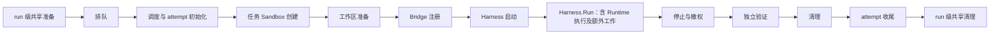

# 性能阶段说明：一次 Agent 任务的时间花在哪里

[返回性能报告](performance-archive.md)

本页解释历史报告的八个阶段，以及当前候选新增的可选 Bridge 准备阶段。旧字段含义和数值保持不变；新运行可显示九项，历史未采集值不补零。它描述代码的计时边界；排查建议只是检查方向，不代表某次实验已证明该处存在瓶颈。

先认识三个概念：**Runner** 在 ECS 上安排任务并记录时间；**Harness** 负责启动、连接和调用 Agent；**Sandbox** 是执行工具或评分的隔离环境。一次 **attempt** 是某个任务的一次尝试，重复运行同一任务会产生不同 attempt。

当前两种运行形态：

- **A（External）**：Agent 容器在 ECS，工具通过 Bridge 到任务 Sandbox 执行。OpenClaw 使用 SSH 路径；Jiuwen 复用原生 Sandbox Provider。
- **B（Embedded）**：Agent 和工具在任务 Sandbox，ECS 上的 Harness 通过云网关连接原生服务。
- 两者均由 ECS 上的 Runner 计时；模型可能是真实 LLM、Strict Replay 或显式 Workload Replay，结果分开统计。评分环境由 Benchmark 决定：codingcase 另建 Sandbox，当前 Terminal-Bench 原题在确认 Agent 停止与 Bridge 撤权后，向原任务 Sandbox 注入私有测试并独立评分，保留上游方法。

## 怎样阅读这些时间

下图只表示典型执行顺序。它特意保留阶段外的工作，**阶段表不是整个 run 的无缝时间分割，加入 Bridge 准备也不改变这一点**。

失败可以提前进入清理；多个 attempt 可以并发。图中顺序不能用来推导跨任务的等待或重叠关系。

- 排队字段在 `run-result.json` 的 `attempts[]`；历史其他七阶段及新增的 Bridge 准备字段在 `tasks[].timing`。
- `attempts[].timing` 是对应任务计时的副本，不能与 `tasks[].timing` 再加一次。
- 下文 `timing.*` 都指上述同一份任务计时。JSON 中 Go duration 的单位是**纳秒**；报告换算成秒。
- 某些开始时刻只保存在函数局部变量中，没有同名 JSON 字段。应使用已记录 duration，不能拿相邻阶段结束时间补算。
- **字段缺失不等于耗时为零**：可能未执行、未完成，或该边界没有测量。失败耗时和成功结束标记也要分开看。

字段定义见 [TaskTiming / AttemptResult](../pkg/core/attempt.go)，调度见 [runProfile](../internal/app/execution.go)，任务执行见 [Runner.runTask](../pkg/runner/runner.go)。

## 各类时间之间是什么关系

**总时间、阶段时间、子操作时间、累计时间和平均时间是不同口径。** 页面展示同一个数值时，应同时说明它的起止、对象、样本数及父级；不能把不同口径堆成一条“总耗时”。

| 指标关系 | 可以怎样计算 / 阅读 | 不能怎样解释 |
| --- | --- | --- |
| 从计划到完成 / Attempt执行总时间 | 同一控制器时钟且边界齐全时，计划到完成 = 排队 + dispatch delay + Attempt。Attempt自身从实际dispatch到该occurrence返回 | Attempt不含排队，不能单独叫包含排队的端到端响应时间；本页八阶段没有单列dispatch delay |
| Attempt / 七个内部阶段 | 对大文本Dashboard三次已核验的成功运行：Attempt = Sandbox创建 + 工作区准备 + Harness启动 + Runtime + 停止撤权 + 独立验证 + 清理 + 七阶段之外的差额。排队在Attempt外 | 差额不能叫纯Agent Loop、网络开销或丢事件量；它含阶段之间和occurrence内尚未归入这七项汇总的工作。失败或其他工作负载须先核对边界再使用该式 |
| Harness.Run / Runtime | Runtime是Harness.Run中的Agent调用窗口；Run还可包含连接及日志/原生产物收集 | 两者不能相加；Trace的agent.run不等于八阶段Runtime |
| Runtime / 模型 / 工具 | 这些子操作可以说明Runtime内在做什么；后台工具可能与模型请求重叠，也存在未观测的调度/交互 | 不用Runtime减模型累计再减工具累计推断精确Agent Loop；不把累计服务时间当不重叠墙钟占比 |
| 单个模型代理HTTP请求 / SSE | 同请求、同clock且边界齐全时：HTTP窗口 = 接收→首SSE flush + 首→末SSE flush + 末flush→handler结束。相同样本集合的各段累计也可相加 | 首content、首tool delta同样从接收开始，会与首SSE区间重叠；平均值不可直接与累计值相加。代理flush不等于Harness收到首token |
| 原生工具观察 / 后台工具 | tool.observed是控制器收到start→result；后台exec的result可能只是accepted，后续执行由job终态和wait说明 | 不把每个tool.observed.exec都画为完整SDK/guest执行的父区间 |
| 控制端执行窗口（字段exec.wait） / guest执行 | 前者从控制器Process提交前到Wait返回，含提交、执行、输出传输与排空；不是只量Wait方法或官方SDK内部方法。后者是guest wrapper执行窗口；精确ID连接同一次操作 | 两者来自不同边界/时钟，不能相加；SDK减guest不能被命名为网络时间 |
| guest总窗 / 首输出 / 退出观察 / pipe drain | 首输出、退出观察是相对于同一wrapper开始的里程碑；pipe drain仅在自然EOF晚于退出观察时有正区间 | 这些相对时点不能相加；EOF先于退出观察时不造负值或填0。guest墙钟也不是CPU用量 |
| 后台job / process.wait | job是accepted→terminal，wait是调用开始→返回；两者可能重叠，wait也可能在job完成后才调用 | job+wait不是任务实际持续时间；缺UTC锚时保留原生独立时钟，不移到主时间线上凑对齐 |
| 独立验证 / pytest / 依赖准备 | Verifier覆盖准备、运行原评分脚本、收取报告；pytest是其中一部分。APT日志的取整耗时可辅助说明长尾 | Verifier+pytest会重复计算。APT约数、pytest秒数与总窗不能强求精确分解；没有测量的剩余成本不猜成网络/安装 |
| 实验driver / Attempt | driver还负责输入核查、临时Adapter、Runner启动和结果/删除确认；包围单次任务的脚本窗口单独展示 | 它不是Sandbox执行时间。仅由driver UTC时间戳相减得到的窗口不冒充单调时钟实测 |

[大文本Dashboard](dashboard/large-scale-text-editing/index.html)三次实际Attempt的七阶段合计分别为278.911862896、269.080194881、726.600273094秒；七阶段之外的差额分别为1.356705992、1.364119625、0.936705733秒。这些是同一原始数据的算术对账，不是新增测点或对差额的因果归因。

以华为该次运行举例：Attempt为727.536978827秒，其中Runtime为191.408838716秒，独立验证为519.266395855秒。原pytest的25.0359447秒在独立验证内部；APT日志约486秒同样来自评分脚本，既不能再加到Verifier上，也不能按取整日志伪造一个精确网络Span。

## 排队

**做什么、在哪里：**任务已经到达计划执行时刻，但还要等待 ECS 上的调度器给它一个并发名额。此时可能尚未创建 Sandbox。

**起止与字段：**`attempts[].scheduled_at → admitted_at`，差值为 `queue_duration`。这里的起点是压测计划中的到达时刻，并不是外部 HTTP 请求抵达服务的时间。

**包括：**计划到达后等待并发容量，以及获准进入执行前的调度等待。

**不包括：**获准之后的 goroutine 调度、attempt 初始化和云平台内部创建队列。获准到真正开始的延迟另记为 `dispatch_delay = started_at - admitted_at`。

**慢时先查：**并发上限是否已占满、前面的任务是否仍在执行或清理、ECS 调度是否拥塞。不能仅凭排队高就判定 Sandbox 慢。

未获准执行的计划任务可能没有 `admitted_at` 和完整排队计时；应结合终态读取，不能补成零。

来源：[runProfile 的 admit](../internal/app/execution.go)。

## 任务 Sandbox 创建

**做什么、在哪里：**Runner 请求 Adapter 创建本次工具执行环境，等待 `ToolSandbox.Start` 返回可用句柄。控制调用来自 ECS，实际资源由云平台创建。

**起止与字段：**调用前记录 `sandbox_create_started_at`，调用返回后记录 `sandbox_create_duration`；成功且取得有效 Sandbox 时才有 `sandbox_ready_at`。

**包括：**本次 Start 调用内的 Adapter、API/SDK、网络往返和实现约定的就绪等待。

**不包括：**事先制作镜像或构建模板，也不包括之后的工作区准备和评分 Sandbox 创建。评分环境的创建记在独立验证内。

**慢时先查：**Adapter 的创建请求、云平台状态与就绪等待、调用重试或网络延迟。这个数字是调用端观察到的创建耗时，不能直接称为虚拟机纯启动时间。

创建失败也可能有 `sandbox_create_duration`，但没有 `sandbox_ready_at`；这表示花过时间，不表示环境创建成功。

来源：[Runner.runTask](../pkg/runner/runner.go)、[Sandbox Manager](../pkg/sandbox/e2b/client.go)。

## 工作区准备

**做什么、在哪里：**把任务需要的初始文件和权限放进刚创建的 Sandbox，使 Agent 接下来可以开始工作。

**起止与字段：**围绕 `Benchmark.PrepareSandbox` 整个调用记录 `sandbox_prepare_duration`；成功时记录 `sandbox_prepared_at`。开始时刻是局部变量，没有独立导出的开始字段。

**包括：**当前 codingcase 的目录初始化、待修复代码、公开测试与任务说明上传，以及文件归属和准备完成检查。命令在任务 Sandbox 内运行，文件由 ECS 传入。

**不包括：**创建 Sandbox、启动 Harness、隐藏测试和独立评分。后续 Bridge 注册也不在这个 duration 内。

**慢时先查：**上传大小与次数、文件 API 延迟、初始化命令和权限设置。准备阶段高不代表 Agent 推理慢。

具体准备内容由 Benchmark 决定；换成其他任务集时，仍以它的 `PrepareSandbox` 实际工作为准。

来源：[codingcase.PrepareSandbox](../pkg/benchmark/codingcase/codingcase.go)、[Runner.runTask](../pkg/runner/runner.go)。

## Bridge 准备（新增可选阶段）

**做什么、在哪里：**为本次 Agent 建立到准确任务 Sandbox 的工具访问入口。Jiuwen A 在 ECS 启动转发端，并在任务 Sandbox 中准备原生操作 worker；B 使用其对应的访问授权实现。

**起止与字段：**围绕 `Bridge.Start` 记录 `bridge_prepare_started_at` 与 `bridge_prepare_duration`；只有成功才写 `bridge_ready_at`。失败或取消也保留实际耗时，未进入则字段缺失。它对应原始事件 `bridge.register`，Snapshot 阶段名为 `bridge_prepare`。

**怎样阅读：**位于工作区准备之后、Harness 启动之前；不与前后两个 duration 重叠计入。release19 及更早报告没有该字段，不能补算成已采集。即使新增这一项，仍需单列阶段外差额，不能承诺所有阶段相加等于 Attempt。[当前验证边界](jiuwen-native-runtime-validation-20261027.md)。

## Harness 启动

**做什么、在哪里：**建立可调用 Agent 的运行入口。A 在 ECS 容器中启动 Agent；B 在任务 Sandbox 内启动 Agent 服务，ECS 端完成对应就绪检查。OpenClaw 使用 Gateway，Jiuwen 使用原生 HTTP/SSE 服务。

**起止与字段：**围绕 `Harness.Start` 记录 `harness_start_duration`；成功返回才记录 `harness_ready_at`。开始时刻没有单独导出的字段。

**包括：**该 Start 实现负责的配置、进程启动、就绪检查，以及其中实际执行的认证工作。

**不包括：**开始正式 Agent 任务，以及 Start 之前的 `bridge.register`。历史报告仅保留该独立操作事件；新候选另有 `bridge_prepare_duration`，不计入 Harness 启动。

**OpenClaw 的 A/B 必须分开理解：**A 的 Gateway `Connect` 放在后续 `Harness.Run` 中、调用 `Client.Agent` 之前；B 的连接与认证在 `Embedded.Start` 内完成。因此两者的启动值不能当作完全相同内容的成本。

**Jiuwen：**A/B 复用 `nativeRuntime.start` 的原生服务启动和就绪检查；A 在此前的 Bridge 准备阶段建立远端 worker，不能套用 OpenClaw 的 Gateway Connect/设备认证解释。

**慢时先查：**启动命令、配置加载、Gateway 就绪、云网关往返和设备认证。先确认本形态把连接放在哪个方法里，再比较耗时。

来源：[A 的 Start / Run](../pkg/harness/openclaw/harness.go)、[B 的 Start / Run](../pkg/harness/openclawcloud/embedded.go)。

## Runtime 执行

**做什么、在哪里：**向已连接的 Gateway 发起 Agent 请求，等待该请求结束。Agent 在 A 的 ECS 容器或 B 的任务 Sandbox 中工作；ECS Harness 观察整个调用。

**起止与字段：**OpenClaw 紧贴 `client.Agent(...)` 调用前后记录 `agent_started_at`、`agent_finished_at`，差值为 `runtime_execution_duration`。

Jiuwen A/B 则在共享 `nativeRuntime.Run` 内围绕 `Client.Run` 的原生 HTTP/SSE 任务调用记录同名 Runtime 字段。原生 Session 建立、文件收集的归属以实际调用位置为准，不套用 OpenClaw 的 Connect 边界。

**包括：**这个调用窗口中的请求发送与终态接收、Agent 循环、模型等待和工具交互。它是控制端观察时间，不是 Agent 的 CPU 使用时间。

**不包括：**之前的 Harness 启动、A 在 Run 开头进行的 Connect，以及 Agent 返回后的日志或原生产物收集。

**Trace 中的 `agent.run` 更宽：**它覆盖整个 `Harness.Run`，对应 `harness_run_invoked_at → harness_run_returned_at`。A 的 Connect、B 的事件收尾等可能在里面，但在 Runtime 字段之外；不能把两者当同一个指标。

**慢时先查：**先看同 attempt 的模型请求与工具事件，再查 Gateway 等待、连接和事件收集。模型、工具可能并行或重叠，不能靠简单相减证明 Agent Loop 的精确开销。

来源：[A 的 Run](../pkg/harness/openclaw/harness.go)、[B 的 Run](../pkg/harness/openclawcloud/embedded.go)、[Runner.copyRuntimeTiming](../pkg/runner/runner.go)。

### Runtime 内部的工具子区间

这些是工具调用的不同观察边界，不是额外的顶层任务阶段，也不能相加。下表的 `tool.observed`、Node spawn/exit/EOF 仅适用于 OpenClaw。

| 子区间 | 实际测什么 | 如何理解 |
| --- | --- | --- |
| `tool.observed.exec` | 控制器收到原生 tool.start → 收到 result | 包含控制器看到事件的传递延迟；A/B 都保留这一口径 |
| `process.spawn_to_exit` | B 原生进程中 spawn 返回 → 直接子进程 exit 回调 | 来自候选镜像的同一 Node 单调时钟；包括回调与日志扰动，不等于 CPU 时间 |
| `process.exit_to_pipe_eof` | 直接子进程 exit → stdout/stderr 最后一个自然 EOF | 只有 EOF 晚于退出才生成；若双流先结束，保留原顺序，不填零或负区间 |

OpenClaw B 新进程区间按精确 ToolCall/run/session ID 关联，在独立时钟视图展示；没有跨域时钟校准，不能与控制器区间拼成一条绝对时间线。直接子进程退出也不能代替整个进程树停止确认。哪些真实运行已有这些测点，见[验收档案](observability/VALIDATION_AND_REPRODUCE.md#r07-native-process-snapshot)。

Jiuwen 保留原生 Tool span；A 另有 Provider、`jiuwen.bridge.forwarding` 和 `jiuwen.worker.native_operation_request` 请求级区间。image7 的 A/B 增加 Python 原生进程回调：`jiuwen.process.creation` 为创建请求到连接回调，`command` 为连接回调到直接子进程退出，`exit_to_pipe_closed` 仅在管道实际晚于退出关闭时生成；首输出是独立事件。创建区间包含起点后的观测写入，命令区间不是 CPU time。各层按准确身份关联、分时钟展示，不能相加或相减当网络延迟。后台请求返回不是进程退出；旧镜像和旧记录不补数据，也不借用 OpenClaw 的 Node 测点。见[Jiuwen 进程计时定义与当前验收](jiuwen-process-observation-20261027.md)。

## 停止与撤权

**做什么、在哪里：**让 Agent 和在途工具停止，再撤掉继续操作任务 Sandbox 的入口，确保随后捕获的候选产物不会被 Agent 继续修改。

**起止与字段：**从调用 `Harness.Stop` 前开始，到随后 `Bridge.Stop` 返回并处理结果为止，记录 `stop_revoke_duration`。两项都成功才记录 `isolation_finished_at`。

**执行顺序：**先 Stop，后 revoke，当前是顺序执行。Trace 分别记录 `harness.stop`、`bridge.revoke`，这两项已包含在阶段耗时内。

**B 的确认内容：**Embedded 停止运行、关闭 Gateway 连接，并要求受管进程组停止；guest 脚本通过 cgroup 的 `populated=0` 确认组内无进程，才返回所需成功标记。只关闭 WebSocket 不能替代这个确认。

**不包括：**删除任务 Sandbox。此时仍要保留候选产物供验证。停止或撤权失败会阻止评分，并进入后续清理。

**慢时先查：**在途工具、进程组是否退净、Gateway 终止等待和撤权结果。进程停止确认也不能证明禁止出网；Huawei 的网络假设仍应独立标注。

来源：[Runner.runTask](../pkg/runner/runner.go)、[Embedded.Stop](../pkg/harness/openclawcloud/embedded.go)、[processGroup.stop](../pkg/harness/openclawcloud/group.go)。

## 独立验证

**做什么、在哪里：**停止隔离确认后，由可信验证逻辑判断任务是否真正完成。codingcase 把候选文件从任务 Sandbox 取回 ECS，再送进全新的评分 Sandbox 执行测试。当前六个 Terminal-Bench 主用例则在原任务 Sandbox 注入并执行原私有测试；这些测试在 Agent 运行期间不提供给 Agent。两条路径都由独立评分判断，不能把模型最终回答当作通过。

**起止与字段：**围绕整个 `Benchmark.Evaluate` 记录 `verifier_duration`。评分正常完成时记录 `verifier_finished_at`；测试不通过也可以有此结束字段，基础设施错误或隔离阻断则不能假装完成。

**包括：**该 Benchmark 的完整 Evaluate 调用。codingcase 包含候选检查与下载、只读副本及 SHA-256、新评分环境创建与准备；Terminal-Bench 复用原环境。两者均包含可信测试注入、原评分脚本执行、报告读取和结果解析；原脚本中的依赖安装也在本阶段，不能把总耗时全称为 pytest 时间。

**候选捕获在本阶段内部：**支持稳定副本捕获的 Benchmark 在副本就绪后记录 `evaluation.artifact.observed_at`，并映射为 `timing.artifact_ready_at`。它不是 Runtime 结束时刻，也不是独立验证之外的第九个阶段。当前 Terminal-Bench 原评分不能借 codingcase 的证据补出此字段；未采集就保留未采集。

**不包括：**评分 Sandbox 的最终删除；该工作属于后面的清理。`evaluation.duration` 与 `verifier_duration` 覆盖重合，也不能再相加。

**慢时先查：**候选传输、评分环境创建、测试执行与报告读取。当前没有把这些子项全部导出为独立 TaskTiming 字段，不能只凭总值断定 pytest 慢。

`AllowNetwork=false` 是创建请求，不自动等于平台已执行禁止出网；Huawei 显式假设样本须按 `infrastructure.network_policy` 与其他条件分开分析。

来源：[codingcase.Evaluate](../pkg/benchmark/codingcase/codingcase.go)、[terminalbench.Evaluate](../pkg/benchmark/terminalbench/evaluate.go)、[Runner.runTask](../pkg/runner/runner.go)。

## 清理

**做什么、在哪里：**Runner 释放本次任务仍持有的资源，避免进程、连接或收费 Sandbox 残留。ECS 发起停止与删除，平台负责实际资源回收。

**起止与字段：**进入 `runTask` 的 `finish` 后开始计时；实际执行过清理才有 `cleanup_duration` 和 `cleanup_finished_at`。结束字段表示本轮清理调用结束，是否成功仍要读 `cleanup.status`。

**包括：**若另建了评分 Sandbox，先停止它（后建的先停），再停止仍活跃的 Harness 和 Bridge，最后停止任务 Sandbox。原环境内评分不会凭空产生第二个 Sandbox 的删除耗时。

**是否重复：**正常流程的停止与撤权已清掉活跃标记，不会在此重复执行。若之前失败，清理会再次尝试；这是额外真实工作，不是把前一阶段耗时重复记账。

**不包括：**Runner 返回后的 attempt 收尾，以及全部 attempt 结束后的 run 级共享清理。三者的边界见下表。

**慢时先查：**资源删除是否返回、是否确认消失、失败重试是否仍有资源归属记录。看到 `cleanup_finished_at` 不代表云资源一定已删除，应同时检查状态和清理证据。

来源：[Runner 的 finish / evaluationSandboxes.stop](../pkg/runner/runner.go)、[Sandbox Manager.Stop / Close](../pkg/sandbox/e2b/client.go)。

## 三层收尾不能混算

| 层次 | 做什么 | 计时与位置 |
| --- | --- | --- |
| 任务清理 | 回收本任务的评分环境、仍活跃的 Harness/Bridge 和任务 Sandbox | `timing.cleanup_duration`，是上面的清理阶段 |
| attempt 收尾 | Runner 返回后关闭本 attempt 的模型会话、实验资源、观测与传输连接 | 包含在 `attempts[].duration`；目前没有一个覆盖全部收尾的独立 duration |
| run 级共享清理 | 全部 attempt 返回后关闭共享资源，例如 A 的共享网络 | `infrastructure.cleanup_duration`；在完整观测窗口之外 |

attempt 收尾可能再次调用幂等的 Stop/Close。Sandbox Manager 对已经确认消失的对象直接返回，并从拥有集合移除；正常情况下不会再次发起同一资源的云删除。失败资源仍可能在后续 Close 中重试。

`tasks[].duration` 覆盖 Runner 的单任务流程；`attempts[].duration = finished_at - started_at` 还覆盖外面的 attempt 初始化与收尾。它们是包含关系，不能相加。

来源：[runCloudAttempt / RunCloud](../internal/app/cloud.go)、[cloud wiring 的 attempt.close](../internal/app/wiring/cloud/cloud.go)。

## 其他指标：不要当作额外阶段

### 产物延迟

`attempts[].artifact_e2e_latency = artifact_ready_at - scheduled_at`。它回答“从计划到达，到拿到可核对路径和 SHA-256 的稳定候选副本，等了多久”。包含排队、执行、停止，以及独立验证开头的候选捕获。

没有经过稳定副本与时间边界核对，就不应报告此指标；Agent 宣称写好了文件并不够。

### 验证延迟

`attempts[].verified_e2e_latency = verifier_finished_at - scheduled_at`。它回答“到独立测试得到结果，等了多久”，不包含随后任务清理。

测试失败也可能完成验证并产生该延迟。任务是否验证成功要另读 `validated`、评分和测试结果，不能从“有验证延迟”推断成功。

### 完整观测窗口

`attempt_summary.observation_duration = window_finished_at - window_started_at`，从调度开始到全部 attempt 返回，包含排队、任务清理和 attempt 收尾。

它**不包含**此前 run 级共享准备、之后共享清理和 recorder 最终归档。停止接收新任务后的 `drain_duration` 已在窗口内部，不能再加一次。

吞吐使用这个包含排空过程的窗口作分母。成功任务吞吐需要独立验证；没有配置时限 SLO 时，不应自行给出有时限含义的 Goodput。

### 模型请求累计

累计 `model/events.jsonl` 中所选请求的结束记录：筛选 `event="request_finished"`，读取同一条记录的 `duration_ns` 字段求和。它包含模型入口接纳之后的请求体读取、解析/匹配，以及真实上游等待或回放输出等待，不是纯模型计算时间。

旧 `events.jsonl` 路径的模型区间从匹配后的 `request_started` 开始；当前有完整请求边界原件的 Snapshot 则使用 `http_request_received → http_request_finished` 形成 `model.http_request`，包含接纳前后及匹配过程，并分别保留 body_read、parse、match 等子区间。两种来源的起点不同，不能混算。比较前明确路径、路由及是否包含重试、拒绝和失败请求；`/models` 查询不能算成一次模型生成。

### 原生工具耗时及累计

原生工具耗时来自 OpenClaw 上报的 `durationMs`，单位为毫秒。`harness/native-tool-events.jsonl` 将它保存为 `native_duration_ms`，对应 `stream=command_output`、`phase=end` 的事件；这几个字段不是嵌套的 JSON 路径。B 在 guest 中计量；A 的工具路径包含 SSH/Bridge 往返。历史 A 文件没有该字段时仍记未采集。

新候选让A/B共用原生事件采集，但Trace中的 `native_event_consumer_interval` 是 **ECS收到start至收到result** 的区间，包含事件传输与消费延迟，不等于上面的原生duration，更不等于进程真正退出。是否完成真实环境验收见[当前证据](observability/VALIDATION_AND_REPRODUCE.md#p0-runtime-candidates)。

SDK客户端区间另列为 `sandbox_client`：`adapter_rpc.*`记录控制端RPC起止；`exec.wait`记录Process提交前至Wait返回，包含提交、执行、输出传输与排空。原始SDK内部调用和guest wrapper目前只有各自时钟下的duration，保留为属性；旧文件没有单调起点时进入duration-only记录，不能倒推到时间线上。各层可能重叠，不能相加或相减后称为纯Agent开销。

按工具调用 ID 区分调用，累计时保留失败调用并说明样本范围。B 采集文件中的 `tool_call_id` 保存原生 ID；开始到结果的 `host_observed_offset_ns` 差值是 ECS 收到事件的观察区间，不能冒充原生执行时间或证明后台进程已经退出。

来源：[finishAttempt / summarizeAttempts](../internal/app/attempts.go)、[模型 ServeHTTP](../internal/modelreplay/server.go)、[原生工具采集](../pkg/harness/openclaw/native_tools.go)。

## 时间域、重叠与 Trace 的阅读边界

模型等待和工具执行发生在 Runtime 内部，可能并行、重叠或重试。因此“Runtime + 模型累计 + 工具累计”会重复计数；“Runtime − 两个累计”也不能作为已证实的 Harness/Agent Loop 开销。

Runner duration 使用本进程单调时钟。模型服务、工具事件采集器各有自己的计时原点；guest 的原生时间戳还属于远端壁钟。UTC 文本看起来相近，不代表这些时钟已精确对齐。

当前离线 Trace 对不能精确对齐的模型和原生工具时间域保留 `UNALIGNED`，不会凭时间接近捏造父子关系。先用真实 attempt、session 和 tool-call 标识核对归属，再在各自可信时间域内读耗时；不要跨域相减。

Trace 中成对的真实操作事件可用于看顺序与区间；统计累计、两个总数之差和缺失端点都不能补画成“已测量的阶段”。`pkg/performance` 摘要里的成功耗时只汇总成功操作，失败、取消和不完整事件另计，不能用成功汇总掩盖失败成本。

来源：[Recorder](../pkg/performance/recorder.go)、[性能摘要](../pkg/performance/summary.go)、[离线 Trace 导出](../pkg/performance/trace.go)。
