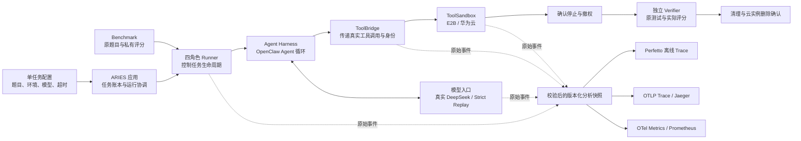

# ARIES 压测系统阶段报告

**最新增量（2026-10-26）：六个选定主用例跨云完成3/6，即fix-git、async两个原始任务，加大文本terminal-result-v2独立变体。原始任务本身仍为2/6，变体单独统计。** [双云报告](tb-crosscloud-performance-20261026.md)已列出八阶段、逐工具耗时与双 Trace 对账。当前版本 E2B 三题回放均通过；华为 DB 因目录元数据偏离失败，沿已批准的独立变体处理。async 欠费中断原失败保留，残留已清理，新批通过。跨云资源条件以CPU/内存同规格为准，磁盘等差异提示即可，见[资源与交付进度](performance-archive.md#跨云用例交付进度)。

华为 C++ 原生任务评分依赖准备修复后，新录制原评分 6/6；后续同云 Strict 回放在首工具结果后偏离、原评分 5/6，均已确认删除 Sandbox。[专项归档](tb-huawei-cpp-performance-20261026.md)保留首次评分失败及后续两次结果。下文19目录、18条Attempt、87次PASS及六题表为此前封存状态，新增结果单列。原题、预算和私测保持；独立变体与原生任务分开统计。P0仍PARTIAL，R05暂停、R13暂缓，P1/P2未验范围和退出条件保留。

release8 已通过 ECS 五项工程检查，合并 host 拒绝身份和原生持久化小字段修复。SQLite 随后用旧 Tape 真实回放，第六请求因解压时改变的 `/tmp` 时间偏离而失败；尚未执行到后台 wait，不能算持久化修复的全链验证。C++ 原录制暴露了 ExecStream 收尾竞态：辅助检查已exit0，自身取消stdin传输却被合并为SSH255；其与缺身份的native调用之间仍是源码顺序推断。修复经旧版复现、候选unit/race和release10五项完整发布检查通过。CPP v2新华为录制原6/6、34/34 exec精确；同Tape回放前5轮/5exec精确，第6请求因gdb内部合流输出的两行提示位置变化而Strict偏离、原5/6，尚未闭环。两次新运行Sandbox均确认删除，旧失败与Tape保留；后台协议未触达，全链观测仍incomplete。

DB首轮原5/7仍需真实重新解题；大文本原5/5但模型重复JSON键造成Tape不完整，严格校验保留。大文本/SQLite的v2公开说明已冻结上传，明确避免无关动态元数据并等待有限后台任务真实完成，未提供参考解；协议和镜像复用；SQLite v2的release10新E2B录制已通过原3/3，35完整模型轮、36/36 exec精确、1次真实后台终态wait映射通过，同Tape回放第24请求因make install自动打印安装mtime而失败，已完成24exec+1wait、原0/3、清理确认。旧长结果字段修复在两次实际后台结果中均已覆盖。大文本v2已完成真实录制、两次同Tape E2B Strict回放及一次华为Strict回放，原评分均5/5、各23完整轮、20/20 exec及2job/2wait通过，全部删除确认；三次回放均0次上游调用。[三次八阶段和工具对照](repro-variants-performance-20261026.md#text-v2-huawei-replay-1)已归档，华为评分519.266秒中APT获取约486秒，不能算作Agent工具耗时。旧原件、分母与coverage unknown保留。

SQLite v3 [新E2B录制](repro-variants-performance-20261026.md#sqlite-v3-e2b-record-1)已通过原3/3，41轮完整Tape、38/38 exec精确、2job/2wait通过并确认删除；Runtime301.446秒、Verifier12.956秒。**同Tape [Strict自回放已FAIL](repro-variants-performance-20261026.md#sqlite-v3-e2b-replay-1)：turn24/request25因make install日志被tail读回的3处mtime偏离，原评分0/3；22次exec精确、2次wait已执行，剩余16次exec未执行，停止/撤权及删除确认。华为对照未运行。** 原生和v1/v2历史失败不会被新录制覆盖。

起始日期：2026-10-25；更新：2026-10-26。**阶段版：六题均已在至少一种云上通过原评分；当前同版同Tape跨云完成3/6（2原始任务＋1大文本v2独立变体），SQLite v3 Strict自回放失败。六题全量闭环、P0和生产验收仍未完成。**

本轮[逐次性能表、失败与证据](tb-six-performance-20261026.md)单独归档，所有失败保留。

后续增量分别见[原题双云对照](tb-crosscloud-performance-20261026.md)、[独立变体实测](repro-variants-performance-20261026.md)和[华为模板准备](tb-huawei-variant-preparation-20261026.md)。准备成功、Agent 成功和完整跨云回放分开列示。

本报告先回答“系统能做什么、哪些任务真实跑过、失败修了没有”。详细历史保留在[性能归档](performance-archive.md)和[验证证据](observability/VALIDATION_AND_REPRODUCE.md)，不以大量协议检查数代替任务成功数。

## 1. 当前系统如何运行

- **Benchmark** 负责出题和评分。Agent 运行时不接触私有测试；停止和撤权确认后才注入评分材料。
- **Harness** 负责启动 Agent、调用模型和收集原生记录。A 模式的 Agent 在 ECS，工具在 Sandbox；B 模式的 Agent 与工具都在 Sandbox。
- **Bridge** 负责工具通信和访问撤销。按真实调用 ID 关联模型、原生工具、SSH、Bridge、SDK 和 guest，不靠命令相似或时间接近推测。
- **Sandbox** 执行真实命令并保持任务状态。每次任务有独立生命周期，用完确认删除；模板构建和实际任务运行分开记账。
- **Strict Replay** 重放真实模型响应；工具仍实际执行。请求历史和工具结果偏离会失败，不会偷偷切回真实模型或放宽匹配。
- **分析快照** 统一校验事件、身份、时钟和缺测，再生成两种 Trace 及指标。未采集的时间不填零，不把不同时钟直接相减。

## 2. 已有能力与本轮增量

| 能力 | 当前证据与范围 |
| --- | --- |
| E2B / 华为云 A、B 单任务运行 | 已有固定小型修复任务的真实运行、严格回放、独立评分与删除证据；不代表下表六个任务均已通过 |
| 多 ToolCall 协议 | Tape v2、真实工具和应用账本已贯通；受控协议用例未解题，原 score 0 保留 |
| 真实模型多 ToolCall 自主修复 | 真实录制/回放各7轮、758帧、7次真实exec，独立评分均12/12，4个Sandbox已删除；本轮双Trace实测对账通过 |
| 分阶段观测 | 已有八阶段、模型边界和工具证据；A/B 原生观测深度不同，缺测明确保留 |
| 双 Trace 与 Metrics | 已有统一快照到 Perfetto、OTLP/Jaeger 和 Metrics/Prometheus 的限定实测；新增运行需单独核验，不能借旧后端结果冒充新验收 |
| 六个真实 Agent 任务 | 原始来源及测试材料已冻结；云接线五项工程检查通过，已归档18条Attempt；缺口与失败见下表 |
| 多任务与容量 | 按当前优先级暂停，待单任务阶段报告完成后推进 |

真实多工具候选源码清单 SHA：`ff02d056c86228ab4b5e13077f84e687200b6cf4a50cb52a7a97300df98ec009`。ECS 上 `make build/test/test-race/lint/integration` 均通过；工程证据 SHA：`f718df91636cb7c8d3414af3a42bee617ad27322e6f61d6dc866f68de869db1b`。这只证明该冻结候选的工程检查通过，不能替代云端 Agent 验证。

六例新增云接线使用源码清单 `dfe38063e06478ae325e7f95e642930b8225d8bd9e180599fa4b4bf98c5a5b9d`，上述五项 ECS 工程检查也全部通过，证据 `9cc1c2190df7a3fd2d51cb0b0f7f58f015f5d480cd4f3d544b604eedb5a2cf17`。任务资源、原超时、私有评分和运行产物分别保留，模板探针通过不计作 Agent 成功。

## 3. 本轮六个真实 Agent 用例

来源：Terminal-Bench 2.1 固定 commit `7131e4375048a0e408a8fb404b5f499d726b695b`。本轮按 E2B A、并发 1 逐例执行，六例均计入覆盖范围；辅助微基准不替代真实 Agent 题目。资料见[用例目录](../cases/sandbox-runtime-v1/README.md)。

| 用例 | Agent 实际要完成的工作 | 对 Sandbox 的主要压力 | 本轮真实运行状态 |
| --- | --- | --- | --- |
| fix-git | 调查并恢复 Git 仓库内容 | 多轮短命令、文件与 Git 操作 | 固定Git日期后重新真实录制、严格回放通过；原评分均2/2，首回放失败保留 |
| cancel-async-tasks | 编写并调试异步取消程序 | Python 执行、信号、进程行为 | 首次5/6；同配置重新由Agent求解后6/6，真实工具Strict Replay亦6/6 |
| db-wal-recovery | 调查数据库/WAL 并恢复数据 | 文件读取、数据库和脚本处理 | 初始mtime适配后，历史Tape真实回放12轮/11工具/7项评分通过；另一次新录制900秒超时保留 |
| large-scale-text-editing | 编写 Vim 宏处理百万行数据 | 大文件处理、CPU/内存与工具执行 | 新录制原5/5、Tape完整；验收脚本字段错已复核修复，新真实回放仍因根目录日期偏离失败 |
| custom-memory-heap-crash | 排查并修复 C++ 堆问题 | 编译、调试、运行和内存行为 | 创建失败，Agent未执行；诊断修复后真实重试确认E2B拒绝4200秒（上限1小时），等待具备足够时限的项目 |
| sqlite-with-gcov | 自主配置并编译带覆盖率的 SQLite | 真实编译、文件与 CPU 负载 | 新录制原3/3、Tape完整、拒绝身份明确；新真实回放因运行中新建目录日期偏离失败 |

“主要压力”是场景设计目的，不等于已测出某项底层性能。编译或大数据处理若发生在 Verifier 内，归入评分阶段，不能冒充 Agent 工作量。SQLite 环境可预装通用编译工具，必须记录这一适配；不预编译答案或改变原评分。

fix-git 首次录制完成8轮模型交互、7次真实 exec，原 CTRF 2/2、正常清理和云端不存在确认均通过。其离线审计完成2424项对账：Perfetto 594区间/52 flows、OTLP 594 spans/52 parents，时间转换实测误差0 ns；coverage 仍为 unknown。本轮后端/UI 未重验。首次回放保留 `strict_request_turns_incomplete` 失败，虽原 reward=1，仍不能算严格回放成功。

fix-git 后续只固定 binding 中新提交的 Git author/committer 日期，重新真实录制并回放；各9轮模型、8个真实exec，工具决策与模型可见结果一致，新提交ID均为 `097c0b5`，回放真实上游请求数为0。两次原评分与删除确认通过；原任务、私测、镜像、Matcher和旧Tape未改。独立对账47项通过，证据 `4a40364d4cebb0fcabdb31d2b4fd337e96a17c905b41e09ae7a3ba32dd714d8c`。日期固定不涉及性能计时；旧commit对象未归档，不声称恢复其具体时间字段。

数据库恢复首次录制完成12轮模型交互、11次真实 exec，原独立评分与云端不存在确认通过。离线审计4840项通过：Perfetto 1198区间/72 flows、OTLP 1198 spans/72 parents，时间误差0 ns，coverage unknown；不是本轮 Jaeger/Prometheus 后端验收。异步取消首次运行的模型、工具、停止门和清理均正常，但原6项评分有1项失败，保留为真实 Agent 质量失败，不将平台运行成功算成任务成功。

大文件首次运行原评分5/5，Harness成功返回后、Stop期间又收到模型请求，导致已完成对话的Tape被标记失败；另有一次heredoc被原远程命令解析器拒绝，错误为`unterminated here-doc VIMEOF.`，但缺少派发前拒绝记录。SQLite对应命令实际使用`<<<` here-string，原解析器误报`unterminated here-doc puts $tcl_version.`，不能归因Agent未闭合heredoc。原失败Tape不补写为成功，Sandbox已删除并确认不存在。C++首次创建返回`allocation_unconfirmed`，当时原适配器吞掉SDK异常，无法确认原因。该次两次限定查询未发现匹配实例；后续独立真实诊断已确认4200秒请求被1小时上限拒绝。原失败及清理未知记录不改写，不把无ID的列表查询说成NotFound。

## 4. 结果如何读

每次运行依次展示：**排队 → 任务 Sandbox 创建 → 工作区准备 → Harness 启动 → Runtime 执行 → 停止与撤权 → 独立验证 → 清理**。这些是原始阶段耗时字段，不能机械相加代替端到端时间；详细定义见[阶段说明](performance-stages.md)。本轮六例已采集的工具 SDK 等待与 guest 整体时长另表展示；模型等待与评分细分尚未整理，不补零或从其他阶段推算。

真实结果表已同时保留首次结果、失败原因、修改版本及重测结果。任务成功必须由原独立 Verifier 支持；脚本退出 0、协议检查通过或 Harness 自称完成均不够。暂未完整封存候选状态的任务，不宣称满足 Artifact Goodput 条件。

故障处理：模板/依赖/权限/桥接/模型通信/评分基础设施/观测/清理问题先定位到证据，再修复对应系统并真实重测。Agent 解题失败也保留并继续分析，不能删掉失败分母、替换参考解或降低断言。必要真实验证不因费用而跳过。

## 5. 尚未完成的范围

六例全量实际运行、完整生产稳定性仍未验收。R05 普通文件永久挂起的生产有界关闭保留遗留，本轮不追加 I/O 框架。原 Terminal-Bench 评分保持停止后的原 Sandbox 方法，不宣称采用全新禁网评分实例；未知的资源配额、跨域时钟和原生漏采分母继续明确标注。

本报告随原件对账更新；未运行项不列为通过，录制成功与严格回放成功分开统计。

2026-10-26本轮新增6次真实运行已经结束，6个Sandbox均删除并独立确认不存在。release-4冻结605文件、ECS五项Go门禁及原生限定验证通过；两项系统修复已在真实录制验证。共19个实验目录、18条Attempt、17次实际Agent执行、12次原评分通过。原driver7次PASS，另2次录制因coverage字段读取错误留下FAIL，新增完整旁路复核通过，旧FAIL不覆盖且不新增测试次数。

DB放3成功是显式初始mtime下的选定历史Tape验收，不能覆盖新录2超时。大文本/SQLite回放首差异已定位，Strict没有自行改变工具决策。原case有效；[可复现变体](design/reproducible-agent-workloads.md)随后获批；此处为封存批次的历史状态，最新大文本v2跨云通过和SQLite v3录制通过 / 自回放失败见本文开头，不回写本批分母。后台/PTY、原题、私测和Strict均保留。E2B C++仍受原预算所需存活时限阻断；华为已接受原预算，首轮评分依赖失败及修复准备另见本文开头，不能降低预算或评分标准凑通过。

新增6份Trace均已实际离线导入核对；DB超时源incomplete不升级，其他coverage仍unknown，新后端与UI未验。当前所有原始失败、八阶段、229条exec和版本证据见[六例性能表](tb-six-performance-20261026.md)及[验证归档](observability/VALIDATION_AND_REPRODUCE.md#tb-six-current)。单任务阶段尚未全部完成，多任务仍暂缓。
